# JOC Jan-2021 · Week 11: portal print

- Source: `JOC Jan-Apr 2021 (text PDF).pdf` pages 58–62 (portal review printout). Parsed text below; the cropped image under each question is the exact page content (code, figures and ticks as printed) and is authoritative.
- `[x]` = option equal to the portal's **Accepted Answer** (official). Lines may carry stray spaces from the PDF text layer.

> getpythoncode@gmail.com  · Due on 2021-04-07, 23:59 IST. · Assignment submitted on 2021-04-07, 13:57 IST

### Q1. The python library selenium is used for which of the following concepts

- [ ] File Handling
- [ ] Image processing
- [ ] Natural Language Processing
- [x] Browser automation
> Yes, the answer is correct. Score: 1

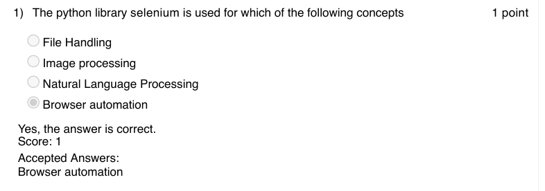

### Q2. Which of the following is true about Browser automation?

- [ ] load and performance testing on the websites
- [ ] web data extraction
- [ ] automated testing
- [x] All of the above
> Yes, the answer is correct. Score: 1

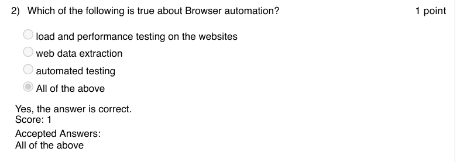

### Q3. The python function for converting a number into a string is

- [ ] numtostring()
- [x] str()
- [ ] to_string()
- [ ] numstring()
> Yes, the answer is correct. Score: 1

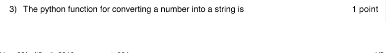

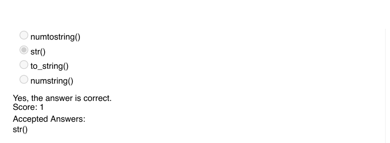

### Q4. Which of the following is the python library for setting the timezone?

- [ ] pytimezone
- [ ] pythonTimeZone
- [ ] timezone
- [x] pytz
> Yes, the answer is correct. Score: 1

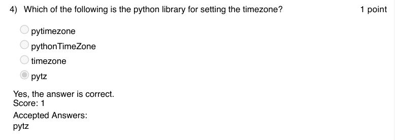

### Q5. Which of the following code snippet will print today’s date?

- [x] Both A and B
- [ ] none
> Yes, the answer is correct. Score: 1

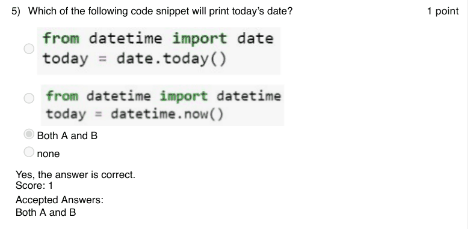

### Q6. Predict the output:

- [ ] Error
> Yes, the answer is correct. Score: 1

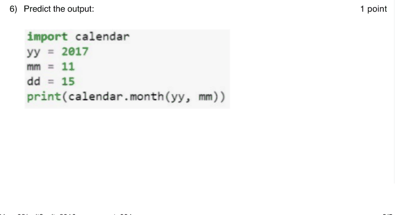

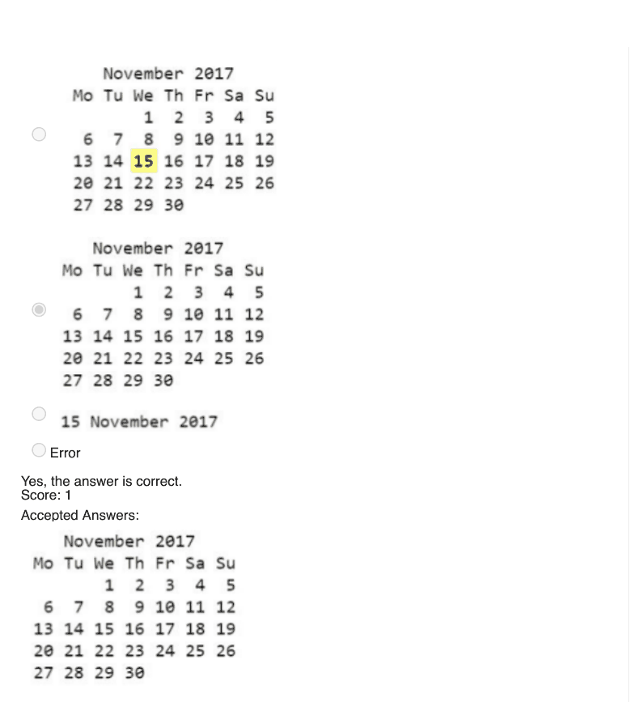

### Q7. What does the following code print?

- [x] Number of leapdays between the specified years
- [ ] Lists all leapdays between the specified years
- [ ] Lists the leapdays and its count between the specified years
- [ ] None
> Yes, the answer is correct. Score: 1

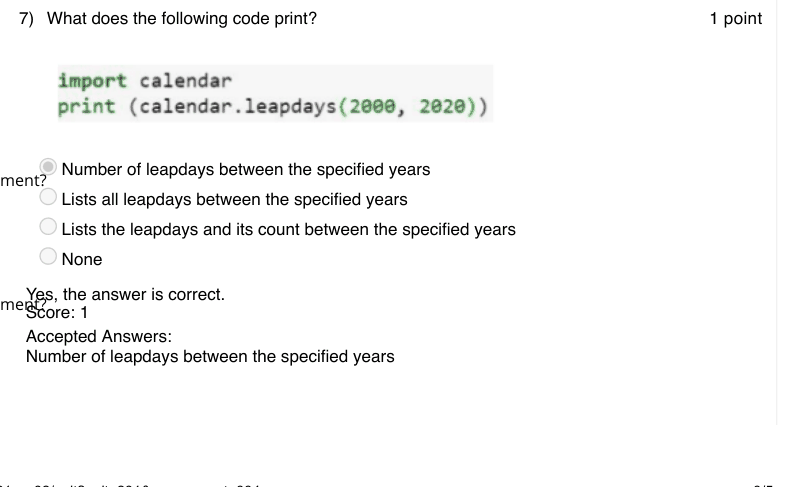

### Q8. What does the python function: calendar.weekday(year, month, day) return if the
weekday is Friday?

- [ ] 3
- [x] 4
- [ ] 5
- [ ] 6
> Yes, the answer is correct. Score: 1

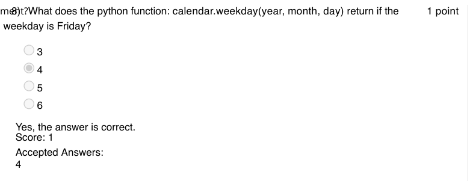

### Q9. What is the return value of the following python function : datetime.datetime.utcnow()

- [x] returns the coordinated universal time
- [ ] returns the current user time
- [ ] returns the coordinated user time
- [ ] returns the concurrent universal time
> Yes, the answer is correct. Score: 1

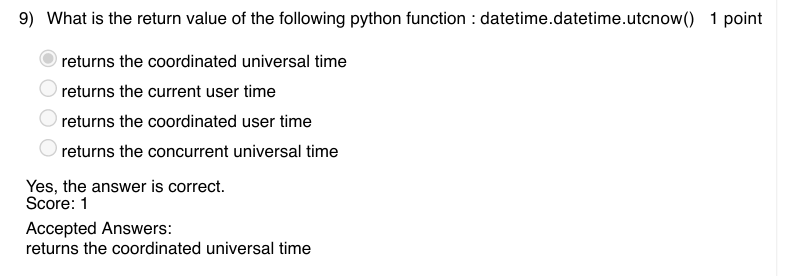

### Q10. Which of the following is the correct code to find whether a given year is a leap year or
not?

> Yes, the answer is correct. Score: 1

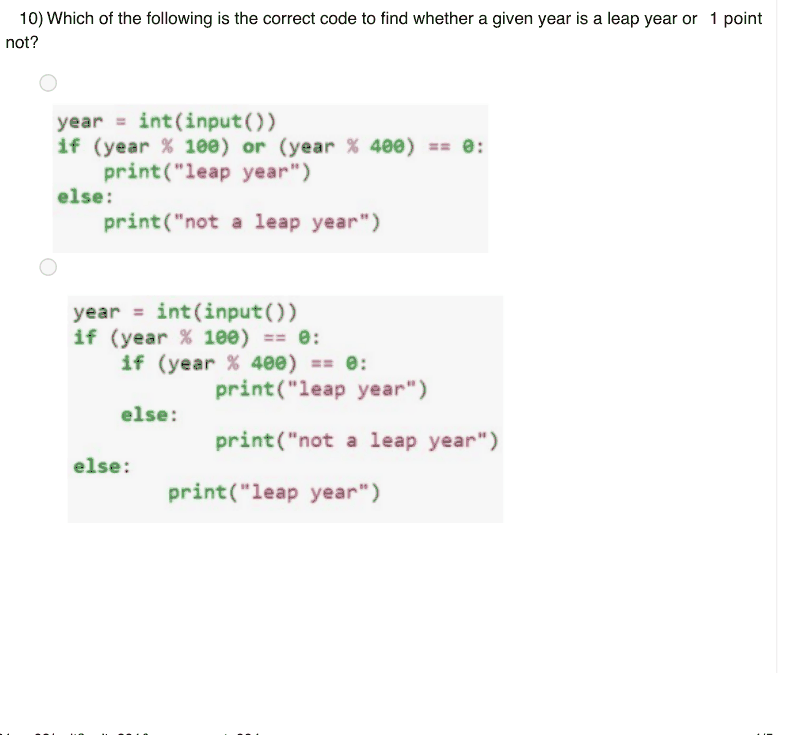

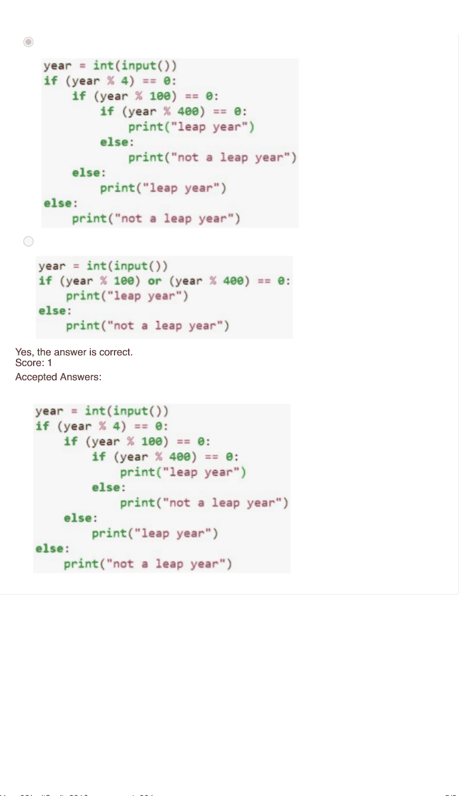
