# JOC Jan-2021 · Week 12: portal print

- Source: `JOC Jan-Apr 2021 (text PDF).pdf` pages 63–66 (portal review printout). Parsed text below; the cropped image under each question is the exact page content (code, figures and ticks as printed) and is authoritative.
- `[x]` = option equal to the portal's **Accepted Answer** (official). Lines may carry stray spaces from the PDF text layer.

> getpythoncode@gmail.com  · Due date: 2021-04-14, 23:59 IST.

### Q1. Which of the following is true about the web graph used for performing Google page
ranking?

- [ ] nodes are the hyperlinks and edges are the web pages
- [ ] nodes are the web pages and edges are the hyperlinks
- [ ] nodes and edges both represent hyperlinks
- [ ] nodes and edges both represent web pages

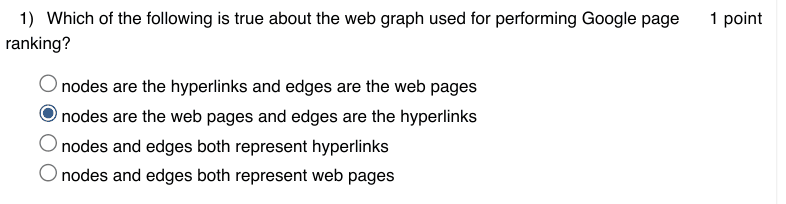

### Q2. In page ranking, the most impressive person is the person liked by maximum number of
people.

- [ ] TRUE
- [ ] FALSE

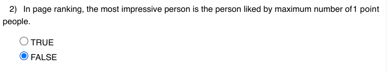

### Q3. What is not true about page ranking algorithm?

- [ ] involves a random walk around the network
- [ ] involves a drunkard walk around the network
- [ ] high ranked node is the one with maximum visits
- [ ] high ranked node is the one with maximum hyperlink

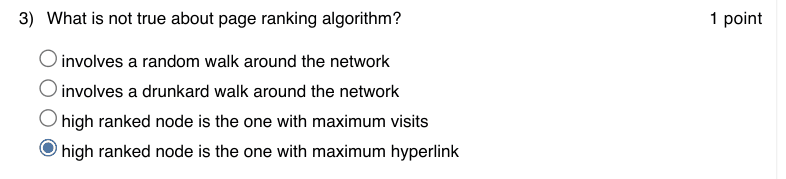

### Q4. In page ranking algorithm

- [ ] we always begin ranking from the first node.
- [ ] we randomly move from one node to another
- [ ] we stop at the sink node
- [ ] All the above statements are true

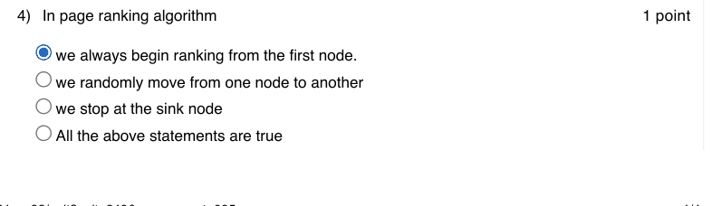

### Q5. In Barbell graph() function of Networkx

- [ ] the first parameter represents number of communities and the second parameter represents number of nodes in-between the communities
- [ ] the first parameter represents number of nodes in the two communities and the second parameter represents number of nodes in-between the communities
- [ ] the first parameter represents number of nodes in-between the communities and the second parameter represents number of nodes in the two communities
- [ ] the first parameter represents number of nodes in-between the communities and the second parameter represents number of communities

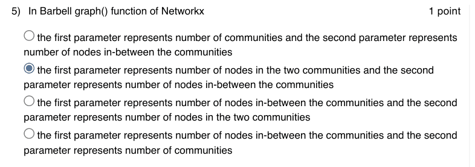

### Q6. What is the type of the following graph?

- [ ] star graph
- [ ] barbell graph
- [ ] ladder graph
- [ ] wheel graph

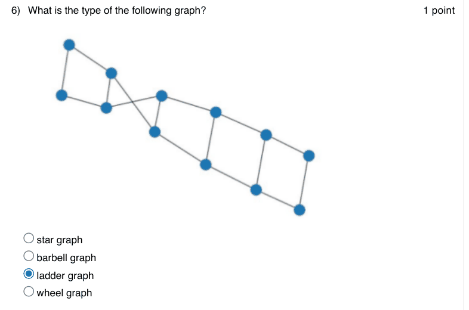

### Q7. Which of the following graph represent a Wheel graph of 5 nodes?

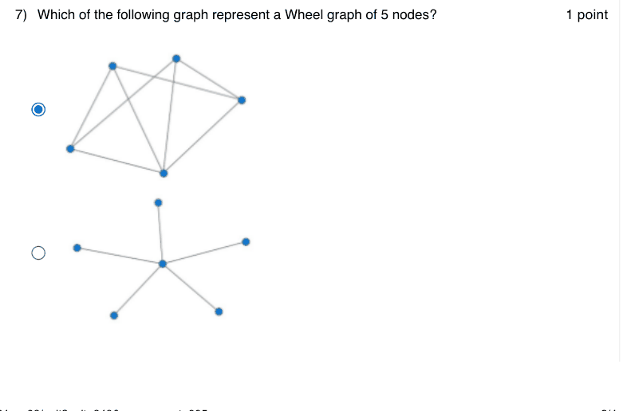

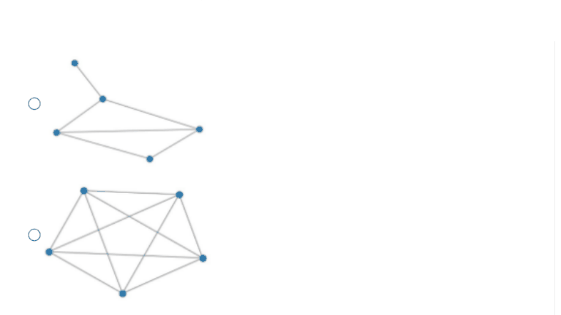

### Q8. What is the next step in page ranking algorithm, if the current node in the walk is a sink
?

- [ ] the algorithm stops
- [ ] the next node is selected randomly from the given set of nodes present in the graph
- [ ] the next node is selected randomly from the list of neighbours of the current node
- [ ] the algorithm restarts from the current node

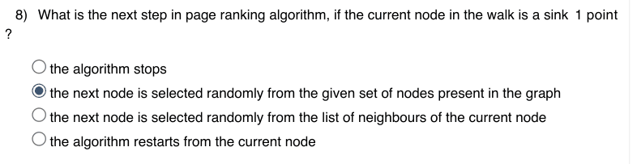

### Q9. Which of the following is a directed network?

- [ ] Social Networking
- [ ] Supply Chain networks
- [ ] Citation Network
- [ ] All of the above

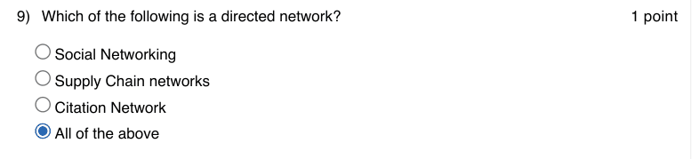

### Q10. Which of the following python function will return random floating point number between
0 and 1?

- [ ] random.float()
- [ ] random.randomfloat()
- [ ] random.frandom()
- [ ] random.random()

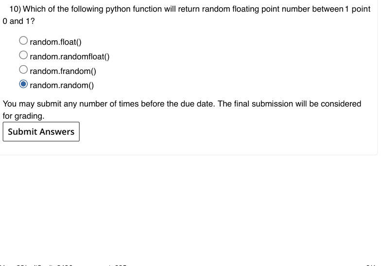

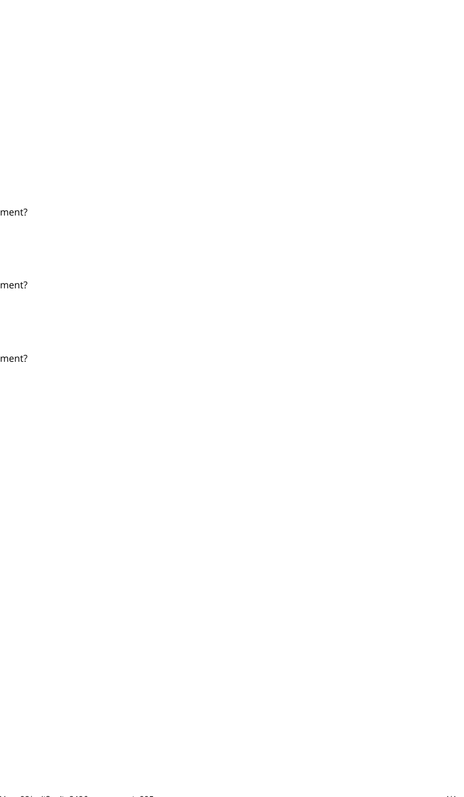
