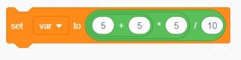
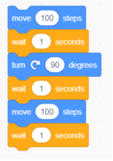
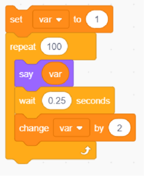
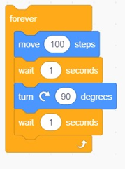

# Week 1 Quiz 💡

**1. What is the value of var after double clicking on the below block of code in scratch?**

- 7.5
- 5  ✅
- 3
- 50

**2. Choose the odd one out. wait, repeat, forever, move**
 
- wait
- repeat
- forever
- move  ✅

**3. How far will the sprite be from the initial position after executing this block of code?**

- 141.42 steps  ✅
- 100 steps
- 10 steps
- 200 steps

**4. What is the name of the command used to reshow the hidden sprite?**

- reappear
- show  ✅
- undo hide
- visible

**5. The command used to make the sprite rotate by a certain degree is ?**

- turn  ✅
- rotate
- revolve
- bend

**6. The command used to delay the sprite by a few seconds is ________**

- wait  ✅
- hold
- stop
- None of the above

**7. What will the sprite recite when the below block of code is executed?**

- All even numbers from 1 to 100
- All even numbers from 1 to 200
- All odd numbers from 1 to 100
- All odd numbers from 1 to 200  ✅

**8. Which of the following does not belong to the motion command ?**

- move
- turn
- glide
- None of the above  ✅

**9. What is the command to increase the size of the sprite?**

- increase size
- change size by  ✅
- expand
- zoom in

**10. When will the sprite stop moving when this block of code is executed ?**

- Never  ✅
- It will stop after a while
- It will stop after 100 rounds
- None of the above
