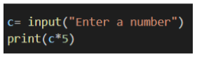
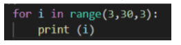
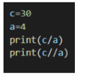
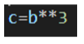
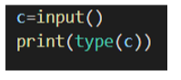
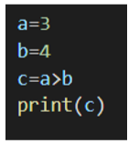

# Week 2 Quiz 💡

**1. What will be the output for the following program if the user gives an input value of 3 to it?**

- 15
- 33333  ✅
- Error message
- 555

**2. Which of these statements in python will throw anerror when executed?**
- print( “Hello” )
- print( ‘Hello’ )
- print( “ ‘Hello’ “ )
- print( “ “Hello” ” )  ✅

**3. What will be the output of the following code when  executed?**

- It will print numbers from 3 to 30
- It will print multiples of 3 till 30
- It will print multiples of 3 till 27  ✅
- It will print 3 thirty times

**4. What will the output of the following code be when executed?**

- 7.5\  
  7  ✅
- 7.5\
  7.5
- 7\
  7
- 7.5\
  2
  
**5. What value will c store in it after the execution of the below code?**

- Value of b multiplied by 3
- Cube of b
- Value of b multiplied with 3 twice
- It will throw an error  ✅

**6. Python was named after the television show Monty Python's Flying Circus.**

- False
- True  ✅

**7. What will the output of the following program be?**

- < class 'str' >  ✅ 
- < class 'int' > 
- < class 'number' > 
- < class 'variable ' >

**8. What will the output of the following program be?**

- It will show an error
- Hello! Welcome to Joy of Computing using  Python course  ✅
- 47
- a+b

**9. The python files will be saved with a .python extension**
 
- False  ✅
- True

**10. What is the output for the following program?**

- True
- False  ✅
- It will display an error message
- Boolean
