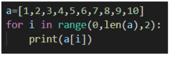
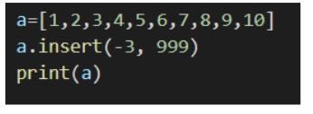
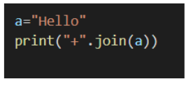

# Week 3 Quiz 💡

**1. List items are ordered, changeable, and do not allow duplicate values. State true or false**
- True
- False  ✅

**2. What will the output of the following program be?**

- All numbers from 1 to 10
- All even numbers from 1 to 10
- All odd numbers from 1 to 10  ✅
- It will give an error

**3. What will the output of the following program be?**

- [1, 2, 3, 4, 5, 6, 7, 8, 9, 10]
- [1, 2, 3, 4, 5, 6, 7, 999, 8, 9, 10]  ✅
- It will give an error
- [999, 0, 0, 1, 2, 3, 4, 5, 6, 7, 8, 9, 10]

**4. Which command will insert the new element to the list at the end? Consider the name of the list to be Shopping and the new element to be inserted is “oil”.**

- Shopping.append(“oil”)
- Shopping.insert(len(Shopping),”oil”)
- Both option a and b  ✅
- Shopping.add(“oil”)

**5. Which method is to find out how many times a particular list element occurs?**

- count  ✅
- repeat
- unique
- sum

**6. Which of these methods is used to find the mean of the below defined list? a = [1, 2, 3, 4, 5, 6, 7, 8, 9, 10]**

- statistics.median(a)  ✅
- stats.median(a)
- median(a)
- average(a)

**7. Which of these following statements is true regarding trimmed mean?**

- It removes a small percentage of the largest and smallest values before calculating the mean
- Trimmed mean is also known as truncated mean
- Both a and b are true  ✅
- Trimmed mean removes a small percentage of largest value before calculating the mean

**8. What is the output of the following program?**

- H+e+l+l+o  ✅
- +Hello+
- +H+e+l+l+o
- +Hello

**9. Which of these methods is used to jumble a given word and give an output separated by a “ , “ symbol? (Consider the string to be stored in variable a)**

- “ , ”.join(random.sample(a, len(a)))  ✅
- random.sample(a, len(a)).join( “ , “ )
- random.sample(a, len(a))
- It is not possible to jumble a word

**10. Which method can be used to remove an element at a particular index from the list?**

- pop( )  ✅
- delete( )
- discard( )
- The element cannot be removed
