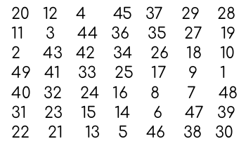
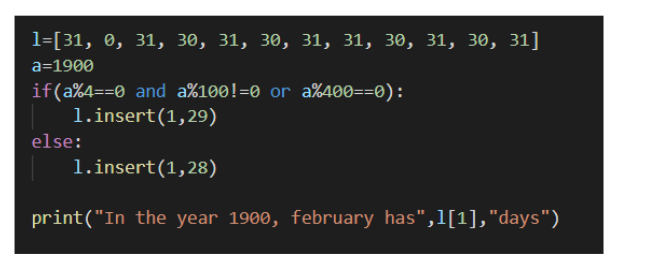
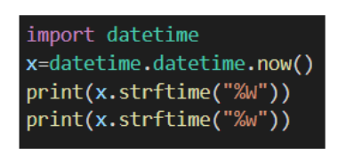
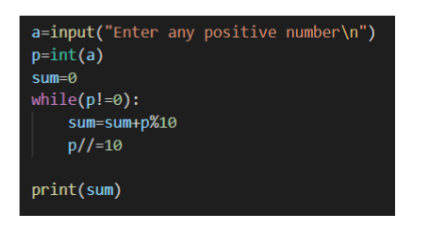
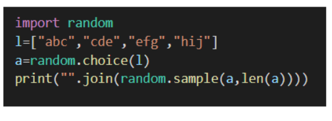
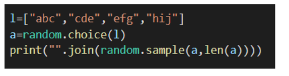
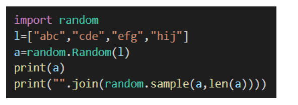
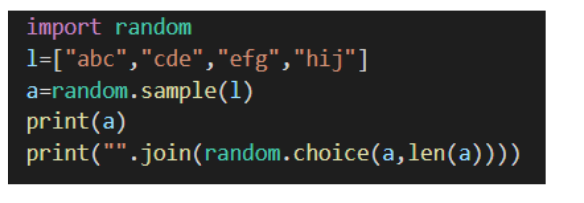
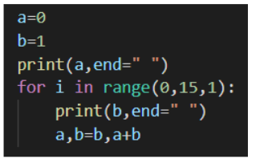

# Week 4 Quiz 💡

**1. What is the magic constant or magic sum of a magic square of size 11?**

- 671  ✅
- 121
- It is not possible to find
- Magic squares only exists for even size

**2. In magic square, the first number will be stored at position (n/2, n-1). Let this position be (i, j). The second number will be stored at position
(i+1, j-1). State whether the following statement is true or false.**

- True
- False  ✅

**3. The below given matrix is a magic square. State whether the following statement is true or false**

- False
- True  ✅

**4. What will the output of the following program be?**

- In the year 1900, february has 28 days  ✅
- In the year 1900, february has 29 days
- In the year 1900, february has 0 days
- It will throw an error

**5. Consider today's date to be 06-06-2021 and the day after tomorrow is tuesday.. What will be the output of the following program?**

- 22\
  0  ✅

- 0\
  22

- Monday\
  29

- 29\
  Tuesday

**6. What will the following program do?**

- Print the sum of digits of a given number  ✅
- Print the number by dividing it by 10
- Print the reverse of the number
- None of the above

**7. Which program will choose an element from the below list and display it in jumbled order?**

-   ✅

- 

- 

- 

**8. There are a total of 100 cards of 25 different colors. How many minimum numbers of draws are required to guarantee that at least two drawn cards have the same color?**

- 100
- 26  ✅
- 25
- 50

**9. What does the following code snippet in python compute?**

- Factorial of numbers from 0 to 15
- Fibonacci series  ✅
- None
- Sequence of numbers from 0 to 15

**10. Dobble game has a deck of 55 cards, each printed with eight different symbols. Any two cards always share one matching symbol only. State whether the above statement is true or false**

- True  ✅
- False
