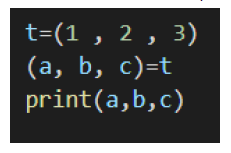
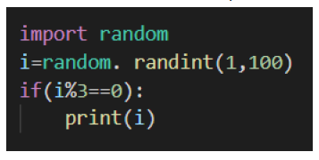
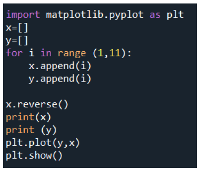
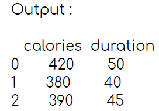
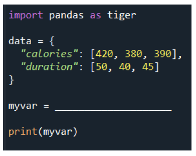
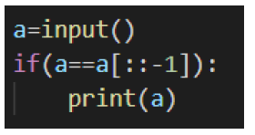

# Week 8 Quiz 💡

**1. Tuples are similar to lists in terms of indexing, nested objects and repetition but it is immutable unlike lists. State whether the above statement is true or false.**

- True  ✅
- False

**2. Which of these following operations are not valid with respect to tuples?**\
 (Consider tuple names to be T1 and T2 with 5 elements in each of it)
- print( T1 + T2 )
- print( T1 * 3 )
- print( T1 [ -4 : -1 ] )
- del T1 [ 1 ]  ✅

**3. What is the output of the following program?**

- 1 2 3  ✅
- Error
- a b c
- t t t

**4. What will be the output of the following program?**

- It generates a random number and prints it
- It generates a random number and doesn't do anything
- It will generate a random number and prints it
- It will generate a random number and prints it only if its a multiple of 3  ✅

**5. Which of these statements are false with respect to clahe?**

- CLAHE is a variant of Adaptive histogram equalization ( AHE ) which takes care of over-amplification of contrast.
- CLAHE operates on small regions in the image, called tiles, rather than the entire image.
- The neighbouring tiles are then combined using bilinear interpolation by including the artificial boundaries.  ✅
- It is used to improve the contrast of images.
 
**6. What is the output of the following program?**

- Linear graph with positive slope
- Linear graph with negative slope  ✅
- Non linear graph with positive slope
- Non linear graph with negative slope

**7. What should be filled in the blank in the given program to obtain the below desired output?**

- pandas.DataFrame(data)
- tiger.DataFrames(data)  ✅
- tiger.Series(data)
- pandas.Series(data)

**8. VADER uses a combination of A sentiment lexicon is a list of lexical features which are generally labeled according to their semantic orientation as either positive or negative. State whether the following statement is true or false.**

- True  ✅
- False

**9. What will the output of the following program be?**

- Prints the reverse of string a
- Prints the string only if its an anagram
- Prints the string only if its a palindrome  ✅
- Error message

**10. If the compound score of a statement is 1.5. What can we infer from the compound statement?**

- It is an extremely positive statement
- It is and extremely negative statement
- It is a neutral statement
- Compound score cannot be 1.5  ✅
