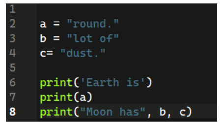
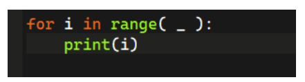
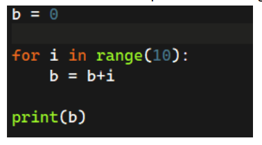
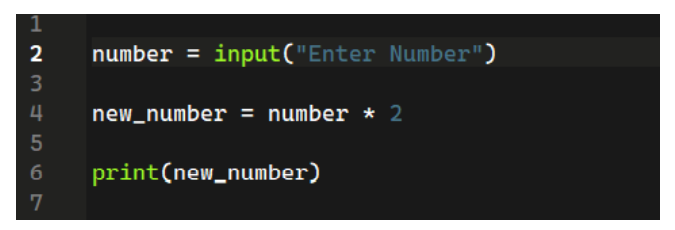
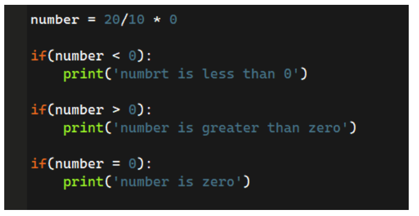
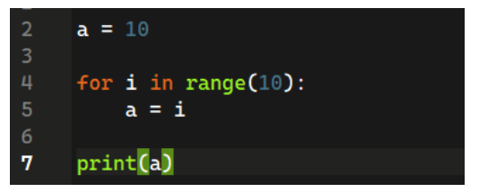
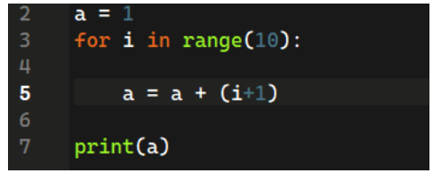
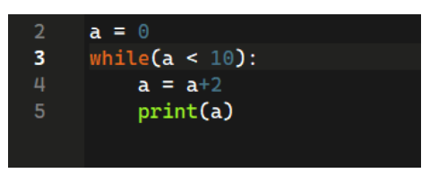

# 📌Week 2 Quiz

**1. Which statement will print ‘The joy of computing’?**
- print(The joy of computing)
- print The joy of computing
- printf(‘The joy of computing’)
- print(‘The joy of computing’)  ✅

**2. What is the output of the following code?**

	
 - Earth is round.\
   Moon has lot of dust.
 - Earth is\
   round.\
   Moon has\
   lot of dust. 
- Earth is\
  round.\
  Moon has lot of dust.  ✅  
- Earth is round.Moon has lot of dust.

**3. What should be the syntax of getting age as an input from a user in python?**
- Age = int(“Enter Age”)
- Age = input(“Enter Age”)  ✅
- Age = get(“Enter Age”)
- Age = input(Enter Age)

**4. What should be the value of _ to print all numbers from 0-10?**

	
- 10
- 9
- 11  ✅
- None of the above

**5. What will be the output of the following code?**

	
- 0
- 45  ✅
- 43
- 50

**6. What will be the output? suppose the input is 20**

	
- 40
- Error
- 2020  ✅
- None of the above

**7. What will be the output of the following code be?**

- number is less than 0
- number is greater than 0
- number is zero  
- Error  ✅

**8. What will be the output of the following code?**

	
  
- 9  ✅
- 10
- 0
- None of the above

**9. What will be the output of the following code?**

	
- 56  ✅
- 45
- 0
- Error

**10. What will be the output of the following code?**

- 1,2,3,4,5,6,7,8,9,10
- 2,4,6,8,10  ✅
- 0,1,2,3,4,5,6,7,8,9,10
- Error
