# 📌Week 3 Quiz

**1. What will be the output of the following code?**

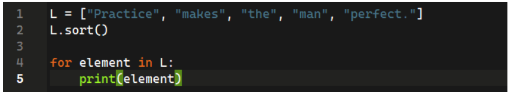

- Practice,Practice,Practice,Practice,Practice
- Practice makes the man perfect.
- Practice makes man perfect. the  ✅
- Makes man perfect. Practice the

**2. What should be the code to print all Even numbers between 1-10 (both inclusive)?**
 
- 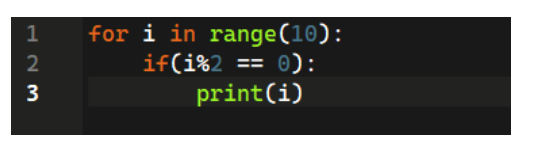 

- 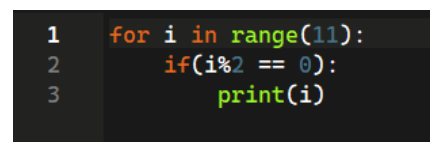 

- 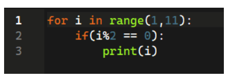  ✅

- 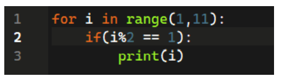 

**3. What will be the output of the following code?**

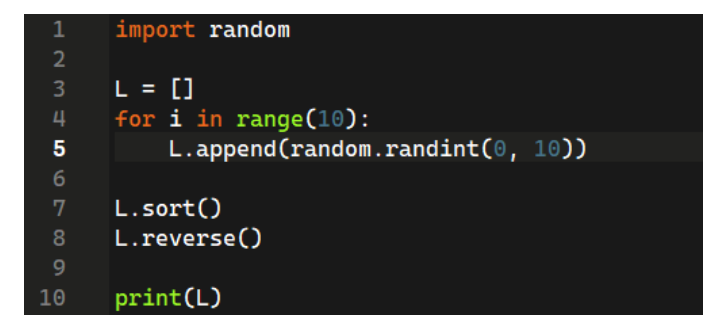
	
- Sorted List(L) containing random elements between 0-10 in descending order.  ✅
- Sorted List containing random elements between 0-10 in ascending order.
- Sorted List containing elements between 0-10.
- Sorted List containing elements between 0-9 in ascending order.

**4. What will be the output of the following code?**

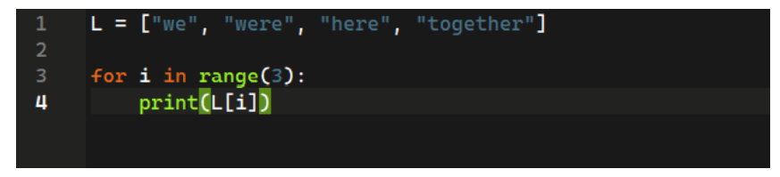
	
- we were here together
- we were here  ✅
- we were
- we

**5. What will be the value of list L?**

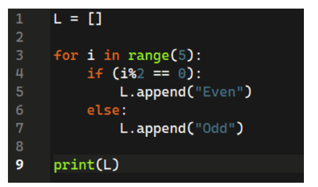

- ['Even', 'Odd', 'Even', 'Odd']
- ['Even', 'Odd', 'Even', 'Odd', 'Even', ‘Odd’]
- ['Even', 'Odd', 'Even', ‘Even', 'Even']
- ['Even', 'Odd', 'Even', 'Odd', 'Even']  ✅

**6. What is the correct code for a function to return the sum of elements of list L?**

- 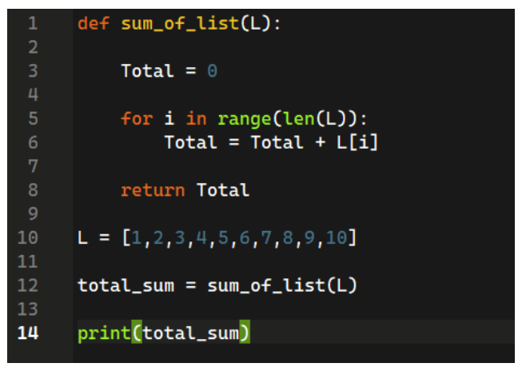  ✅

- 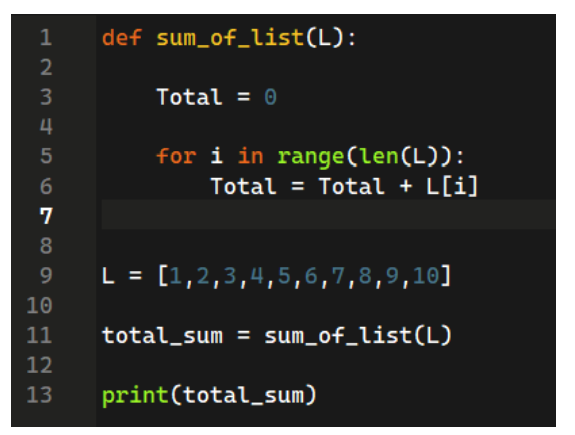

- 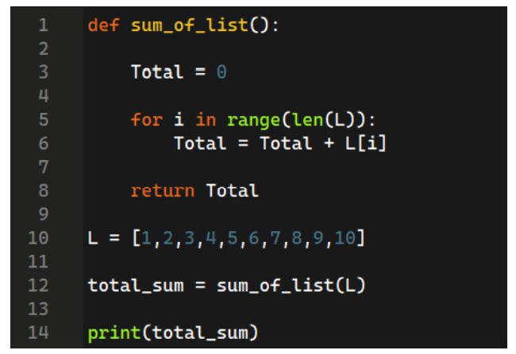

- 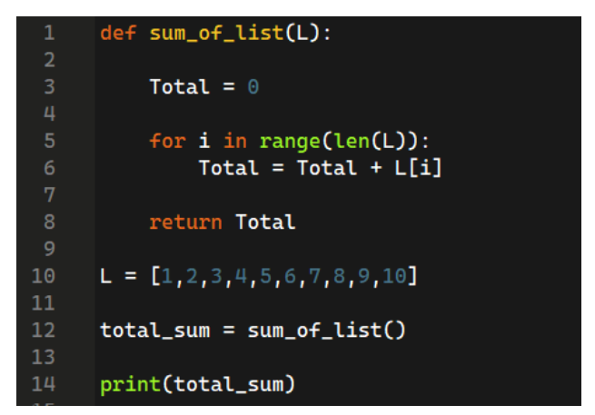
 
**7. What does the following code represent?**

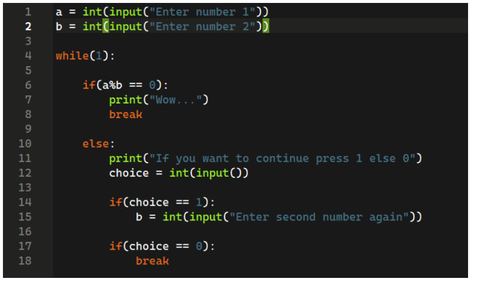

- Checks if a is divisible by b.  ✅
- Checks if b is divisible by a.
- Checks if a and b are multiples of 5.
- None of the above.

**8. Suppose there exists a file named file.txt. What the following code will do?**

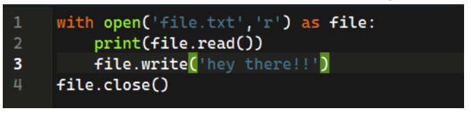

- Print whatever is there in the file and add hey there.
- Throws an error in the end as the file is not opened in writable mode.  ✅
- Throws an error in the end as the file is not opened in readable mode.
- No error will be thrown and the code will work fine.

**9. Suppose there is an empty file named file.txt. What will be the output of the following code?**

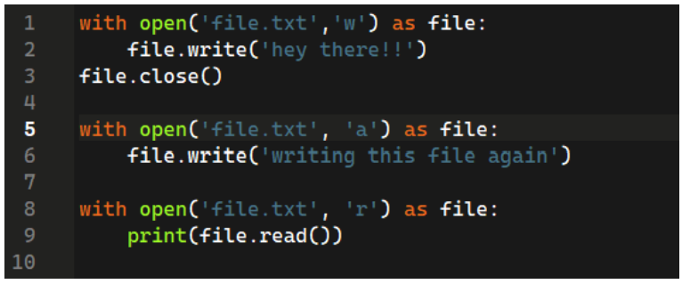

- writing this file again
- hey there!!
- hey there!!writing this file again  ✅
- Throws an error

**10. What will be the output of the following code?**

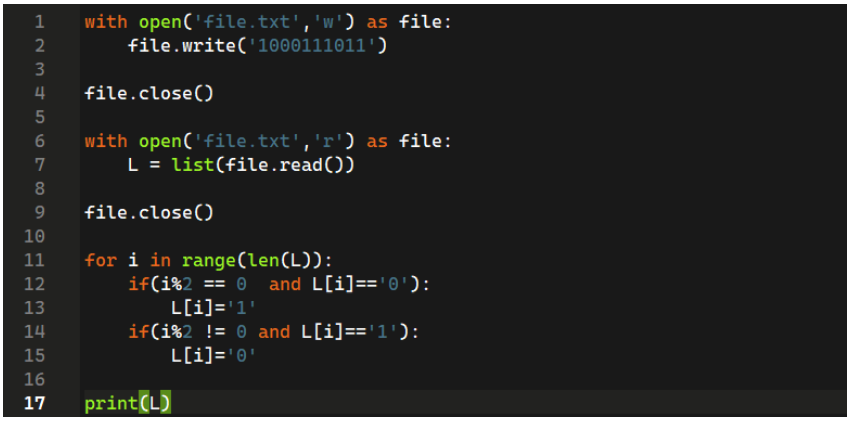
	
- Alternative 1’s and 0’s respectively  ✅
- Alternative 0’s and 1’s respectively.
- All Zeroes towards left and ones towards the right.
- All ones towards the left and zeroes towards the right.
