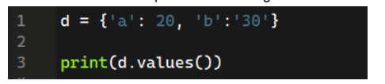
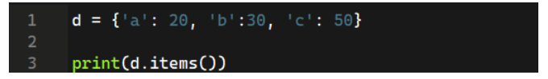
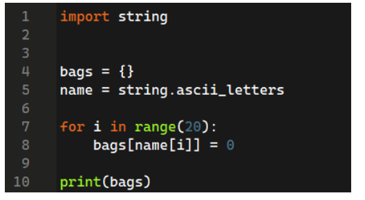
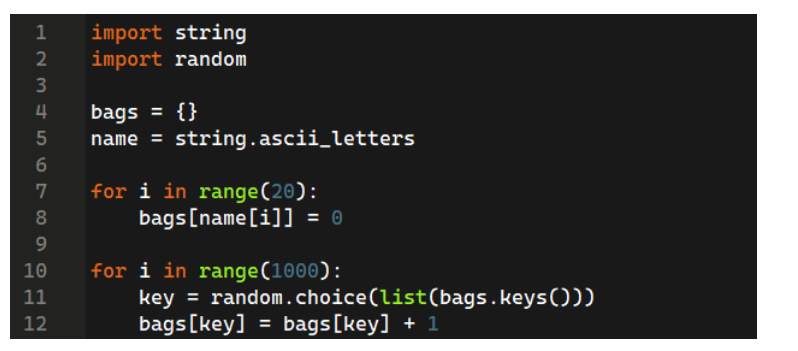
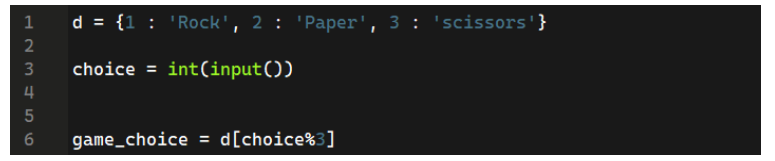
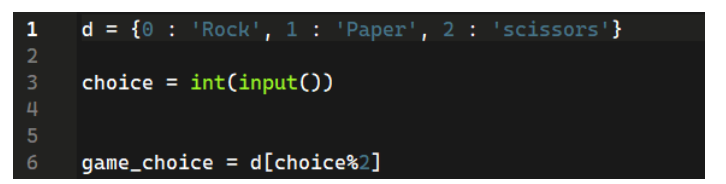
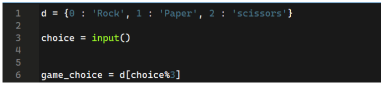
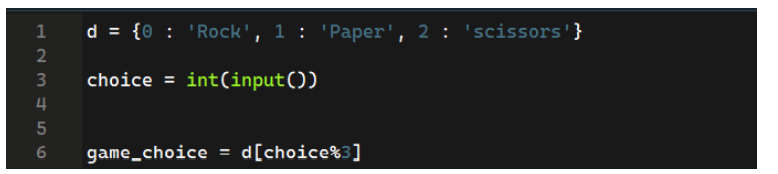
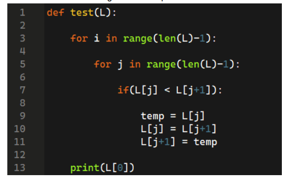

# 📌 Week 5 Quiz

**1. What is the syntax to create a dictionary?**
- D = []
- D = {}  ✅
- D = ()
- D = dictionary()

**2. What is the correct statement about dictionaries?**
- There can be multiple same keys.
- Every value must be unique.
- Every key must be unique.  ✅
- We can’t get every key from the dictionary.

**3. What is the correct syntax to get all the keys only from a dictionary d?**
- d.key()
- d.item()
- d.value()
- d.keys()  ✅

**4. What will be the output of the following code?**

	
- 20 ‘30’  ✅
- ‘20’ ‘30’
- 20 30
- a b

**5. What will be the output of the following code?**

	
- ‘a’ ‘b’ ‘c’
- 20 30 50
- ('a', 20), ('b', 30), ('c', 50)  ✅
- (‘a’, ‘b’, ‘c’) (20, 30, 50)

**6. What will be the output of the following code?**

	
- Creates a dictionary with keys in range 0-19 and values 0
- Creates a dictionary with keys in range a-t and values 0.  ✅
- Creates a dictionary with keys in range a-z and values in range 0-19.
- Creates a dictionary with keys in range a-t and values in range 0-19.

**7. What does the following code mimics?**

	
- Distribute 1000 marbles evenly in every bag.
- Distribute 500 marbles randomly in every bag.
- Distribute 1000 marbles randomly in every bag.  ✅
- Throws an error.

**8. What is the correct code to choose rock, paper, or scissors correctly?**
 
- 
 
-  

- 

-   ✅

**9. Binary search is applicable in?**
- Unsorted list.
- Only in the list which is sorted in ascending order.
- Only in the list which is sorted in descending order.
- Any sorted list.  ✅

**10. What will be the output of the following code?**

- The first element of the initial list.
- The largest element of the list.  ✅
- The smallest element of the list.
- Throws an error.
