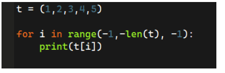
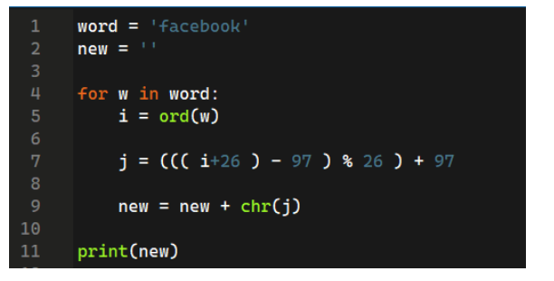
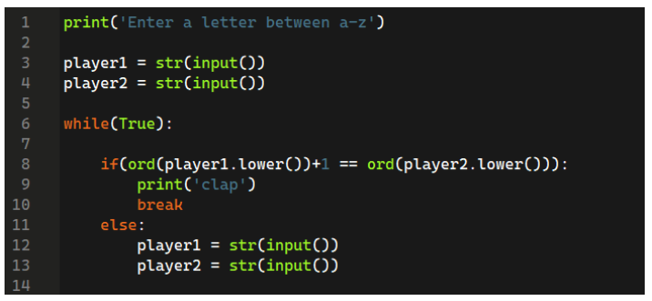
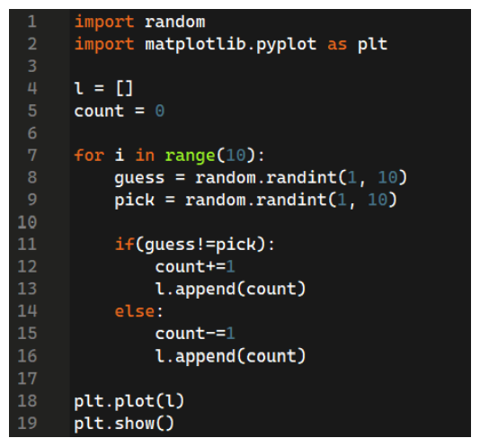
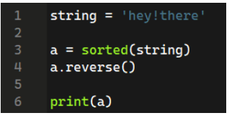
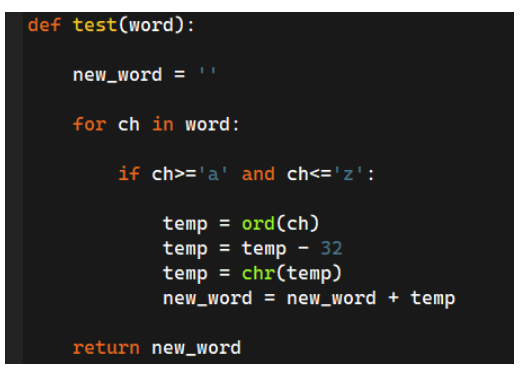

# 📌Week 8 Quiz

**1. What is the correct initialisation of tuples?**
- Dates = [12,23,3,4]
- Dates = (12,23,3,4)  ✅
- Dates = {12,23,3,4}
- Both B and C

**2. What operations can be done on tuples?**
- Tuples are appendable.
- We can delete a value from tuples.
- Both A and B.
- We can count the number of instances of an element.  ✅

**3. What will be the output of the following code?**

	
- 1,2,3,4,5
- 5,4,3,2,1
- 5,4,3,2  ✅
- 1,2,3,4

**4. What will be the output of the following code?**

- facebook  ✅
- gbdfcppl
- ezbdannj
- ytvxuhhd

**5. When the following program will clap?**

	
- When both players will enter the same letters.
- When player 2 will enter the next letter with respect to player 1.  ✅
- When player 1 will enter the next letter with respect to player 2.
- It will never clap.

**6. Which statement is correct about the following program?** 

	
- The graph will go up when guess and pick are the same.
- The graph will go down when guess and pick are the same.
- The graph will go up when guess and pick are not the same.
- Both B and C  ✅

**7. What does NLTK do?**
- Helps to work with human language data.  ✅
- Helps to convert machine data into human language.
- Helps to work on gibberish language.
- Helps to translate dog language into human language.

**8. What is the output of the following code?**

	
- ['!', 'e', 'e', 'e', 'h', 'h', 'r', 't', 'y']
- ['h', 'e', 'y', '!', 't', 'h', 'e', 'r', 'e']
- ['y', 't', 'r', 'h', 'h', 'e', 'e', 'e', '!']  ✅
- None of the above

**9. While converting an image into black and white during enhancement you cannot convert it back into a colored image.**
- True
- False  ✅

**10. The following code will**

- Converting lower case letters into upper case.  ✅
- Converting upper case letters into lower case.
- Return the same word
- Error
