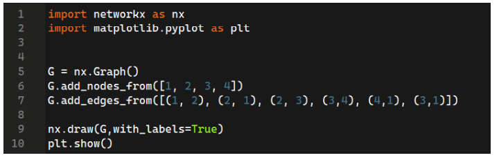
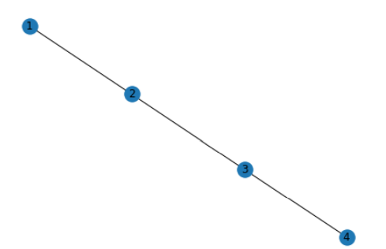
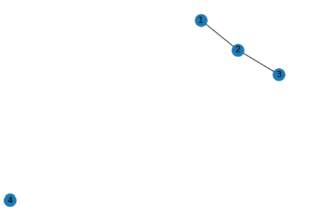
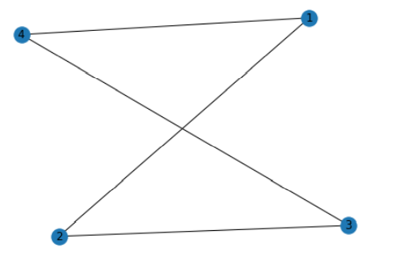
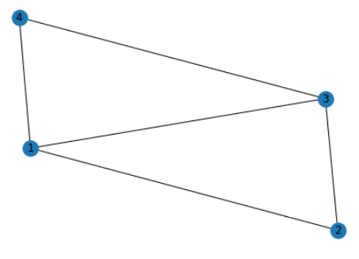
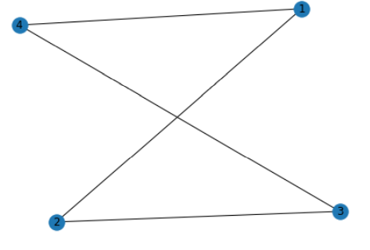
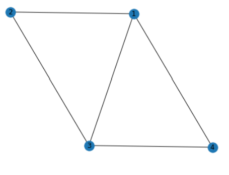
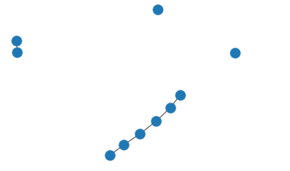

# 📌Week 9 Quiz

**1. How can we identify which book is written by which author?**
- By matching handwriting.
- By analyzing word length with previous books.  ✅
- By analyzing the number of pages in a book.
- By analyzing the book’s preface.

**2. How can a list L can be converted into a tuple?**
- tuple(L)  ✅
- tup(L)
- L(tuple)
- L(tup)

**3. Will the following piece of code always return True?**

	
- True  ✅
- False

**4. What is the output of the following code?**

- 

- 

- 

-   ✅

**5. How many edges are there in the following graph?**

	
- 4  ✅
- 5
- 3
- 2

**6. How many neighbors does node 3 have?**

	
- 2
- 4
- 1
- 3  ✅

**7. In which of the following ways can we create a string in python?**
	
- By using single quotes.
- By using double-quotes.
- By using triple-quotes.
- All of the above.  ✅

**8. How many nodes, edges does the following graph have?**

		
- 10,6  ✅
- 10,5
- 8,6
- 8,5

**9. A complete graph will have a degree of separation?**
- 1  ✅
- 2
- 3
- Depends on the number of nodes.

**10. How can we get an RGB of a pixel?**
- RGB()
- getpixel()  ✅
- getvalue()
- getrbg()
