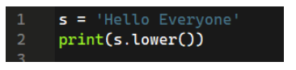
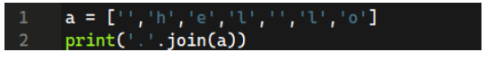
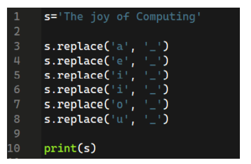
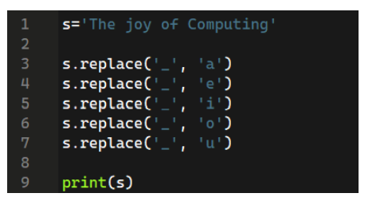
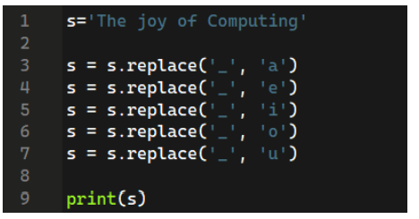
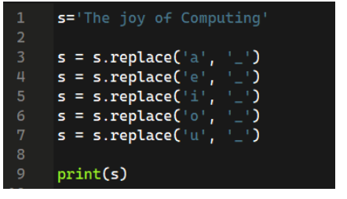
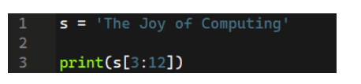
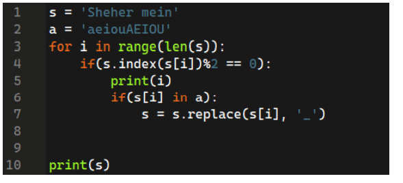
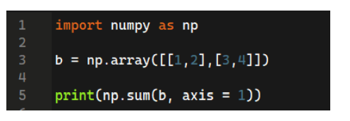
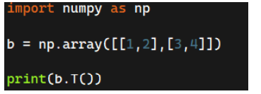

# 📌Week 10 Quiz

**1. What is the output of the following code?**

	
- HELLO EVERYONE
- Hello Everyone
- helloeveryone
- hello everyone  ✅

**2. type(9) will return?**
- float
- int  ✅
- str
- class

**3. Output of the following code will be?**

	
- hello
- h.e.l.l.o  ✅
- .h.e.l..l.o
- .h.e.l.l.o

**4. Which code snippet represent replacing all vowels with ‘_’ in a string?(suppose string name is s)**

- 

- 

- 

-   ✅

**5. What will be the output of the following list slicing**

	
- ‘Joy of C’
- ‘ Joy of C’  ✅
- ‘Joy of Co’
- ‘ Joy of Co’

**6. What does the following code represent?**

	
- Replacing all letters at odd index with ‘_’.
- Replacing all vowels at odd index with ‘_’.
- Replacing all vowels at even index with ‘_’.  ✅
- Replacing all letters at even index with ‘_’.

**7. What will be the output of the following code?**

	
- [4 6]
- [3 7]  ✅
- [3 4]
- None of the above

**8. How to take a transpose of a matrix?**
 
- 

-   ✅

- 

- 
 
**9. Lossy and Lossless compressions are the same?**
- True
- False  ✅

**10. What is the shape of the following numpy array?**

numpy.array([ [1,2,3], [4,5,6] ])

- (2,3)  ✅
- (3,2)
- (3,3)
- (2,2)
