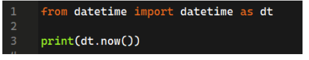
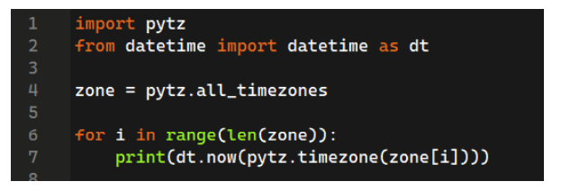
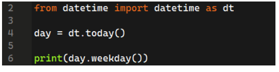

# 📌Week 11 Quiz

**1. Which library is used for browser automation?**
- nltk
- numpy
- selenium  ✅
- PIL

**2. time.time() will return?**
- Time in seconds.  ✅
- Current date and time.
- Time in minutes
- The current date, time and year.

**3. ibrary used to get all timezones?**
- selenium
- calender
- nltk
- pytz  ✅

**4. The output of the following code will be?**

	
- Date and time in dd- mm-yy hh:MM:ss:ms respectively.
- Time and date in hh:MM:ss:ms dd- mm-yy respectively.
- Date and time in mm-dd-yy hh:MM:ss:ms respectively.
- Date and time in yy- mm-dd hh:MM:ss:ms respectively.  ✅

**5. We can use the same web drivers for different browsers**
- True
- False  ✅

**6. What will be the output of the following code?**

	
- Print the current date and time of all time zones.  ✅
- Print the current date and time of specific time zones.
- Print the current date of all time zones.
- Print the current date of some specific time zones.

**7. What will be the output if the system date is 10 December 2021(Friday)?**

	
- 5
- 3
- 4  ✅
- error

**8. Which statement will return the calendar for a whole year?**
- calendar.month(year)
- calendar(year)
- calendar.prcal(year)  ✅
- calendar.year(year)

**9. By which statement we can come out from the loop?**
- continue
- leave
- catch
- break  ✅

**10. How to check for the leap year?**
- calendar.leap(year)  ✅
- calendar.is_leap(year)
- calendar.isleap(year)
- calendar.checkleap(year)
