# JOC Jul-2024 · Week 0: portal print

- Source: `JOY-OF-COMPUTING-USING-PYTHON (portal print, Wk0-12).pdf` pages 1–5 (portal review printout). Parsed text below; the cropped image under each question is the exact page content (code, figures and ticks as printed) and is authoritative.
- `[x]` = option equal to the portal's **Accepted Answer** (official). Lines may carry stray spaces from the PDF text layer.

> gireesh218@gmail.com 

### Q1. What is the next number in the sequence 4, 8, 16, _?

- [ ] 20
- [ ] 24
- [ ] 28
- [x] 32
> Yes, the answer is correct. Score: 1

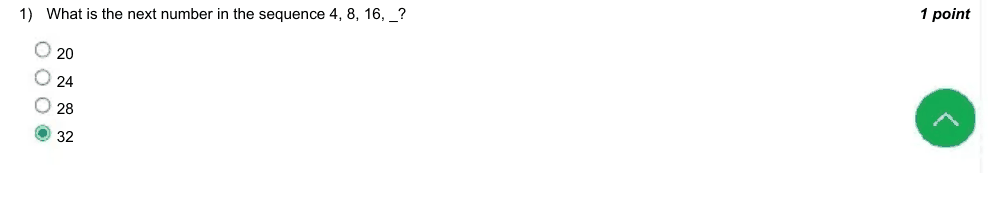

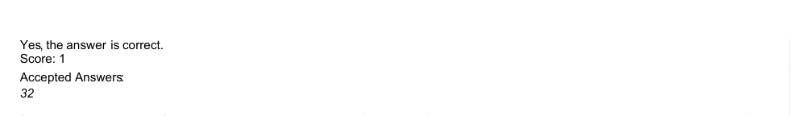

### Q2. What will be the sum of the sequence up to 5th term 9, 36, 144, 576, ...?

- [x] 3069
- [ ] 3070
- [ ] 3071
- [ ] 3072
> Yes, the answer is correct. Score: 1

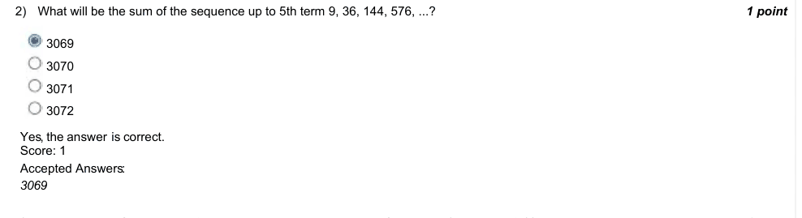

### Q3. The diameter of the circle is 10cm. What will be the perimeter of the shape(Use pi = 3.14)?

- [x] 31.4cm
- [ ] 41.4cm
- [ ] 51.4cm
- [ ] 61.4cm
> Yes, the answer is correct. Score: 1

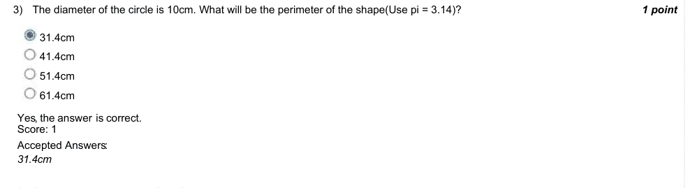

### Q4. Choose the odd one out of the following 2, 3, 5, and 6.

- [ ] 2
- [ ] 3
- [ ] 5
- [x] 6
> Yes, the answer is correct. Score: 1

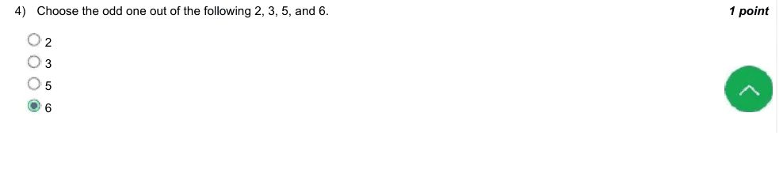

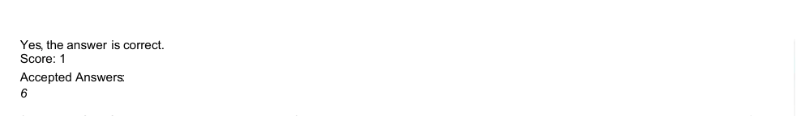

### Q5. Which of the following is an Armstrong number?
(Armstrong number is a number that is equal to the sum of cubes of its digits.)

- [ ] 123
- [ ] 333
- [x] 407
- [ ] 663
> Yes, the answer is correct. Score: 1

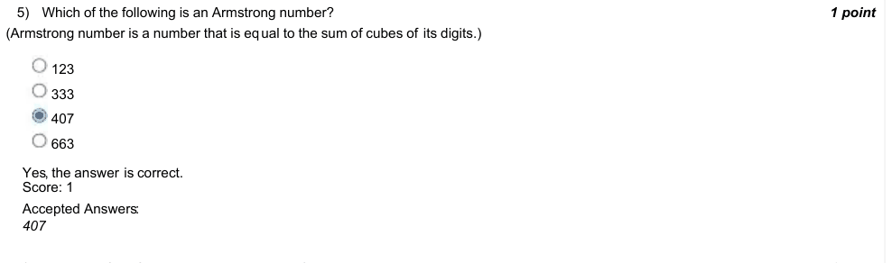

### Q6. The sum of the first ten natural numbers is?

- [ ] 45
- [ ] 54
- [x] 55
- [ ] 60
> Yes, the answer is correct. Score: 1

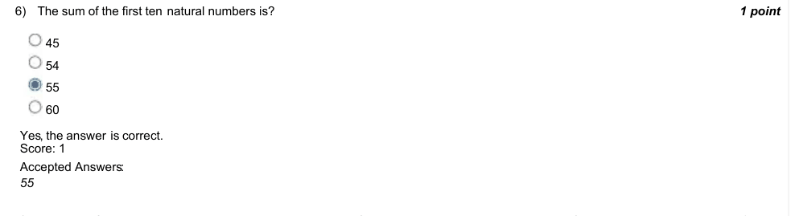

### Q7. (question text in image)

- [ ] A couple of dice is rolled together. What is the probability of getting the same number on both dice?
- [x] 1/6
- [ ] 1/36
- [ ] 1/3
- [ ] 1
> Yes, the answer is correct. Score: 1

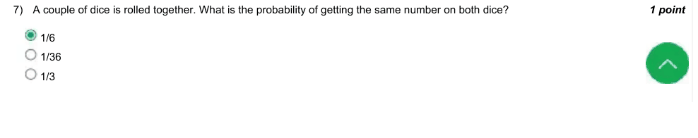

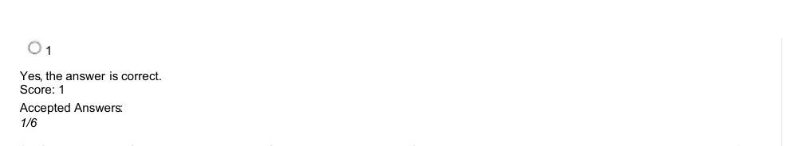

### Q8. If the perimeter of a circle is equal to that of a square, then the ratio of their areas is

- [ ] 22: 7
- [x] 14: 11
- [ ] 7: 22
- [ ] 11: 14
> Yes, the answer is correct. Score: 1

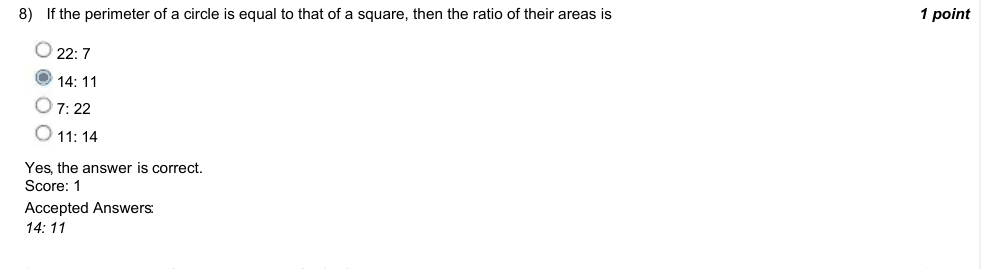

### Q9. What is the Least Common Multiple of 4 & 8?

- [ ] 2
- [x] 8
- [ ] 12
- [ ] 16
> Yes, the answer is correct. Score: 1

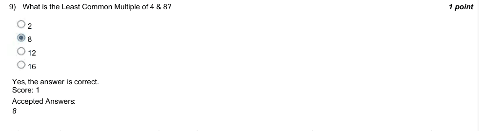

### Q10. The area of circle A is equal to the sum of the area of two small circles with diameters of 6cm and 8cm. Then the diameter of
circle A will be?

- [ ] 5
- [x] 10
- [ ] 15
- [ ] 20
> Yes, the answer is correct. Score: 1

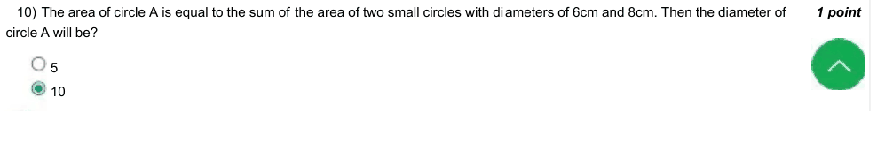

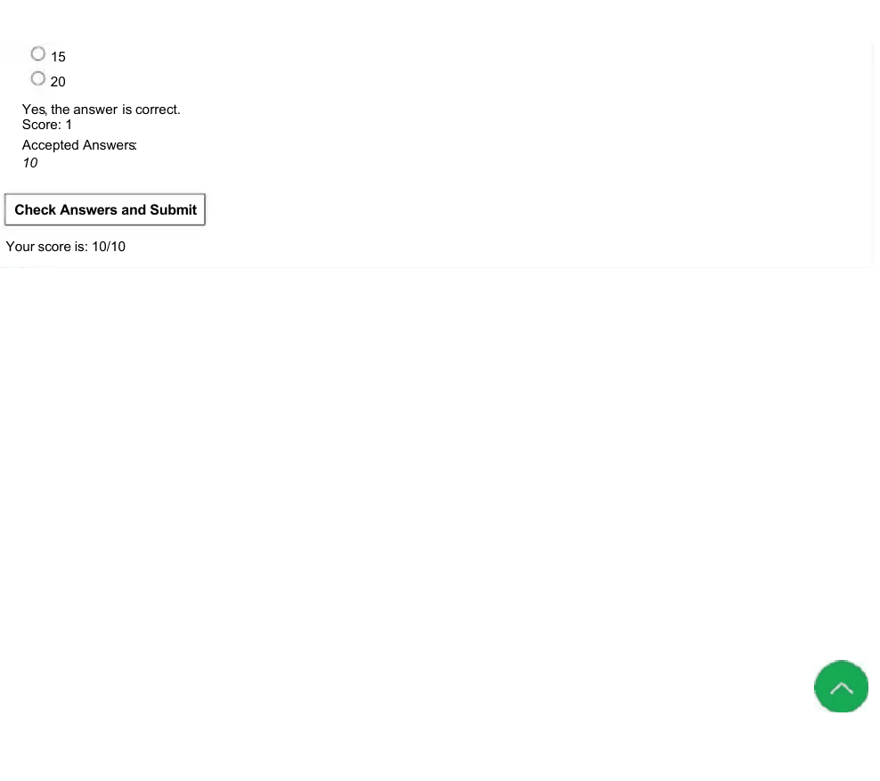
