# JOC Jul-2024 · Week 2: portal print

- Source: `JOY-OF-COMPUTING-USING-PYTHON (portal print, Wk0-12).pdf` pages 19–26 (portal review printout). Parsed text below; the cropped image under each question is the exact page content (code, figures and ticks as printed) and is authoritative.
- `[x]` = option equal to the portal's **Accepted Answer** (official). Lines may carry stray spaces from the PDF text layer.

> gireesh218@gmail.com  · Due on 2024-08-07, 23:59 IST.

### Q1. Statement : If a variable is assigned multiple times, the latest value is not stored in the variable

- [ ] False, the variable stores all values it was assigned
- [x] False, the variable stores the value from the latest assignment.
- [ ] True, the variable stores the value from the second-last assignment.
- [ ] True, the variable stores value from the initial assignment
> Yes, the answer is correct. Score: 1

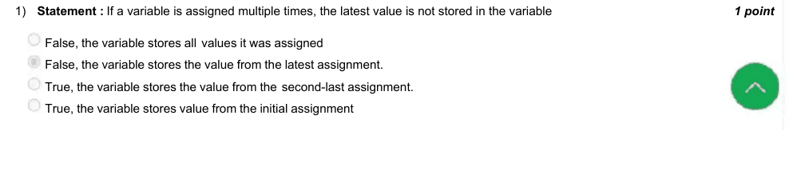

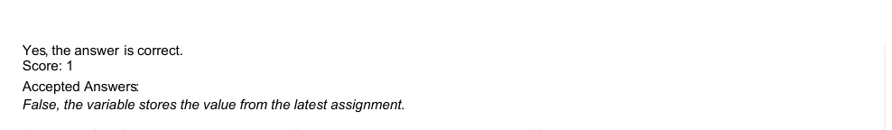

### Q2. Which of the following code blocks print - ”Hello Ram Lakshman and Hanuman !” ?

> Yes, the answer is correct. Score: 1

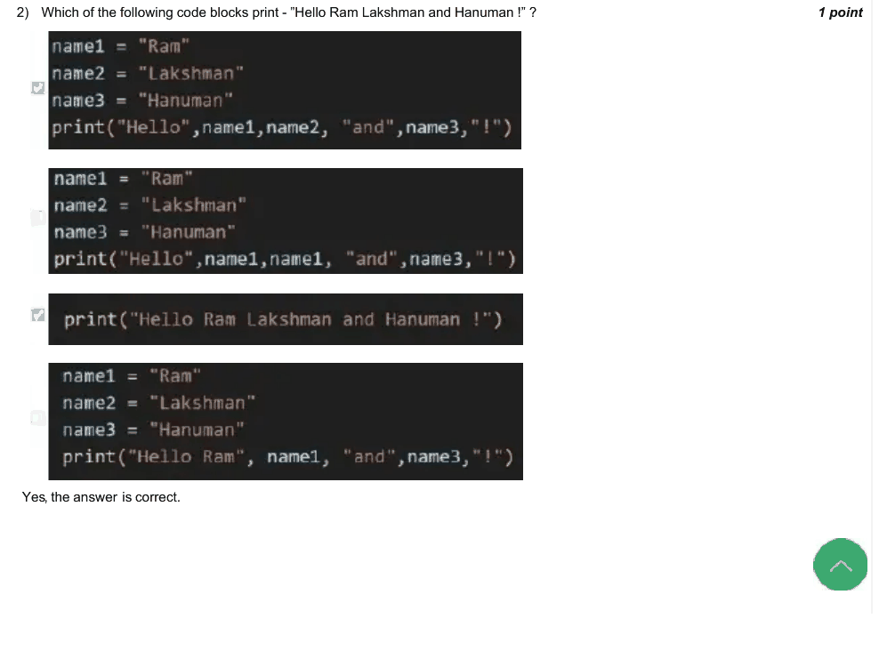

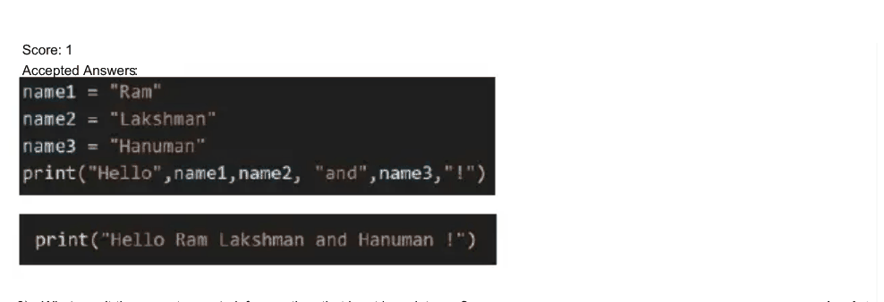

### Q3. What aren’t the correct ways to inform python that input is an integer ?

- [x] in(input())
- [x] float(input())
- [ ] int(input())
- [ ] a = input() a = int(a)
> Yes, the answer is correct. Score: 1

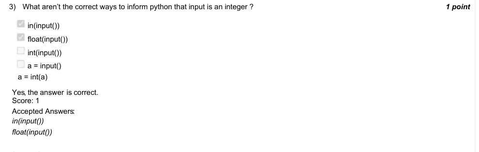

### Q4. The following program outputs 722 -
For what value of a does the code output 8 ?

- [ ] 2
- [ ] 1
- [x] 4
- [ ] 6
> Yes, the answer is correct. Score: 1

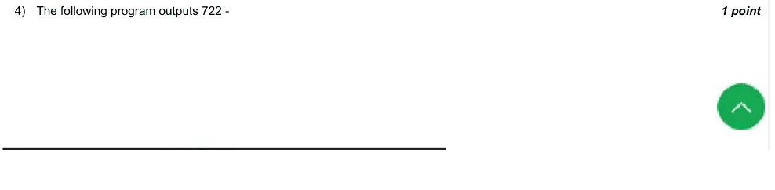

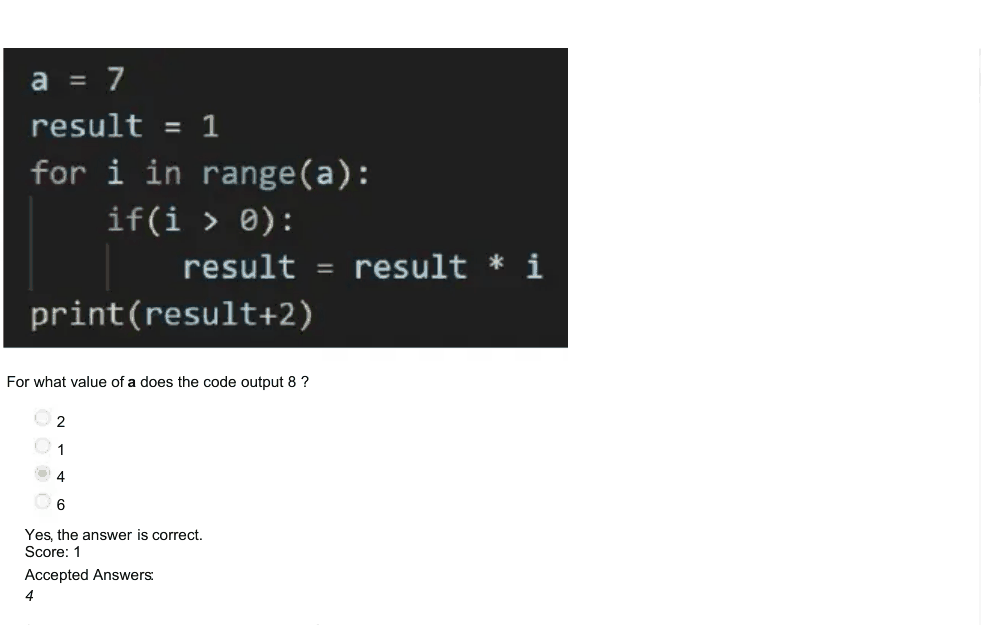

### Q5. What does previous question calculate ?

- [ ] Calculates the factorial of a.
- [ ] Calculates the factorial of a and adds 2.
- [ ] Calculates the a multiples of a starting from 1 and adds 2.
- [x] Calculates the factorial of a-1 and adds 2.
> Yes, the answer is correct. Score: 1

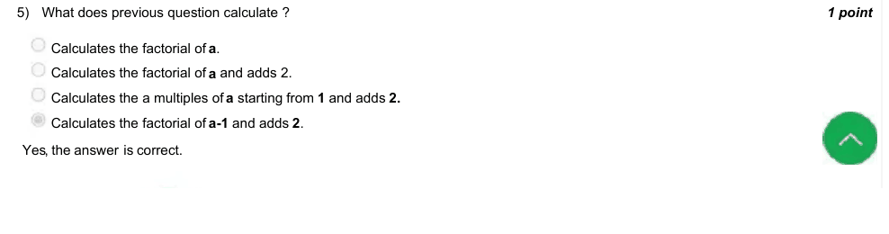

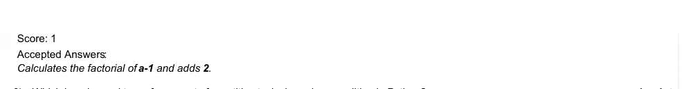

### Q6. Which loop is used to perform a set of repetitive tasks based on condition in Python?

- [x] while loop
- [ ] for loop
- [ ] do-while loop
- [ ] while-range loop
> Yes, the answer is correct. Score: 1

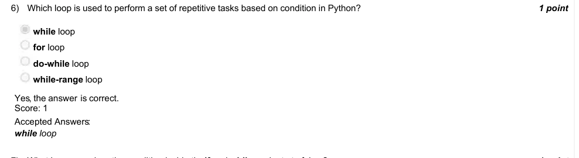

### Q7. What happens when the condition inside theif and while evaluate to false ?

- [ ] Python interpreter ignores the if/while blocks, and halts the program.
- [x] Python interpreter ignores the if/while blocks, and proceeds the program from the lines after the if/while block.
- [ ] Python interpreter executes the if/while blocks, and rest of the program.
- [ ] Python interpreter executes the if/while, and the programs runs in an infinite loop.
> Yes, the answer is correct. Score: 1

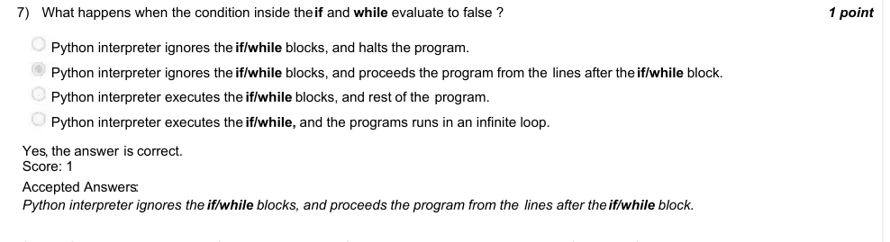

### Q8. The following program might/might not have an infinite loop. Does the program have infinite loop ?

- [ ] No, the program doesn’t have infinite loop.
- [x] Yes, it can be prevented by updating the value of a before the if block at line 3
- [ ] Yes, it can be prevented by removing both the if blocks inside the while loop.
- [ ] Yes, but it cannot be prevented
> Yes, the answer is correct. Score: 1

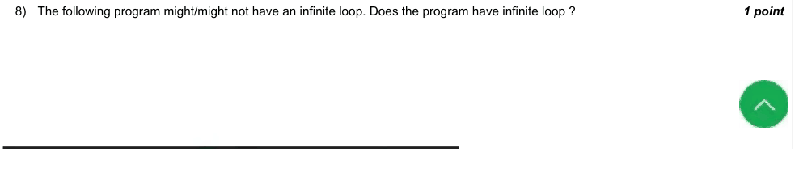

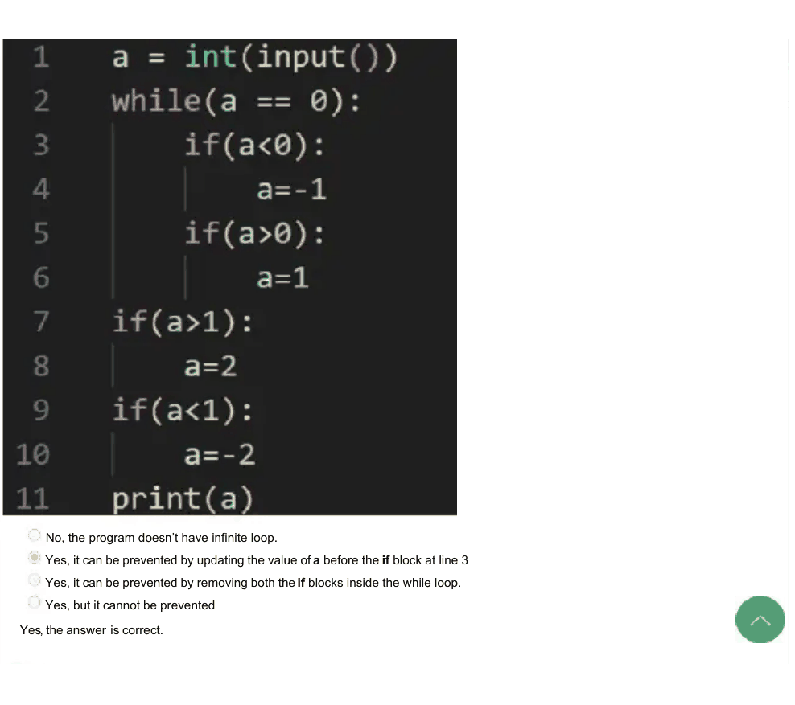

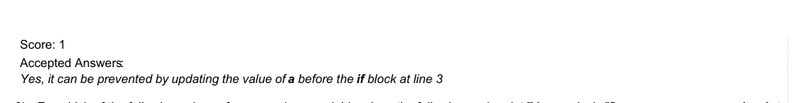

### Q9. For which of the following values of name and age variables does the following code print ”You are lucky”?

- [ ] aryan, 20
- [ ] arjun, 19
- [ ] aakash, 17
- [x] aatreya, 18
> Yes, the answer is correct. Score: 1

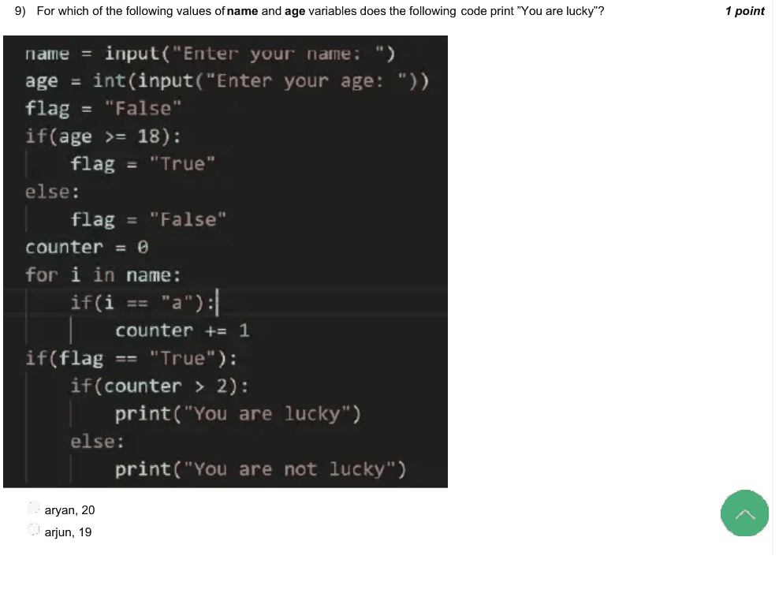

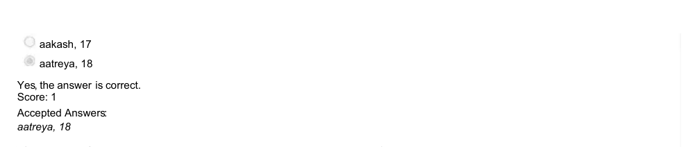

### Q10. For which of the options among the previous question, the program doesn’t print anything.

- [ ] aryan, 20
- [ ] arjun, 19
- [x] aakash, 17
- [ ] aatreya, 18
> Yes, the answer is correct. Score: 1

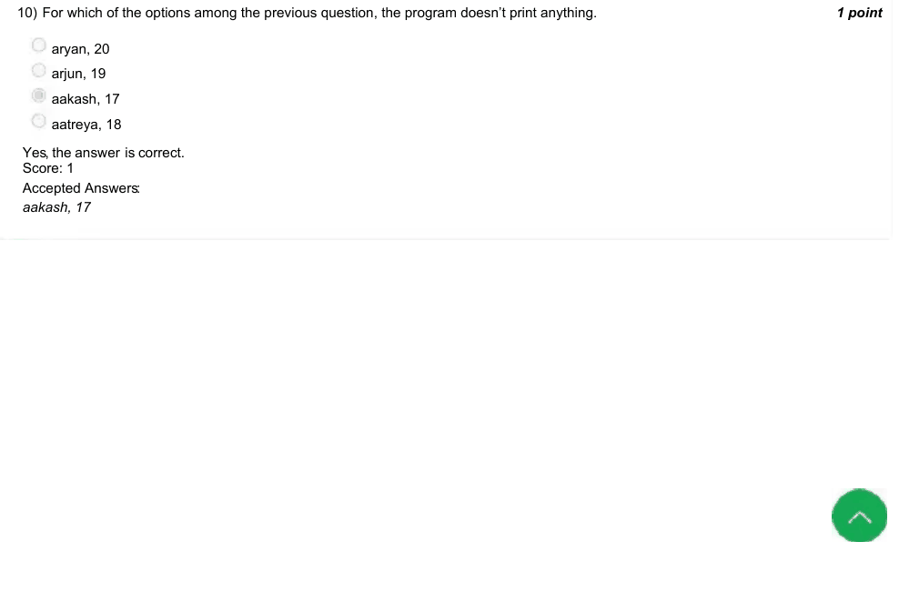
