# JOC Jul-2024 · Week 3: portal print

- Source: `JOY-OF-COMPUTING-USING-PYTHON (portal print, Wk0-12).pdf` pages 27–33 (portal review printout). Parsed text below; the cropped image under each question is the exact page content (code, figures and ticks as printed) and is authoritative.
- `[x]` = option equal to the portal's **Accepted Answer** (official). Lines may carry stray spaces from the PDF text layer.

> gireesh218@gmail.com  · Due on 2024-08-14, 23:59 IST.

### Q1. Which of the following is/are true statement(s)?

- [x] Lists are used to store multiple values.
- [ ] One can access element in list by using non-numeric indices.
- [x] Iterating over lists is possible in Python.
- [ ] We need to specify required size of list while creating a new list variable.
> Yes, the answer is correct. Score: 1

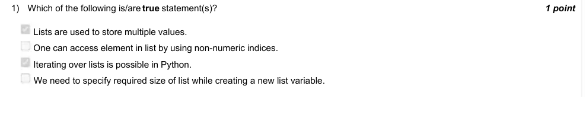

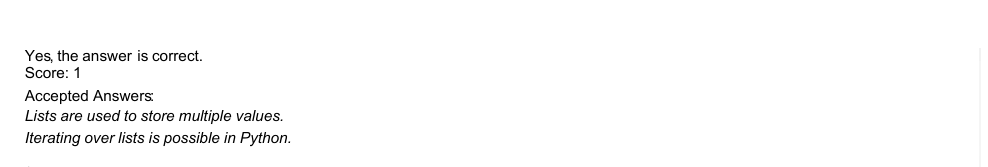

### Q2. In the below code -
For what value of n does the program print 21 ?
7

Accepted answer(s): (Type: Numeric) 7
> Yes, the answer is correct. Score: 1

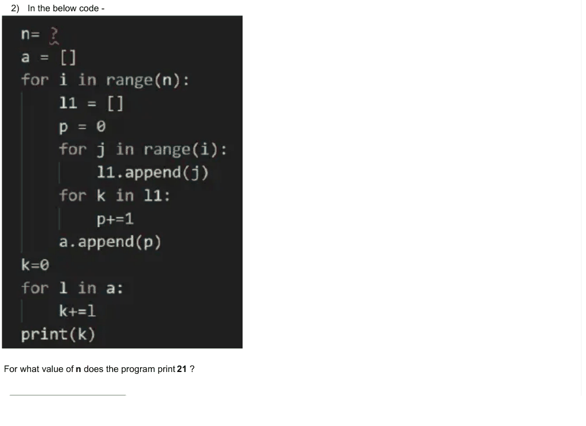

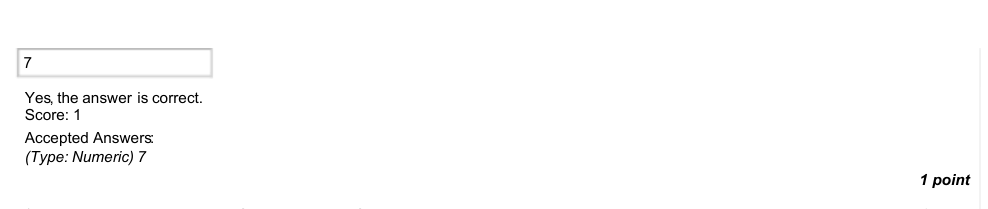

### Q3. From the previous question, for what values ofn is the number 7 appended to list a.

- [ ] 7
- [ ] 6
- [x] 8
- [x] 9
> Yes, the answer is correct. Score: 1

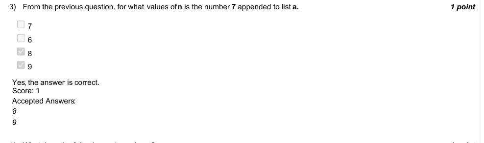

### Q4. What does the following code perform ?

- [ ] It converts any input list into a new list which is filled with some alternative even and odd numbers.
- [ ] It converts any input list into a new list such that at even indices, the value is a multiple of an even number and at odd indices, the value is either odd or even number.
- [ ] It converts any input list into a new list such that at even indices, the value is multiple of 2 and at odd indices, the value is multiple of 3.
- [ ] It converts any input list into a new list, which follows no pattern.
> Accepted answer (not matched to a printed option): It converts any input list into a new list such that at even indices, the value is a multiple of an even number and at odd indices, the value is; either odd or even number.
> Yes, the answer is correct. Score: 1

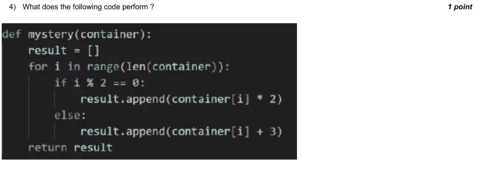

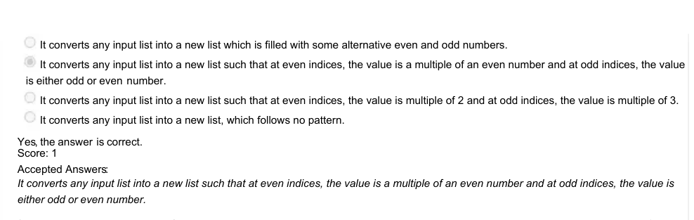

### Q5. From the previous question, if the option -
It converts any input list into a new list which is filled with some alternative even and odd numbers.
is incorrect, Can you make changes to code such that this option is true ?

- [ ] No, it is not possible to make such changes.
- [ ] No, the option is already correct.
- [x] Yes, we can make changes.
> Yes, the answer is correct. Score: 1

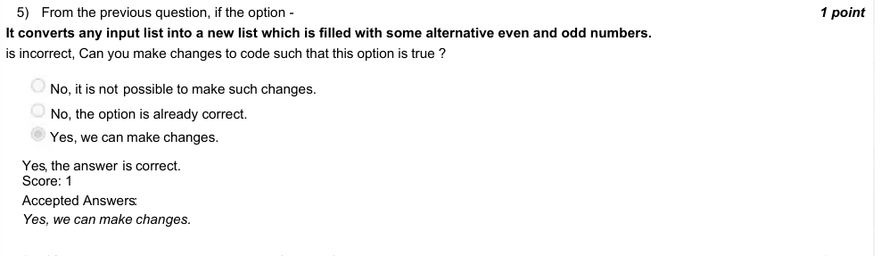

### Q6. If file.txt exists, Does the code successfully run ?

- [ ] Yes
- [x] No
> Yes, the answer is correct. Score: 1

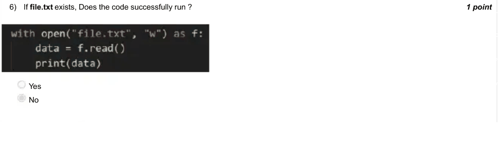

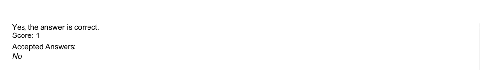

### Q7. Which of the following are examples of Social Computing ?

- [x] StackOverflow
- [x] Wikipedia
- [x] Quora
- [ ] None
> Yes, the answer is correct. Score: 1

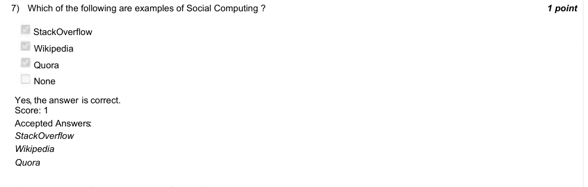

### Q8. What does the following code print forn = 3?

- [x] WE KNOW THE WISDOM OF SERIES
- [ ] WE ARE YET TO KNOW MANY THINGS
> Yes, the answer is correct. Score: 1

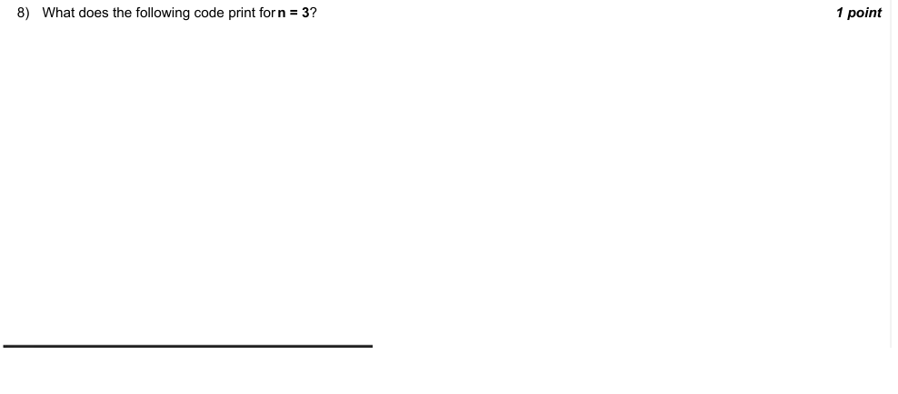

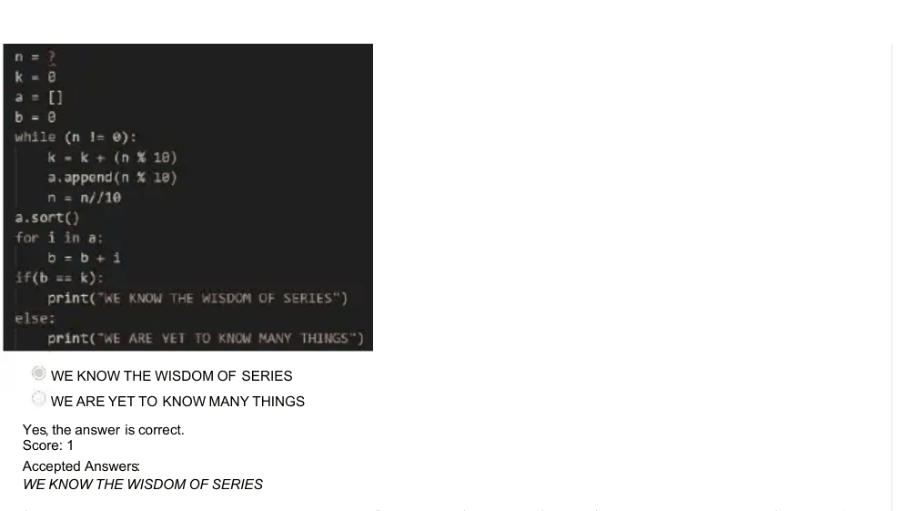

### Q9. From the previous question, is the variable n or a.sort() responsible for printing of either of the two possible sentences ?

- [x] No, it is not dependent on variable n, the code will never print ”WE ARE YET TO KNOW MANY THINGS”.
- [ ] Yes on a.sort() only, but the code will never print ”WE ARE YET TO KNOW MANY THINGS”.
- [ ] Yes on both, the code may print both sentences.
- [x] No, it is not dependent on a.sort(), the code will never print ”WE ARE YET TO KNOW MANY THINGS”.
> Yes, the answer is correct. Score: 1

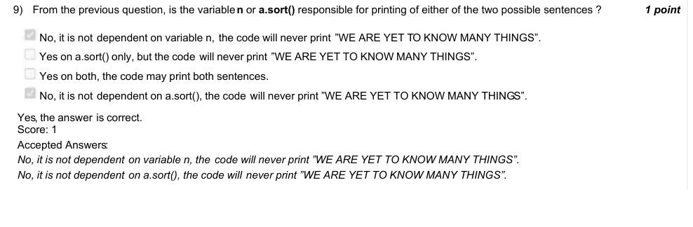

### Q10. What does the code in question 8, calculate ?

- [ ] 2309 Can you say what the values of k and b are if n = 10294343763482 x 10
- [ ] . If values of k and b are different, enter 0, else enter value of k 56
> Accepted answer (not matched to a printed option): (Type: Numeric) 56
> Yes, the answer is correct. Score: 1

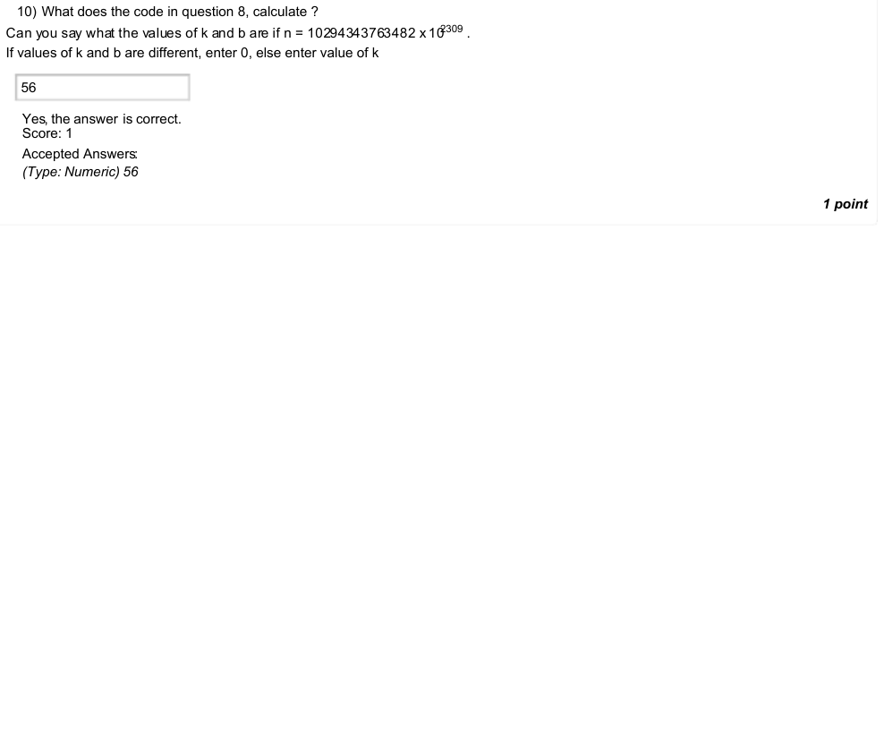
