# JOC Jul-2024 · Week 4: portal print

- Source: `JOY-OF-COMPUTING-USING-PYTHON (portal print, Wk0-12).pdf` pages 34–41 (portal review printout). Parsed text below; the cropped image under each question is the exact page content (code, figures and ticks as printed) and is authoritative.
- `[x]` = option equal to the portal's **Accepted Answer** (official). Lines may carry stray spaces from the PDF text layer.

> gireesh218@gmail.com  · Due on 2024-08-21, 23:59 IST.

### Q1. Which of the following options provides the general formula for the magic constant of a magic square of size , where all

- [ ] n
- [ ] n2 elements are distinct numbers from 1 to
- [ ] ?
- [ ] n2 n(
- [x] + 1)
- [ ] 2 n3 2 n3
- [ ] + 2
- [ ] 2 n4
- [x] n2
- [x] +
- [x] 2n
> Yes, the answer is correct. Score: 1

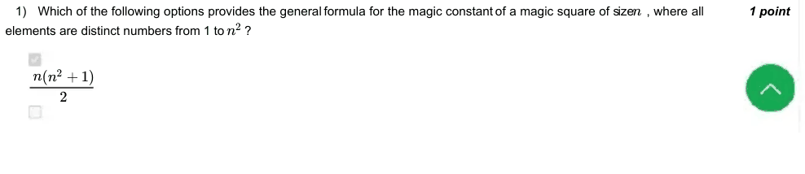

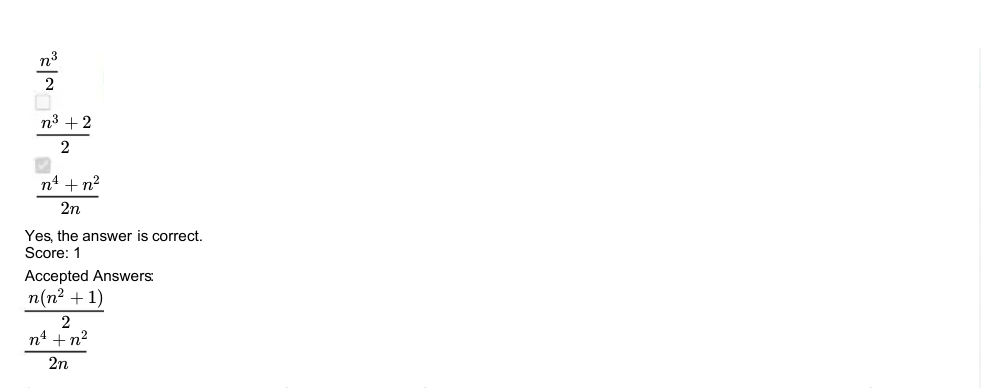

### Q2. What would the magic constant be for a magic square of size 6, given that all elements in the square are distinct numbers from 1
to 36?

- [ ] 72
- [x] 111
- [ ] 109
- [ ] 110
> Yes, the answer is correct. Score: 1

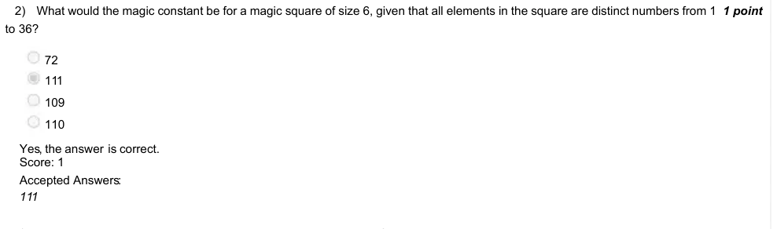

### Q3. Does transposing the magic square give us a new magic square ?

- [x] Yes
- [ ] No
> Yes, the answer is correct. Score: 1

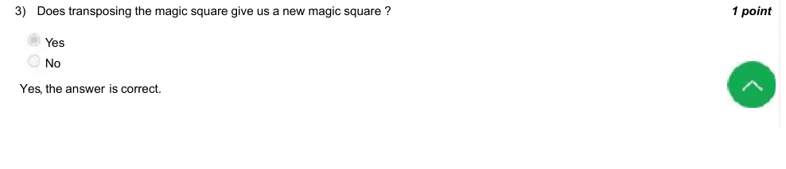

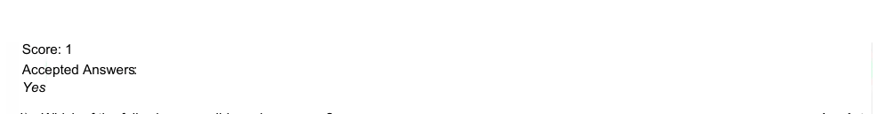

### Q4. Which of the following are valid magic squares ?
⎡

- [x] ⎤
- [x] 10
- [x] 3
- [x] 13
- [ ] 8 ⎢⎢⎢
- [x] ⎥⎥⎥
- [x] 5
- [x] 16
- [x] 2
- [x] 11
- [x] 4
- [x] 9
- [x] 7
- [ ] 14 ⎣
- [x] ⎦
- [x] 15
- [x] 6
- [x] 12
- [ ] 1 ⎡
- [x] ⎤
- [x] 20 −e
- [x] 6 −e
- [x] 26 −e
- [ ] 16 −e ⎢⎢⎢
- [x] ⎥⎥⎥
- [x] 10 −e
- [x] 32 −e
- [x] 4 −e
- [x] 22 −e
- [x] 8 −e
- [x] 18 −e
- [x] 14 −e
- [ ] 28 −e ⎣
- [x] ⎦
- [x] 30 −e
- [x] 12 −e
- [x] 24 −e
- [ ] 2 −e ⎡
- [x] ⎤
- [x] 1
- [x] 14
- [x] 4
- [ ] 15 ⎢⎢⎢
- [x] ⎥⎥⎥
- [x] 8
- [x] 11
- [x] 5
- [x] 10
- [x] 13
- [x] 2
- [x] 16
- [ ] 3 ⎣
- [x] ⎦
- [x] 12
- [x] 7
- [x] 9
- [ ] 6 ⎡
- [x] ⎤
- [x] 14π
- [x] 4π
- [x] 15π
- [ ] π ⎢⎢⎢
- [x] ⎥⎥⎥
- [x] 8π
- [x] 11π
- [x] 5π
- [x] 10π
- [x] 13π
- [x] 2π
- [x] 16π
- [ ] 3π ⎣
- [x] ⎦
- [x] 12π
- [x] 7π
- [x] 9π
- [x] 6π
> Yes, the answer is correct. Score: 1

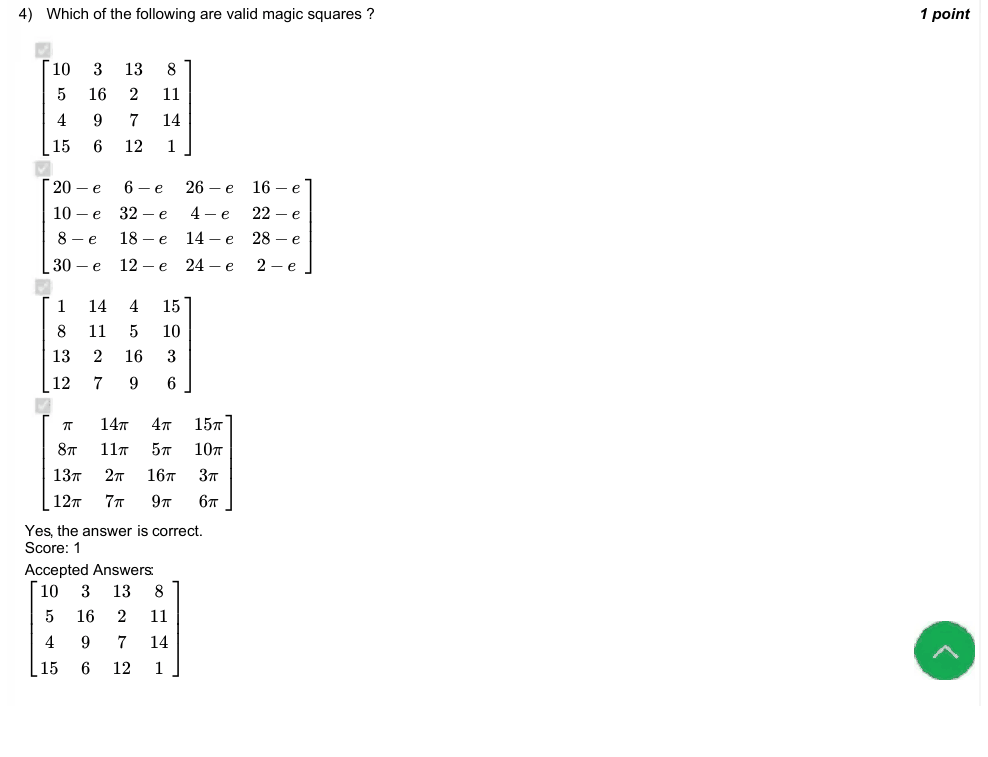

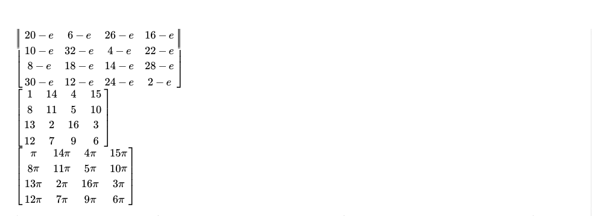

### Q5. What is the minimum number of people required to ensure that at least two of them share the same 30-minute birth interval? The
intervals start from 12:00 AM and each interval lasts for half an hour.
49

Accepted answer(s): (Type: Numeric) 49
> Yes, the answer is correct. Score: 1

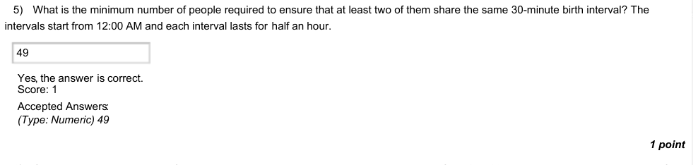

### Q6. Calculate the magic constant for 4x4 square, where all elements are distinct numbers from 1 to 16, is it same as the magic constant for
Ramanujan’s magic square ?
If yes, enter 0, else enter the absolute difference between the two.
Hint: Search the about Ramanujan’s magic square.
105

Accepted answer(s): (Type: Numeric) 105
> Yes, the answer is correct. Score: 1

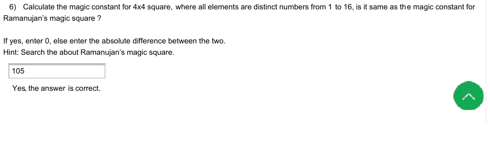

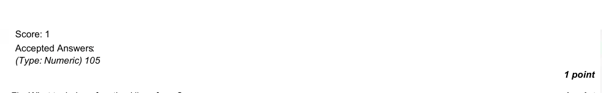

### Q7. What task does function1() perform ?

- [ ] Calculate factorial of number n.
- [ ] Calculate factors of number n.
- [ ] Calculate prime factors of number n.
- [x] Calculate factors of number n excluding n.
> Yes, the answer is correct. Score: 1

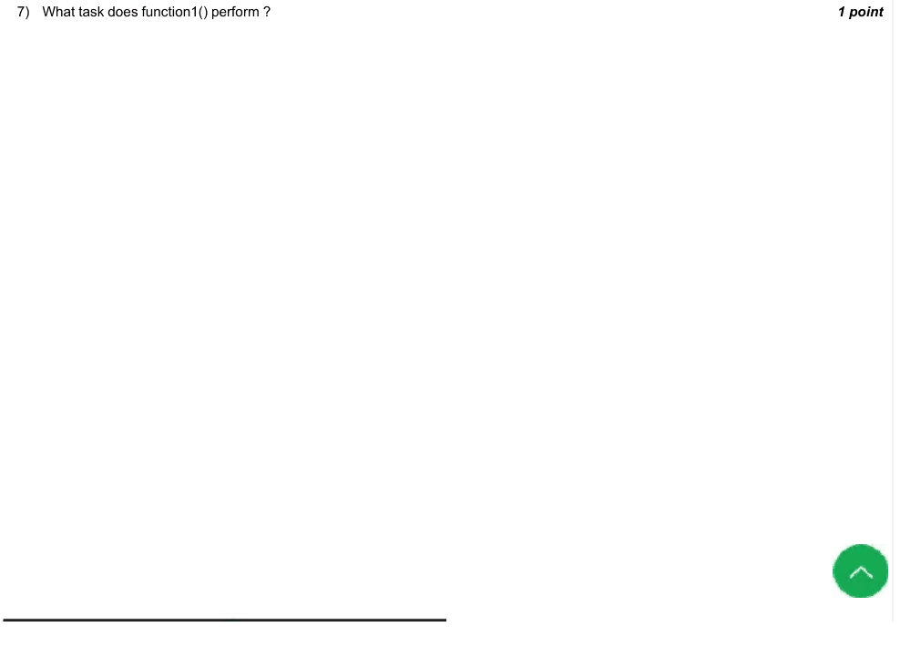

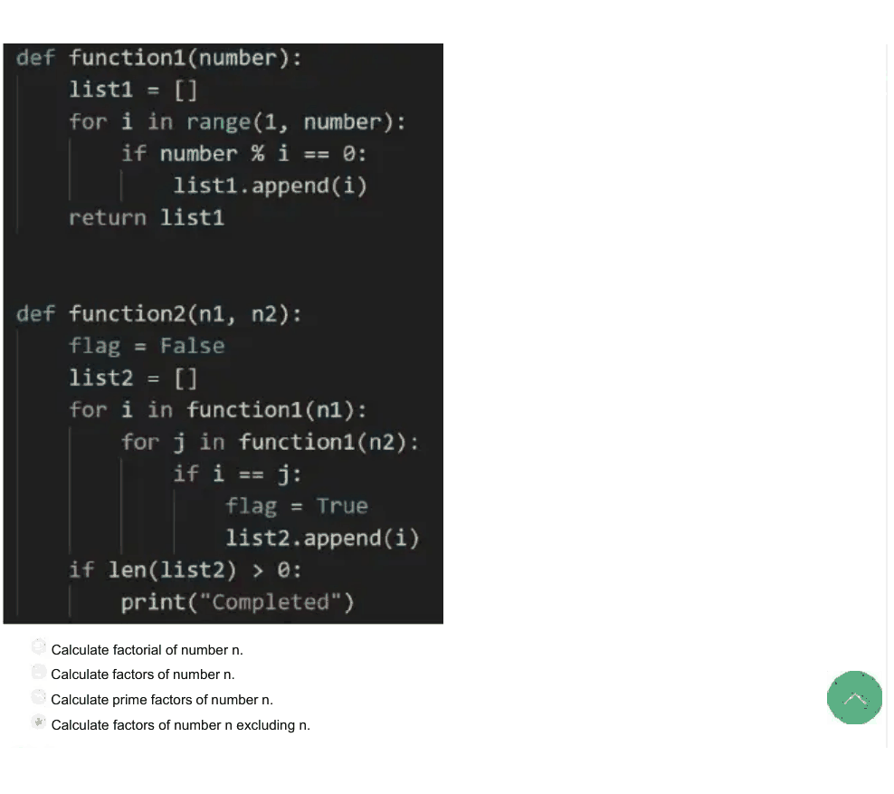

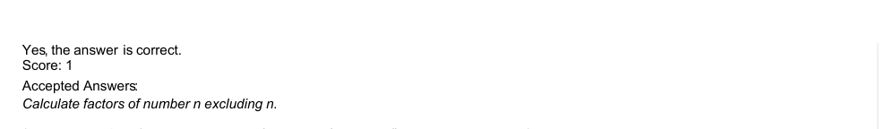

### Q8. For what n1,n2 flag will the variable flag inside function2() be not equal to true ?

- [ ] 2,3
- [x] 0,0
- [x] 1,1
- [x] 1,0
> Yes, the answer is correct. Score: 1

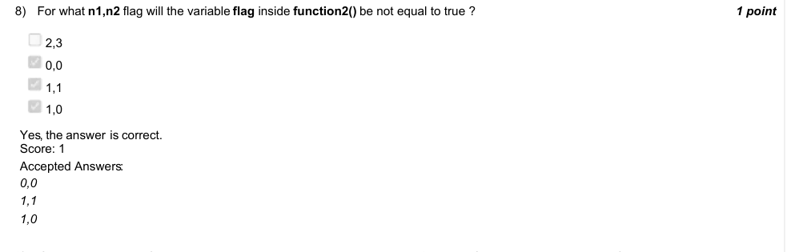

### Q9. If all possible pairs of prime numbers between 0 and 20, are given to n1 and n2, for how many pairs would function2 print
”Completed” ?

- [ ] It will not print ”Completed” for any pair.
- [ ] It will print ”Completed” only for pairs (2,3)(3,5),(2,5), and for the remaining it would not print ”Completed”.
- [ ] It will print ”Completed” only for pair (2,3), and for the remaining other pairs of primes it would not print ”Completed”.
- [x] It will print ”Completed” for all pairs of primes between 0 and 20.
> Yes, the answer is correct. Score: 1

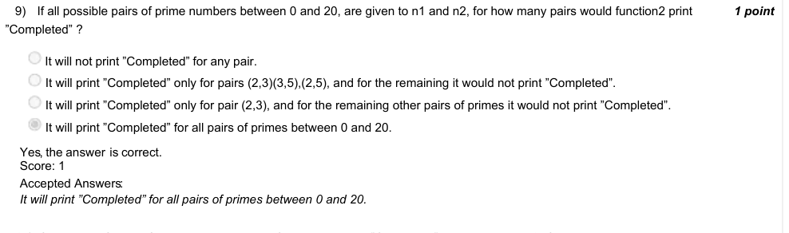

### Q10. If numbers of pairs of primes which result in function2 to print ”Completed” are greater than 0, Can we edit the code in
function2() so that ”Completed” is never printed for any pair of primes ?

- [ ] Yes, we can change the logic for setting flag variable to True.
- [x] Yes, we can change/increase the threshold for length oflist2 in the last if block.
- [ ] No, it is logically not possible.
- [ ] Yes, we can change the initial value of flag to True, instead of False.
> Yes, the answer is correct. Score: 1

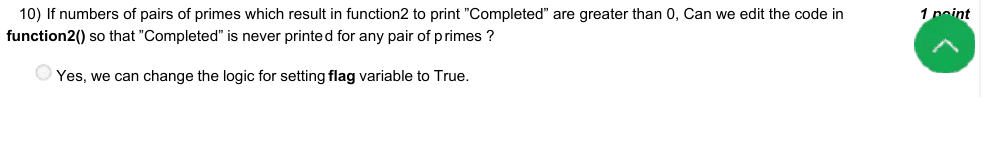

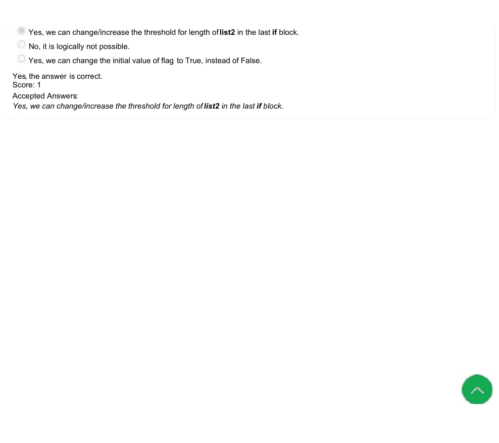
