# JOC Jul-2024 · Week 5: portal print

- Source: `JOY-OF-COMPUTING-USING-PYTHON (portal print, Wk0-12).pdf` pages 42–48 (portal review printout). Parsed text below; the cropped image under each question is the exact page content (code, figures and ticks as printed) and is authoritative.
- `[x]` = option equal to the portal's **Accepted Answer** (official). Lines may carry stray spaces from the PDF text layer.

> gireesh218@gmail.com  · Due on 2024-08-28, 23:59 IST.

### Q1. Which of the following is the correct way to add data with key as

- [ ] and value as
- [ ] to a
- [ ] courseData dictionary named
- [ ] ? courseData["CS101"].append("Web Programming") courseData["CS101"]["Web Programming"] courseData["CS101"] = "Web Programming"; courseData["CS101"] = "Web Programming"
> Accepted answer (not matched to a printed option): courseData["CS101"] = "Web Programming"
> Yes, the answer is correct. Score: 1

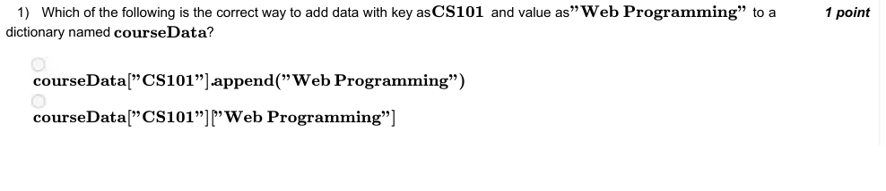

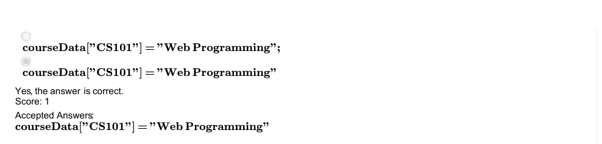

### Q2. What is the probability of Monty opening the door with goat, given the hypothesis that you initially chose the door which has car ?

- [ ] 0.5
- [ ] 0.66
- [ ] 0.33
- [x] 1
> Yes, the answer is correct. Score: 1

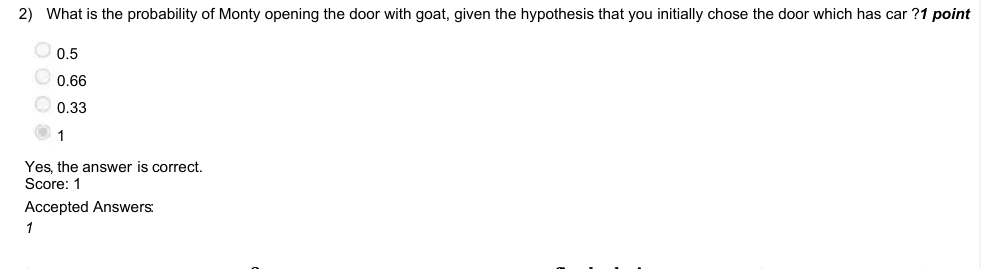

### Q3. What should be replaced with
in line 10, so that there is high chance that
is equal to 2 ?

- [x] True
- [x] (2**90) % 2 == 0
- [x] 3*((3**89) + 3 ) % 3 == 0
- [x] (2**90 ) % len(doors) == 1
> Yes, the answer is correct. Score: 1

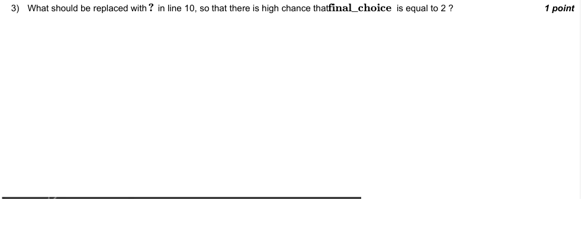

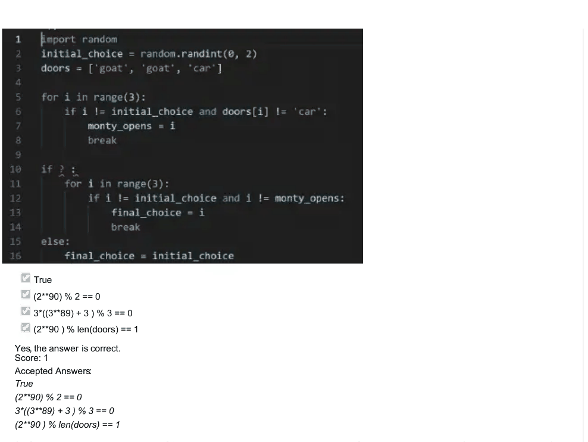

### Q4. Given that you have a sorted list of 1024 elemets, what is the maximum number of comparisons required to find the target
element using binary search ? Also what is the number of comparisons to search such an element using linear search ?

- [ ] Binary: 10, Linear: 512
- [ ] Binary: 11, Linear: 1024
- [x] Binary: 10, Linear: 1024
- [ ] Binary: 11, Linear: 512
> No, the answer is incorrect. Score: 0

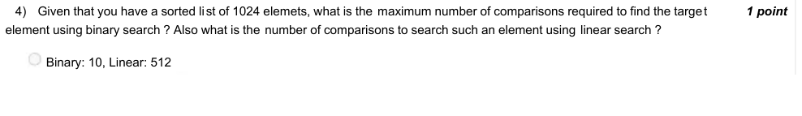

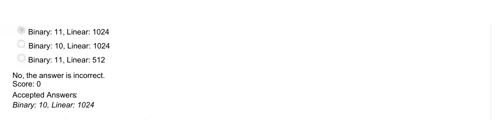

### Q5. What type of data is contained in a file with a .wav or .wave extension?

- [ ] Log data
- [x] Audio data
- [ ] Video data
- [ ] Image data
> Yes, the answer is correct. Score: 1

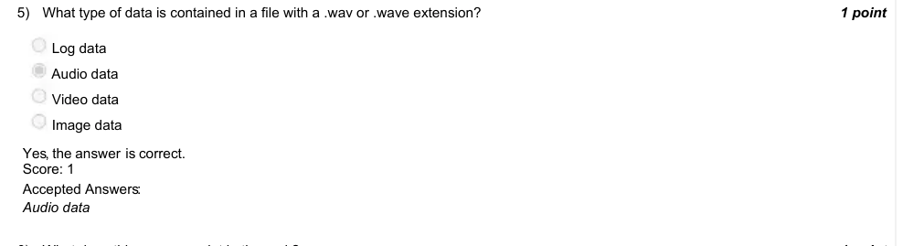

### Q6. What does this program print in the end ?

- [ ] Fraction of throws where both players showed different symbol(rock/paper/scissors)
- [ ] Fraction of throws where both players showed rock.
- [x] Fraction of throws where both players showed same symbol(rock/paper/scissors)
- [ ] Fraction of throws where both players showed paper.
> Yes, the answer is correct. Score: 1

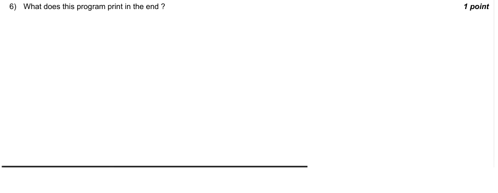

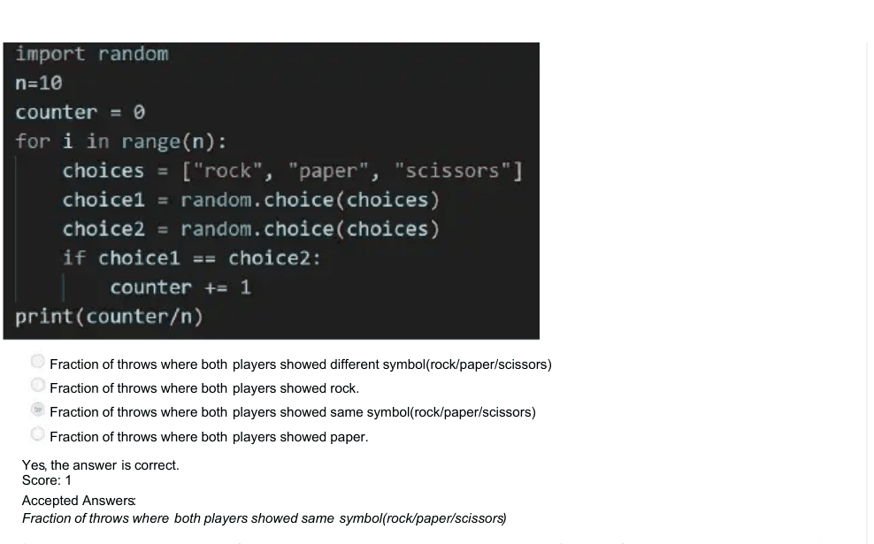

### Q7. In binary search, what happens if the target value is greater than the middle element of the array?

- [ ] The search continues in the left half of the array.
- [x] The search continues in the right half of the array.
- [ ] The search ends.
- [ ] The array is sorted again.
> Yes, the answer is correct. Score: 1

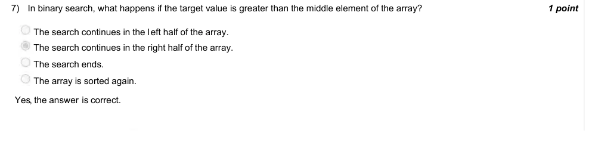

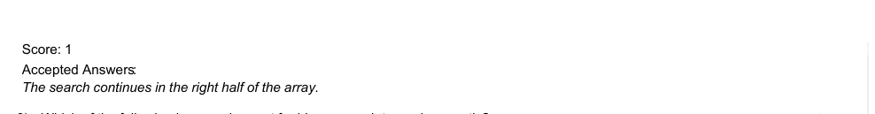

### Q8. Which of the following is a requirement for binary search to work correctly?

- [x] The list must be sorted.
- [ ] The list must contain only positive numbers.
- [ ] The list must be of an even length.
- [ ] The list must contain unique elements.
> No, the answer is incorrect. Score: 0

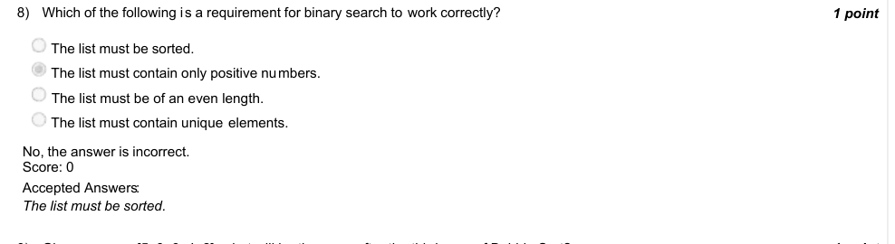

### Q9. Given an array [5, 3, 8, 4, 2], what will be the array after the third pass of Bubble Sort?

- [ ] [3, 2, 4, 8, 5]
- [x] [3, 2, 4, 5, 8]
- [ ] [2, 3, 4, 5, 8]
- [ ] [3, 5, 2, 4, 8]
> Yes, the answer is correct. Score: 1

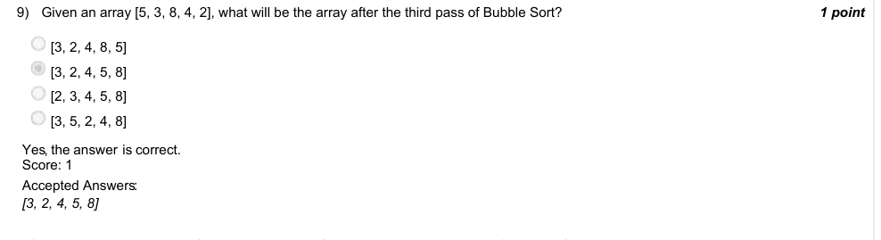

### Q10. How many swaps are performed in iteration 3 for bubble sorting list [4,3,2,1]? Enter 0 if the list is sorted in less than 3 iterations.
1

Accepted answer(s): (Type: Numeric) 1
> Yes, the answer is correct. Score: 1

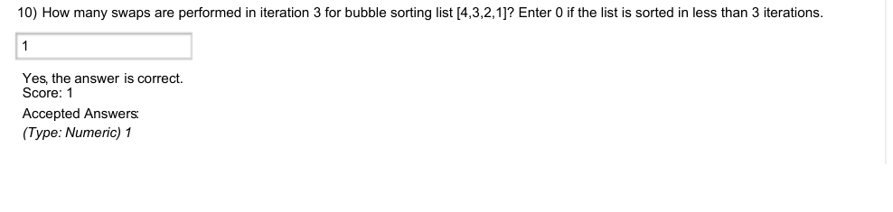

