# JOC Jul-2024 · Week 6: portal print

- Source: `JOY-OF-COMPUTING-USING-PYTHON (portal print, Wk0-12).pdf` pages 49–54 (portal review printout). Parsed text below; the cropped image under each question is the exact page content (code, figures and ticks as printed) and is authoritative.
- `[x]` = option equal to the portal's **Accepted Answer** (official). Lines may carry stray spaces from the PDF text layer.

> gireesh218@gmail.com  · Due on 2024-09-04, 23:59 IST.

### Q1. If n is a positive integer, what is the output of the function given input n,

- [ ] Sum of numbers from 1 to n
- [ ] Sum of numbers from 1 to n-1
- [ ] n-1
- [x] n
> Yes, the answer is correct. Score: 1

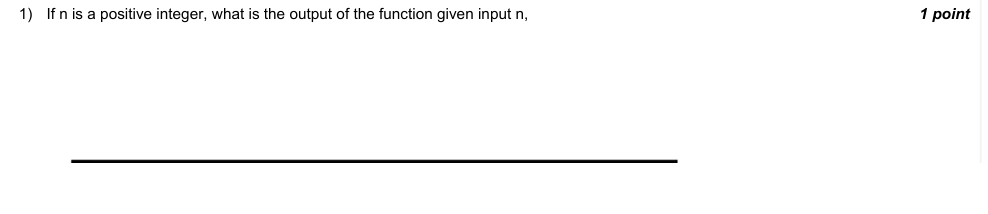

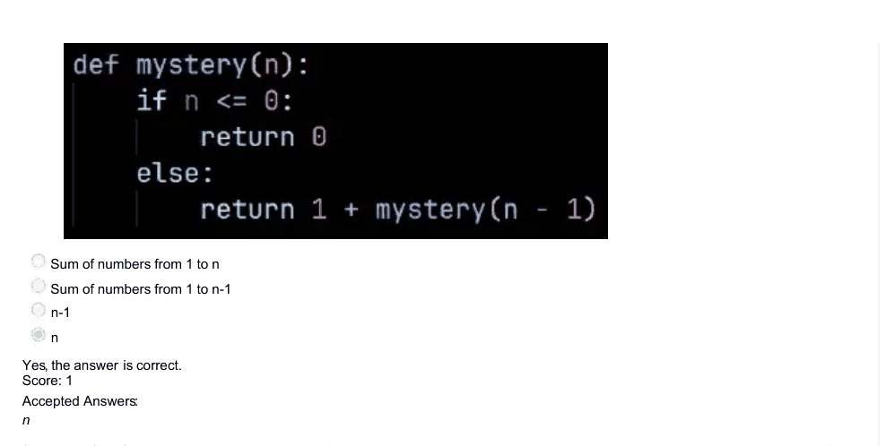

### Q2. Which of the following are true about recursion?

- [x] Recursion is a process in which a function calls itself as a subroutine.
- [ ] Recursion is a better alternative for performing repetitive tasks compared to iteration.
- [x] Recursion requires more resources compared to iteration.
> Yes, the answer is correct. Score: 1

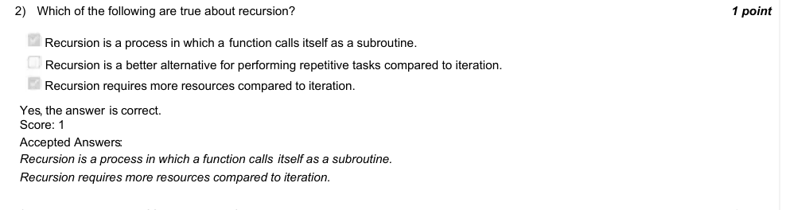

### Q3. What is the output of following code ?

- [ ] 10
- [x] 8
- [ ] 5
- [ ] Error
> Yes, the answer is correct. Score: 1

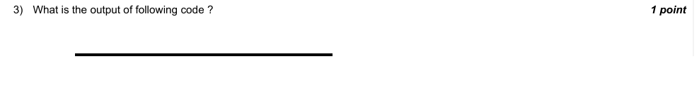

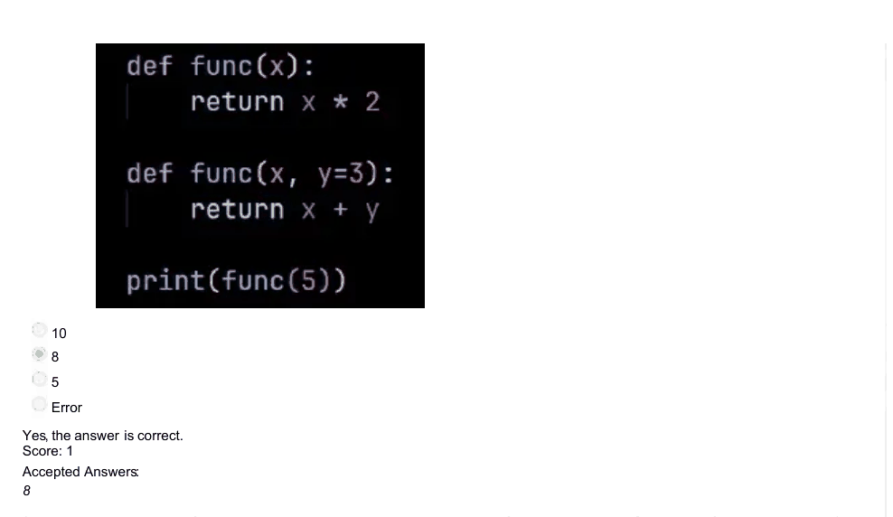

### Q4. The letter 'e' is the most frequently occurring letter in the English language. Suppose we apply a Substitution Cipher where 'e' is
mapped to 'a', and all other letters are uniquely mapped to different letters. If we encrypt a very long English storybook using this cipher, will the
frequency of 'a' be the highest in the encrypted text?
Hint: Search the internet for more info, if needed

- [x] Yes, it would be same as ’e’ in the original text
- [ ] Yes, it would be higher than ’e’ in the original text.
- [ ] No, it would be lower than ’e’ in the original text.
- [ ] No, we cannot predict
> Yes, the answer is correct. Score: 1

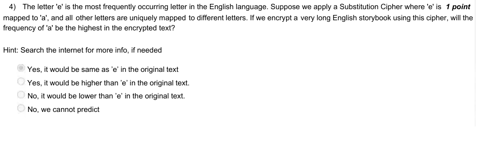

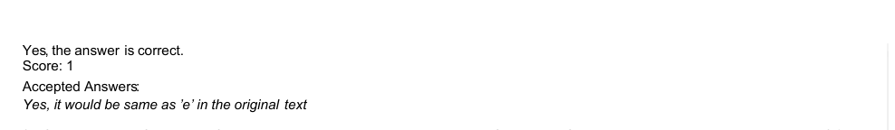

### Q5. Could we check frequency of letters in a long ciphertext and map them to frequency of letters in English to decrypt the message?
Hint: Search the internet for more info, if needed.

- [x] Yes, it is possible.
- [ ] No, it is not possible.
> Yes, the answer is correct. Score: 1

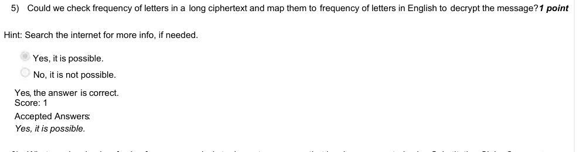

### Q6. What are drawbacks of using frequency analysis to decrypt a message that has been encrypted using Substitution Cipher?

- [x] It will not work if the cipher text is too small.
- [ ] It works flawlessly.
- [ ] It will not work if the encrypted text was previously encrypted using a different cipher, which could have removed patterns in common English.
- [ ] The frequency analysis method doesn’t work at all for Substitution Cipher
> Yes, the answer is correct. Score: 1

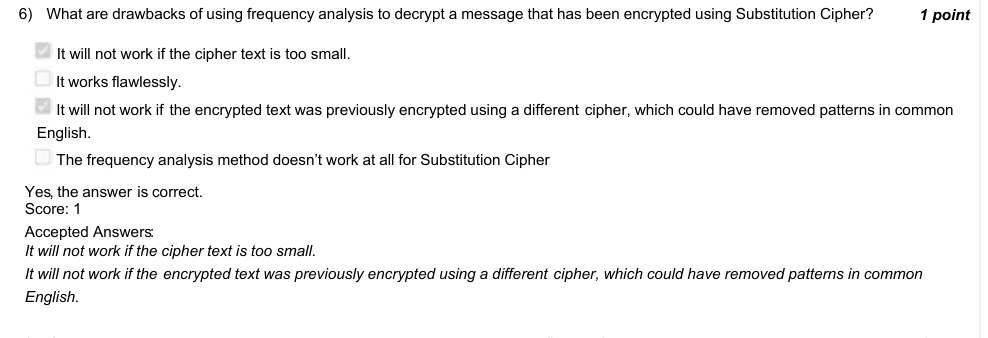

### Q7. If variable dict name is a non-empty dictionary, what does dict name.keys() return?

- [ ] Returns nothing, but prints all the keys in the dictionary.
- [x] Returns a list of all the keys in the dictionary.
- [ ] Returns a list of all the values in the dictionary.
- [ ] Returns a list of all the items in the dictionary
> Yes, the answer is correct. Score: 1

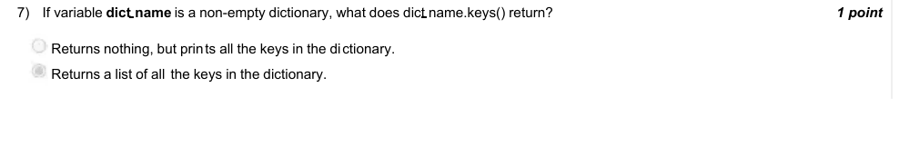

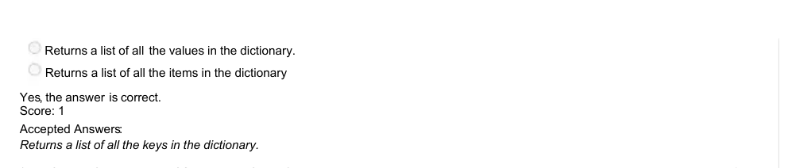

### Q8. Is Ceaser Cipher a type of Substitution Cipher?

- [x] Yes
- [ ] No
> Yes, the answer is correct. Score: 1

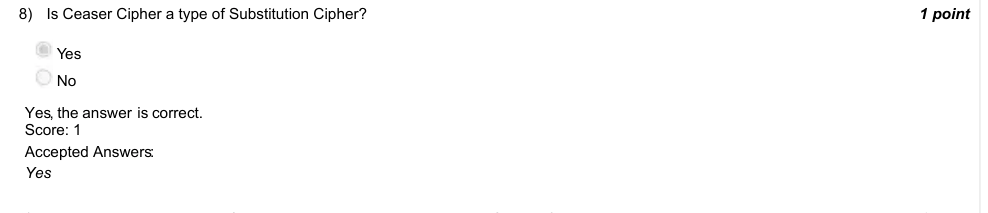

### Q9. What is the consequence of not having a base case in a recursive function?

- [x] The function will run infinitely.
- [ ] The function will run only once.
- [ ] The function will not run at all.
- [ ] The function will run only for a fixed number of times.
> Yes, the answer is correct. Score: 1

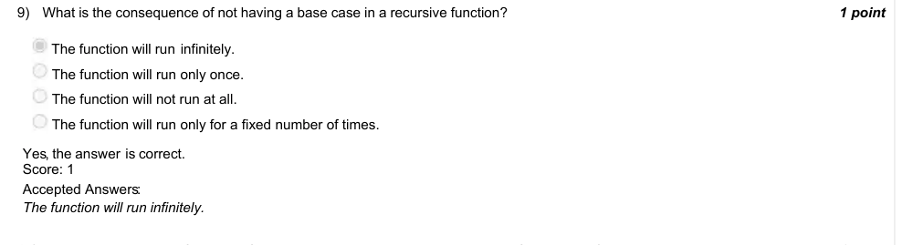

### Q10. What are the number of possible final lines when someone wins, in a game of TicTac-Toe?

- [ ] 3
- [x] 8
- [ ] 9
- [ ] 4
> Yes, the answer is correct. Score: 1

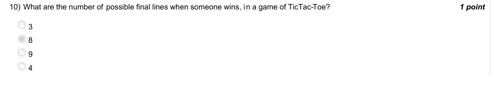

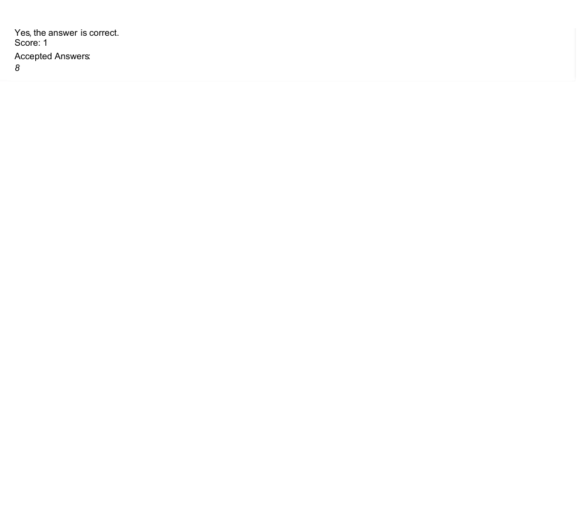
