# JOC Jul-2024 · Week 7: portal print

- Source: `JOY-OF-COMPUTING-USING-PYTHON (portal print, Wk0-12).pdf` pages 55–59 (portal review printout). Parsed text below; the cropped image under each question is the exact page content (code, figures and ticks as printed) and is authoritative.
- `[x]` = option equal to the portal's **Accepted Answer** (official). Lines may carry stray spaces from the PDF text layer.

> gireesh218@gmail.com  · Due on 2024-09-11, 23:59 IST.

### Q1. Which of the following methods is used to read the content of a CSV file in Python using the csv module?

- [x] csv.reader()
- [ ] csv.write()
- [ ] csv.load()
- [ ] csv.readfile()
> Yes, the answer is correct. Score: 1

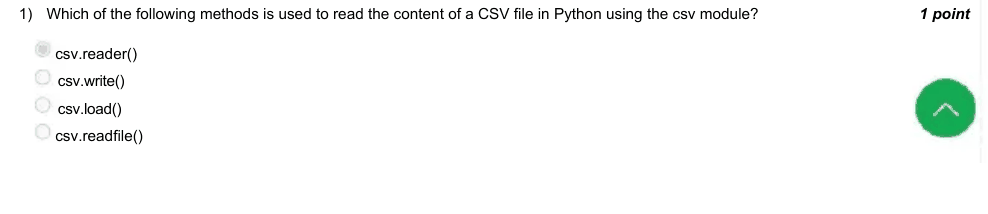

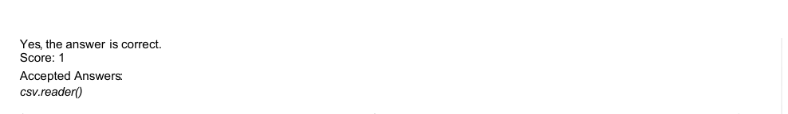

### Q2. Which command is used to install a Python package using pip?

- [x] pip install package-name
- [ ] install pip package-name
- [ ] python install package-name
- [ ] pip package-name install
> Yes, the answer is correct. Score: 1

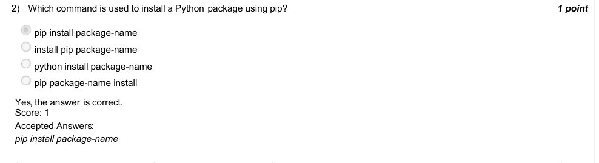

### Q3. What is the primary purpose of the gmplot library in Python?

- [ ] To create 3D plots
- [x] To plot data on Google Maps
- [ ] To generate matplotlib graphs
- [ ] To create dashboards
> Yes, the answer is correct. Score: 1

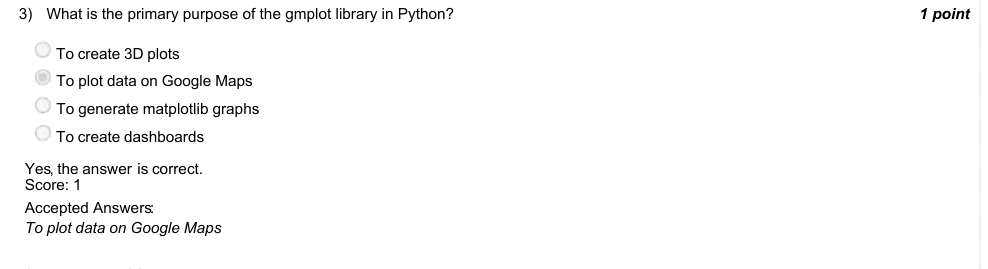

### Q4. In a game of Snakes and Ladders, a player is currently on square 96. There is a snake on square 99 that sends the player back to
square 78. If the player wishes to reach square 100 in one dice throw, what number must they roll on the dice?
4

Accepted answer(s): (Type: Numeric) 4
> Yes, the answer is correct. Score: 1

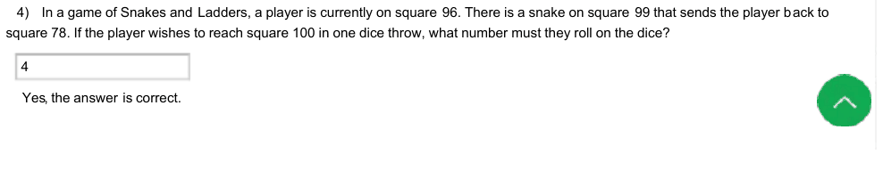

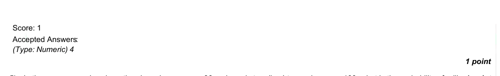

### Q5. In the same scenario, where the player is on square 96 and needs to roll a 4 to reach square 100, what is the probability of rolling
this number on a fair six-sided die?

- [ ] 1/2
- [ ] 1/3
- [ ] 1/4
- [x] 1/6
> Yes, the answer is correct. Score: 1

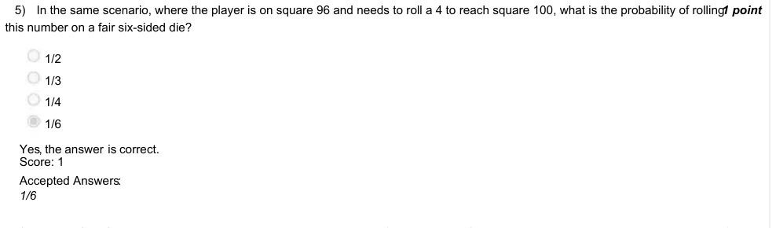

### Q6. Which of the following commands will draw a square using Python’s turtle module?
Turtle is imported in the following way-
import turtle as t
turtle = t.Turtle()

- [ ] for i in range(4): turtle.forward(100) turtle.left(90) for i in range(4): turtle.forward(100) turtle.right(90) for i in range(4): turtle.backward(100) turtle.left(90) for i in range(4): turtle.backward(100) turtle.right(90)
> Accepted answer (not matched to a printed option): for i in range(4):; turtle.forward(100); turtle.left(90); for i in range(4):; turtle.forward(100); turtle.right(90); for i in range(4):; turtle.backward(100); turtle.left(90); for i in range(4):; turtle.backward(100); turtle.right(90)
> Yes, the answer is correct. Score: 1

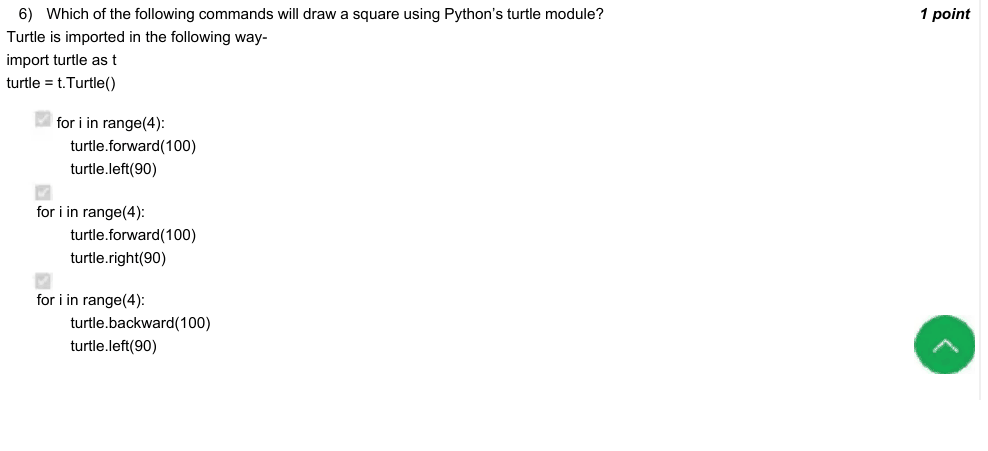

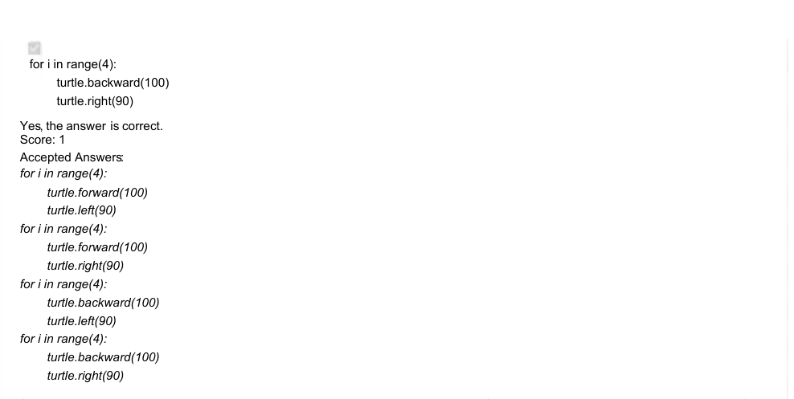

### Q7. Does the turtle module in Python allow you to draw complex shapes on the screen?

- [x] Yes
- [ ] No
> Yes, the answer is correct. Score: 1

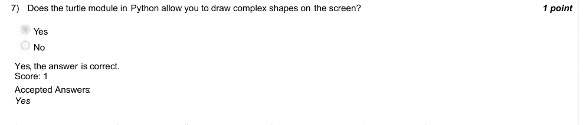

### Q8. What is the purpose of the turtle.penup() and turtle.pendown() commands in Python’s turtle module?

- [x] To stop the turtle from drawing and then resume drawing at a new position
- [ ] To change the color of the turtle’s pen
- [ ] To speed up or slow down the drawing speed of the turtle
> Yes, the answer is correct. Score: 1

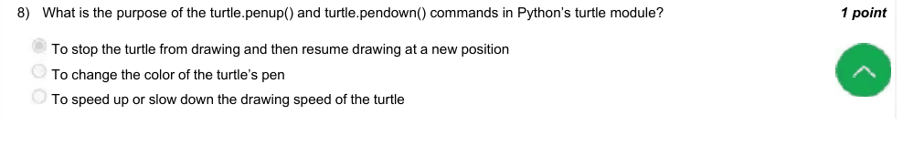

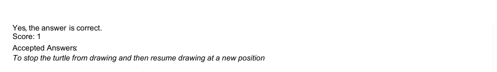

### Q9. What is the default drawing state of the turtle when a new turtle object is created in Python’s turtle module?

- [ ] The turtle’s pen is up, so it does not draw while moving.
- [x] The turtle’s pen is down, so it draws while moving.
- [ ] The turtle is hidden, so it does not appear on the screen.
- [ ] The turtle starts with a circular shape.
> Yes, the answer is correct. Score: 1

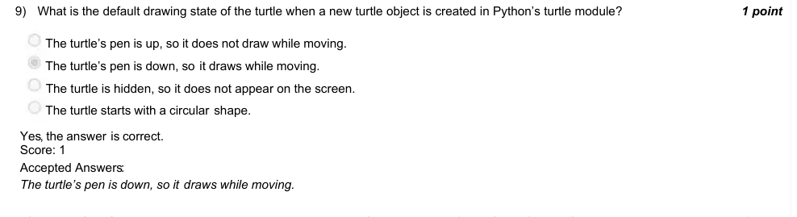

### Q10. Which of the following commands is used to open an image file using Python’s PIL (Pillow) library?

- [ ] img = PIL.Image.open(’image.jpg’)
- [x] img = Image.open(’image.jpg’)
- [ ] img = open_image(’image.jpg’)
- [ ] img = PIL.open_image(’image.jpg’)
> Yes, the answer is correct. Score: 1

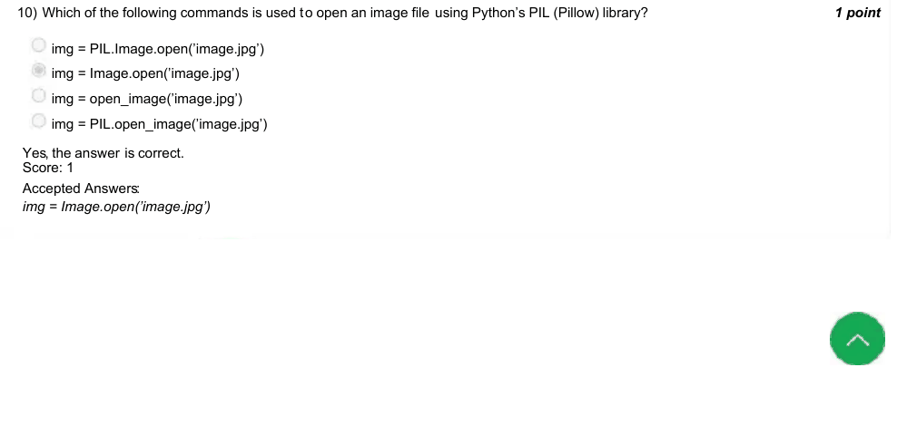
