# JOC Jul-2024 · Week 8: portal print

- Source: `JOY-OF-COMPUTING-USING-PYTHON (portal print, Wk0-12).pdf` pages 60–64 (portal review printout). Parsed text below; the cropped image under each question is the exact page content (code, figures and ticks as printed) and is authoritative.
- `[x]` = option equal to the portal's **Accepted Answer** (official). Lines may carry stray spaces from the PDF text layer.

> gireesh218@gmail.com  · Due on 2024-09-18, 23:59 IST.

### Q1. Which of the following is a valid way to create a tuple in Python?

- [ ] t = [1, 2, 3]
- [x] t = (1, 2, 3)
- [ ] t = {1, 2, 3}
- [x] t = 1, 2, 3
> Yes, the answer is correct. Score: 1

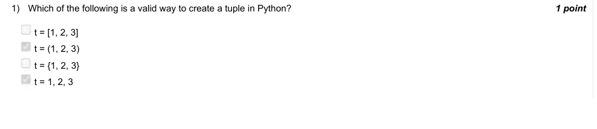

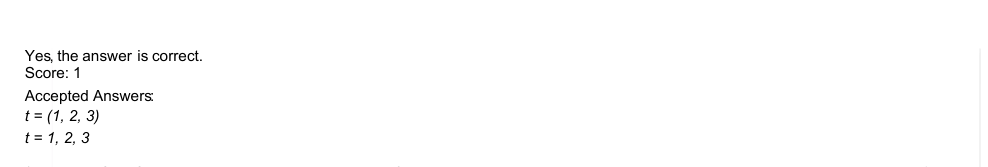

### Q2. Which of the following operations is valid on a tuple?

- [ ] t[1] = 4
- [ ] t.append(4)
- [x] t = t + (4,)
- [ ] del t[1]
> Yes, the answer is correct. Score: 1

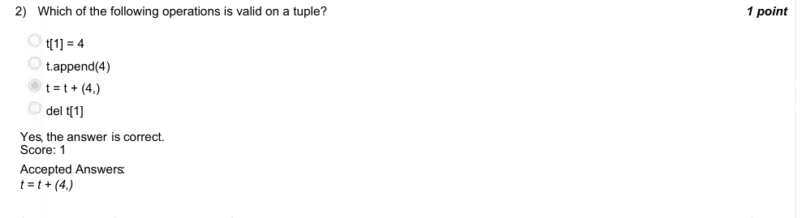

### Q3. What will the following code output?
t = [1, 2, 3]
print(type((t,t)))
< class ’list’ >
< class ’set’ >
< class ’tuple’ >

- [ ] Error
> Accepted answer (not matched to a printed option): < class ’tuple’ >
> Yes, the answer is correct. Score: 1

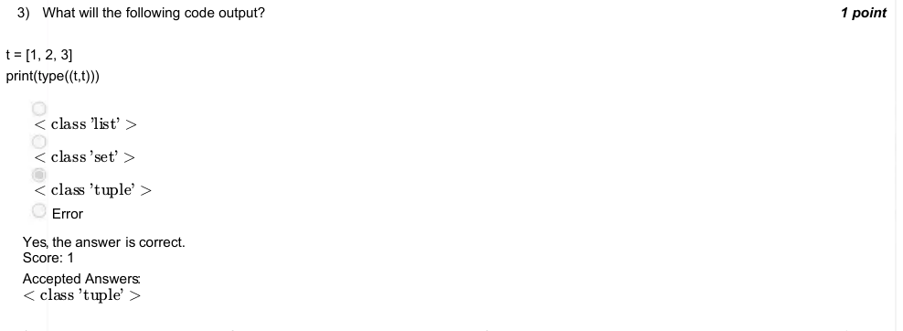

### Q4. What is the primary purpose of the matplotlib.pyplot module in Python?

- [ ] To perform matrix operations.
- [ ] To handle file I/O operations.
- [x] To generate and customize visualizations like plots and graphs.
- [ ] To manipulate and process images.
> Yes, the answer is correct. Score: 1

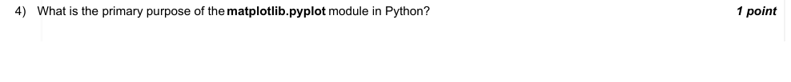

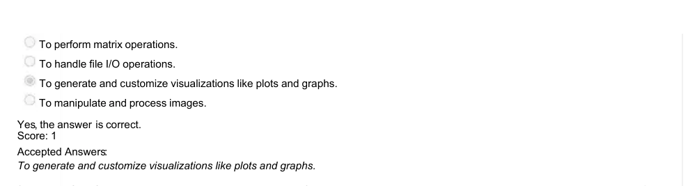

### Q5. Which of the following statements is true about anagrams?

- [ ] Two strings of different lengths can be anagrams.
- [ ] Two strings are anagrams if they contain the same characters in the same order.
- [x] Two strings are anagrams if they contain the same characters in different orders.
> Yes, the answer is correct. Score: 1

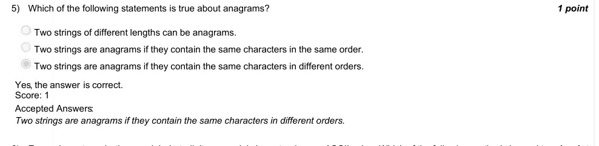

### Q6. Every character, whether an alphabet, digit, or special character, has an ASCII value. Which of the following methods is used to
find the ASCII value ?

- [ ] ASCII(’a’)
- [x] ord(’a’)
- [ ] int(’a’)
- [ ] ASC val(’a’)
> Yes, the answer is correct. Score: 1

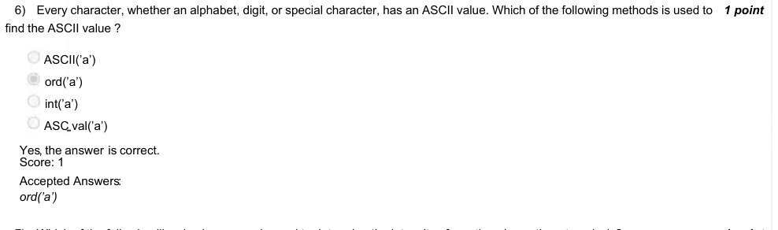

### Q7. Which of the following libraries is commonly used to determine the intensity of emotions in sentiment analysis?

- [x] VADER
- [ ] Numpy
- [ ] Pandas
- [ ] SciPy
> Yes, the answer is correct. Score: 1

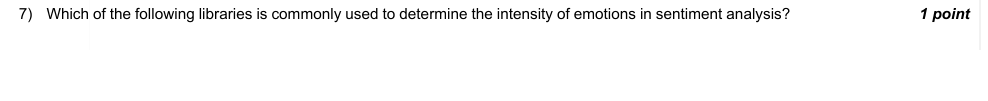

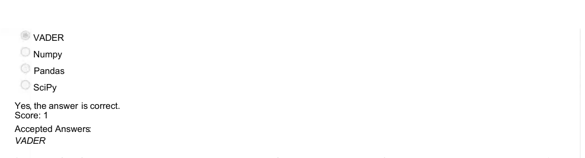

### Q8. Which of the following Python code snippets correctly checks if two strings are anagrams?

- [ ] def are_anagrams(str1, str2): return sorted(str1) == sorted(str2) def are_anagrams(str1, str2): return set(str1) == set(str2) def are_anagrams(str1, str2): return str1 == str2[::-1] def are_anagrams(str1, str2): return len(str1) == len(str2)
> Accepted answer (not matched to a printed option): def are_anagrams(str1, str2):; return sorted(str1) == sorted(str2)
> Yes, the answer is correct. Score: 1

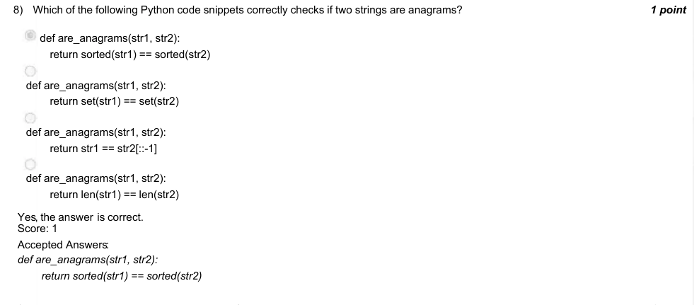

### Q9. Why is gambling generally a bad decision ?

- [x] Because you will lose more money than you win over time.
- [ ] Because the probability of winning is always 0.
- [ ] Because you will always win.
- [ ] Because the amount of money you can win is always greater than the amount you lost over time
> Yes, the answer is correct. Score: 1

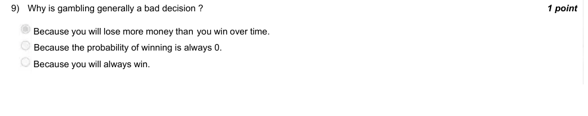

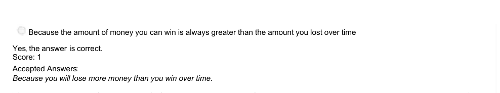

### Q10. True or False: A significant amount of information can be extracted from an image by applying the appropriate image
enhancement techniques

- [x] True
- [ ] False
> Yes, the answer is correct. Score: 1

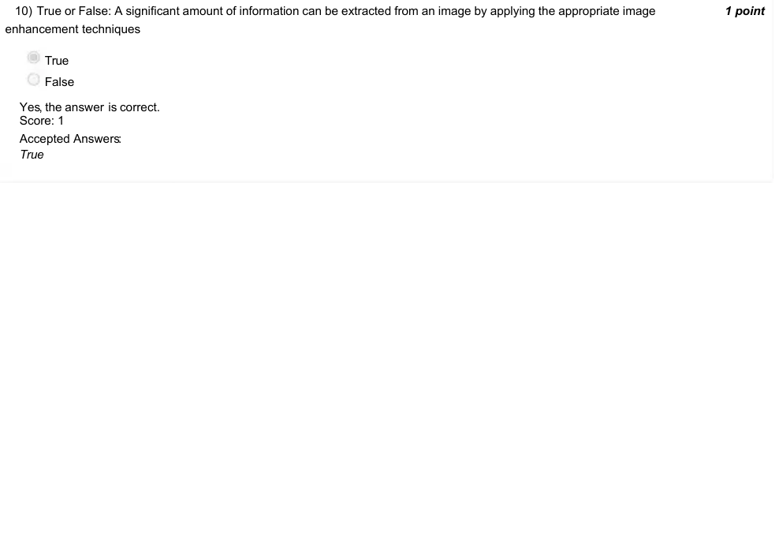
