# JOC Jul-2024 · Week 9: portal print

- Source: `JOY-OF-COMPUTING-USING-PYTHON (portal print, Wk0-12).pdf` pages 65–70 (portal review printout). Parsed text below; the cropped image under each question is the exact page content (code, figures and ticks as printed) and is authoritative.
- `[x]` = option equal to the portal's **Accepted Answer** (official). Lines may carry stray spaces from the PDF text layer.

> gireesh218@gmail.com  · Due on 2024-09-25, 23:59 IST.

### Q1. ‘nltk.download()‘ function downloads necessary packages for the Natural Language Toolkit (NLTK) library?

- [x] True
- [ ] False
> Yes, the answer is correct. Score: 1

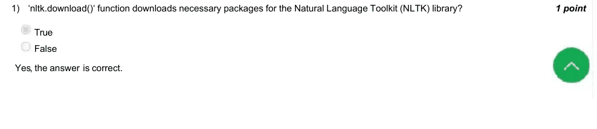

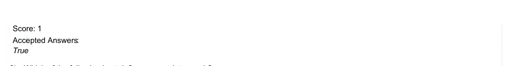

### Q2. Which of the following best defines a complete graph?

- [x] A graph where every pair of distinct vertices is connected by a unique edge
- [ ] A graph with no edges
- [ ] A graph with a single vertex
- [ ] A graph with at least one loop
> Yes, the answer is correct. Score: 1

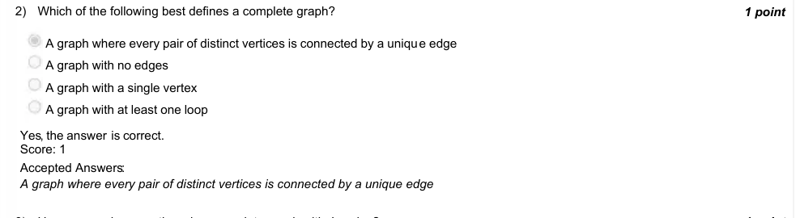

### Q3. How many edges are there in a complete graph with 4 nodes?

- [x] 6
- [ ] 8
- [ ] 12
- [ ] 16
> Yes, the answer is correct. Score: 1

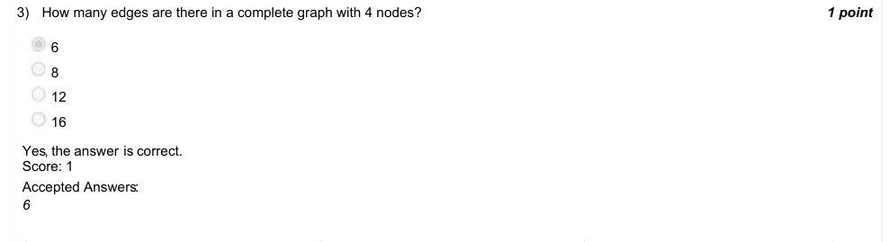

### Q4. Which Python library is most commonly used for working with graphs related to networks?

- [ ] Random
- [ ] Pandas
- [ ] NumPy
- [x] NetworkX
> Yes, the answer is correct. Score: 1

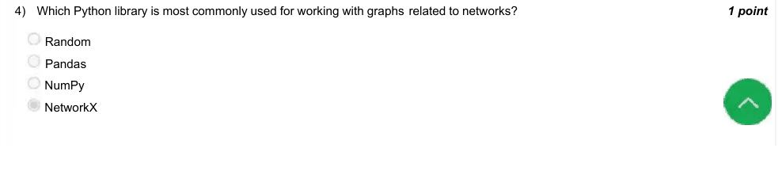

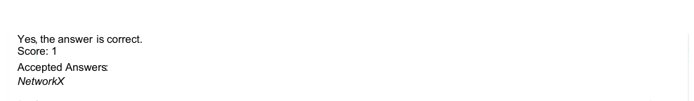

### Q5. Gephi is:

- [ ] A Python library for linear algebra
- [x] A software for visualizing and analyzing large networks
- [ ] A tool for data cleaning and preprocessing
- [ ] A Python library for building statistical models
> Yes, the answer is correct. Score: 1

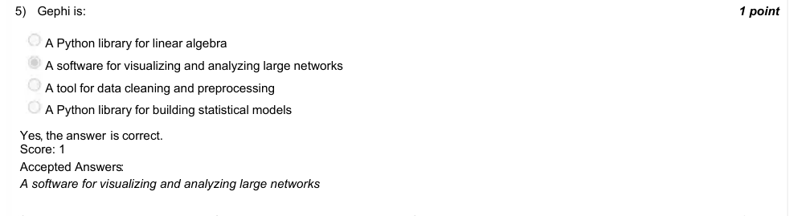

### Q6. How many attributes typically define a color in digital representations?

- [ ] 1
- [ ] 2
- [x] 3
- [ ] 9
> Yes, the answer is correct. Score: 1

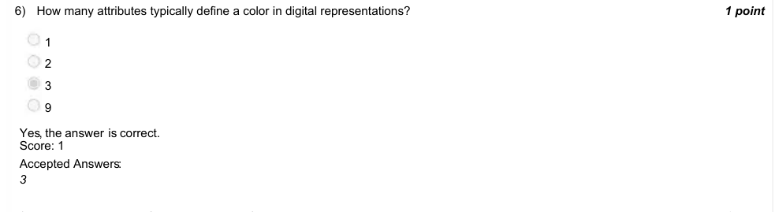

### Q7. What is the degree of a node in a graph?

- [x] The number of edges connected to the node
- [ ] The shortest path between two nodes
- [ ] The number of nodes in the graph
- [ ] The distance from the node to the center of the graph
> Yes, the answer is correct. Score: 1

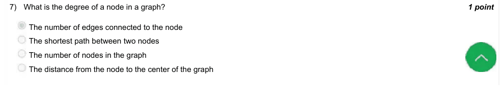

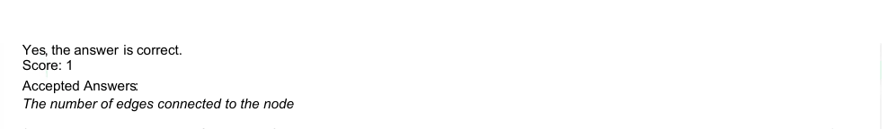

### Q8. What is the primary goal of stylometry?

- [x] To analyze the style and structure of literary works for authorship attribution
- [ ] To create stylized graphics for digital art
- [ ] To study phonology of languages
- [ ] To enhance the readability of texts by adjusting font styles
> Yes, the answer is correct. Score: 1

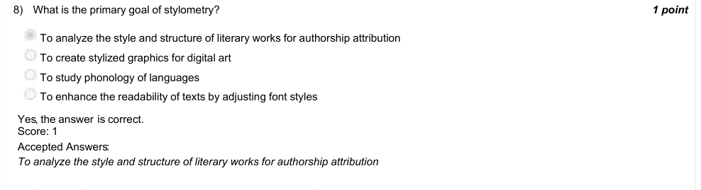

### Q9. Given the following Python code, what is printed in the end?
x = ["apple", "banana", "cherry", "date"]
k = 0
for item in x:
k += len(item)
print(k)

- [ ] 4
- [x] 21
- [ ] 24
- [ ] 26
> Yes, the answer is correct. Score: 1

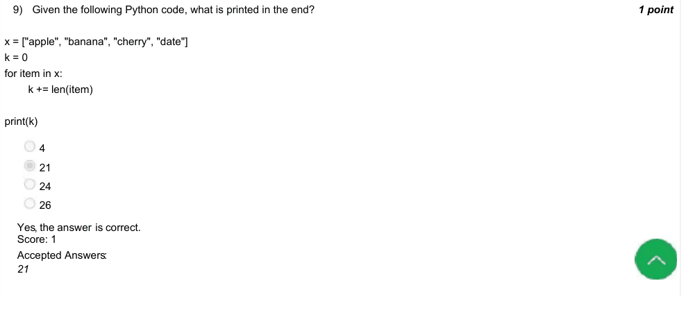

### Q10. How can you estimate the area of a sub-region within a larger region by randomly throwing points in the larger region?

- [ ] By counting the total number of points and calculating the sum of their distances from the center
- [x] By calculating the proportion of points that land in the sub-region compared to the total number of points in the larger region
- [ ] By calculating the distance between each point and the boundary of the region
- [ ] By averaging the coordinates of all the points that land in the larger region
> Yes, the answer is correct. Score: 1

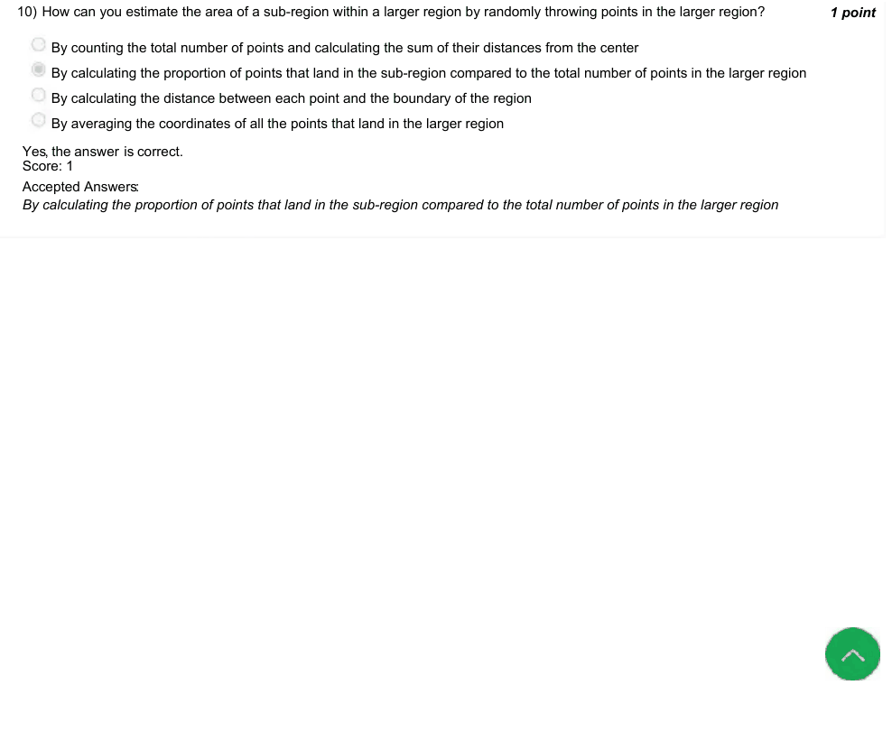

