# JOC Jul-2024 · Week 10: portal print

- Source: `JOY-OF-COMPUTING-USING-PYTHON (portal print, Wk0-12).pdf` pages 71–75 (portal review printout). Parsed text below; the cropped image under each question is the exact page content (code, figures and ticks as printed) and is authoritative.
- `[x]` = option equal to the portal's **Accepted Answer** (official). Lines may carry stray spaces from the PDF text layer.

> gireesh218@gmail.com  · Due on 2024-10-02, 23:59 IST.

### Q1. What will be the output of the following Python code?

- [x] "World"
- [ ] "World!"
- [ ] "Worl"
- [ ] "orld"
> Yes, the answer is correct. Score: 1

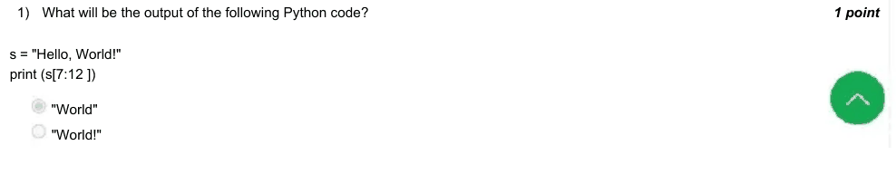

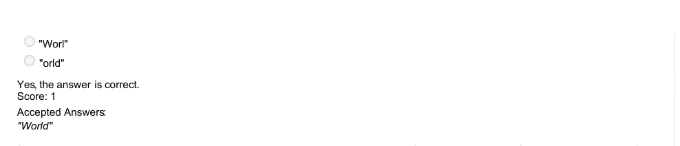

### Q2. Which string method would you use to remove all leading and trailing whitespace from a string in Python?

- [x] strip()
- [ ] split()
- [ ] replace()
- [ ] join()
> Yes, the answer is correct. Score: 1

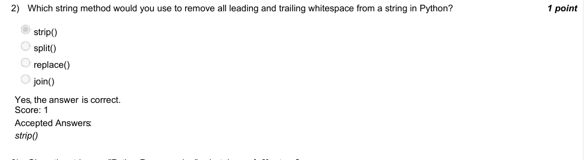

### Q3. Given the string s = "PythonProgramming", what does s [::2] return?

- [ ] "PythonProgramming"
- [ ] "Pto rgamn"
- [ ] "PyonPormig"
- [x] "PtoPormig"
> Yes, the answer is correct. Score: 1

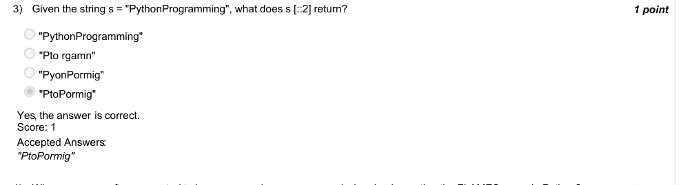

### Q4. Why are names often converted to lowercase and spaces removed when implementing the FLAMES game in Python?

- [ ] To increase game difficulty
- [x] To ensure consistent character comparison
- [ ] Because uppercase letters are not supported in Python strings
- [ ] To encrypt the names for privacy
> Yes, the answer is correct. Score: 1

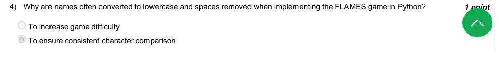

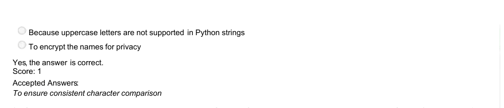

### Q5. Given the names "Alice" and "Bob", what is the FLAMES result of their relationship according to the FLAMES game?

- [ ] Friends
- [ ] Love
- [x] Affection
- [ ] Marriage
- [ ] Enemy
- [ ] Siblings
> Yes, the answer is correct. Score: 1

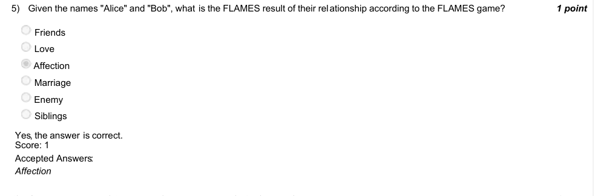

### Q6. Given a = np.array ([1, 2, 3, 4, 5]), what does print(a[1:4]) output?

- [ ] [1 2 3]
- [x] [2 3 4]
- [ ] [2 3 4 5]
- [ ] [1 2 3 4]
> Yes, the answer is correct. Score: 1

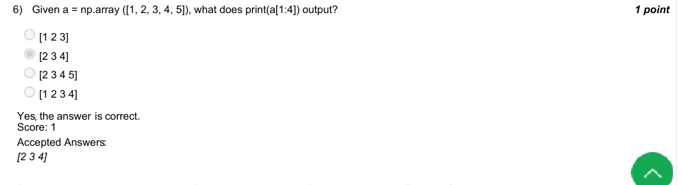

### Q7. In the NumPy array arr = np.array ( [ [1,2,3],[4,5,6],[7,8,9] ] ), what is the value of arr [1,2]?

- [ ] 5
- [x] 6
- [ ] 2
- [ ] 8
> Yes, the answer is correct. Score: 1

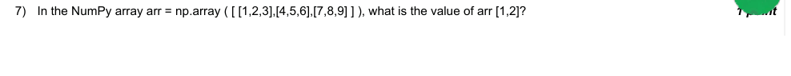

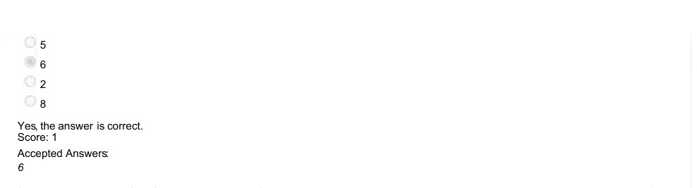

### Q8. What is the output of the following Python code?
s = "abcdef"
print (s[1:5:2])

- [x] "bd"
- [ ] "bcd"
- [ ] "ace"
- [ ] "be"
> Yes, the answer is correct. Score: 1

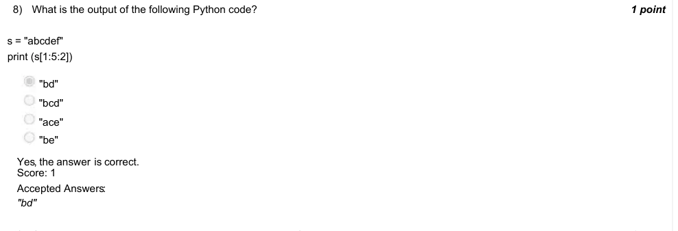

### Q9. Can numpy be used when working with images in Python?

- [x] Yes
- [ ] No
> Yes, the answer is correct. Score: 1

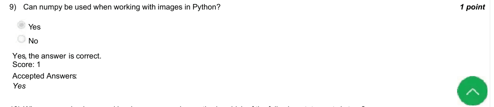

### Q10. When comparing lossy and lossless compression methods, which of the following statements is true?

- [ ] Lossy compression reduces file size without any loss of quality.
- [x] Lossless compression reduces file size without any loss of quality.
> Yes, the answer is correct. Score: 1

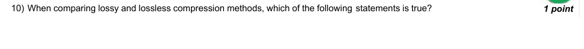

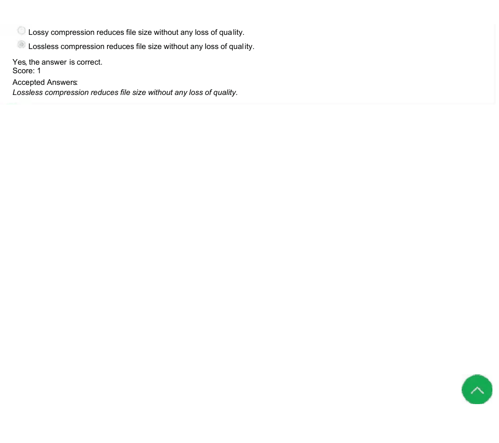
