# JOC Jul-2024 · Week 11: portal print

- Source: `JOY-OF-COMPUTING-USING-PYTHON (portal print, Wk0-12).pdf` pages 76–79 (portal review printout). Parsed text below; the cropped image under each question is the exact page content (code, figures and ticks as printed) and is authoritative.
- `[x]` = option equal to the portal's **Accepted Answer** (official). Lines may carry stray spaces from the PDF text layer.

> gireesh218@gmail.com  · Due on 2024-10-09, 23:59 IST.

### Q1. Which Python library is commonly used for automating web browsers for tasks like

- [ ] datetime
- [x] selenium
- [ ] chrome
- [ ] webdriver
> Yes, the answer is cor rect. Score: 1

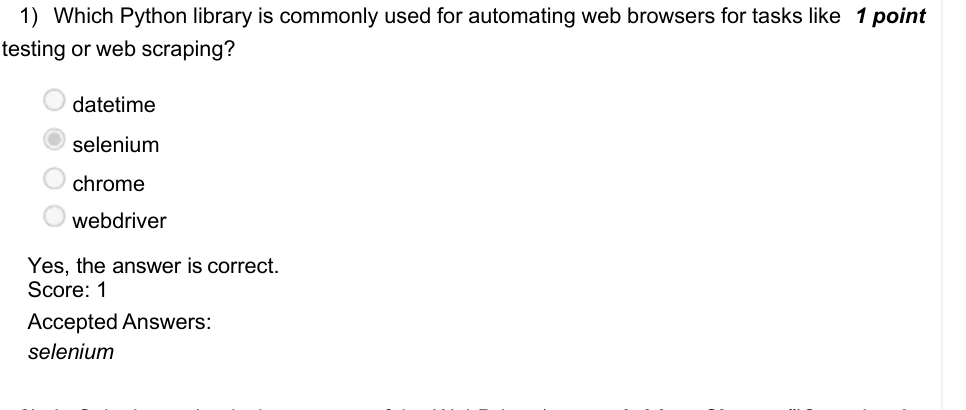

### Q2. In Selenium, what is the purpose of the WebDriver (e.g., webdriver.Chrome())?

- [ ] To interact with databases
- [ ] To send HTTP requests
- [x] To control a web browser programmatically
- [ ] To parse HTML and XML documents
> Yes, the answer is correct. Score: 1

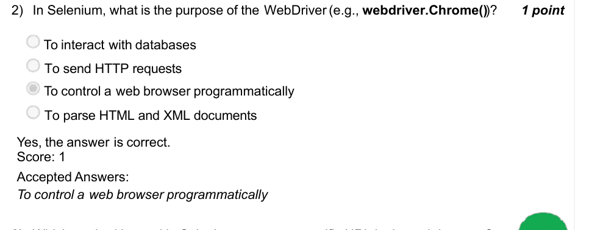

### Q3. Which method is used in Selenium to open a specific URL in the web browser?

- [ ] driver.open(url)
- [ ] driver.load(url)
- [ ] driver.navigate(url)
- [x] driver.get(url)
> Yes, the answer is correct. Score: 1

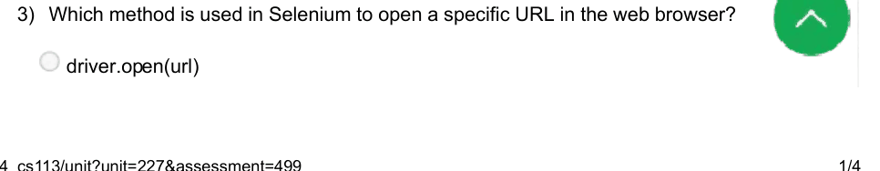

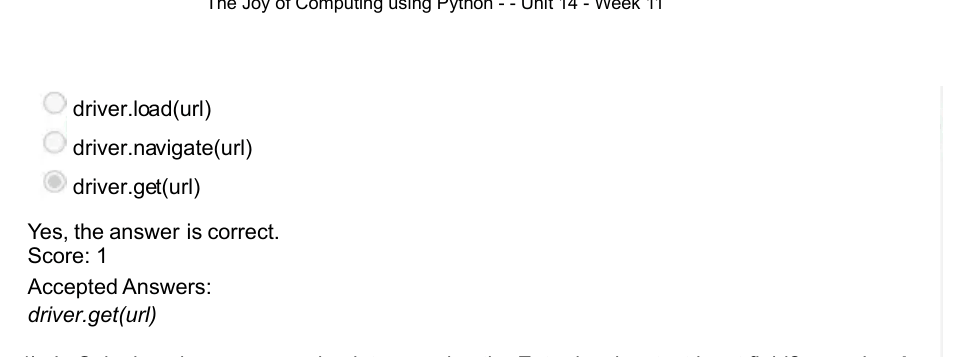

### Q4. In Selenium, how can you simulate pressing the Enter key in a text input field?

- [ ] input field.send keys(Keys.ENTER)
- [ ] input field.submit()
- [x] input field.send keys(Keys.RETURN)
- [ ] input field.press(’Enter’)
> No, the answer is incorrect. Score: 0

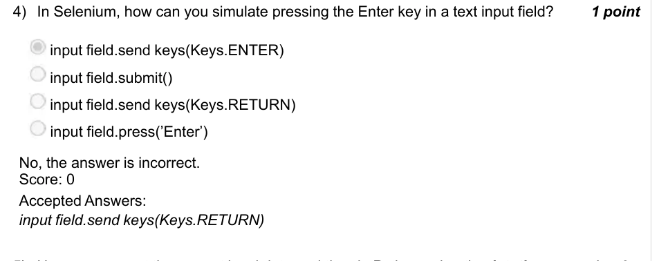

### Q5. How can you get the current local date and time in Python using the datetime

- [ ] datetime.date.today()
- [x] datetime.datetime.now()
- [ ] datetime.time.now()
> Yes, the answer is correct. Score: 1

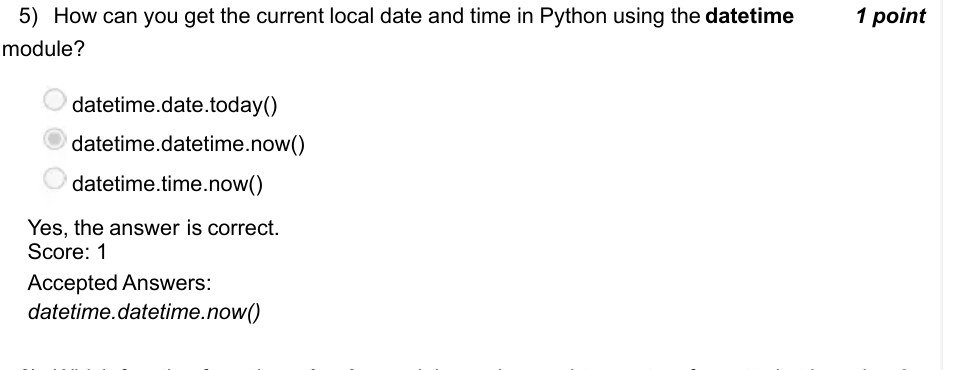

### Q6. Which function from the calendar module can be used to create a formatted string

- [ ] calendar.printmonth()
- [x] calendar.month()
- [ ] calendar.monthcalendar()
> Yes, the answer is correct. Score: 1

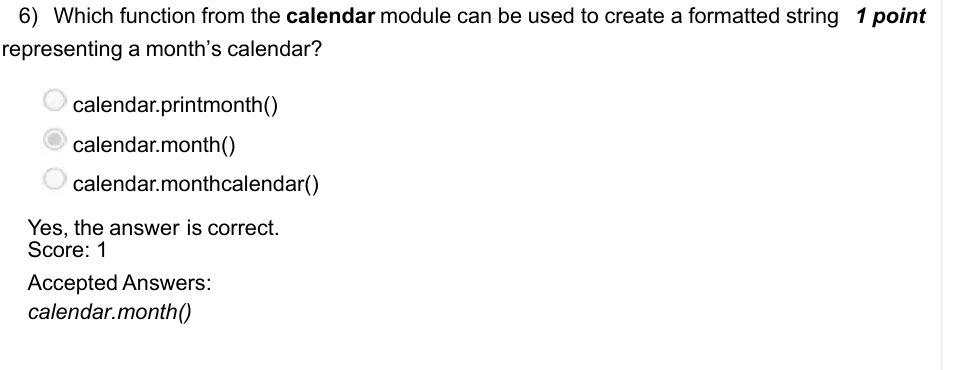

### Q7. Which function would you use to replace characters in a string in Python?

- [ ] string.modify()
- [x] string.replace(old, new)
- [ ] string.remove(old)
- [ ] string.update(new)
> Yes, the answer is correct. Score: 1

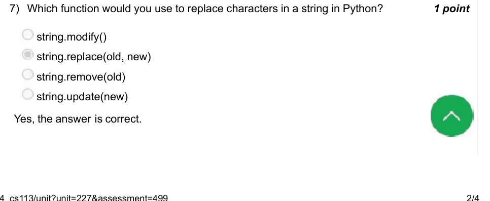

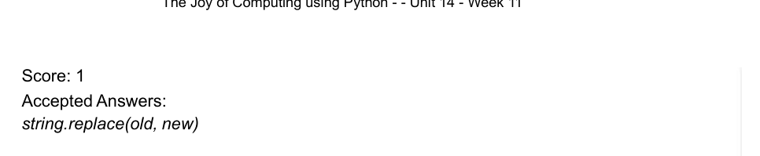

### Q8. Which of the following statements correctly imports the datetime module in Python?

- [ ] import datetime
- [ ] from datetime import datetime
- [ ] import datetime as dt
- [x] All of the given options
> Yes, the answer is correct. Score: 1

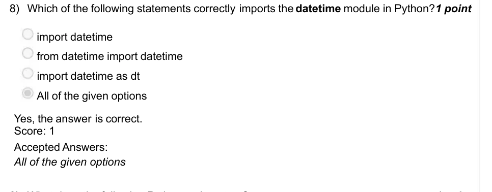

### Q9. What does the following Python code output?

- [x] True
- [ ] False
- [ ] 2024.0
- [ ] None
> Yes, the answer is correct. Score: 1

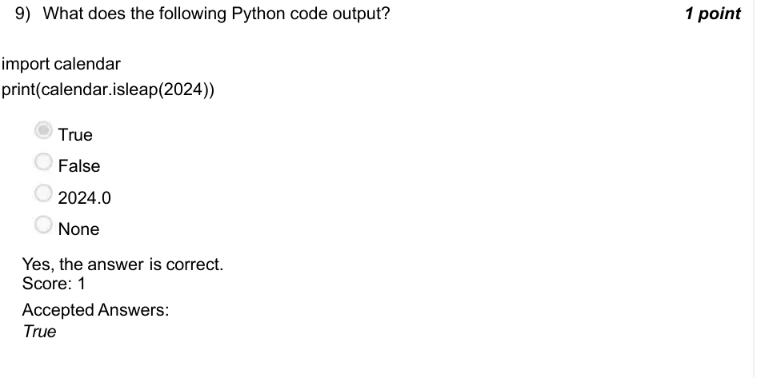

### Q10. Using the datetime module, how can you print the current date 7 times, each time

- [ ] for i in range(7): print(datetime.datetime.now() + datetime.timedelta(days=i))
- [ ] for i in range(7): print(datetime.date.today() + datetime.timedelta(days=i))
- [ ] for i in range(7): print(datetime.datetime.today().add(days=i))
- [ ] for i in range(7): print(datetime.date.now().add(days=i))
> Accepted answer (not matched to a printed option): for i in range(7):; print(datetime.date.today() + datetime.timedelta(days=i))
> Yes, the answer is correct. Score: 1

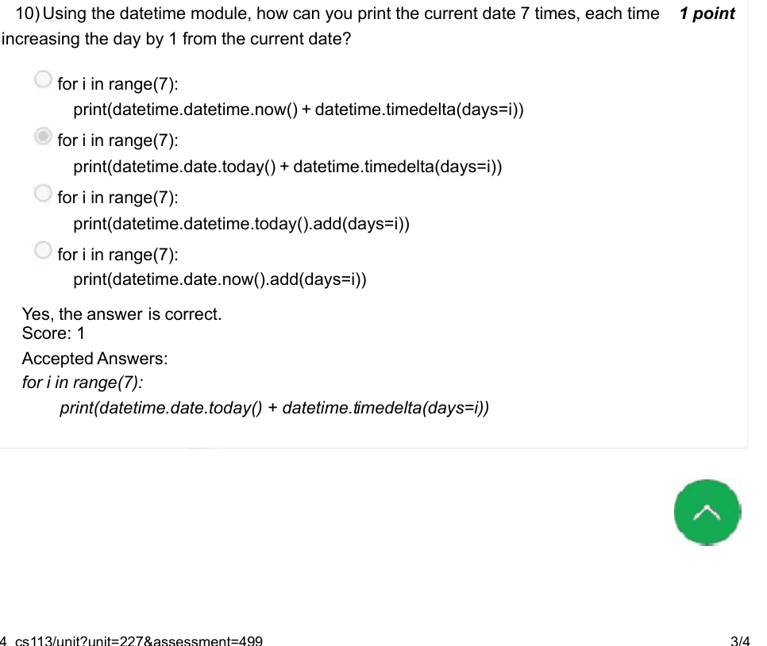

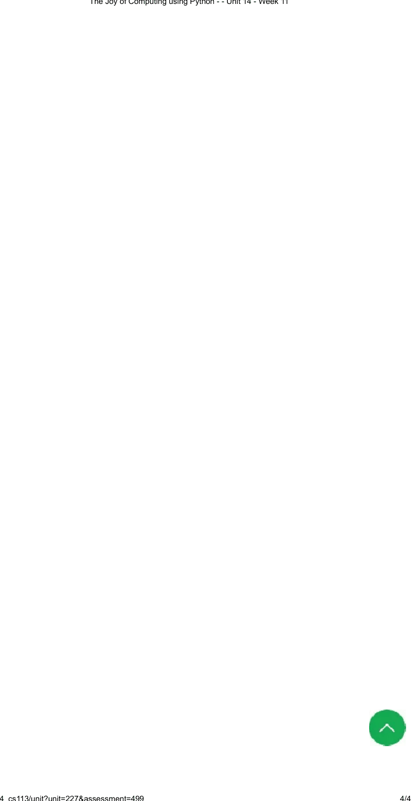
