# JOC Jul-2024 · Week 12: portal print

- Source: `JOY-OF-COMPUTING-USING-PYTHON (portal print, Wk0-12).pdf` pages 80–84 (portal review printout). Parsed text below; the cropped image under each question is the exact page content (code, figures and ticks as printed) and is authoritative.
- `[x]` = option equal to the portal's **Accepted Answer** (official). Lines may carry stray spaces from the PDF text layer.

> gireesh218@gmail.com  · Due on 2024-10-16, 23:59 IST.

### Q1. What is the key operation performed when the number n in the Collatz Conjecture is

- [ ] Add 1 Multiply by 3 and add 1 Divide by 2 Subtract 1
> Accepted answer (not matched to a printed option): Divide by 2
> Yes, the answer is correct. Score: 1

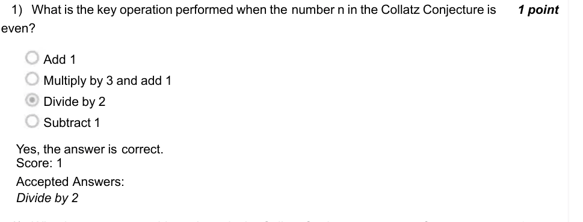

### Q2. What happens to an odd number n in the Collatz Conjecture sequence?
It is divided by 2
It remains unchanged
n × 3 + 1
It is replaced by
n −1
It is replaced by

Accepted answer(s): n × 3 + 1; It is replaced by
> Yes, the answer is correct. Score: 1

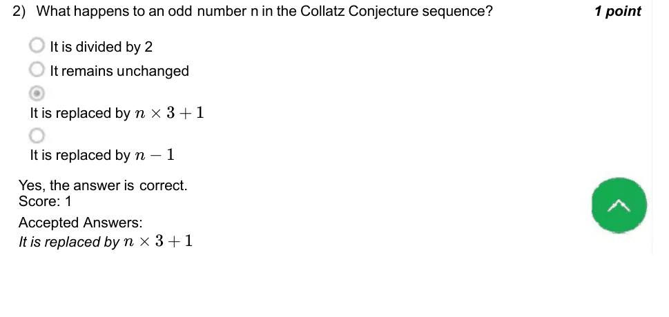

### Q3. (question text in image)

- [ ] What is the ultimate goal of the Collatz Conjecture sequence?
- [ ] Reach the number 0
- [ ] Return to the starting number
- [x] Reach the number 1
- [ ] Cycle through odd numbers
> Yes, the answer is correct. Score: 1

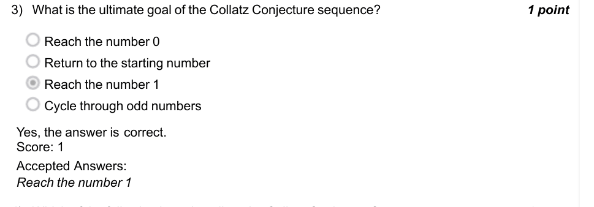

### Q4. (question text in image)

- [ ] Which of the following best describes the Collatz Conjecture?
- [ ] It has been proven for all natural numbers
- [x] It remains an unsolved problem in mathematics
- [ ] It is a trivial problem with a simple solution
- [ ] It only applies to prime numbers
> Yes, the answer is correct. Score: 1

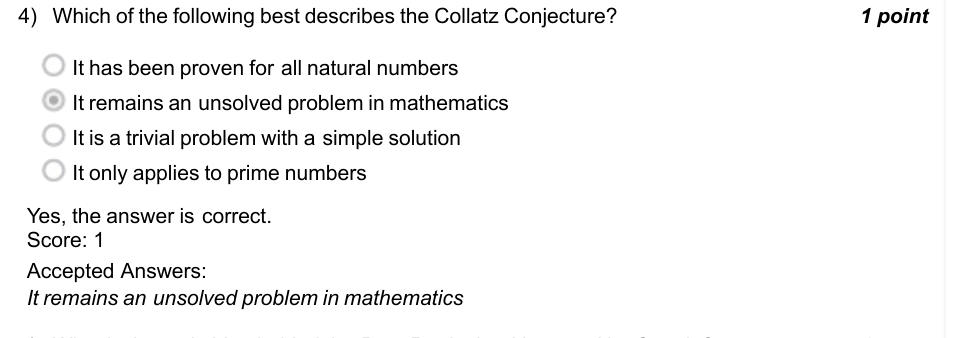

### Q5. (question text in image)

- [ ] What is the main idea behind the PageRank algorithm used by Google?
- [ ] Count the number of keywords on a page
- [x] Rank pages based on random walks on a graph of web links
- [ ] Rank pages based on user reviews
- [ ] Rank pages alphabetically
> Yes, the answer is correct. Score: 1

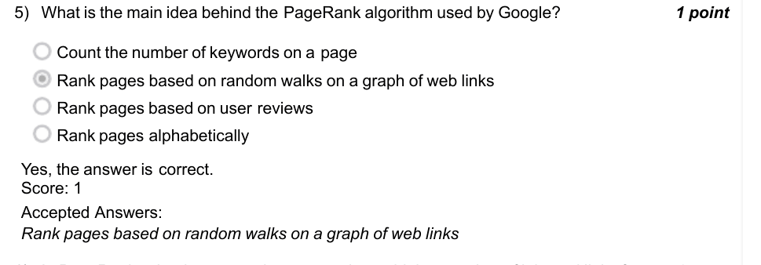

### Q6. (question text in image)

- [ ] In PageRank, what happens when a page has a higher number of inbound links from
- [ ] Its rank decreases due to the load on the server
- [x] Its rank increases
- [ ] Its rank remains unchanged
- [ ] It is marked as a less relevant page
> Yes, the answer is correct. Score: 1

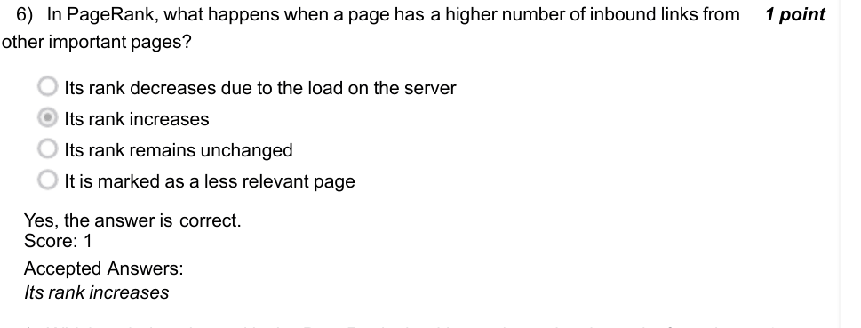

### Q7. (question text in image)

- [ ] Which technique is used in the PageRank algorithm to determine the rank of a web
- [ ] Depth-first search
- [ ] Hyperlink analysis
- [x] Random walk simulation
- [ ] Data scraping
> No, the answer is incorrect. Score: 0

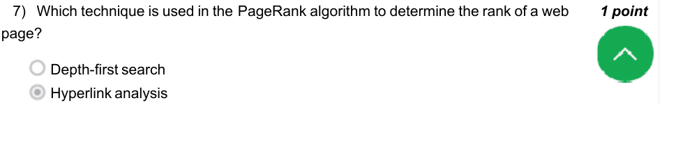

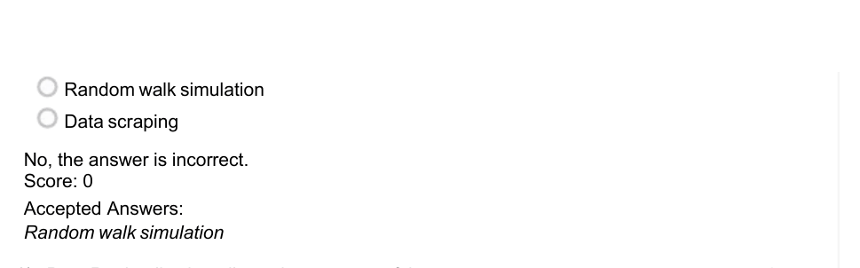

### Q8. (question text in image)

- [ ] PageRank relies heavily on the structure of the:
- [ ] Web page content
- [x] Hyperlink network between web pages
- [ ] User interaction data
- [ ] Server location
> Yes, the answer is correct. Score: 1

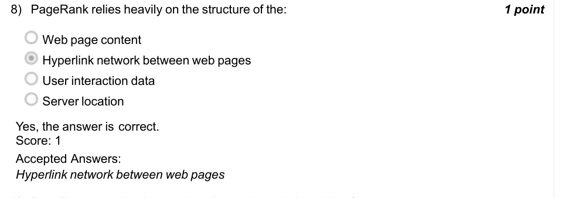

### Q9. (question text in image)

- [ ] PageRank was developed primarily to solve which problem?
- [ ] Calculating the shortest path in a network
- [x] Ranking the importance of web pages on the internet
- [ ] Counting the total number of web pages
- [ ] Reducing the size of search engine databases
> Yes, the answer is correct. Score: 1

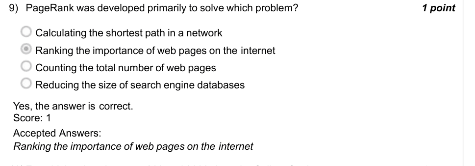

### Q10. (question text in image)

- [ ] For which values between 200 and 3000 does the Collatz Conjecture not converge to
- [ ] 2498.0
- [ ] 1576.0
- [ ] 2789.0
- [x] None of the given options
> Yes, the answer is correct. Score: 1

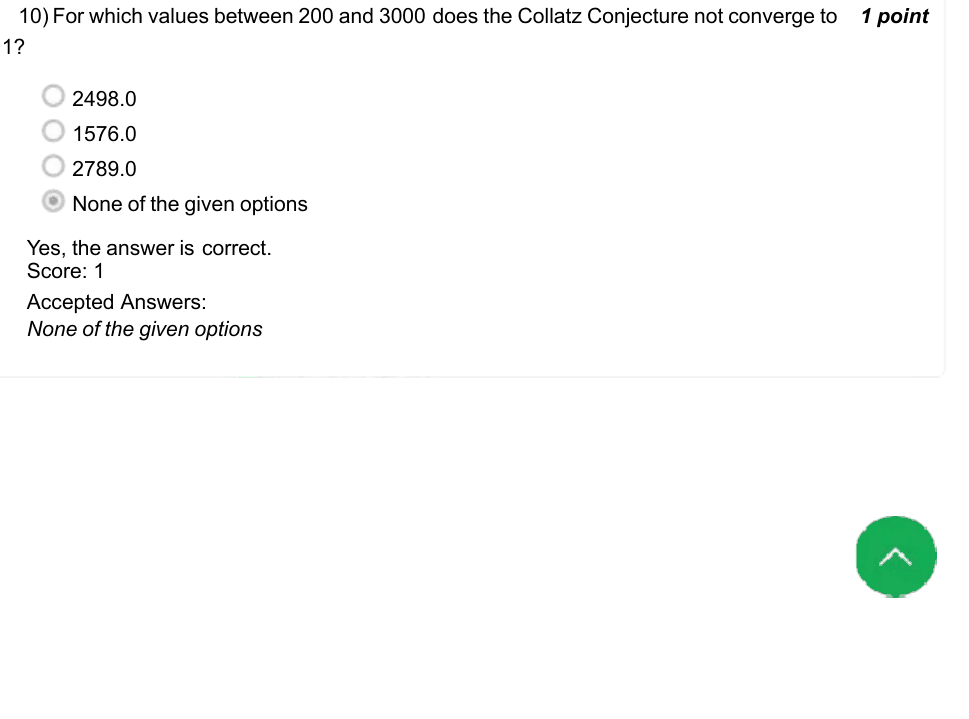

