# JOC Jan-2025 · Week 1: portal print

- Source: `Python-NPTEL (portal print, Wk1-12).pdf` pages 1–7 (portal review printout). Parsed text below; the cropped image under each question is the exact page content (code, figures and ticks as printed) and is authoritative.
- `[x]` = option equal to the portal's **Accepted Answer** (official). Lines may carry stray spaces from the PDF text layer.

> bhargavi111gm@gmail.com · Due on 2025-02-05, 23:59 IST.

### Q1. Which blocks can be used to move the cat?

- [ ] Walk
- [x] Move
- [ ] Teleport
- [x] Glide
> Yes, the answer is correct. Score: 1

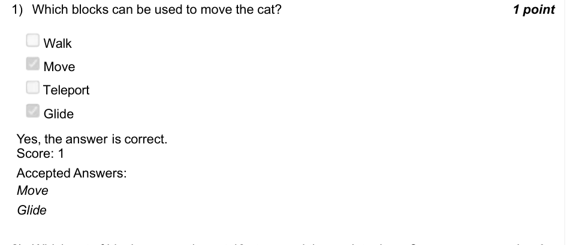

### Q2. Which set of blocks moves the cat 40 steps and then points down ?

> Yes, the answer is correct. Score: 1

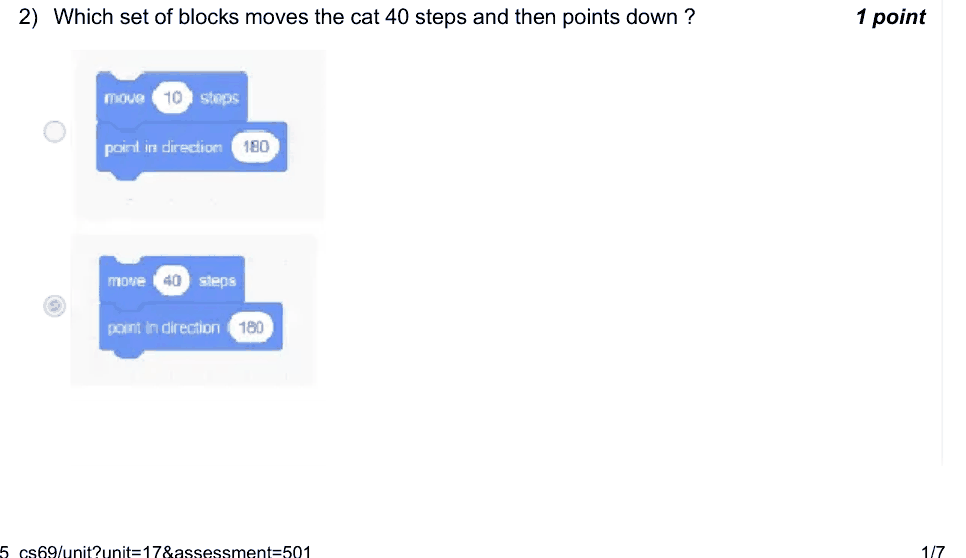

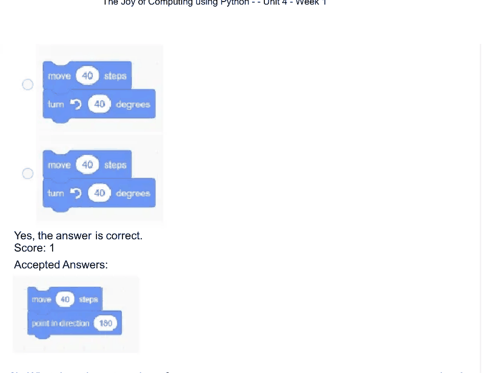

### Q3. What does the cat say here ?

- [ ] Says the number 7, for 1 second, 7 times and changes the value of number variable by multiplying previous value with 1.
- [ ] Says the number 7, for 1 second, 7 times and changes the value of number variable by adding previous value with 1.
- [ ] Says the number 7, for 1 second, then says numbers from 6 to 1 one by one for 1 second each.
- [ ] Says the number 7, for 1 second, then says numbers from 6 to 0 one by one for 1 second each.
> Accepted answer (not matched to a printed option): Says the number 7, for 1 second, then says numbers from 6 to 1 one by one for 1 second; each.
> Yes, the answer is correct. Score: 1

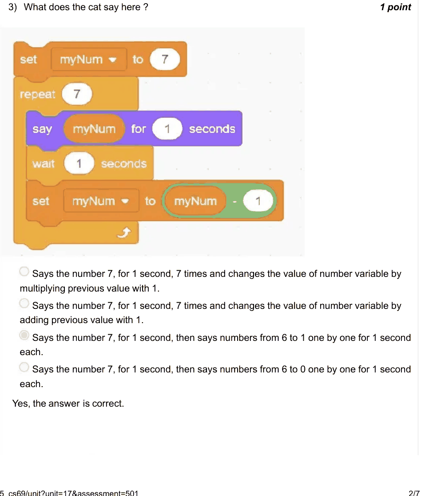

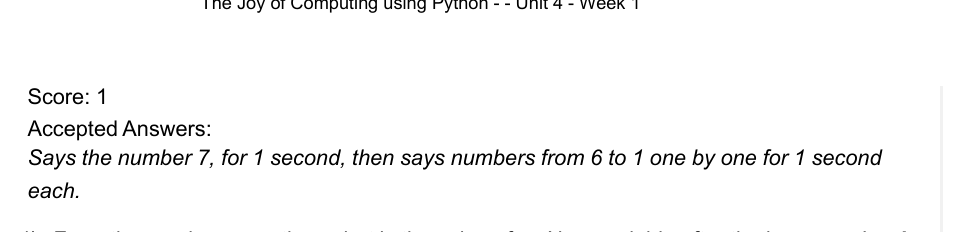

### Q4. From the previous question, what is the value of myNum variable after the loop

- [ ] 1
- [ ] 2
- [ ] 7
- [x] 0
> Yes, the answer is correct. Score: 1

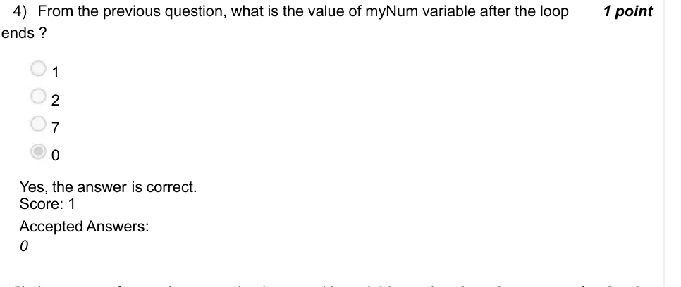

### Q5. Let answer for previous question be stored in variable x, what does the cat say after the execution of the loop ?

- [ ] 16
- [x] 5
- [ ] 29
- [ ] 44
> Yes, the answer is correct. Score: 1

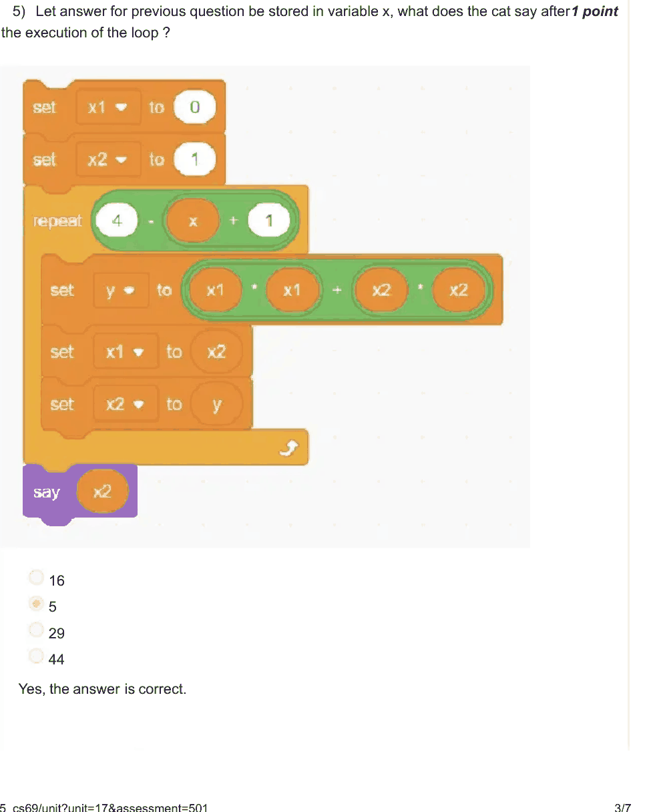

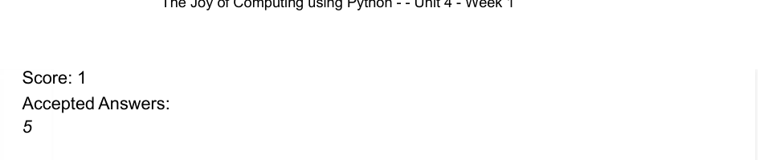

### Q6. Which of the following data types is primarily used for storing a sequence of

- [ ] Integer
- [ ] Float
- [x] String
- [ ] Boolean
> Yes, the answer is correct. Score: 1

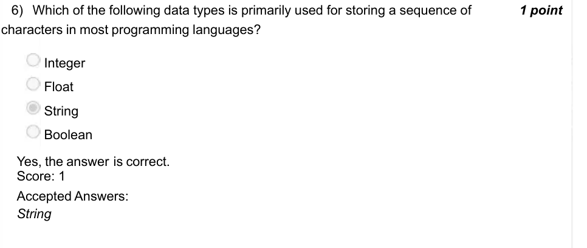

### Q7. Which of the following statements best describes why loops are commonly used ?

- [ ] Loops make the code run slower but more reliably.
- [x] Loops allow you to execute a block of code repeatedly without having to write it multiple times.
- [ ] Loops are only useful for error handling.
- [ ] Loops automatically convert variables from one data type to another.
> Yes, the answer is correct. Score: 1

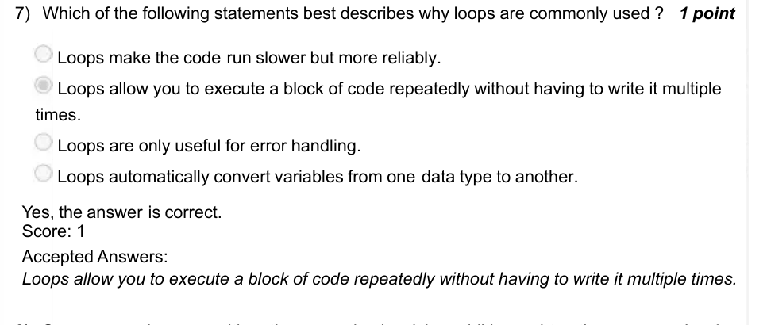

### Q8. Suppose you have an arithmetic expression involving addition, subtraction,

- [ ] Such expressions cannot be computed.
- [ ] A computer can only evaluate expressions involving addition and multiplication.
- [x] These expressions can be evaluated using built-in operations or libraries.
- [ ] A computer can only evaluate expressions involving addition and subtraction.
> Yes, the answer is correct. Score: 1

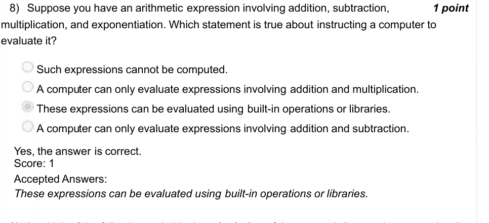

### Q9. In which of the following code blocks calculation of the squared distance between

> Yes, the answer is correct. Score: 1

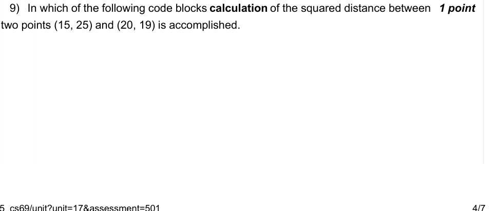

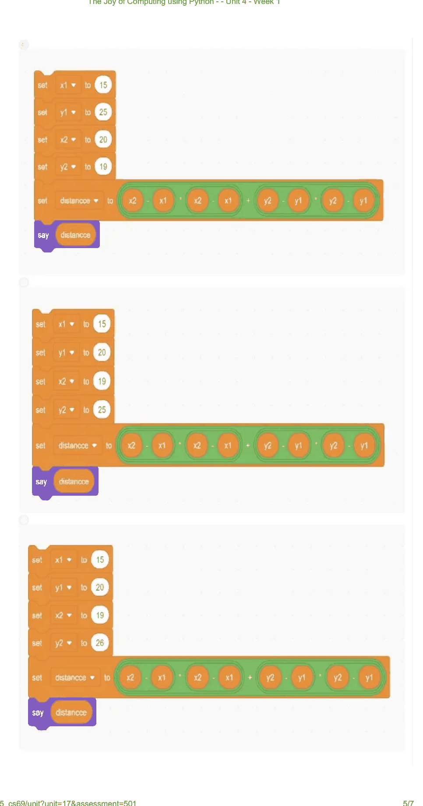

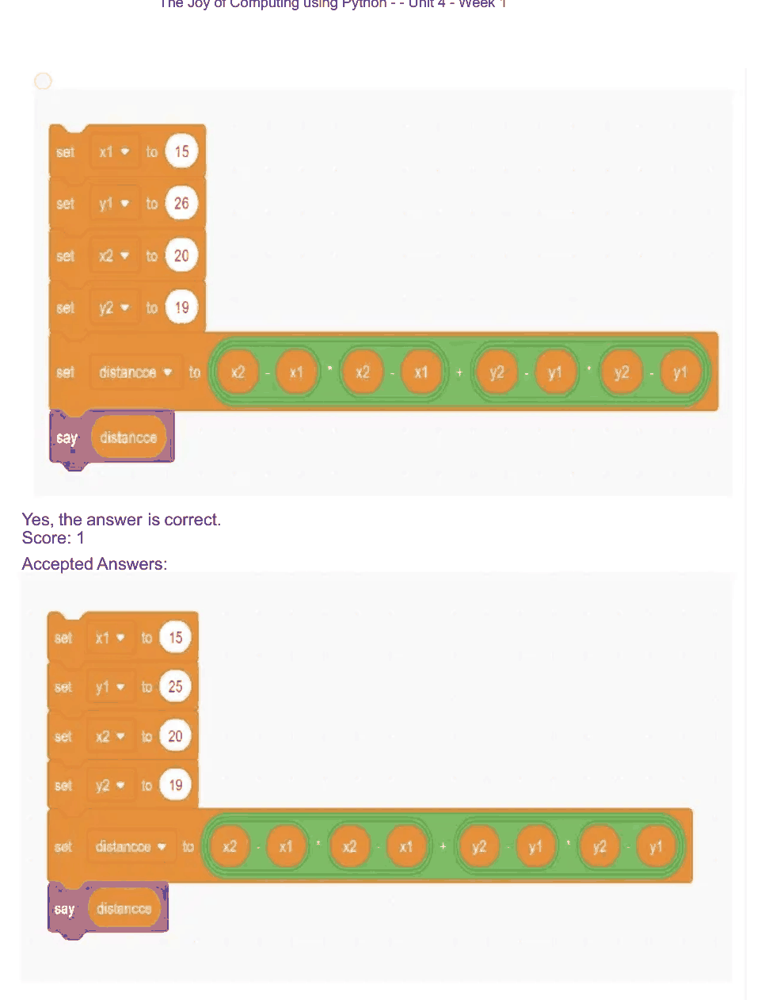

### Q10. (question text in image)

- [ ] What task does the block below accomplish ?
- [x] Moves the ball in a parabolic path and stops 18 away steps from center(0, 0) in x direction.
- [ ] Moves the ball in a circular path and 18 times.
- [ ] Moves the ball in a parabolic path and stops 18 away steps from center(0, 0) in y direction.
- [ ] Moves the ball in a parabolic path and stops 17 away steps from center(0, 0) in x direction.
> No, the answer is incorrect. Score: 0

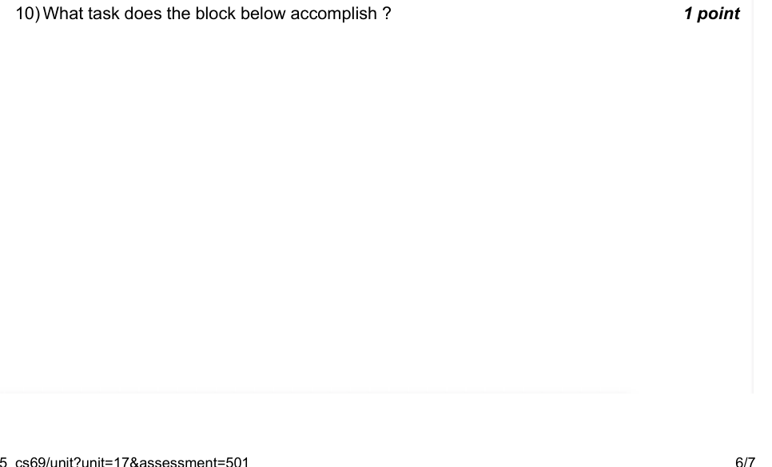

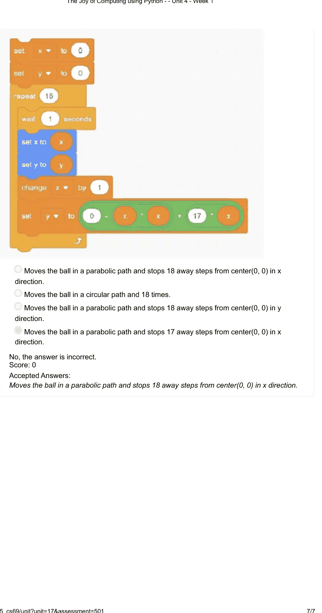
