# JOC Jan-2025 · Week 2: portal print

- Source: `Python-NPTEL (portal print, Wk1-12).pdf` pages 8–12 (portal review printout). Parsed text below; the cropped image under each question is the exact page content (code, figures and ticks as printed) and is authoritative.
- `[x]` = option equal to the portal's **Accepted Answer** (official). Lines may carry stray spaces from the PDF text layer.

> bhargavi111gm@gmail.com · Due on 2025-02-05, 23:59 IST.

### Q1. Statement: If a variable is assigned a value once, the value in the variable cannot

- [ ] False, the variable stores all values it was assigned.
- [x] False, the variable stores the value from the latest assignment.
- [ ] True, the variable stores only the value from the second-last assignment.
- [ ] True, the variable stores value from the initial assignment only.
> Yes, the answer is cor rect. Score: 1

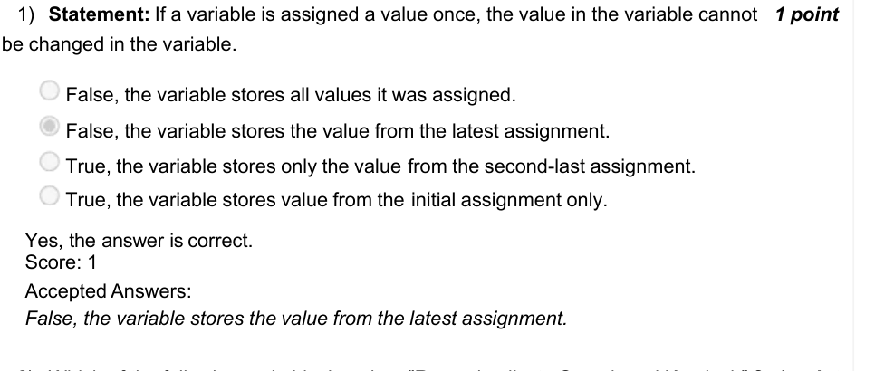

### Q2. Which of the following code blocks print - ”Ramesh talks to Suresh and Kamlesh” ?

> Partially Correct. Score: 0.67

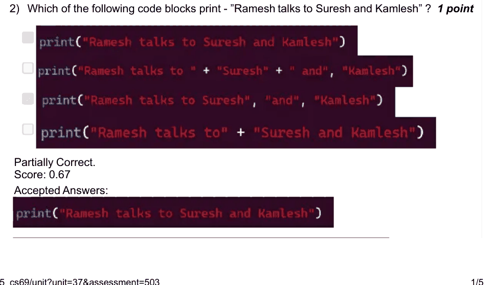

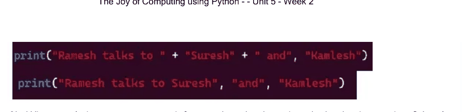

### Q3. What aren’t the correct ways to inform python that input is a decimal point number ?

- [x] in(input())
- [ ] float(input())
- [x] int(input())
- [ ] a = input() a = int(a)
> Yes, the answer is correct. Score: 1

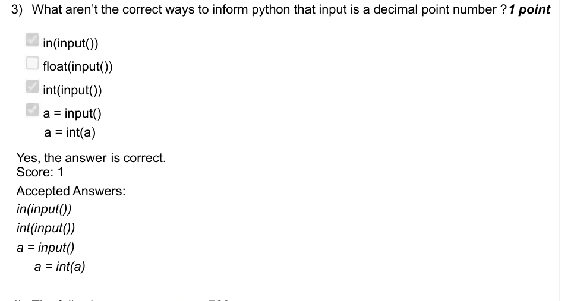

### Q4. The following program outputs 723 -

- [ ] 1
- [ ] 2
- [x] 6
- [ ] 5
> Yes, the answer is correct. Score: 0

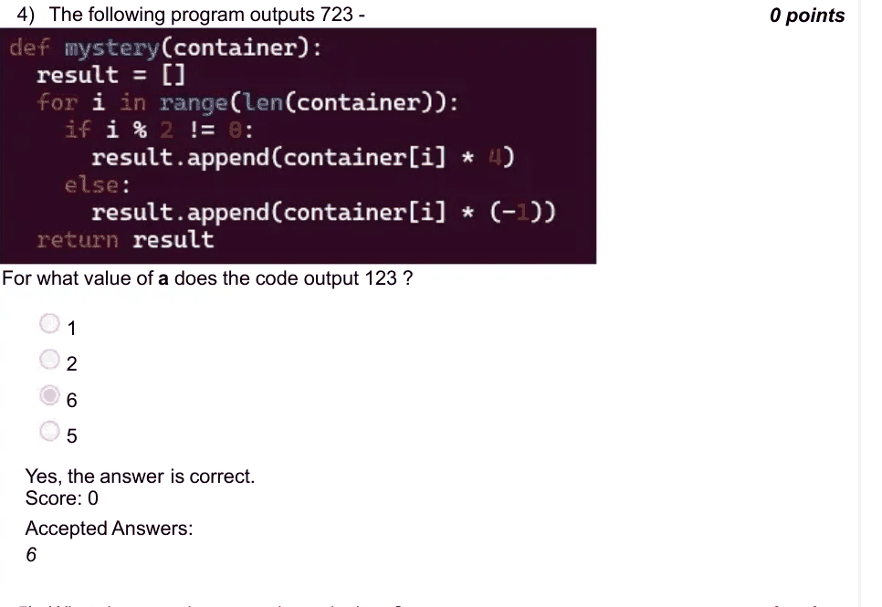

### Q5. What does previous question calculate ?

- [ ] Calculates the factorial of a.
- [x] Calculates the factorial of a-1 and adds 3
- [ ] Calculates the factorial of a-1+3.
- [ ] Calculates the a multiples of a starting from 1 and adds 3.
> Yes, the answer is correct. Score: 0

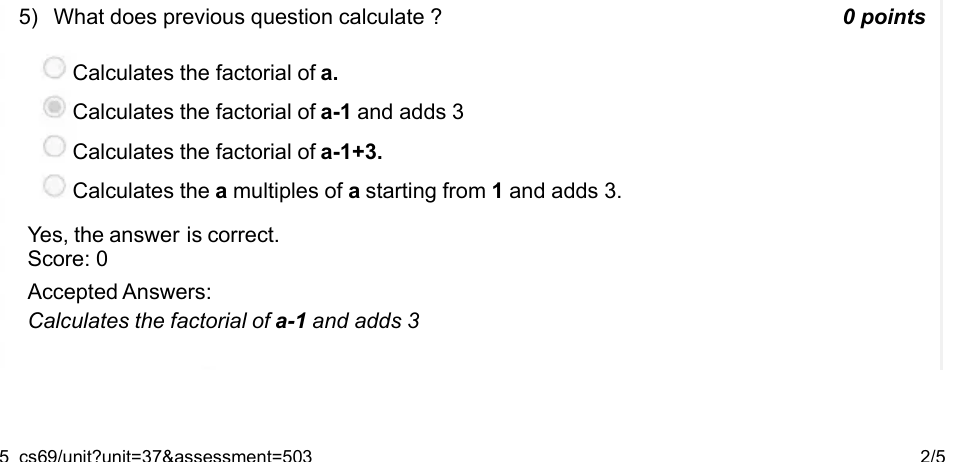

### Q6. Which loop is used to perform a set of repetitive tasks without a condition by default

- [ ] while loop
- [x] for loop
- [ ] do-while loop
- [ ] while-range loop
> Yes, the answer is correct. Score: 1

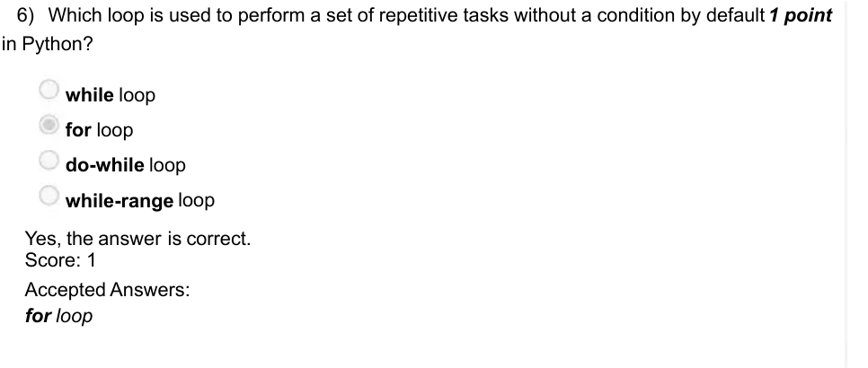

### Q7. What happens when the condition inside the if and while evaluate to false ?

- [ ] Python interpreter ignores the if/while blocks, and halts the program.
- [ ] Python interpreter ignores the if/while blocks, and proceeds the program from the lines after the if/while block.
- [ ] Python interpreter executes the if/while blocks, and rest of the program.
- [ ] Python interpreter executes the if/while, and the programs runs in an infinite loop.
> Accepted answer (not matched to a printed option): Python interpreter ignores the if/while blocks, and proceeds the program from the lines after; the if/while block.
> Yes, the answer is correct. Score: 1

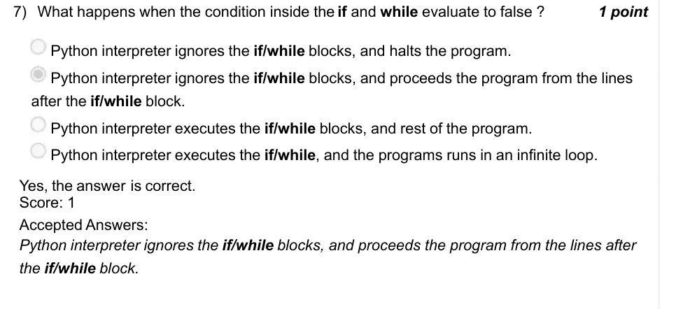

### Q8. The following program might/might not have an infinite loop. Does the program

- [ ] No, the program doesn’t have infinite loop.
- [x] Yes, it can be prevented by updating the value of a before the if block at line 3.
- [ ] Yes, it can be prevented by removing both the if blocks inside the while loop.
- [ ] Yes, but it cannot be prevented.
> Yes, the answer is correct. Score: 0

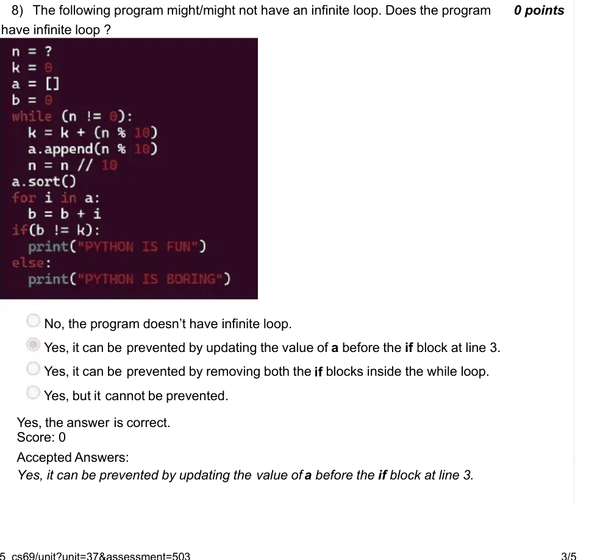

### Q9. For which of the following values of name and age variables does the following

- [x] aryan, 20
- [ ] arjun, 19
- [ ] aakash, 16
- [x] anand, 18
> Yes, the answer is correct. Score: 1

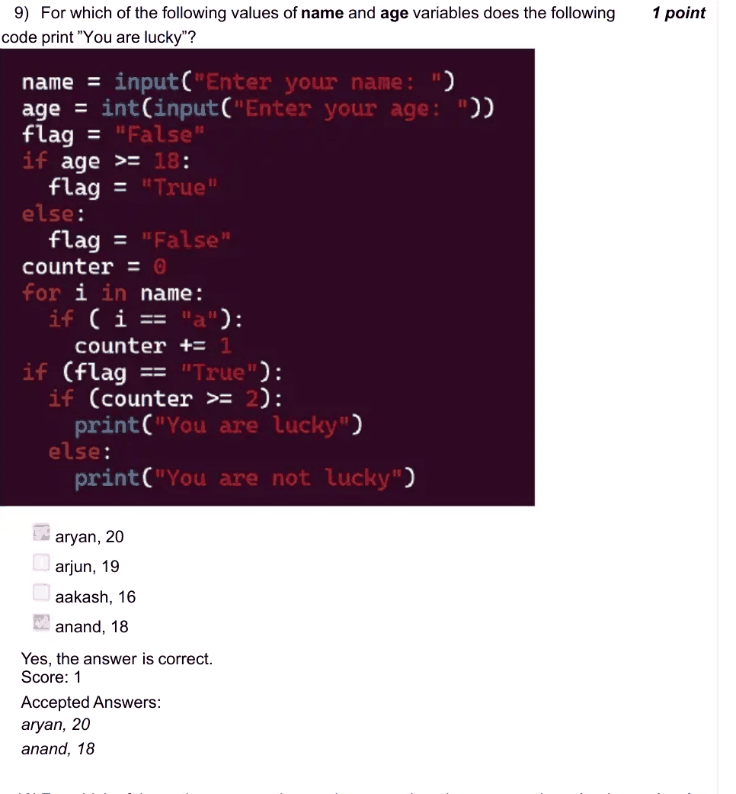

### Q10. For which of the options among the previous question, the program doesn’t print

- [ ] aryan, 20
- [x] aakash, 16
- [ ] arjun, 19
- [ ] anand, 18
> Yes, the answer is correct. Score: 1

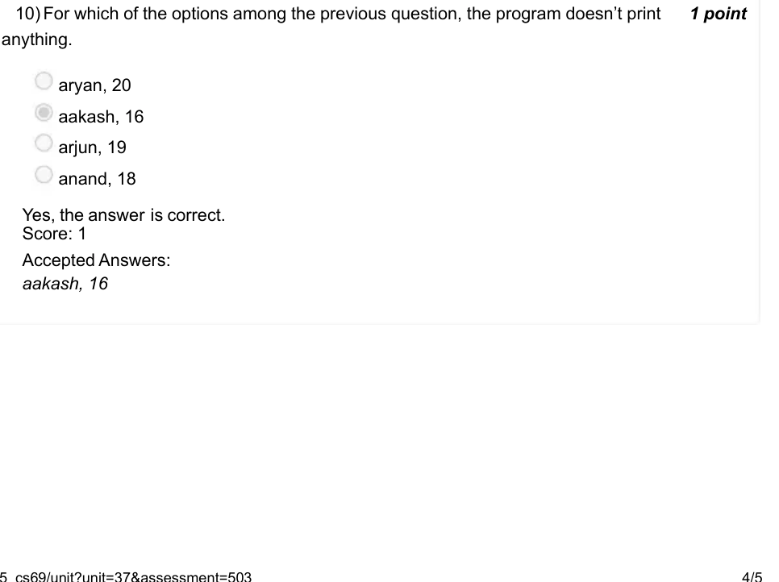

