# JOC Jan-2025 · Week 3: portal print

- Source: `Python-NPTEL (portal print, Wk1-12).pdf` pages 13–17 (portal review printout). Parsed text below; the cropped image under each question is the exact page content (code, figures and ticks as printed) and is authoritative.
- `[x]` = option equal to the portal's **Accepted Answer** (official). Lines may carry stray spaces from the PDF text layer.

> bhargavi111gm@gmail.com  · Due on 2025-02-12, 23:59 IST.

### Q1. Which of the following is/are false statement(s)?

- [x] Lists are fixed in size, they cannot store more than 1024 values
- [x] One can access element in list by using non-numeric indices
- [ ] Iterating over lists is possible in Python
- [x] We need to specify required size of list while creating a new list variable
> Partially Correct. Score: 0.67

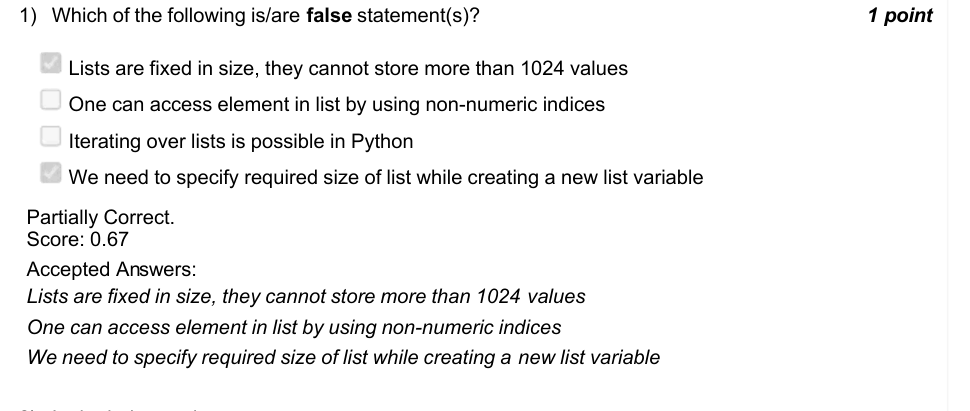

### Q2. In the below code -
For what value of n does the program print 10 ?

Accepted answer(s): (Type: Numeric) 5
> No, the answer is incorrect. Score: 0

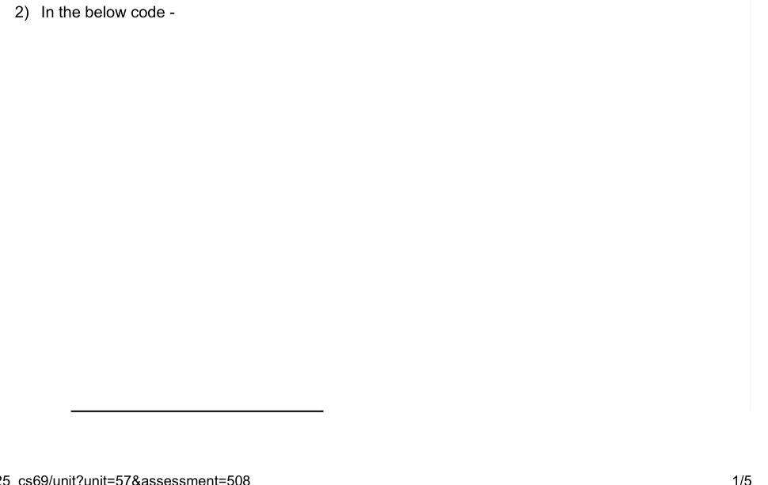

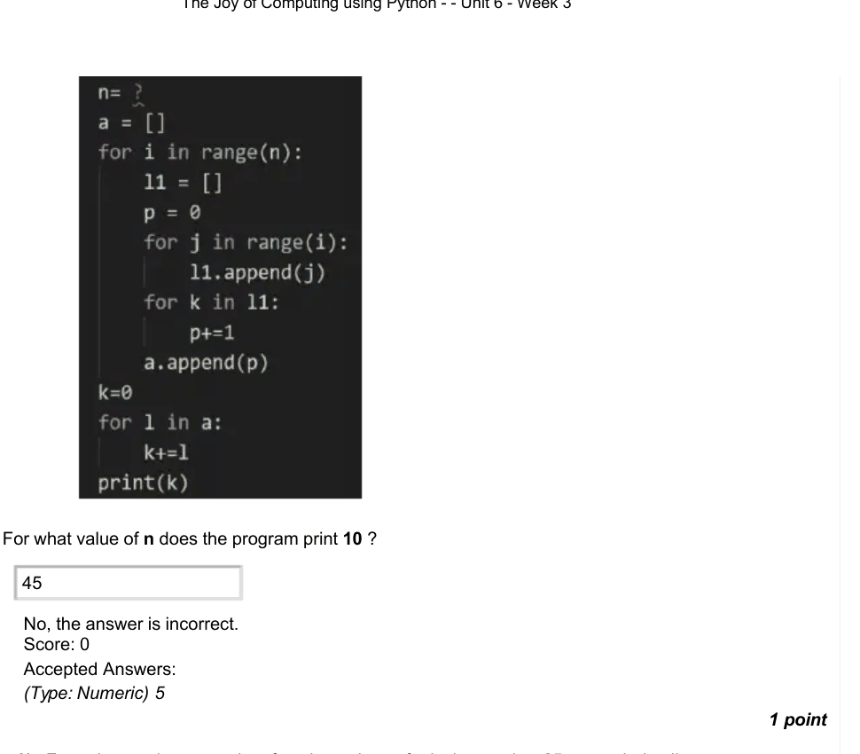

### Q3. From the previous question, for what values of n is the number 25 appended to list a.

- [ ] 25
- [ ] 24
- [x] 35
- [x] 32
> No, the answer is incorrect. Score: 0

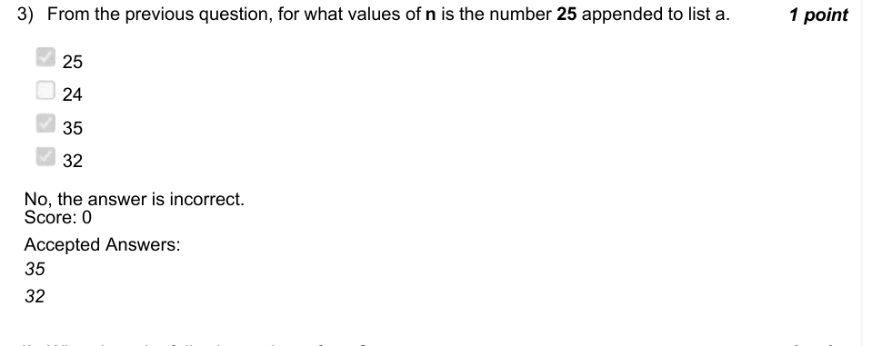

### Q4. What does the following code perform ?

- [ ] It converts any input list into a new list which is filled with some numbers which are always in increasing order
- [ ] It converts any input list into a new list such that at even indices, the value is a multiple of an even number and at odd indices, the value is either even or negative number
- [ ] It converts any input list into a new list such that at odd indices, the value is always even number and at even indices, the value is negative
- [ ] It converts any input list into a new list, which follows no pattern
> Accepted answer (not matched to a printed option): It converts any input list into a new list such that at odd indices, the value is always even number and; at even indices, the value is negative
> No, the answer is incorrect. Score: 0

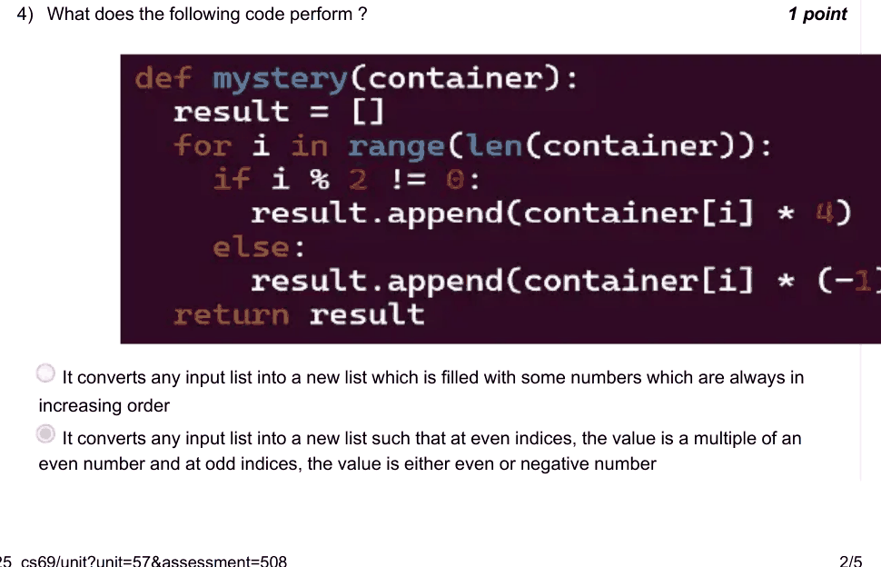

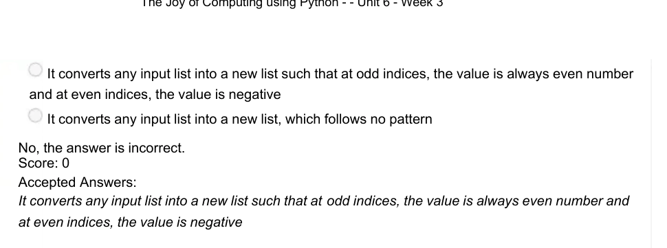

### Q5. From the previous question, if the option -
It converts any input list into a new list such that at even indices, the value is a multiple
is incorrect, Can you make changes to code such that it this option is always true for

- [ ] No, it is not possible to make such changes
- [ ] No, the option is already correct
- [x] Yes, we can make changes
> No, the answer is incorrect. Score: 0

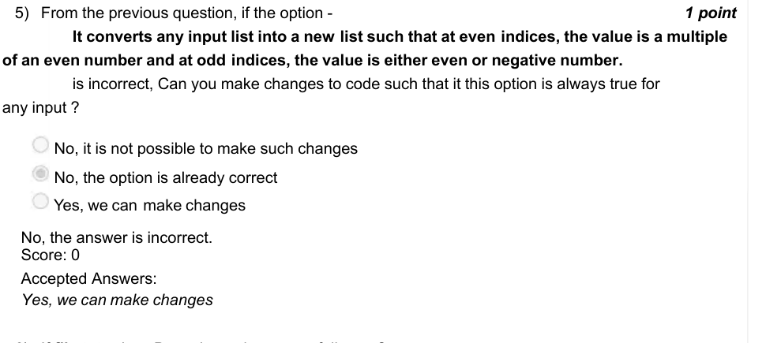

### Q6. If file.txt exists, Does the code successfully run ?

- [x] Yes
- [ ] No
> No, the answer is incorrect. Score: 0

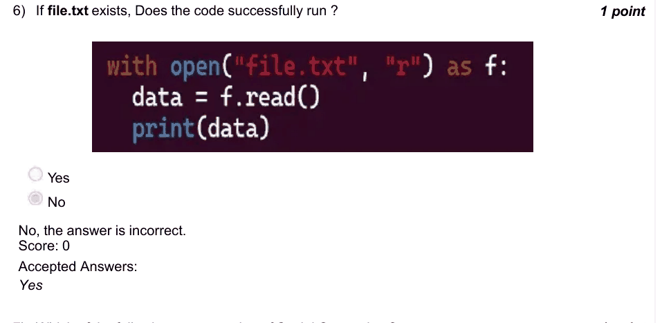

### Q7. Which of the following are examples of Social Computing ?

- [ ] ChatGPT
- [x] Wikipedia
- [x] Quora
- [ ] Twitch
> No, the answer is incorrect. Score: 0

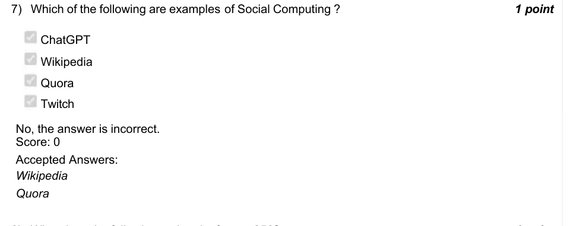

### Q8. What does the following code print for n = 256?

- [x] PYTHON IS BORING
- [ ] PYTHON IS FUN
> Yes, the answer is correct. Score: 1

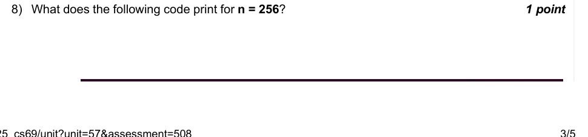

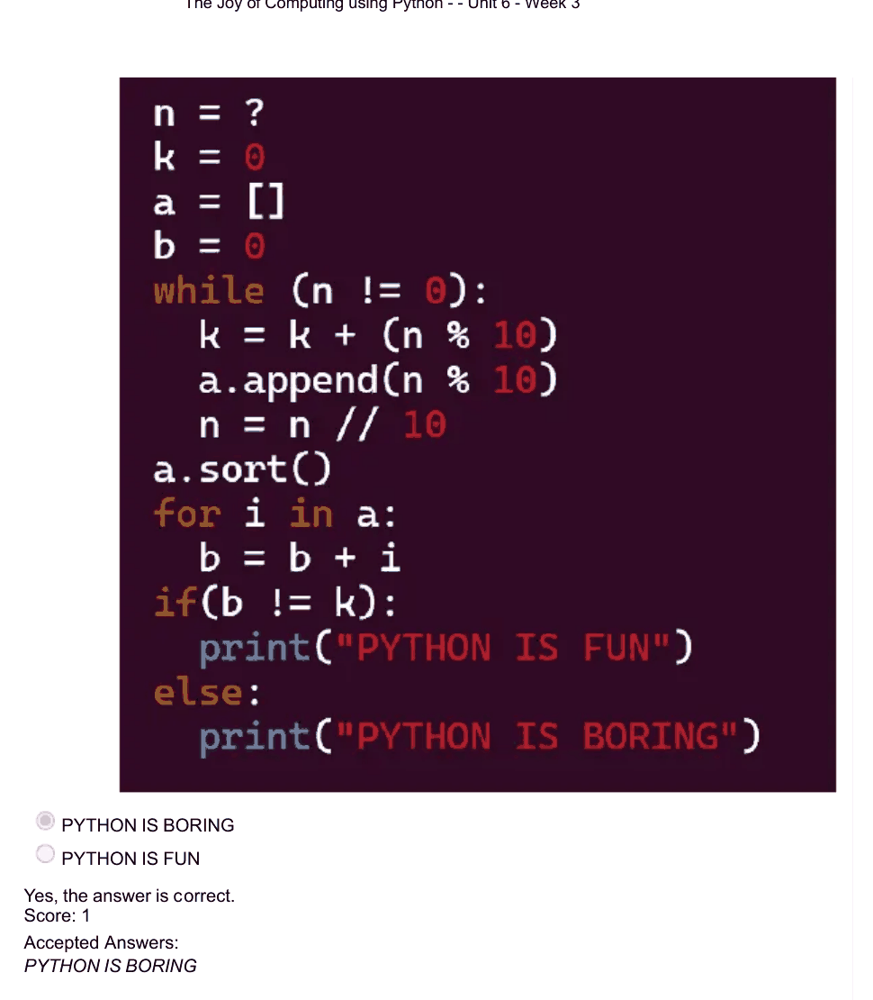

### Q9. From the previous question, is a.sort() responsible for printing of either of the two possible

- [ ] Yes, and the code may print ”PYTHON IS FUN”
- [ ] No, it is purely dependent on variable n
- [x] No, it is not dependent on a.sort(), and the code will never print ”PYTHON IS FUN”
> No, the answer is incorrect. Score: 0

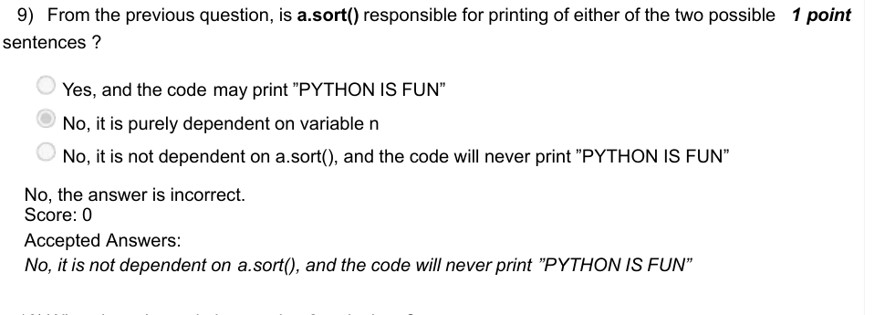

### Q10. What does the code in question 8, calculate ?
Can you say what the values of k and b are if n = 245326785456 x 10
.
󰀳
󰀳
󰀵
󰀹
If values of k and b are different, enter 0, else enter value of k.
64

Accepted answer(s): (Type: Numeric) 57
> No, the answer is incorrect. Score: 0

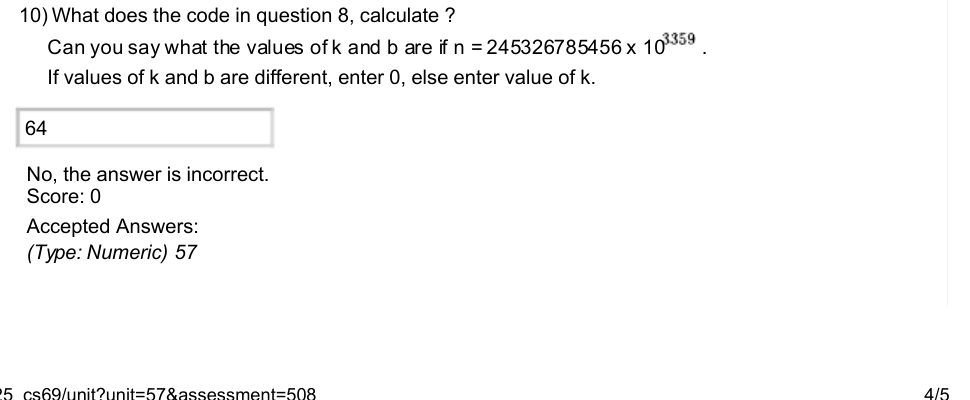

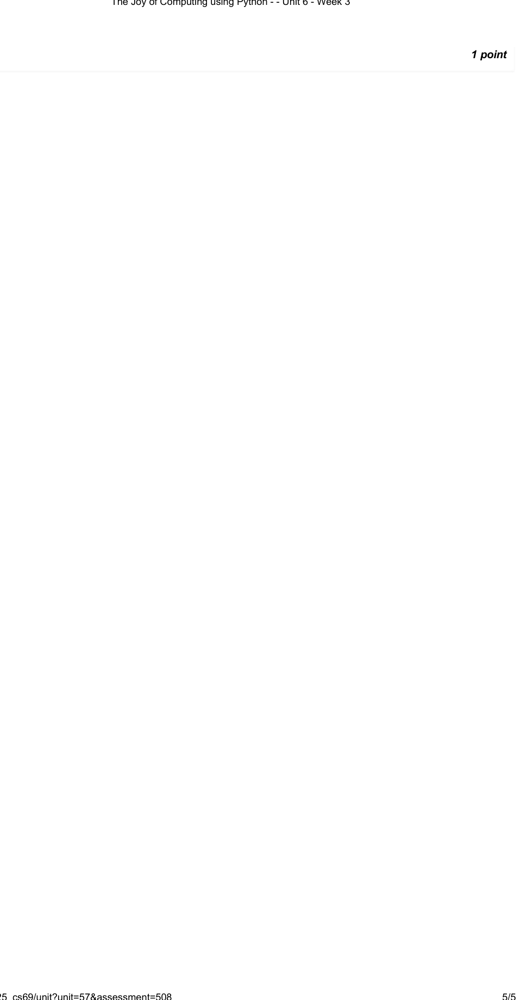
