# JOC Jan-2025 · Week 4: portal print

- Source: `Python-NPTEL (portal print, Wk1-12).pdf` pages 18–22 (portal review printout). Parsed text below; the cropped image under each question is the exact page content (code, figures and ticks as printed) and is authoritative.
- `[x]` = option equal to the portal's **Accepted Answer** (official). Lines may carry stray spaces from the PDF text layer.

> bhargavi111gm@gmail.com · Due on 2025-02-19, 23:59 IST.

### Q1. Which of the following options provides the general formula for the magic constant
?
2
󰁮
󰁮
2
󰁮
󰁮
(
+
1
)
2
3
󰁮
2
3
+
2
󰁮
󰁮
2
4
2
+
󰁮
󰁮
2
󰁮

Accepted answer(s): 2; (; +; 1; ); 󰁮; 󰁮; 2; 4; 2; +; 󰁮; 󰁮; 2; 󰁮
> No, the answer is incorrect. Score: 0

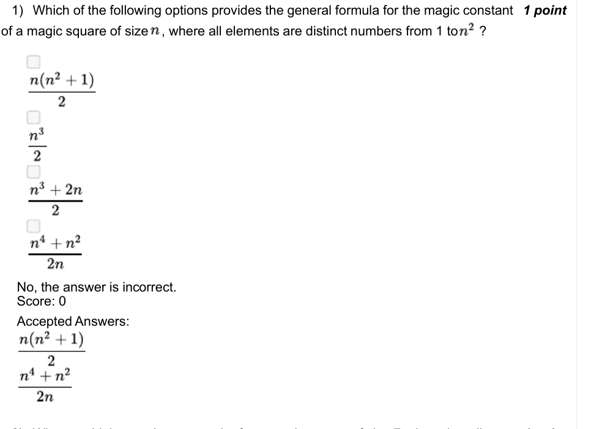

### Q2. What would the magic constant be for a magic square of size 7, given that all

- [ ] 260
- [ ] 111
- [x] 175
- [ ] 165
> No, the answer is incorrect. Score: 0

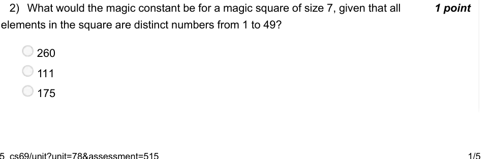

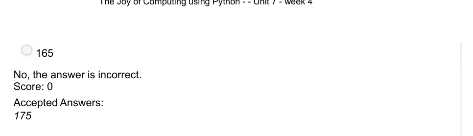

### Q3. Does transposing any magic square change the sum across some

- [ ] Yes
- [x] No
> No, the answer is incorrect. Score: 0

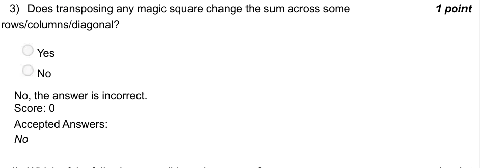

### Q4. Which of the following are valid magic squares ?
3
8
1
0
1
3
⎡
⎤
5
2
1
6
1
1
⎢
⎥
⎢
⎥
⎢
⎥
4
9
7
1
4
⎣
⎦
6
1
1
5
1
2
2
0
−
6
−
2
6
−
1
6
−
󰁥
󰁥
󰁥
󰁥
⎡
⎤
󰁥
󰁥
󰁥
󰁥
1
0
−
3
2
−
4
−
2
2
−
⎢
⎥
⎢
⎥
⎢
⎥
󰁥
󰁥
󰁥
󰁥
8
−
1
8
−
1
4
−
2
8
−
2
⎣
⎦
3
0
−
1
2
−
2
4
−
2
−
󰁥
󰁥
󰁥
󰁥
1
4
1
4
1
5
⎡
⎤
8
5
1
1
1
0
⎢
⎥
⎢
⎥
⎢
⎥
2
3
1
3
1
6
⎣
⎦
7
9
6
1
2
4
π
π
π
π
1
4
1
5
⎡
⎤
8
5
π
π
π
π
1
1
1
0
⎢
⎥
⎢
⎥
⎢
⎥
2
3
1
3
1
6
π
π
π
π
⎣
⎦
7
9
6
π
π
π
π
1
2

Accepted answer(s): 3; 8; 1; 0; 1; 3; ⎡; ⎤; 5; 2; 1; 6; 1; 1; ⎢; ⎥; ⎢; ⎥; ⎢; ⎥; 4; 9; 7; 1; 4; ⎣; ⎦; 6; 1; 1; 5; 1; 2; 1; 4; 1; 4; 1; 5; ⎡; ⎤; 8; 5; 1; 1; 1; 0; ⎢; ⎥; ⎢; ⎥; ⎢; ⎥; 2; 3; 1; 3; 1; 6; ⎣; ⎦; 7; 9; 6; 1; 2; 4; 1; 4; 1; 5; π; π; π; π; ⎡; ⎤; 8; 5; π; π; π; π; 1; 1; 1; 0; ⎢; ⎥; ⎢; ⎥; ⎢; ⎥; 2; 3; 1; 3; 1; 6; π; π; π; π; ⎣; ⎦; 7; 9; 6; 1; 2; π; π; π; π
> No, the answer is incorrect. Score: 0

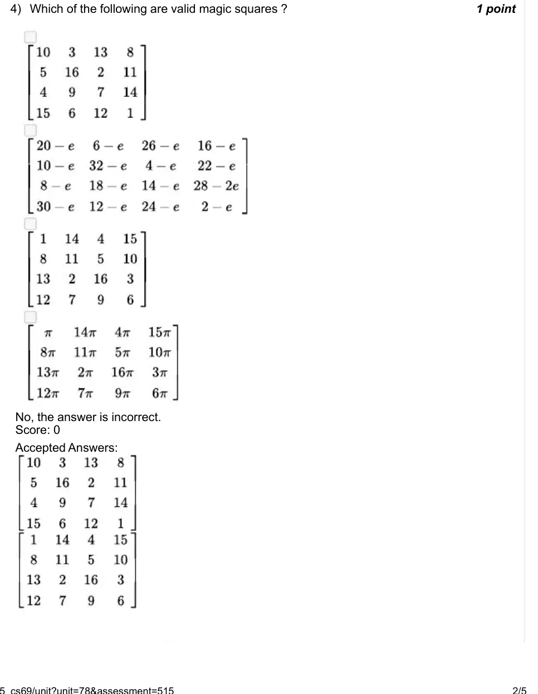

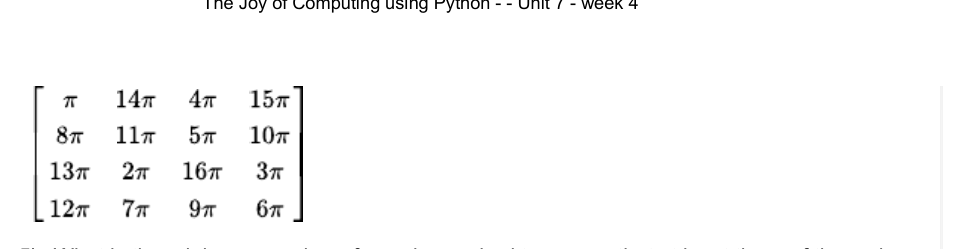

### Q5. (question text in image)

Accepted answer(s): (Type: Numeric) 97
> No, the answer is incorrect. Score: 0

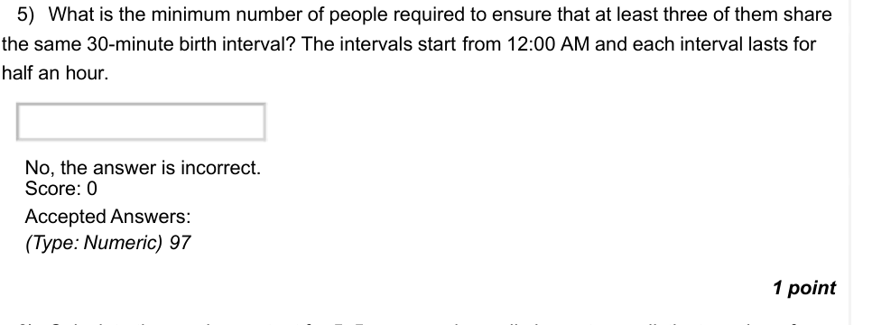

### Q6. (question text in image)

Accepted answer(s): (Type: Numeric) 74
> No, the answer is incorrect. Score: 0

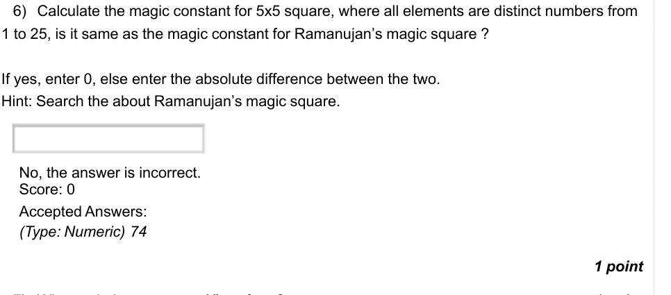

### Q7. (question text in image)

- [ ] What task does mystery1() perform?
- [ ] Calculate factorial of number n.
- [ ] Calculate factors of number n.
- [ ] Calculate factors of number n+1 excluding n.
- [x] Calculate factors of number n excluding n.
> No, the answer is incorrect. Score: 0

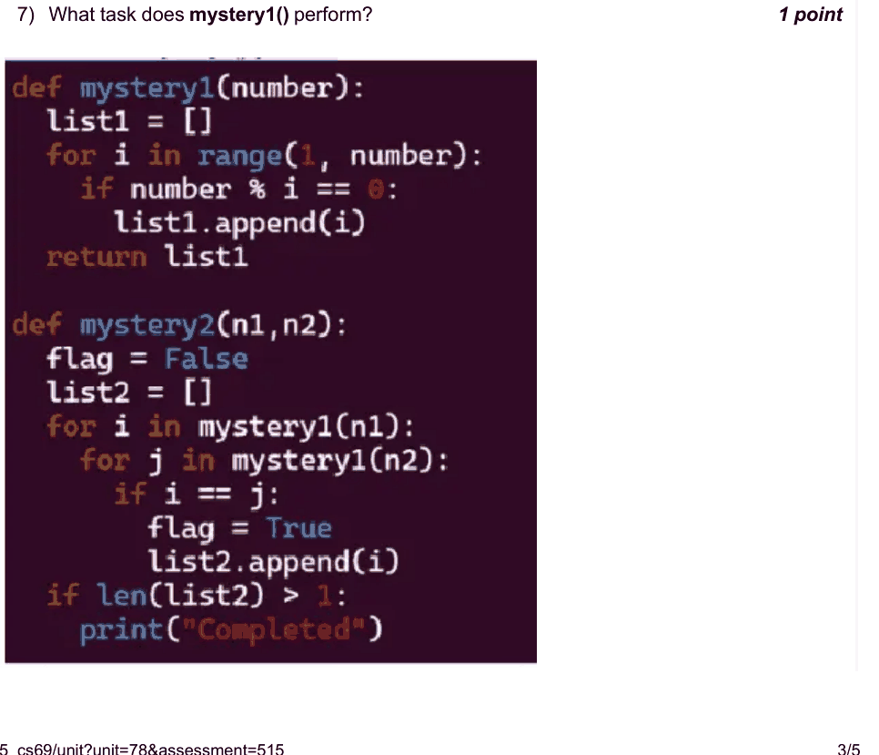

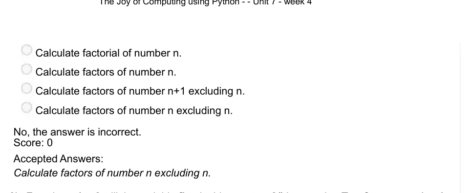

### Q8. For what n1, n2 will the variable flag inside mystery2() be equal to True?

- [ ] 1,2
- [x] 2,3
- [x] 3,4
- [ ] 0,0
> No, the answer is incorrect. Score: 0

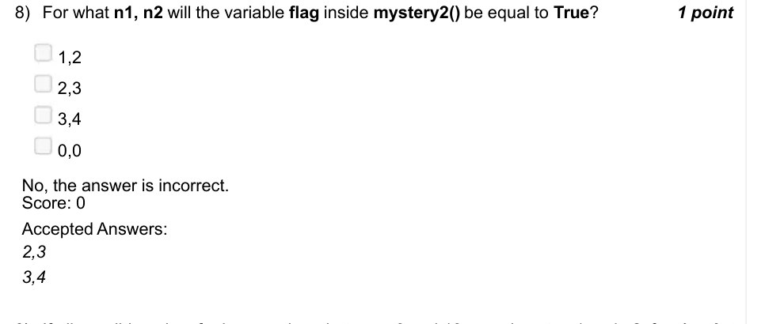

### Q9. If all possible pairs of prime numbers between 0 and 10, are given to n1 and n2, for how many pairs would mystery2 print ”Completed” ?

- [ ] It will print ”Completed” only for pairs (2,3)(7,2),(2,5), and for the remaining it would not print ”Completed”.
- [ ] It will print ”Completed” only for pair (2,3), and for the remaining other pairs of primes it would not print ”Completed”.
- [ ] It will print ”Completed” for all pairs of primes between 0 and 20.
- [x] It will not print ”Completed” for any pair.
> No, the answer is incorrect. Score: 0

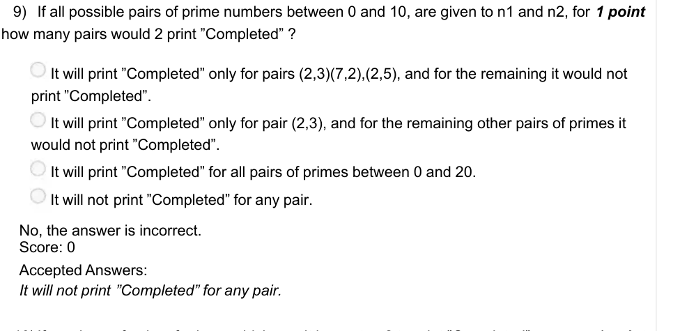

### Q10. If numbers of pairs of primes which result in mystery2 to print ”Completed” are lesser than 1, Can we edit the code in mystery2() so that ”Completed” is always printed for any pair of primes ?

- [ ] Yes, we can change the logic for setting flag variable to False.
- [ ] No, it is logically not possible.
- [x] Yes, we can change/decrease the threshold for length of list2 in the last if block.
- [ ] Yes, we can change the initial value of flag to False, instead of True.
> No, the answer is incorrect. Score: 0

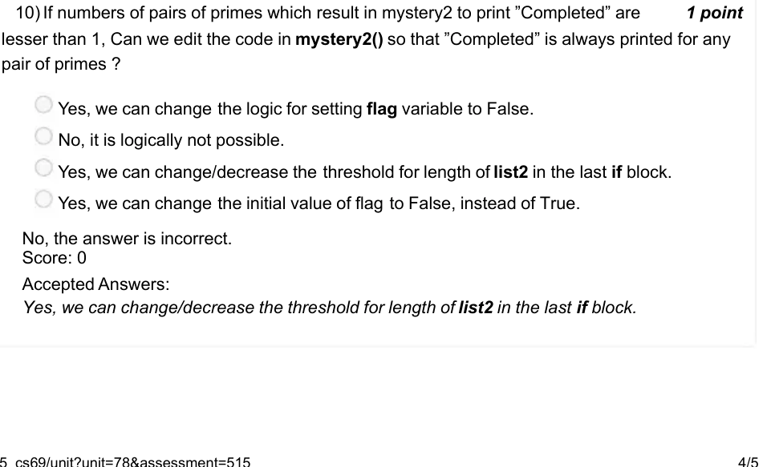

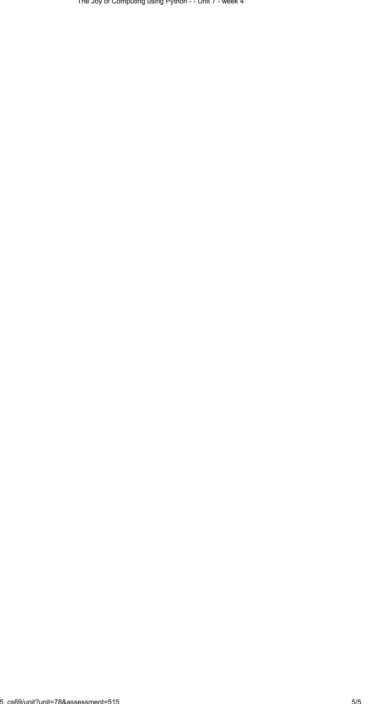
