# JOC Jan-2025 · Week 5: portal print

- Source: `Python-NPTEL (portal print, Wk1-12).pdf` pages 23–27 (portal review printout). Parsed text below; the cropped image under each question is the exact page content (code, figures and ticks as printed) and is authoritative.
- `[x]` = option equal to the portal's **Accepted Answer** (official). Lines may carry stray spaces from the PDF text layer.

> bhargavi111gm@gmail.com · Due on 2025-02-26, 23:59 IST.

### Q1. Which of the following is the correct way to add data with key as
and value
C
S
1
0
2

to a dictionary named
?
"
D
󰁡
󰁴
󰁡
󰁢
󰁡
󰁳
󰁥

M
󰁡
󰁮
󰁡
󰁧
󰁥
󰁭
󰁥
󰁮
󰁴

S
󰁹
󰁳
󰁴
󰁥
󰁭
󰁳
"
󰁣
󰁯
󰁵
󰁲
󰁳
󰁥
󰁳
󰁣
󰁯
󰁵
󰁲
󰁳
󰁥
󰁳
[
"
C
S
1
0
1
"
]

=

(
"
D
󰁡
󰁴
󰁡
󰁢
󰁡
󰁳
󰁥

M
󰁡
󰁮
󰁡
󰁧
󰁥
󰁭
󰁥
󰁮
󰁴

S
󰁹
󰁳
󰁴
󰁥
󰁭
󰁳
"
)
󰁣
󰁯
󰁵
󰁲
󰁳
󰁥
󰁳
[
"
C
S
1
0
2
"
]
[
"
D
󰁡
󰁴
󰁡
󰁢
󰁡
󰁳
󰁥

M
󰁡
󰁮
󰁡
󰁧
󰁥
󰁭
󰁥
󰁮
󰁴

S
󰁹
󰁳
󰁴
󰁥
󰁭
󰁳
"
]
󰁣
󰁯
󰁵
󰁲
󰁳
󰁥
󰁳
[
"
C
S
1
0
2
"
]

=

"
D
󰁡
󰁴
󰁡
󰁢
󰁡
󰁳
󰁥

M
󰁡
󰁮
󰁡
󰁧
󰁥
󰁭
󰁥
󰁮
󰁴

S
󰁹
󰁳
󰁴
󰁥
󰁭
󰁳
"
󰁣
󰁯
󰁵
󰁲
󰁳
󰁥
󰁳
[
"
C
S
1
0
1
"
]

=

"
D
󰁡
󰁴
󰁡
󰁢
󰁡
󰁳
󰁥

M
󰁡
󰁮
󰁡
󰁧
󰁥
󰁭
󰁥
󰁮
󰁴

S
󰁹
󰁳
󰁴
󰁥
󰁭
󰁳
"

Accepted answer(s): 󰁣; 󰁯; 󰁵; 󰁲; 󰁳; 󰁥; 󰁳; [; "; C; S; 1; 0; 2; "; ]; ; =; ; "; D; 󰁡; 󰁴; 󰁡; 󰁢; 󰁡; 󰁳; 󰁥; ; M; 󰁡; 󰁮; 󰁡; 󰁧; 󰁥; 󰁭; 󰁥; 󰁮; 󰁴; ; S; 󰁹; 󰁳; 󰁴; 󰁥; 󰁭; 󰁳; "
> Yes, the answer is correct. Score: 1

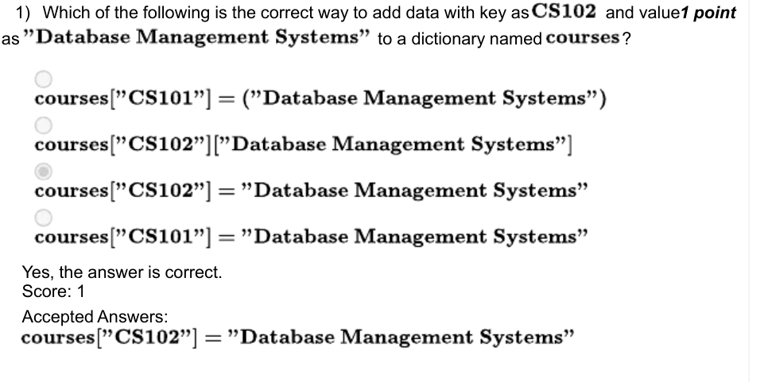

### Q2. What is the probability of Monty not opening the door with goat, given the hypothesis that you initially chose the door which has car ?

- [x] 0
- [ ] 0.5
- [ ] 1
- [ ] 0.33
> Yes, the answer is correct. Score: 1

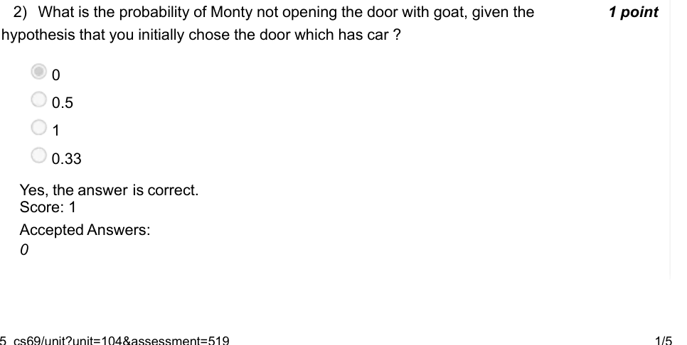

### Q3. What should be replaced with
in line 10, so that there is high chance that
?

- [ ] is equal to 2 ?
- [ ] _ 󰁩 󰁮 󰁡 󰁬 󰁣 󰁨 󰁯 󰁩 󰁣 󰁥
- [x] 2
- [ ] % 2 != 0 2 ∗ ∗ ( 1 0 2 4 )
- [ ] % 2 == 0 2 ∗ ( 2 ∗ ∗ ( 8 9 ) + 7 )
- [ ] % len(doors) != 1 ( 2 ∗ ∗ ( 9 0 ) )
> Yes, the answer is correct. Score: 1

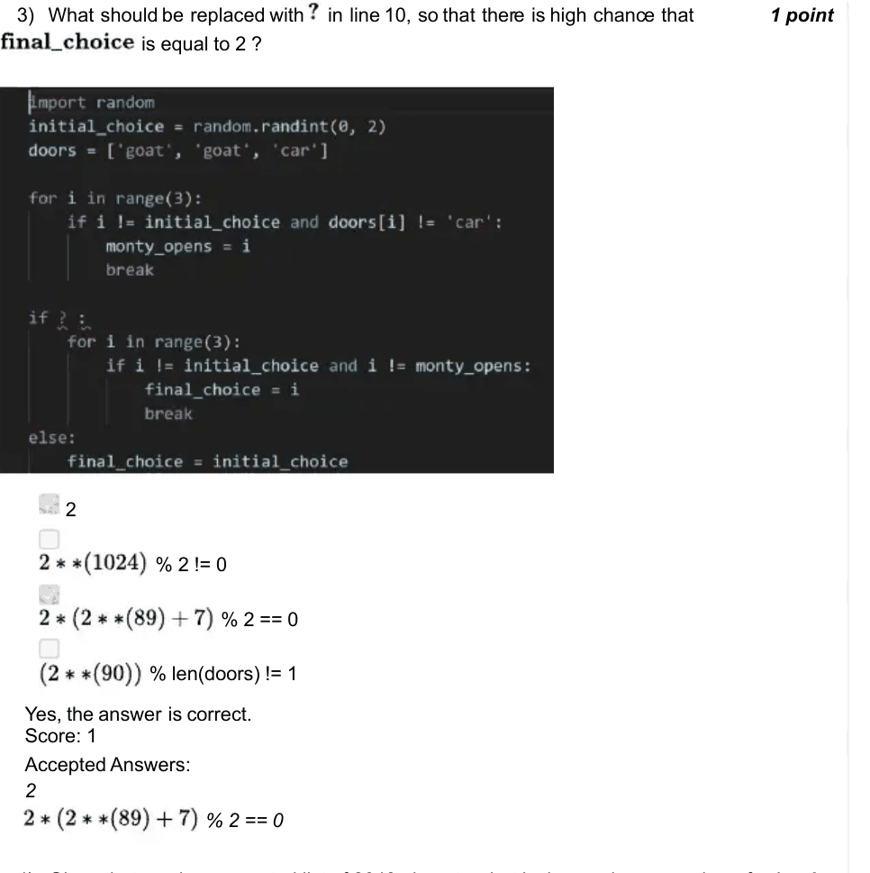

### Q4. Given that you have a sorted list of 2048 elemets,what is the maximum number of comparisons to search such an element using linear search ? Can binary search do it in less number of comparisons ?

- [ ] Yes, binary search can do it more efficiently, linear search takes 1024 comparisons
- [x] Yes, binary search can do it more efficiently, linear search takes 2048 comparisons
- [ ] No, binary search may/may not do it more efficiently, linear search takes 1024 comparisons
- [ ] No, binary search will take more comparisons, linear search takes 2048 comparisons
> Yes, the answer is correct. Score: 1

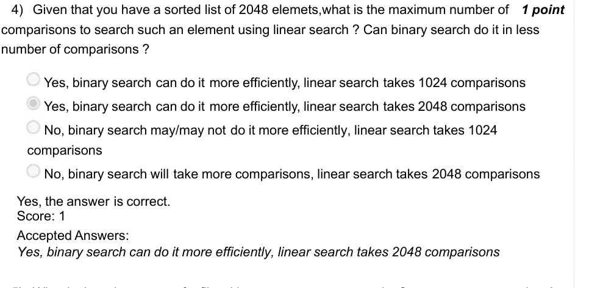

### Q5. What is the primary use of a file with a .wav or .wave extension?

- [ ] Storing video recordings
- [ ] Storing log files
- [ ] Storing waves of files
- [x] Storing audio recordings
> Yes, the answer is correct. Score: 1

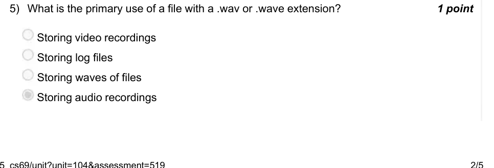

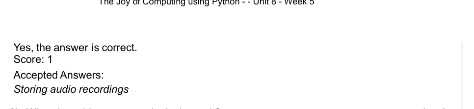

### Q6. What does this program print in the end ?

- [x] Fraction of throws where both players showed different symbol(rock/paper/scissors)
- [ ] Fraction of throws where both players showed rock.
- [ ] Fraction of throws where both players showed same symbol(rock/paper/scissors)
- [ ] Fraction of throws where both players showed paper.
> Yes, the answer is correct. Score: 1

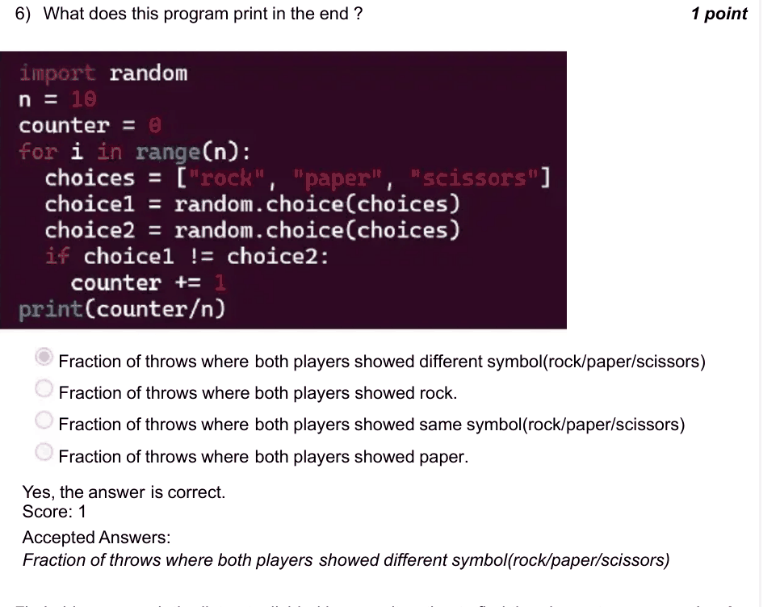

### Q7. In binary search the list gets divided in every iteration to find the element.

- [x] True
- [ ] False
> Yes, the answer is correct. Score: 1

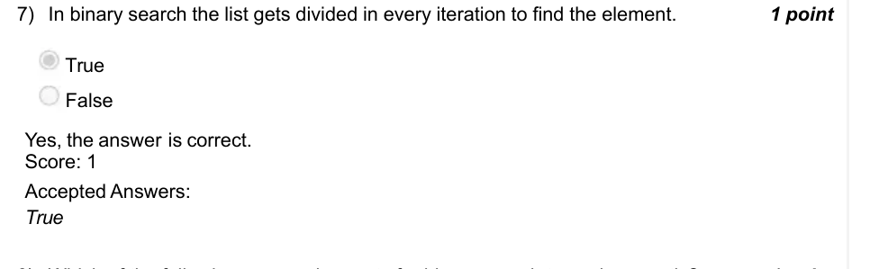

### Q8. Which of the following are requirements for binary search to work correctly?

- [ ] The list can be unsorted.
- [ ] The list must contain only positive integers.
- [x] The list must be sorted.
- [ ] The list must have no duplicate values.
> Yes, the answer is correct. Score: 1

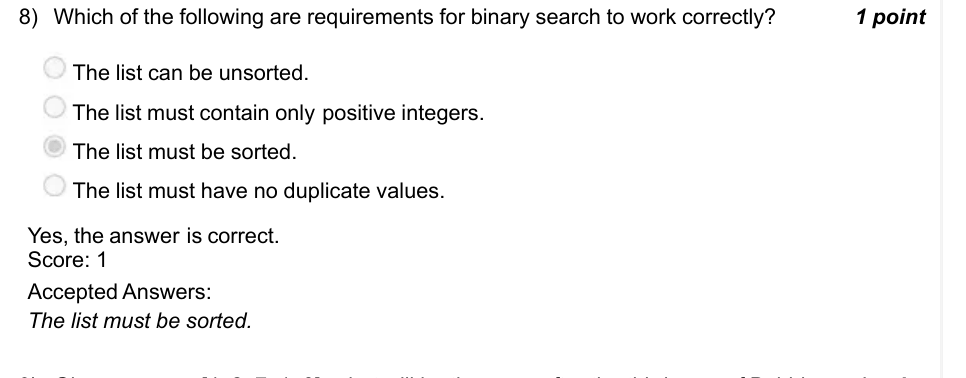

### Q9. Given an array [4, 2, 7, 1, 3], what will be the array after the third pass of Bubble
[
1
,
3
,
2
,
4
,
7
]
[
2
,
4
,
1
,
3
,
7
]
[
1
,
2
,
3
,
4
,
7
]
[
2
,
1
,
3
,
4
,
7
]

Accepted answer(s): [; 1; ,; 2; ,; 3; ,; 4; ,; 7; ]
> Yes, the answer is correct. Score: 1

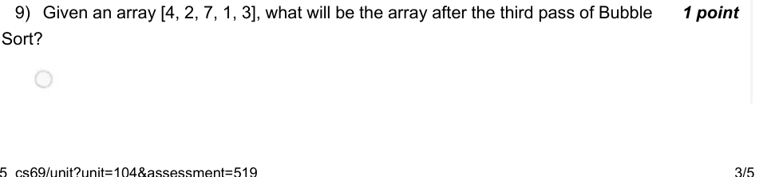

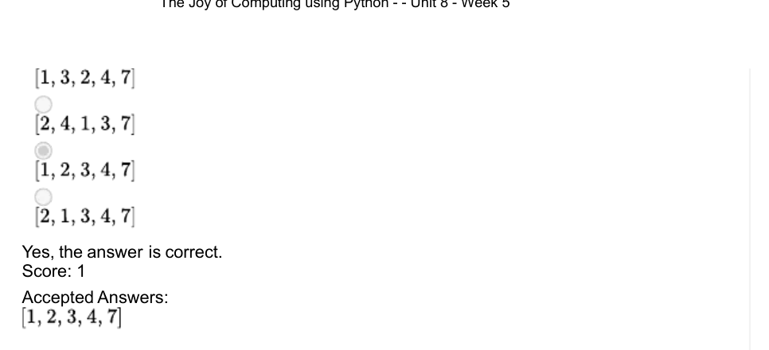

### Q10. How many swaps are performed in iteration 3 for bubble sorting list [5,4,3,2,1]? Enter 0 if the list is sorted in less than 3 iterations.

Accepted answer(s): (Type: Numeric) 2
> Yes, the answer is correct. Score: 1

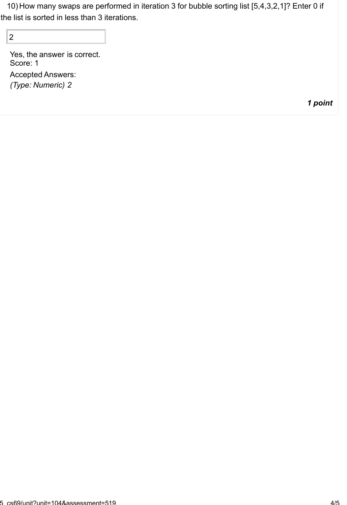

