# JOC Jan-2025 · Week 6: portal print

- Source: `Python-NPTEL (portal print, Wk1-12).pdf` pages 28–32 (portal review printout). Parsed text below; the cropped image under each question is the exact page content (code, figures and ticks as printed) and is authoritative.
- `[x]` = option equal to the portal's **Accepted Answer** (official). Lines may carry stray spaces from the PDF text layer.

> bhargavi111gm@gmail.com · Due on 2025-03-05, 23:59 IST.

### Q1. If n is a positive integer, what is the output of the function given input n,

- [x] Sum of numbers from 1 to n
- [ ] Sum of numbers from 1 to n-1
- [ ] n-1
- [ ] n
> Yes, the answer is cor rect. Score: 1

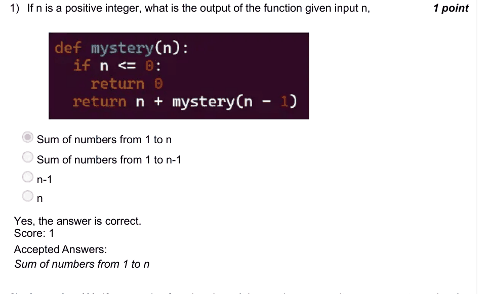

### Q2. Assertion (A): If a recursive function doesn’t have a base case, it may never stop.
Reason (R): Recursion means that a function calls itself.

- [ ] Both (A) and (R) are true, and (R) is the correct explanation of (A).
- [x] Both (A) and (R) are true, but (R) is not the correct explanation of (A).
- [ ] (A) is true, but (R) is false.
- [ ] (A) is false, but (R) is true.
> Yes, the answer is correct. Score: 1

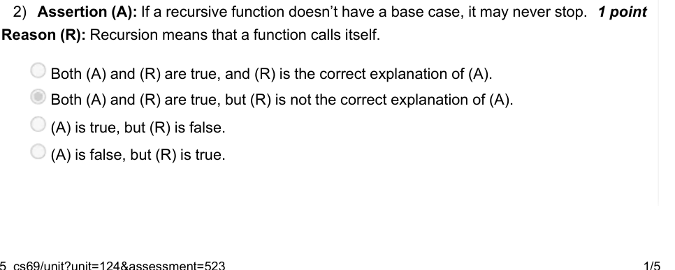

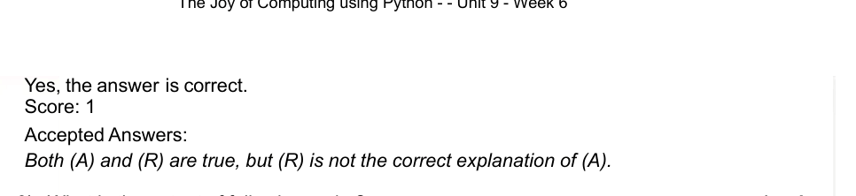

### Q3. What is the output of following code ?

- [ ] Error
- [ ] 25
- [x] 26
- [ ] 5
> Yes, the answer is correct. Score: 1

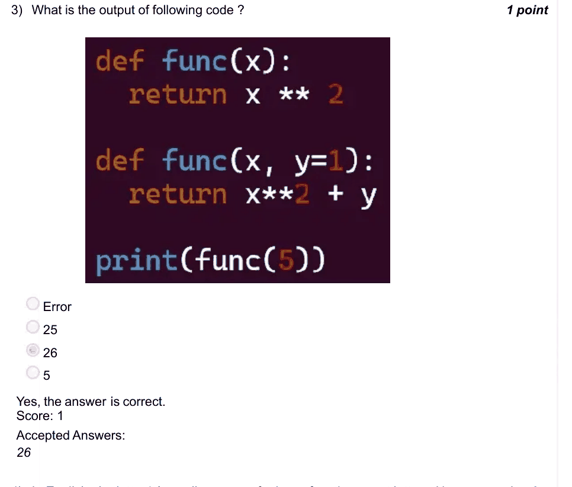

### Q4. In English, the letter ‘z’ usually appears far less often than most letters. Now imagine applying a Substitution Cipher to a large body of English text, where ‘z’ is replaced by ‘r’, and every other letter is also mapped to a unique letter. After encryption, which letter is likely to be the least frequent in the new text?
Hint: Search the internet for more info, if needed.

- [ ] z
- [x] r
- [ ] e
- [ ] It is not possible to determine
> Yes, the answer is correct. Score: 1

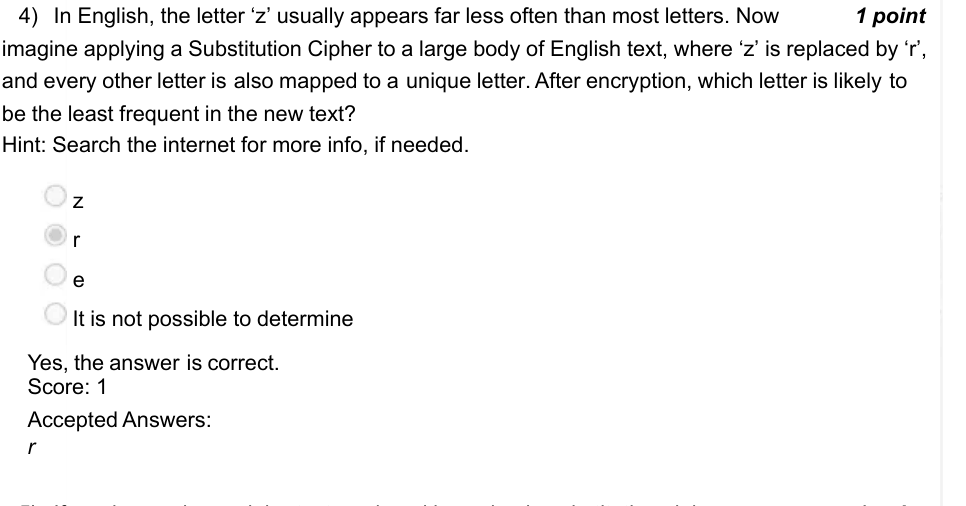

### Q5. If you have a large ciphertext produced by a simple substitution cipher on an English text, can you determine the original message by examining how often each letter appears?
Hint: Search the internet for more info, if needed.

- [x] Yes, it can be done.
- [ ] No, it cannot be done.
> Yes, the answer is correct. Score: 1

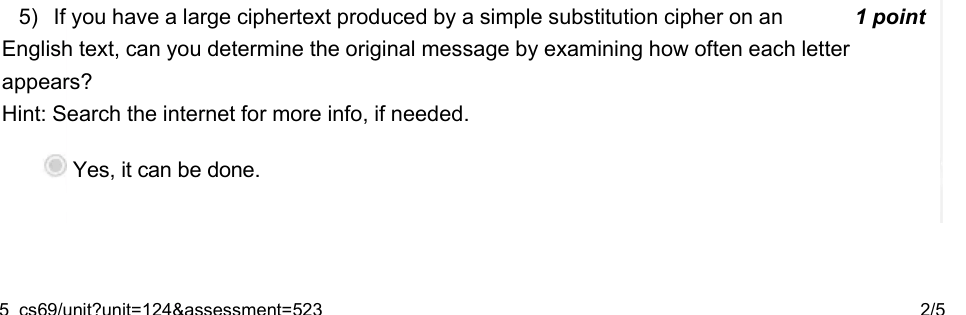

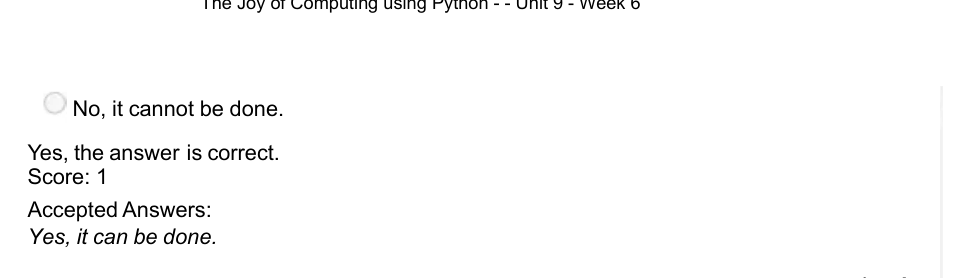

### Q6. Suppose you suspect that a piece of ciphertext was produced using a simple substitution cipher. Under which circumstances might frequency analysis fail to yield accurate results?

- [x] The ciphertext is short.
- [x] The ciphertext was encrypted with another method before encrypting with sub-stitution cipher.
- [ ] The ciphertext is very long.
> Yes, the answer is correct. Score: 1

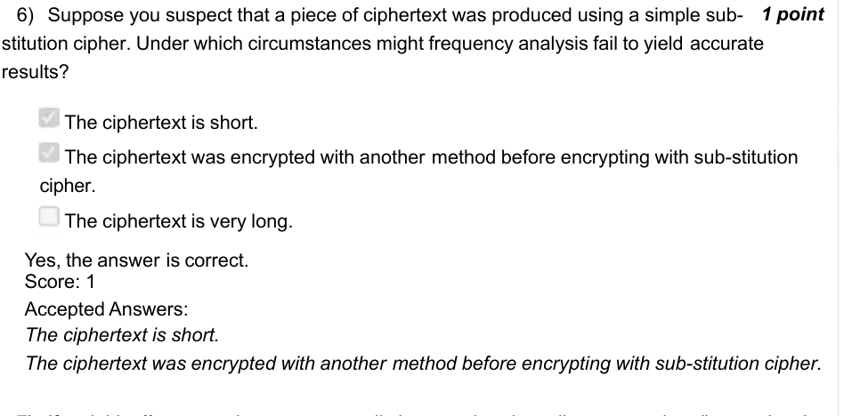

### Q7. If variable dict_name is a non-empty dictionary, what does dict name.values() return?

- [ ] Returns nothing, but prints all the keys in the dictionary.
- [ ] Returns a list of all the keys in the dictionary.
- [x] Returns a list of all the values in the dictionary.
- [ ] Returns a list of all the items in the dictionary.
> Yes, the answer is correct. Score: 1

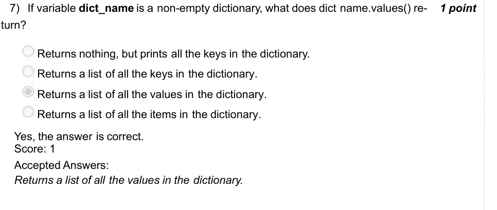

### Q8. Assertion (A): A Caesar Cipher is a type of Substitution Cipher.
Reason (R): In a Caesar Cipher, each letter in the plaintext is replaced by a letter at a fixed shift in the alphabet.

- [x] Both (A) and (R) are true, and (R) is the correct explanation of (A).
- [ ] Both (A) and (R) are true, but (R) is not the correct explanation of (A).
- [ ] (A) is true, but (R) is false.
- [ ] (A) is false, but (R) is true.
> Yes, the answer is correct. Score: 1

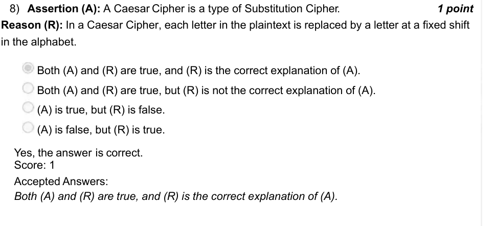

### Q9. Which outcome generally follows from providing a proper base case in a recursive function?

- [x] The function returns a predefined result when the base condition is met.
- [x] It prevents infinite recursion and stops when a specific codition is met.
- [ ] It ensures recursion depth is always constant.
- [ ] It allows the function to keep calling itself indefinitely.
> Yes, the answer is correct. Score: 1

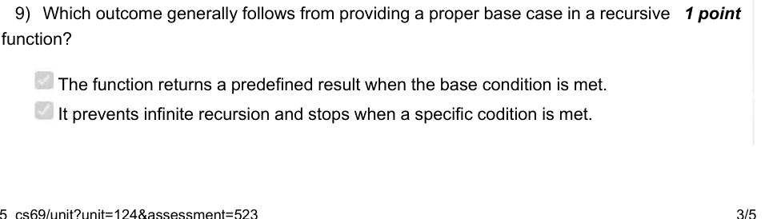

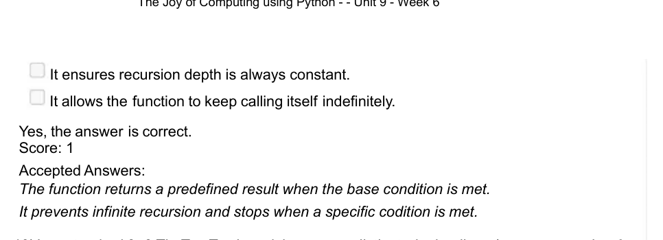

### Q10. In a standard 3×3 Tic-Tac-Toe board, how many distinct winning lines (rows, columns, or diagonals) pass through the center square?

- [ ] 3
- [ ] 2
- [ ] 5
- [x] 4
> Yes, the answer is correct. Score: 1

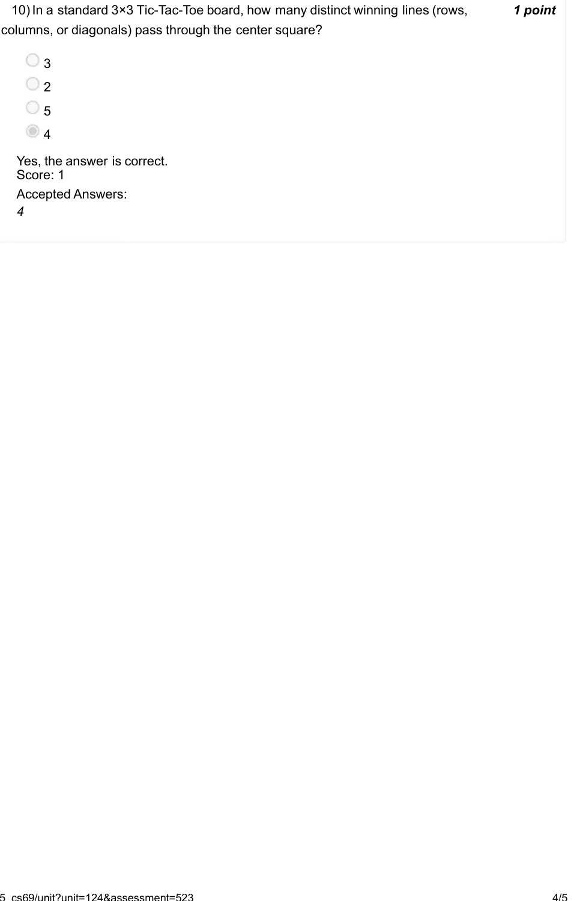

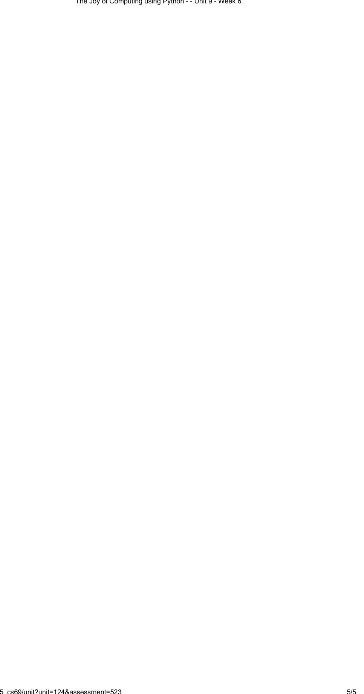
