# JOC Jan-2025 · Week 7: portal print

- Source: `Python-NPTEL (portal print, Wk1-12).pdf` pages 33–38 (portal review printout). Parsed text below; the cropped image under each question is the exact page content (code, figures and ticks as printed) and is authoritative.
- `[x]` = option equal to the portal's **Accepted Answer** (official). Lines may carry stray spaces from the PDF text layer.

> bhargavi111gm@gmail.com · Due on 2025-03-12, 23:59 IST.

### Q1. What will be the output of the following code?

- [ ] 2
- [x] 3
- [ ] 4
- [ ] Error
> Yes, the answer is cor rect. Score: 1

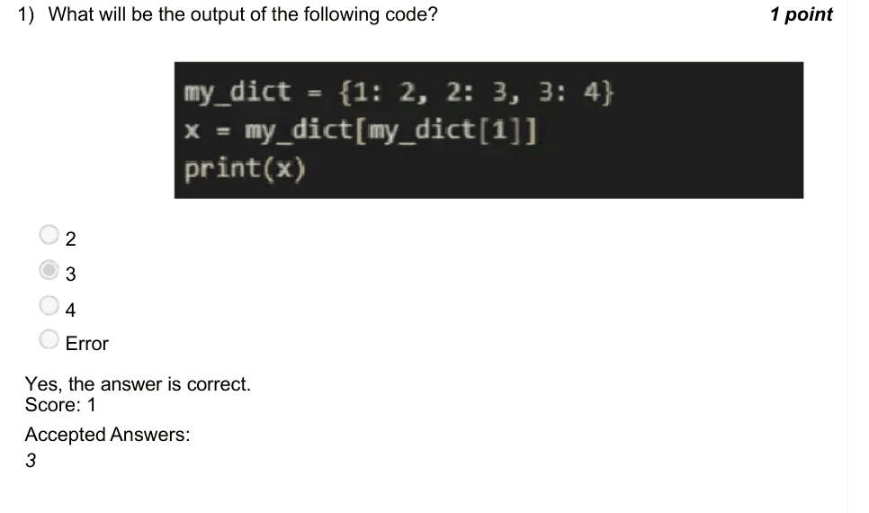

### Q2. What is the spiral order traversal of the given matrix?

- [ ] 1, 2, 3, 7, 11, 10, 9, 5, 6
- [ ] 1, 2, 3, 5, 6, 7, 9, 10, 11
- [x] 1, 5, 9, 10, 11, 7, 3, 2, 6
- [ ] 1, 5, 9, 2, 6, 10, 3, 7, 11
> Yes, the answer is correct. Score: 1

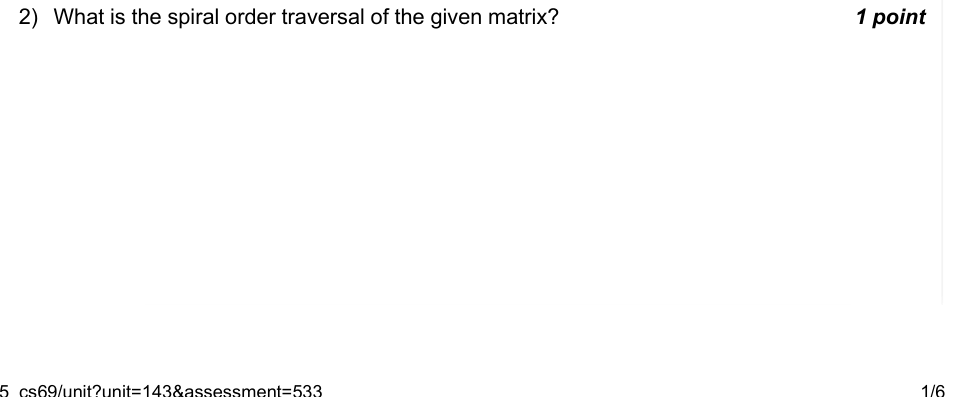

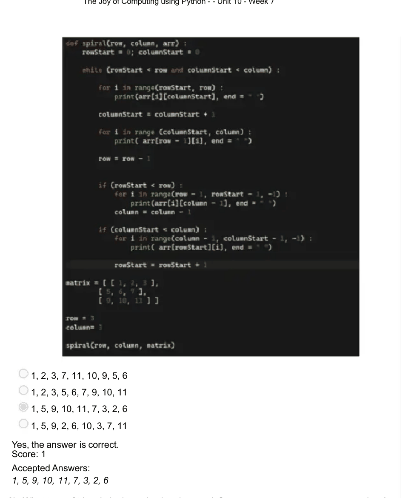

### Q3. What type of triangle is drawn by the given code?

- [ ] Scalar triangle
- [ ] Right angle triangle
- [x] Equilateral triangle
- [ ] Isosceles triangle
> Yes, the answer is correct. Score: 1

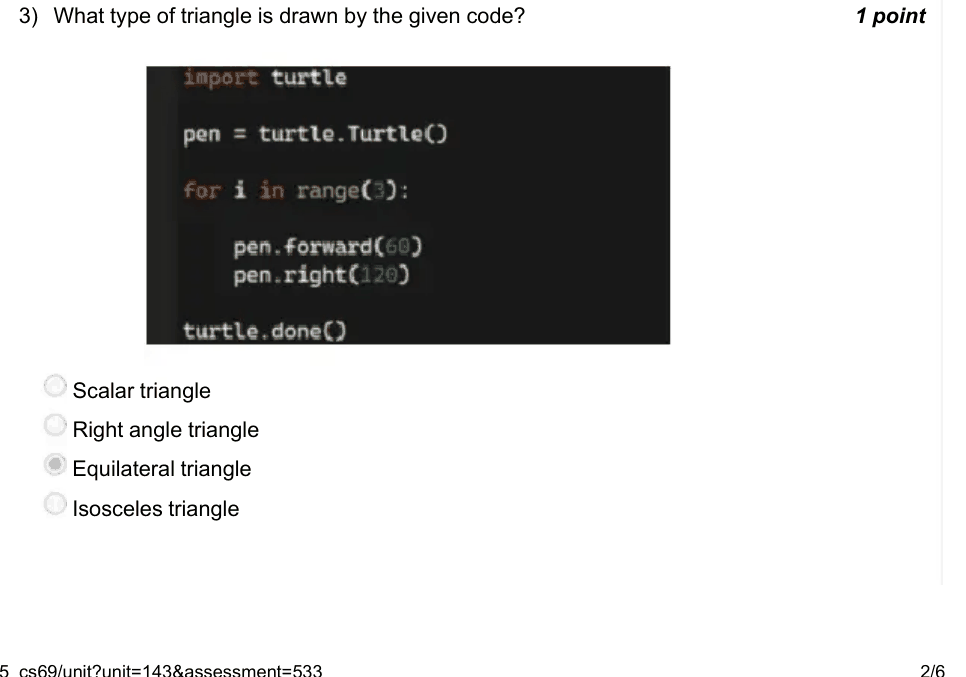

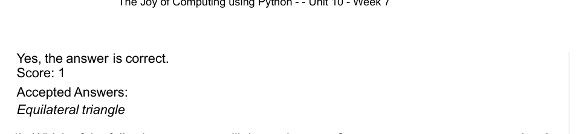

### Q4. (question text in image)

- [ ] Which of the following programs will draw a hexagon?
> Yes, the answer is correct. Score: 1

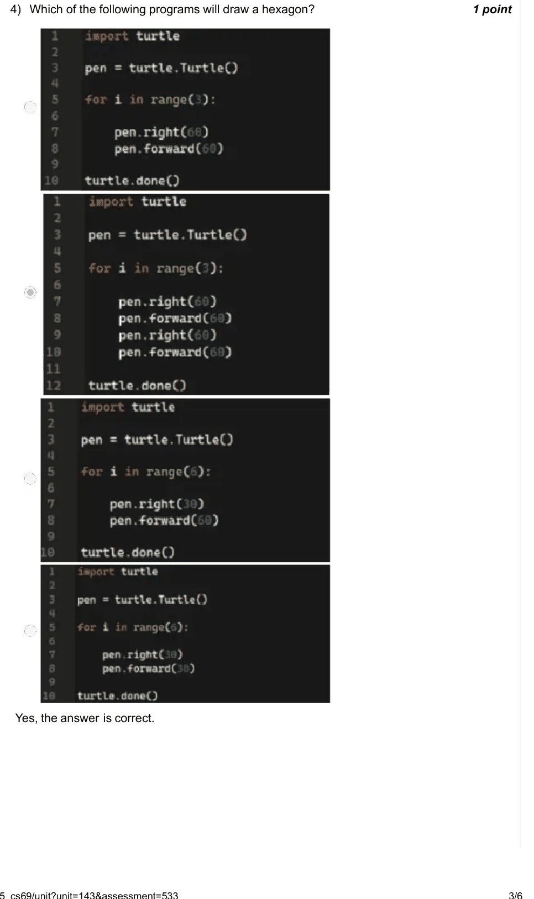

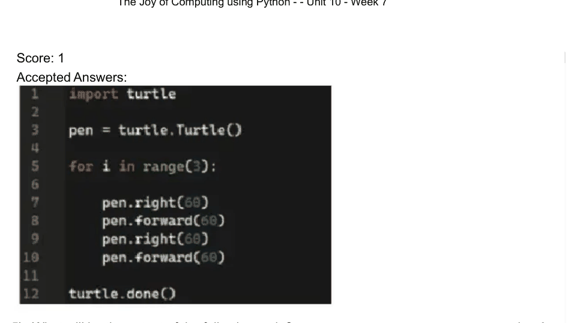

### Q5. What will be the output of the following code?

- [ ] {1: ”one”, 1.0: ”float one”, True: ”boolean one”}
- [x] {1: ”boolean one”}
- [ ] {1: ”one”, 1.0: ”float one”}
- [ ] {1.0: ”float one”, True: ”boolean one”}
> Yes, the answer is correct. Score: 1

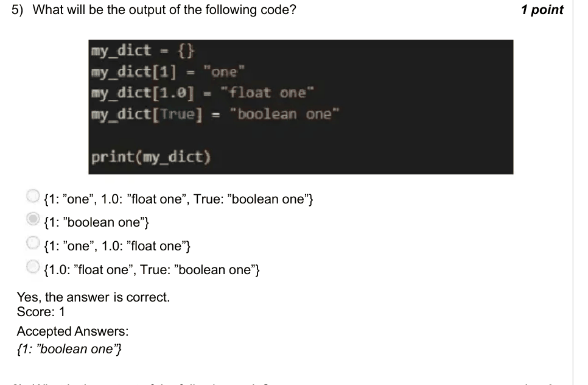

### Q6. What is the output of the following code?

> Yes, the answer is correct. Score: 1

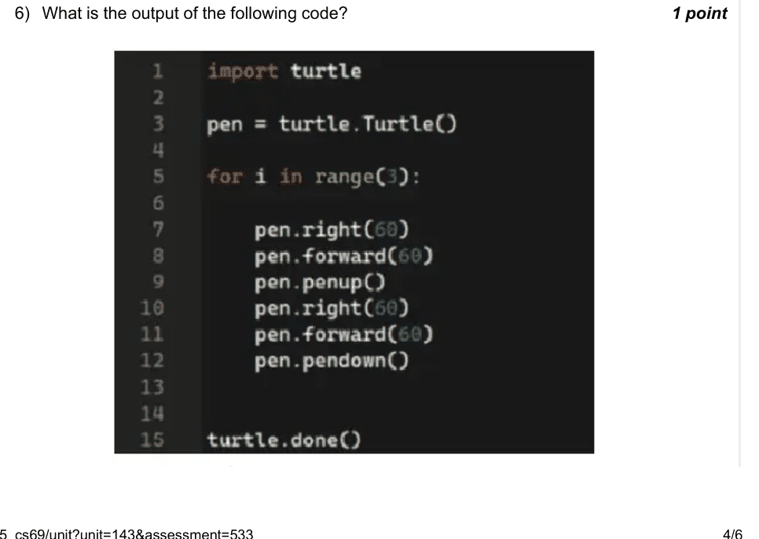

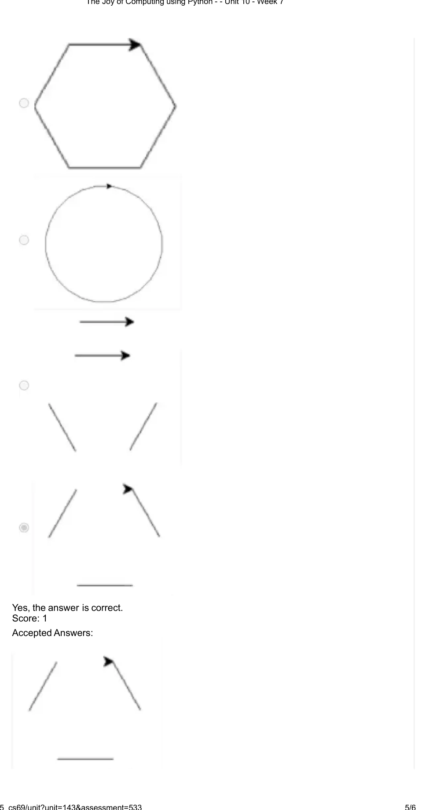

### Q7. Which turtle command is equivalent to lifting up a pen?

- [ ] penlift()
- [x] penup()
- [ ] uppen()
- [ ] penremove()
> Yes, the answer is correct. Score: 1

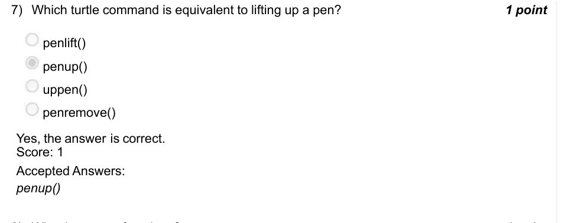

### Q8. Why do we use functions?

- [ ] To improve readability.
- [ ] To reuse code blocks.
- [ ] For the ease of code debugging.
- [x] All of the above.
> Yes, the answer is correct. Score: 1

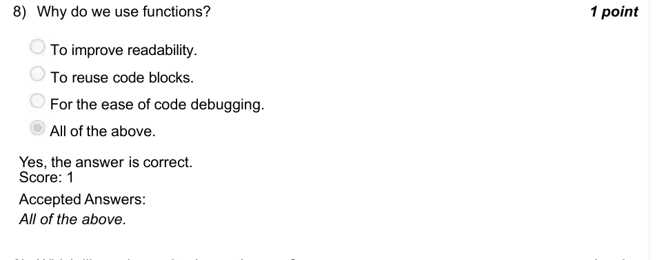

### Q9. Which library is used to import images?

- [x] PIL
- [ ] Imageview
- [ ] IMG
- [ ] image
> Yes, the answer is correct. Score: 1

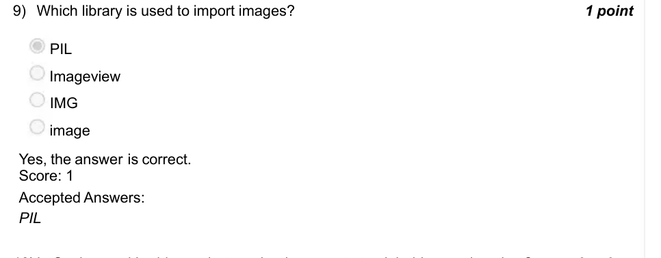

### Q10. In Snakes and Ladders, what can be the ways to track ladders and snakes?

- [ ] Maintain a dictionary with snake or ladder number blocks as keys.
- [ ] Using the if condition to check on every number.
- [x] Both A and B.
- [x] Both A and B.
> Yes, the answer is correct. Score: 0

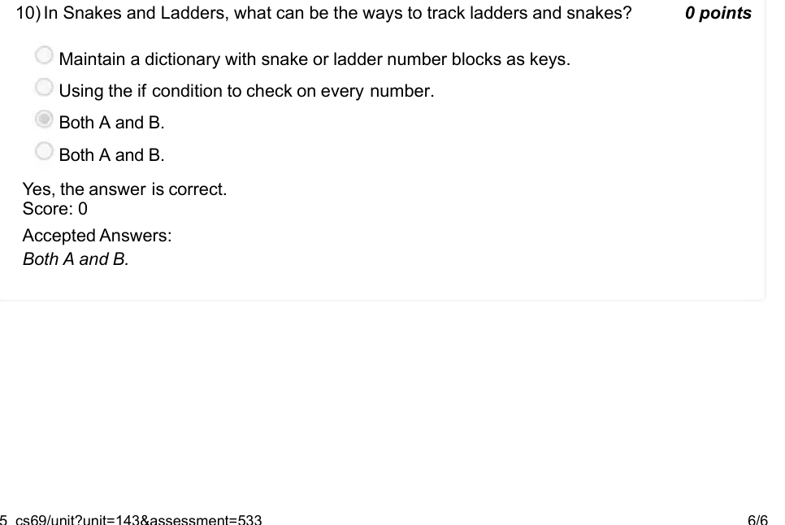
