# JOC Jan-2025 · Week 8: portal print

- Source: `Python-NPTEL (portal print, Wk1-12).pdf` pages 39–43 (portal review printout). Parsed text below; the cropped image under each question is the exact page content (code, figures and ticks as printed) and is authoritative.
- `[x]` = option equal to the portal's **Accepted Answer** (official). Lines may carry stray spaces from the PDF text layer.

> bhargavi111gm@gmail.com  · Due on 2025-03-19, 23:59 IST.

### Q1. What will be the output of the following Python code?

- [x] ([1, 2, 5], [3, 4])
- [ ] ([1, 2], [3, 4])
- [ ] ([1, 2], [3, 4, 5])
- [ ] TypeError: Tuple object does not support item assignment
> Yes, the answer is correct. Score: 1

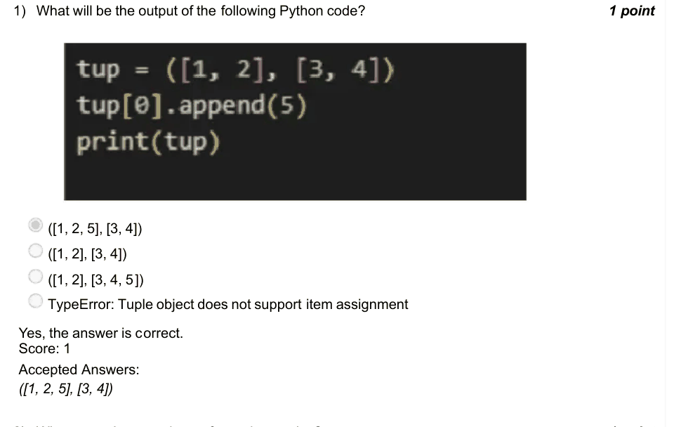

### Q2. What operations can be performed on tuples?

- [ ] Tuples are appendable
- [ ] We can delete a value from tuples
- [ ] Both (a) and (b)
- [x] We can count the number of instances of an element
> Yes, the answer is correct. Score: 1

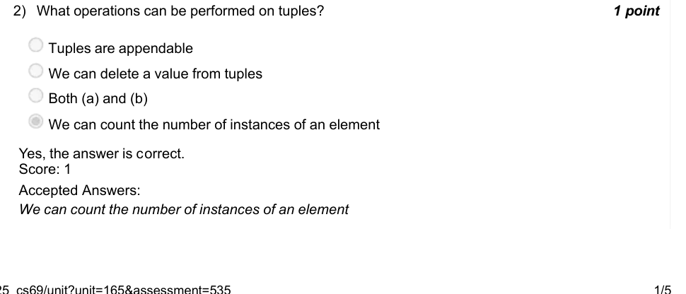

### Q3. What will be the output of the following Python code?

- [ ] 1,2,3,4,5
- [ ] 5,4,3,2,1
- [x] 5,4,3,2
- [ ] 1,2,3,4
> Yes, the answer is correct. Score: 1

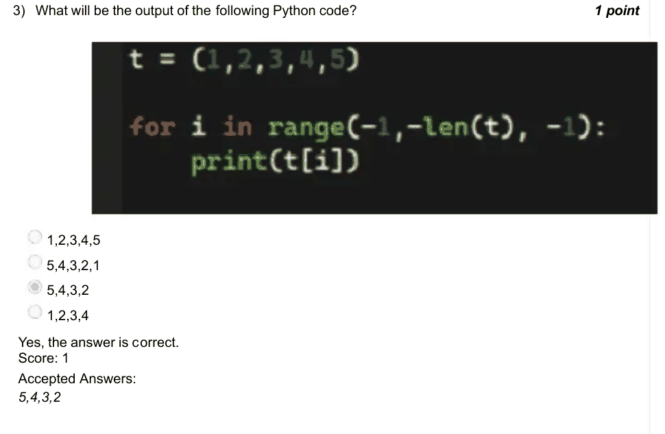

### Q4. What will be the output of the following Python code?

- [x] facebook
- [ ] gbdfcppl
- [ ] ezbdannj
- [ ] ytvxuhhd
> Yes, the answer is correct. Score: 1

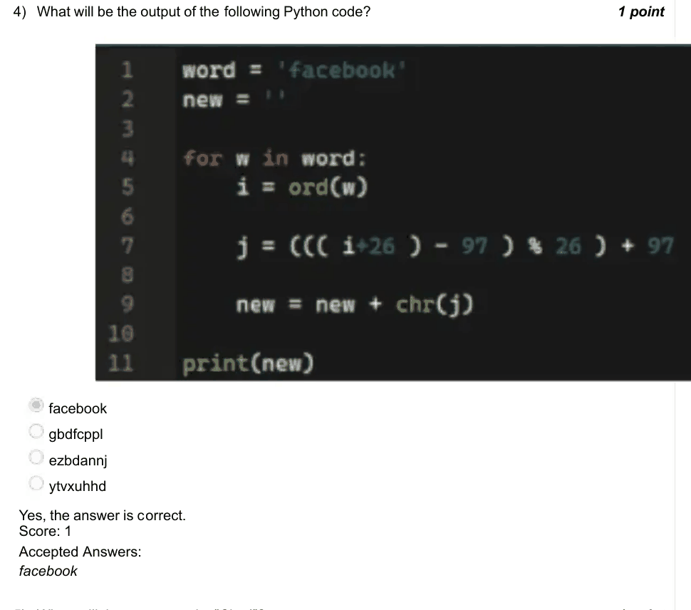

### Q5. When will the program print ”Clap!”?

- [ ] When both players enter the same letters.
- [x] When player 2 enters the next letter after player 1.
- [ ] When player 1 enters the next letter after player 2.
- [ ] It will never clap.
> Yes, the answer is correct. Score: 1

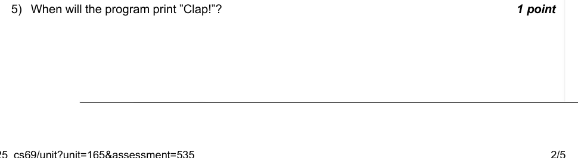

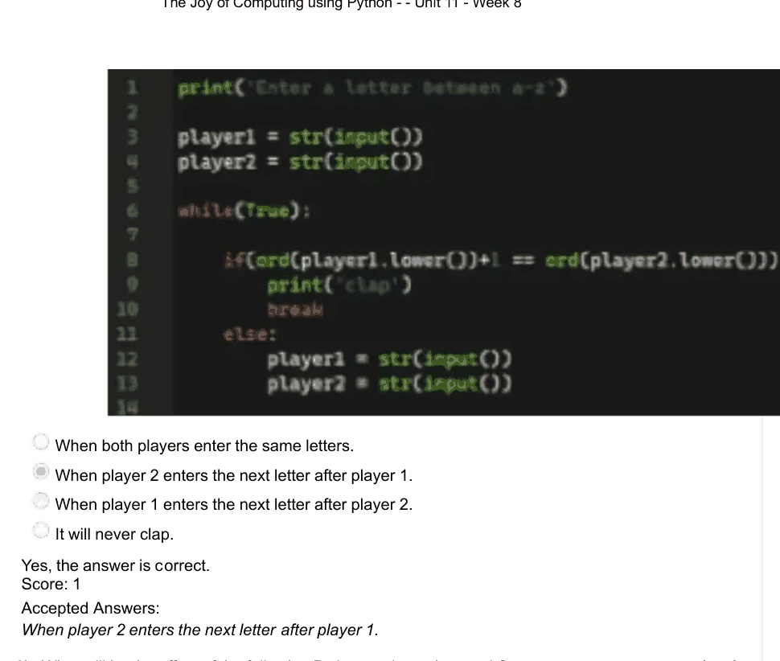

### Q6. What will be the effect of the following Python code on the graph?

- [ ] The graph will go up when guess and pick are the same.
- [ ] The graph will go down when guess and pick are the same.
- [ ] The graph will go up when guess and pick are not the same.
- [x] Both (b) and (c).
> Yes, the answer is correct. Score: 1

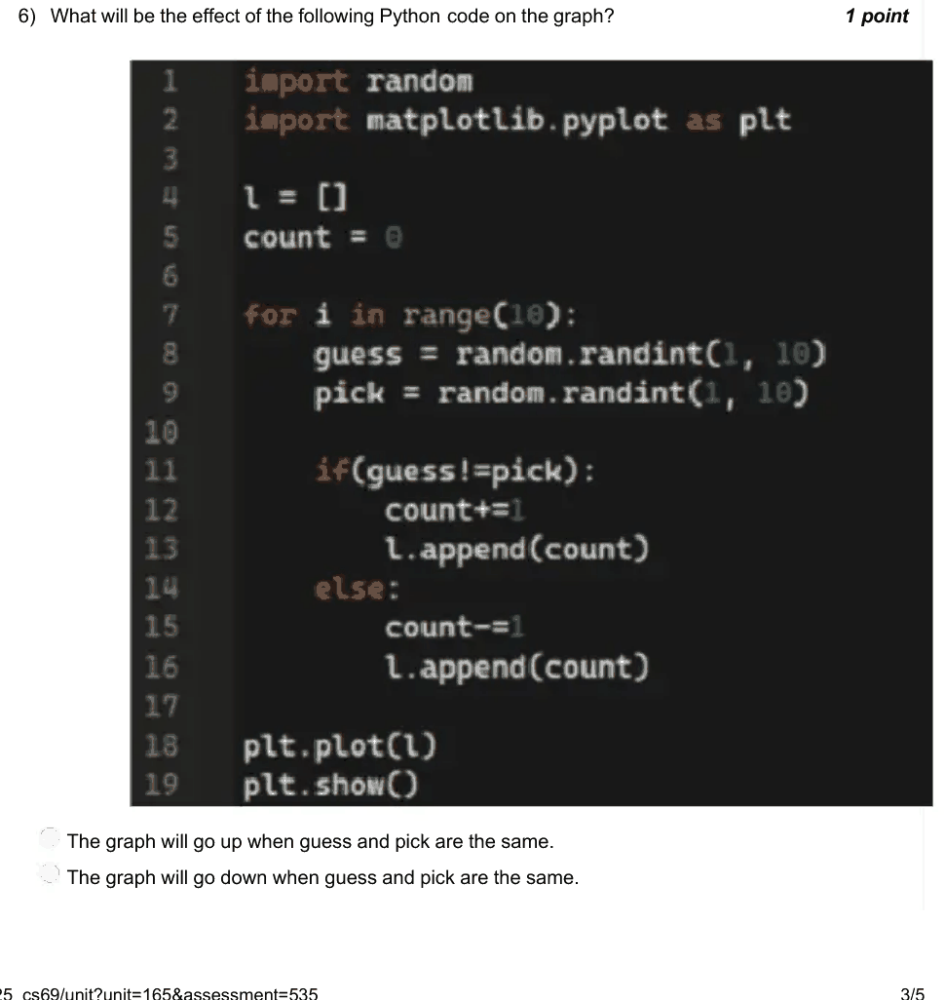

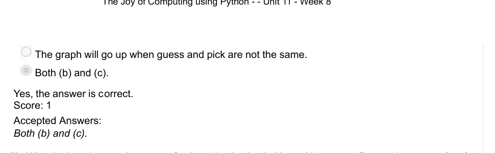

### Q7. What is the primary advantage of using tokenization in Natural Language Processing

- [ ] It allows the model to understand entire sentences as a single entity.
- [x] It splits text into smaller, manageable units, which helps in processing language more effectively.
- [ ] It eliminates the need for syntactical analysis.
- [ ] It improves the grammatical structure of the text.
> Yes, the answer is correct. Score: 1

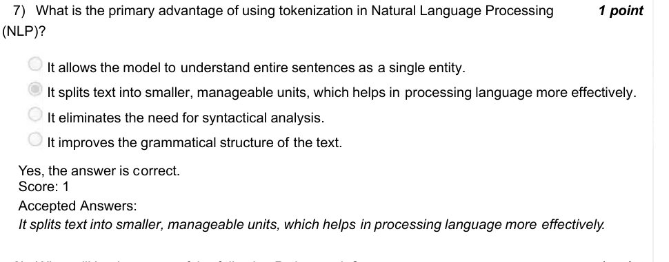

### Q8. What will be the output of the following Python code?

- [ ] [’!’, ’e’, ’e’, ’e’, ’h’, ’h’, ’r’, ’t’, ’y’]
- [ ] [’h’, ’e’, ’y’, ’!’, ’t’, ’h’, ’e’, ’r’, ’e’]
- [x] [’y’, ’t’, ’r’, ’h’, ’h’, ’e’, ’e’, ’e’, ’!’]
- [ ] None of the above
> Yes, the answer is correct. Score: 1

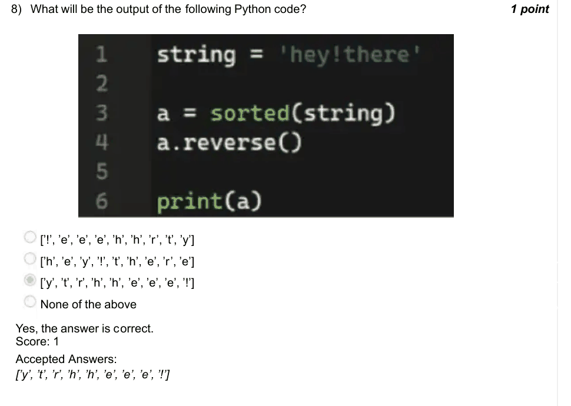

### Q9. While converting an image into black and white, can it be converted back into a colored

- [ ] True
- [x] False
> Yes, the answer is correct. Score: 1

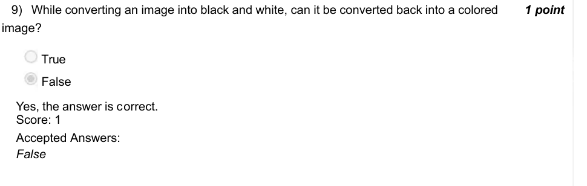

### Q10. What will be the output of the following Python code?
Converting lowercase letters into uppercase.

- [ ] Converting uppercase letters into lowercase.
- [ ] Returns the same word.
- [ ] Error.
> Accepted answer (not matched to a printed option): Converting lowercase letters into uppercase.
> Yes, the answer is correct. Score: 1

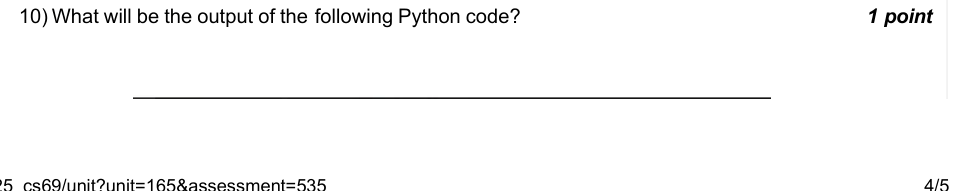

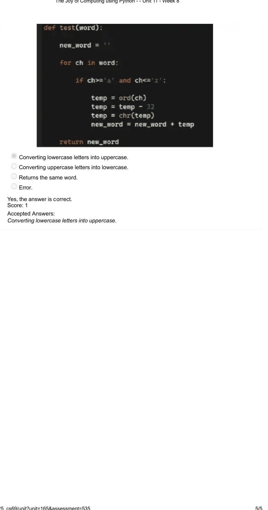
