# JOC Jan-2025 · Week 9: portal print

- Source: `Python-NPTEL (portal print, Wk1-12).pdf` pages 44–49 (portal review printout). Parsed text below; the cropped image under each question is the exact page content (code, figures and ticks as printed) and is authoritative.
- `[x]` = option equal to the portal's **Accepted Answer** (official). Lines may carry stray spaces from the PDF text layer.

> bhargavi111gm@gmail.com  · Due on 2025-03-26, 23:59 IST.

### Q1. How can we identify which book is written by which author?

- [ ] By matching handwriting.
- [x] By analyzing word length with previous books.
- [ ] By analyzing the number of pages in a book.
- [ ] By analyzing the book’s preface.
> Yes, the answer is correct. Score: 1

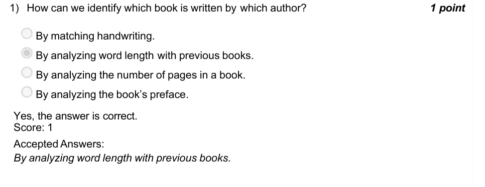

### Q2. What is the key diff erence between lists and tuples in Python, and when would you

- [ ] Lists are immutable and can be used when elements need to be modified, while tuples are mutable and best for storing fixed data.
- [ ] Lists are mutable and can be used for dynamic data manipulation, while tuples are immutable and used to store fixed collections of items.
- [ ] Both lists and tuples are mutable and can be used interchangeably for any purpose.
- [ ] Tuples are used only for string data, while lists can store any data type.
> Accepted answer (not matched to a printed option): Lists are mutable and can be used for dynamic data manipulation, while tuples are immutable; and used to store fixed collections of items.
> Yes, the answer is correct. Score: 1

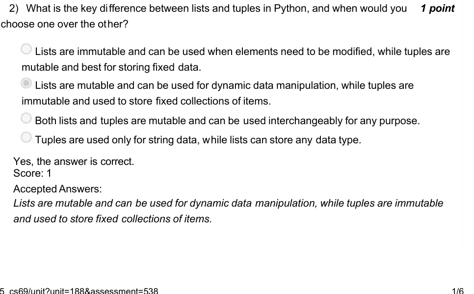

### Q3. Will the following piece of code always return True?

- [ ] True
- [x] False
> Yes, the answer is correct. Score: 1

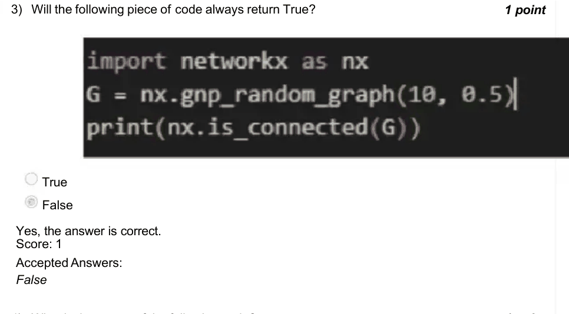

### Q4. What is the output of the following code?

> Yes, the answer is correct. Score: 1

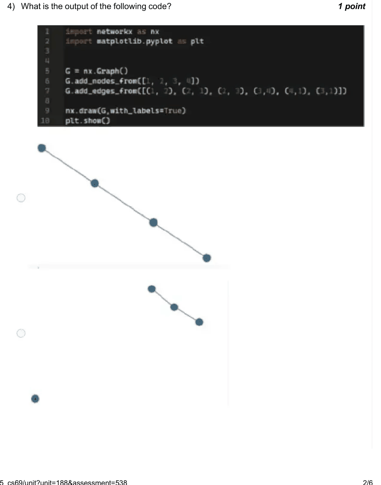

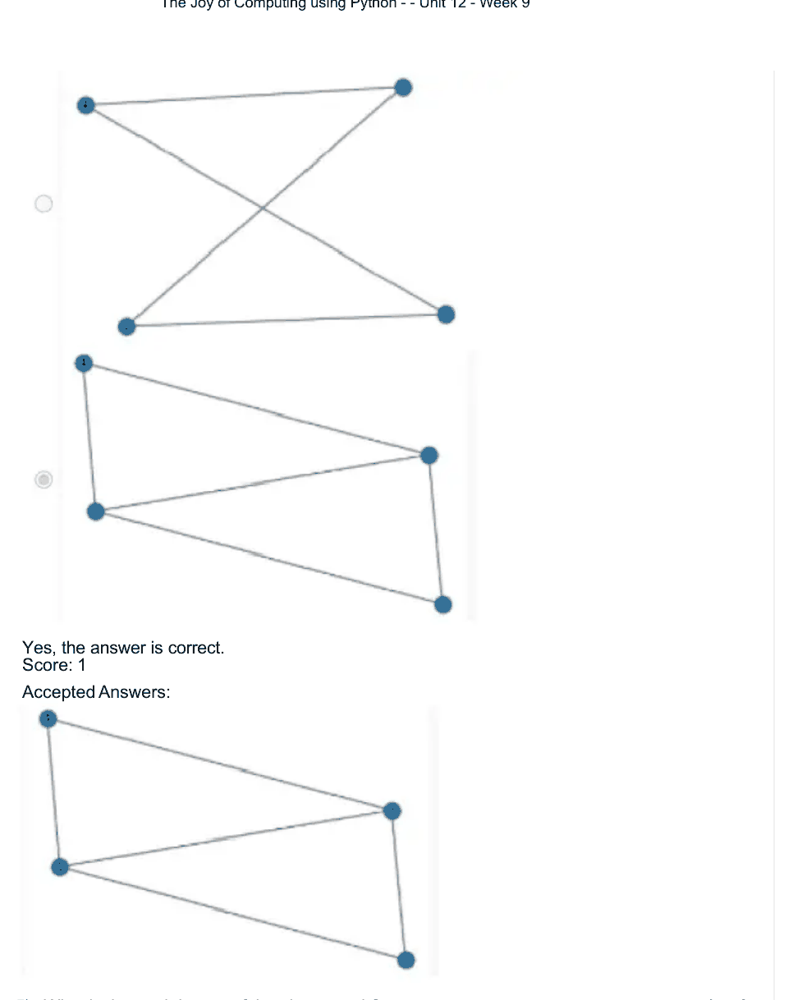

### Q5. What is the total degree of the given graph?

- [ ] 10
- [x] 8
- [ ] 6
- [ ] 4
> Yes, the answer is correct. Score: 1

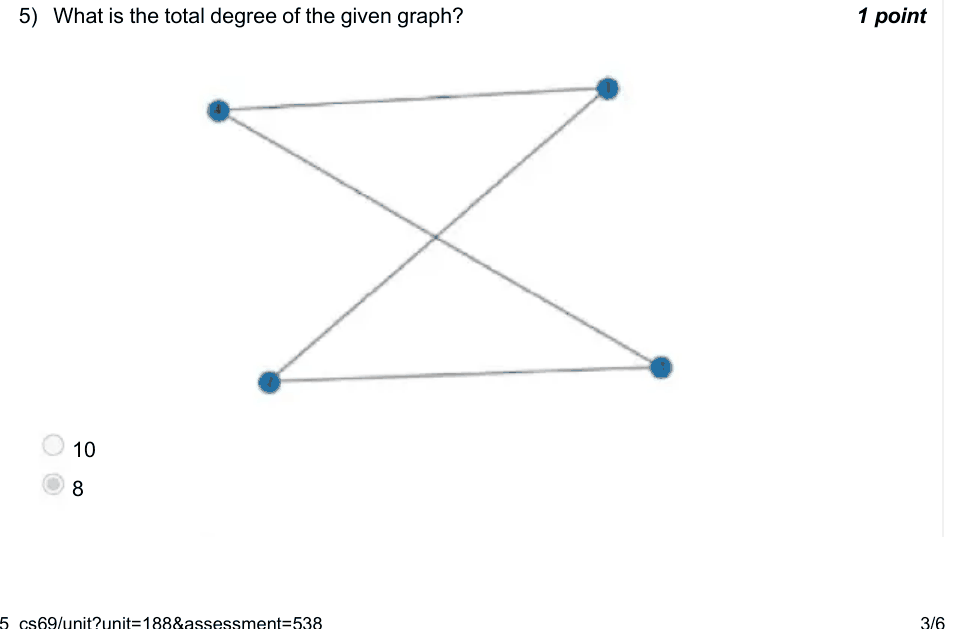

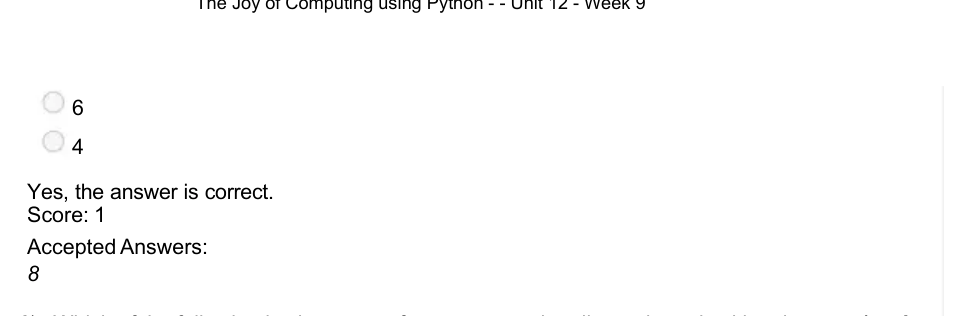

### Q6. Which of the following is always true for a connected undirected graph with at least

- [ ] Every node has an even degree
- [x] The sum of all node degrees is even
- [ ] The graph contains an Eulerian path
- [ ] The graph contains a Hamiltonian cycle
> Yes, the answer is correct. Score: 1

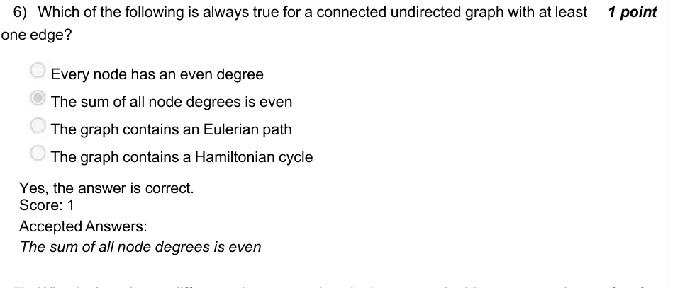

### Q7. What is the primary difference between using single quotes, double quotes, and

- [ ] Single and double quotes can only be used for single-line strings, while triple quotes are used for multi-line strings
- [ ] Single quotes are used for strings with one word, while double quotes are for strings with multiple words
- [ ] Double quotes are more efficient than single quotes for creating strings
- [ ] There is no difference in how Python interprets single quotes, double quotes, or triple quotes for strings
> Accepted answer (not matched to a printed option): Single and double quotes can only be used for single-line strings, while triple quotes are used; for multi-line strings
> Yes, the answer is correct. Score: 1

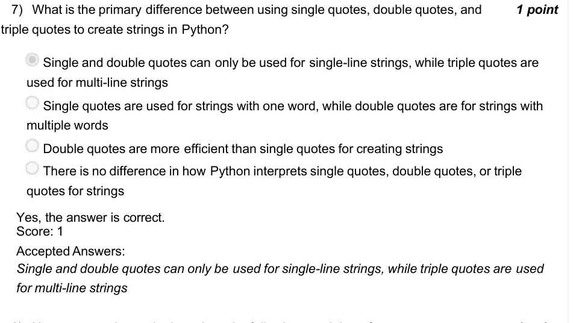

### Q8. How many nodes and edges does the following graph have?

- [x] 10,6
- [ ] 10,5
- [ ] 8,6
- [ ] 8,5
> Yes, the answer is correct. Score: 1

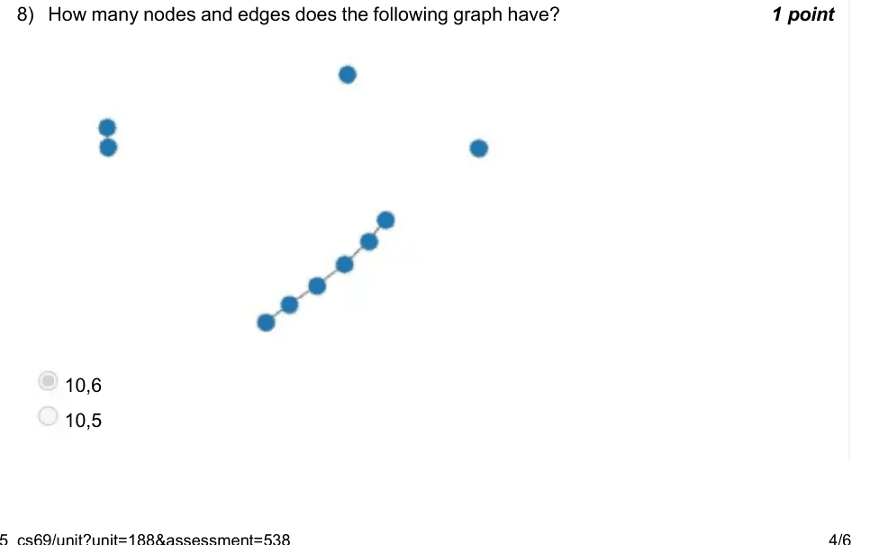

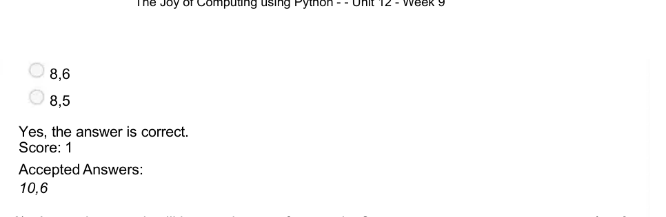

### Q9. (question text in image)

- [ ] A complete graph will have a degree of separation?
- [x] 1
- [ ] 2
- [ ] 3
- [ ] Depends on the number of nodes
> Yes, the answer is correct. Score: 1

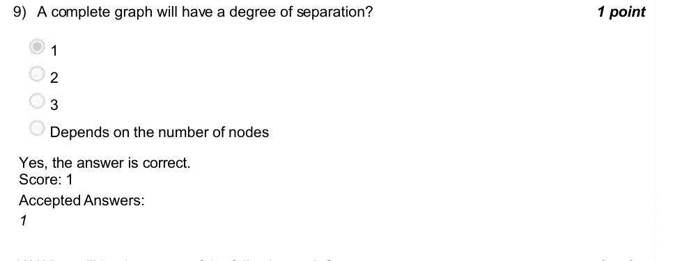

### Q10. What will be the output of the following code?

- [ ] It will print ”Hello”
- [x] It will raise a TypeError
- [ ] The string will be updated to ”Hello”
- [ ] It will change the first character to uppercase and print ”Hello”
> Yes, the answer is correct. Score: 1

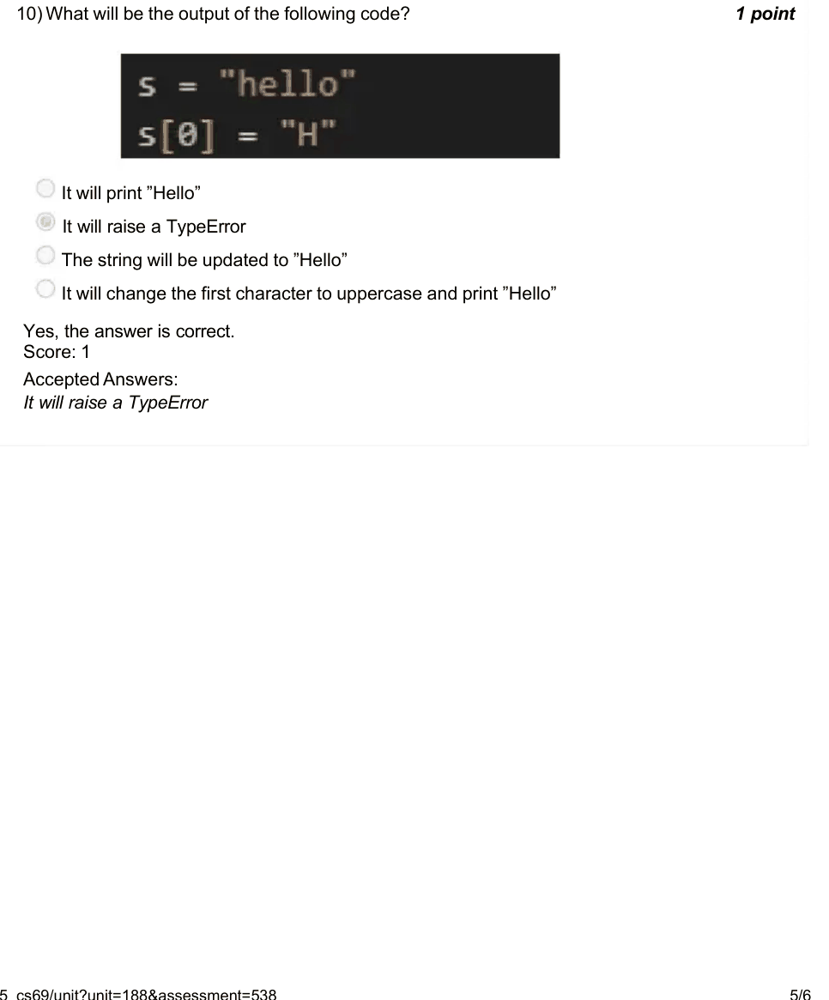

