# JOC Jan-2025 · Week 10: portal print

- Source: `Python-NPTEL (portal print, Wk1-12).pdf` pages 50–53 (portal review printout). Parsed text below; the cropped image under each question is the exact page content (code, figures and ticks as printed) and is authoritative.
- `[x]` = option equal to the portal's **Accepted Answer** (official). Lines may carry stray spaces from the PDF text layer.

> bhargavi111gm@gmail.com · Due on 2025-04-02, 23:59 IST.

### Q1. Which of the following statements is correct about Python’s dynamic typing?

- [ ] Variables must be declared before use.
- [x] A variable’s type can change at runtime.
- [ ] Python does not allow reassignment of variable types.
- [ ] Python is statically typed.
> Yes, the answer is correct. Score: 1

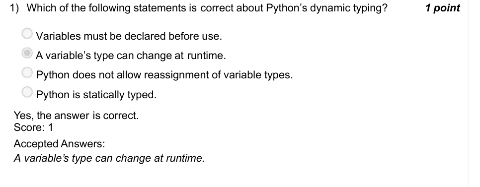

### Q2. What will be the output of the following code?

- [ ] toPmiagmnrh
- [ ] toPmiagmnrPg
- [x] tnoaigmooP
- [ ] toPmiagmnr
> Yes, the answer is correct. Score: 1

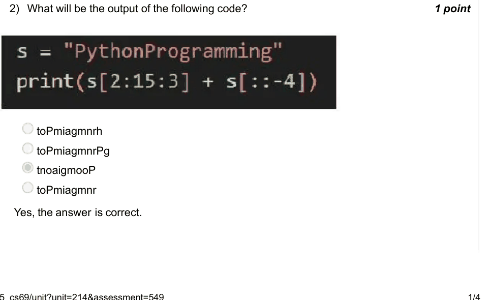

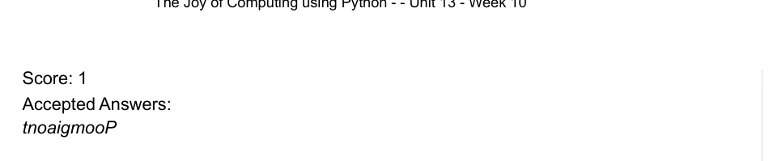

### Q3. What does the following code print?

- [ ] 6
- [ ] 7
- [x] 9
- [ ] Value Error
> Yes, the answer is correct. Score: 1

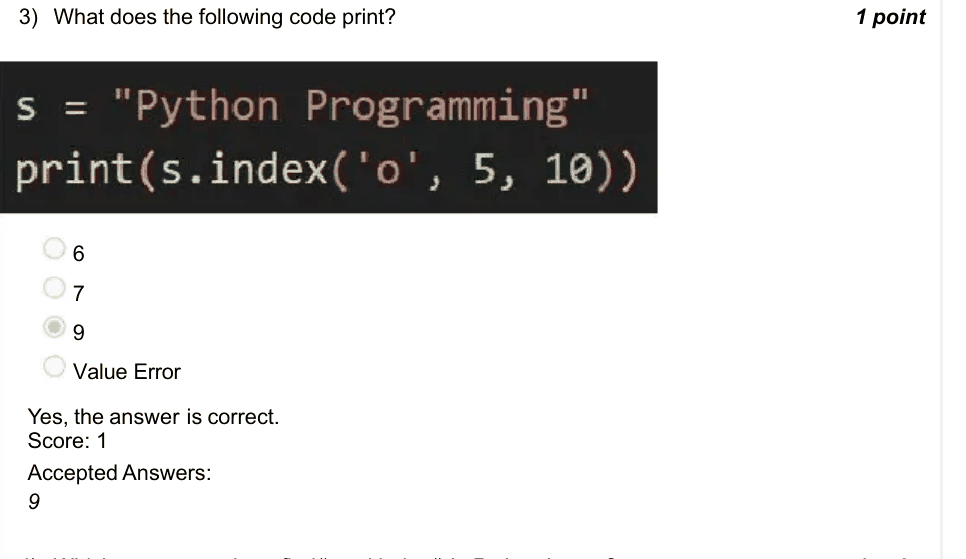

### Q4. Which statement about find() and index() in Python is true?

- [ ] Both return -1 if the substring is not found.
- [x] index() raises an error if not found, but find() returns -1.
- [ ] index() and find() behave identically.
- [ ] Both return the first index of occurrence.
> Yes, the answer is correct. Score: 1

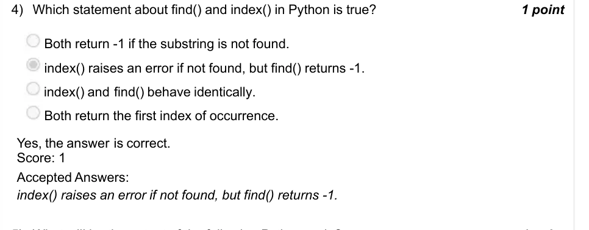

### Q5. What will be the output of the following Python code?

- [ ] 3
- [ ] 2
- [ ] 0
- [x] -3
> Yes, the answer is correct. Score: 1

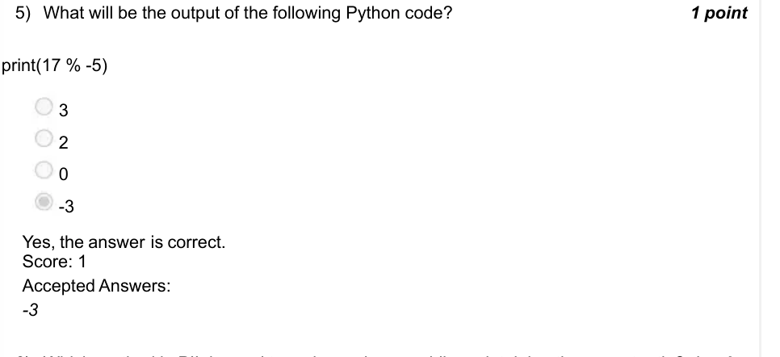

### Q6. Which method in PIL is used to resize an image while maintaining the aspect ratio?

- [ ] resize()
- [x] thumbnail()
- [ ] reshape()
- [ ] aspect ratio resize()
> Yes, the answer is correct. Score: 1

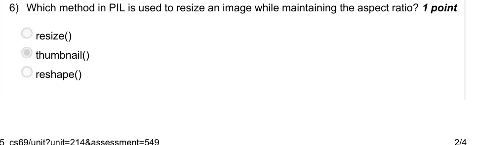

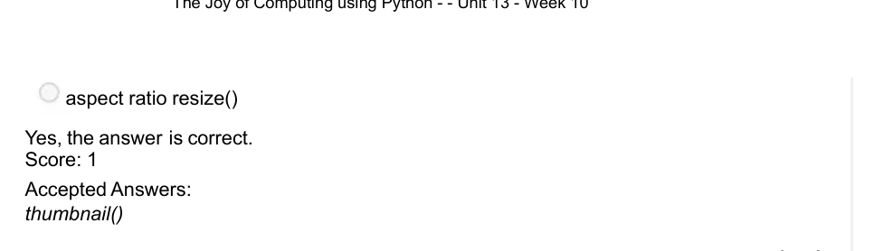

### Q7. Which of the following correctly finds all numbers divisible by 3 but not by 5 in a list?

- [x] [x for x in nums if x % 3 == 0 and x % 5 != 0]
- [ ] [x for x in nums if x % 5 != 0 or x % 3 == 0]
- [ ] [x for x in nums if x % 3 != 0 and x % 5 == 0]
- [ ] filter(lambda x: x % 3 == 0 and x % 5 == 0, nums)
> Yes, the answer is correct. Score: 1

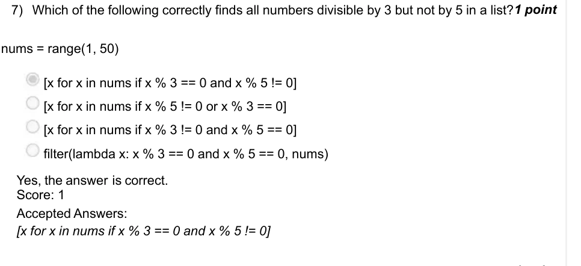

### Q8. What will be the output of the following code?

- [ ] 2
- [x] 5
- [ ] [5, 6]
- [ ] 4
> Yes, the answer is correct. Score: 1

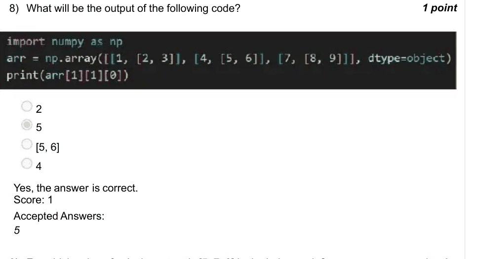

### Q9. For which value of axis the output is [5, 7, 9] in the below code?

- [x] 0
- [ ] 1
- [ ] 2
- [ ] axis argument is not required.
> Yes, the answer is correct. Score: 1

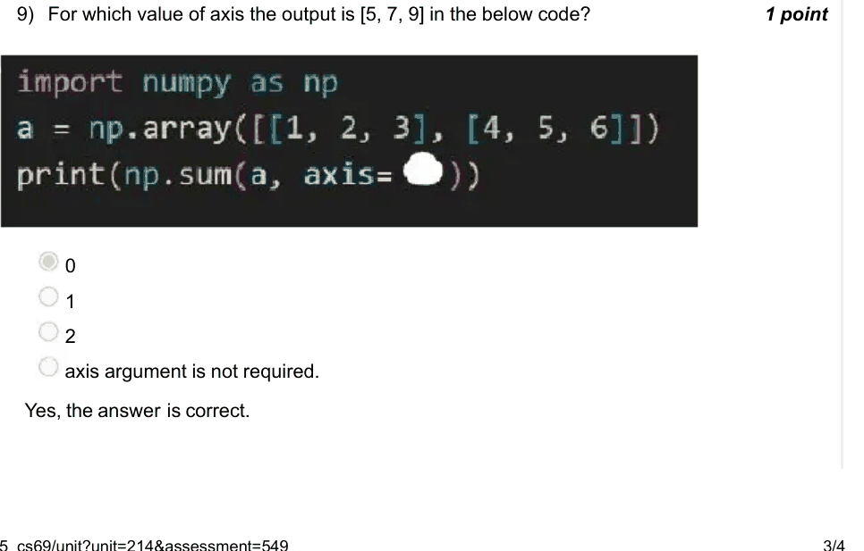

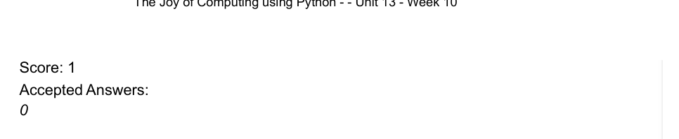

### Q10. What will be the shape of the resulting NumPy array?

- [x] (3, 2)
- [ ] (4, 3)
- [ ] (3, 4)
- [ ] (4, 2)
> Yes, the answer is correct. Score: 1

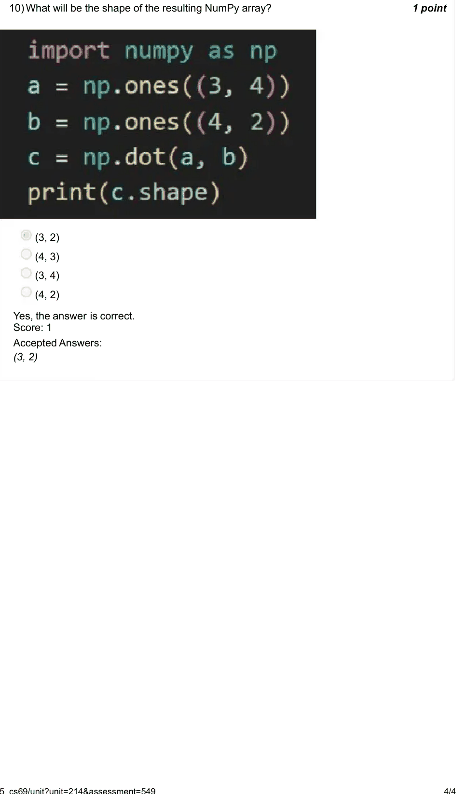
