# JOC Jan-2025 · Week 11: portal print

- Source: `Python-NPTEL (portal print, Wk1-12).pdf` pages 54–58 (portal review printout). Parsed text below; the cropped image under each question is the exact page content (code, figures and ticks as printed) and is authoritative.
- `[x]` = option equal to the portal's **Accepted Answer** (official). Lines may carry stray spaces from the PDF text layer.

> bhargavi111gm@gmail.com · Due on 2025-04-09, 23:59 IST.

### Q1. In Selenium, what is the purpose of WebDriver, such as webdriver.Chrome()?

- [ ] It is used to interact with web elements like buttons and text fields.
- [x] It launches and controls a web browser session for automation.
- [ ] It is used to write test cases in Selenium.
- [ ] It provides built-in methods to handle databases in web applications.
> No, the answer is incorrect. Score: 0

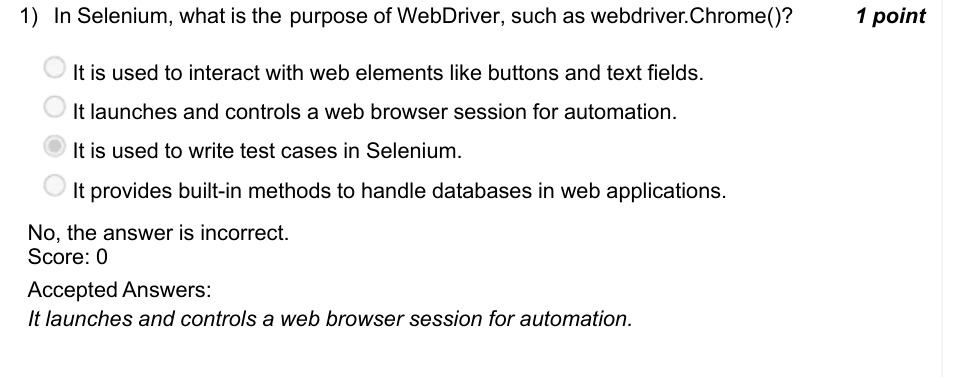

### Q2. Which of the following is the best locator strategy in Selenium in terms of

- [ ] find_element_by_name()
- [x] find_element_by_id()
- [ ] find_element_by_class_name()
- [ ] find_element_by_xpath()
> Yes, the answer is correct. Score: 1

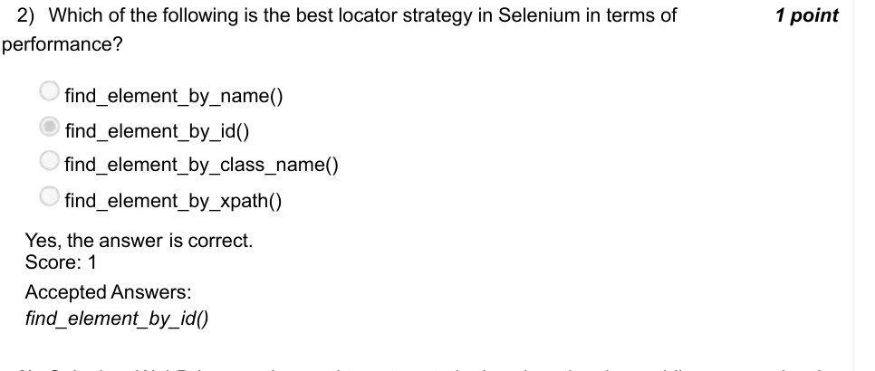

### Q3. Selenium WebDriver can be used to automate both web and native mobile

- [ ] True
- [x] False
> Yes, the answer is correct. Score: 1

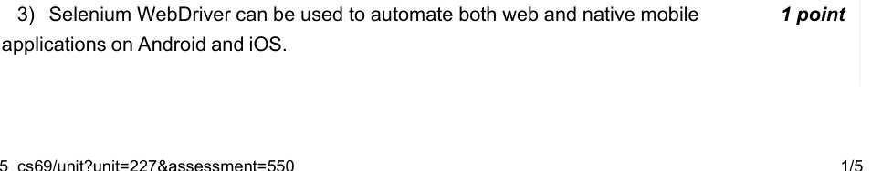

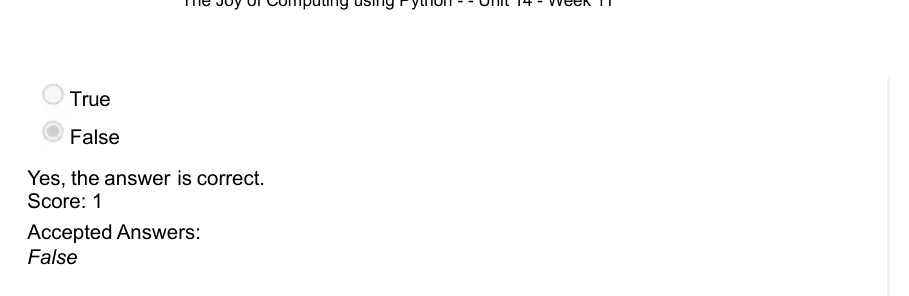

### Q4. What is the output of the following Python code?

- [x] (0, 0) (0, 1) (1, 0) (1, 1) (2, 0) (2, 1) (4, 0) (4, 1)
- [ ] (0, 0) (0, 1) (1, 0) (1, 1) (2, 0) (2, 1) (3, 0) (3, 1) (4, 0) (4, 1)
- [ ] (0, 0) (0, 1) (1, 0) (1, 1) (2, 0) (2, 1) (3, 0) (3, 1) (3, 2) (4, 0) (4, 1)
- [ ] (0, 0) (0, 1) (1, 0) (1, 1) (2, 0) (2, 1) (3, 0) (4, 0) (4, 1) (4, 2)
> Yes, the answer is correct. Score: 1

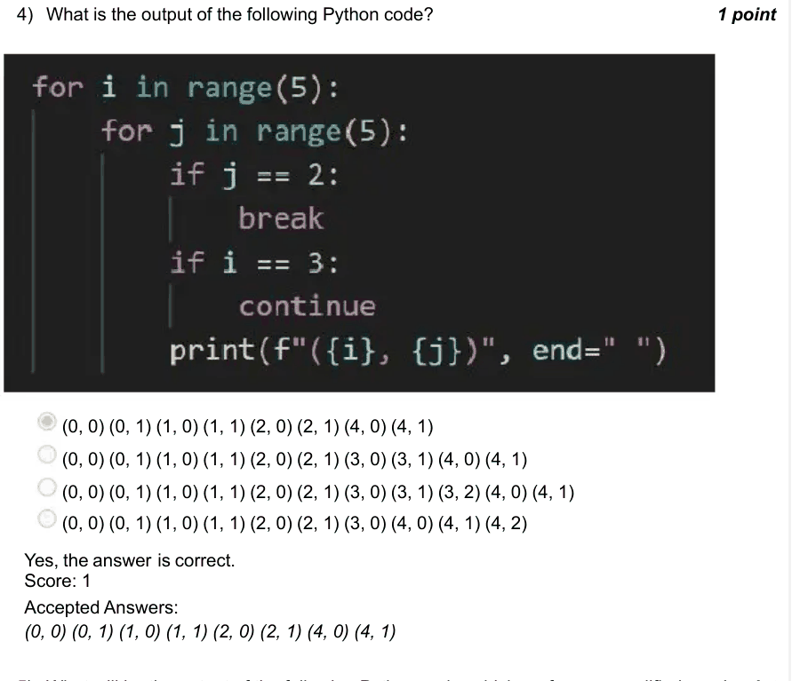

### Q5. What will be the output of the following Python code, which performs a modified

- [ ] Checking 3 Checking 8 Checking 1 Found at index 3
- [ ] Checking 3 Checking 1 Found at index 3
- [ ] Checking 3 Checking 8 Checking 1 Checking 7 Found at index 3
- [x] Found at index 3
> Yes, the answer is correct. Score: 1

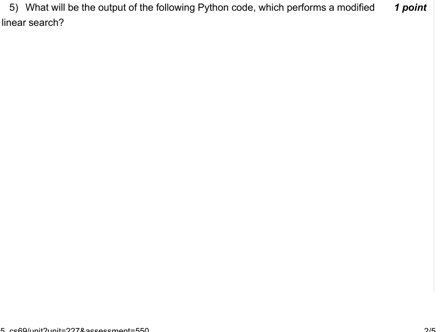

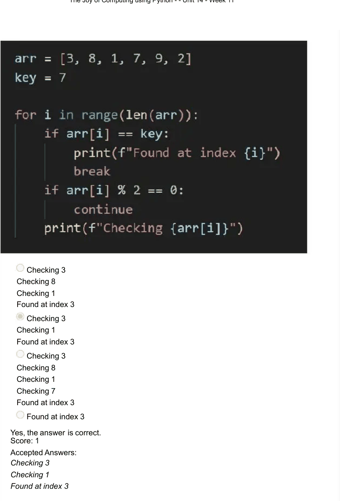

### Q6. What does calendar.isleap(2100) return?

- [x] False
- [ ] True
- [ ] None
- [ ] 1
> Yes, the answer is correct. Score: 1

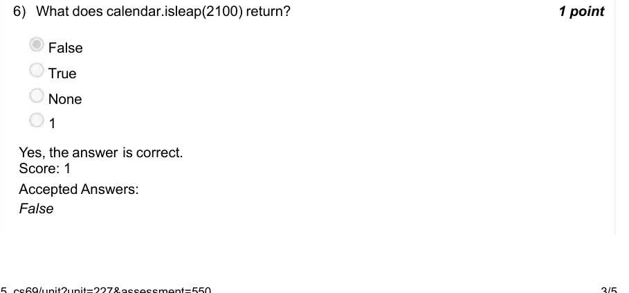

### Q7. What is the output of datetime.date(2024, 2, 29) + datetime.timedelta(days=1)?

- [ ] 2024-02-30
- [x] 2024-03-01
- [ ] ValueError
- [ ] 2024-02-29
> Yes, the answer is correct. Score: 1

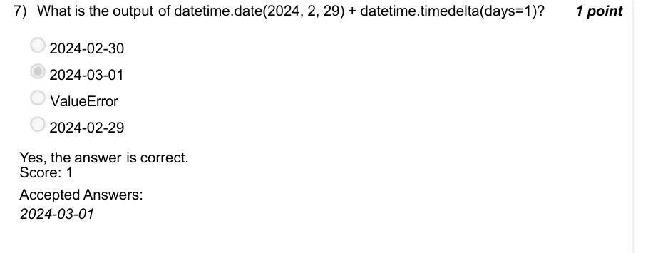

### Q8. Which function is used to get the current local time in Python?

- [x] time.localtime()
- [x] datetime.now()
- [ ] time.time()
- [ ] datetime.utcnow()
> Partially Correct. Score: 0.5

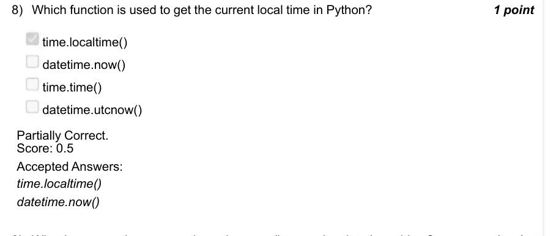

### Q9. What happens when you apply .astimezone() to a naive datetime object?

- [ ] It changes to UTC
- [ ] It raises an error
- [x] It assumes local timezone
- [ ] It converts to IST
> Yes, the answer is correct. Score: 1

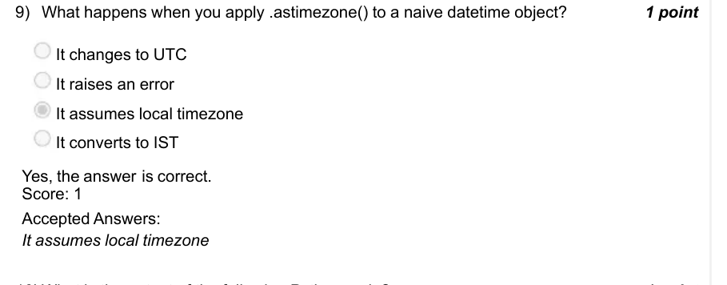

### Q10. What is the output of the following Python code?

- [x] 2024-02-29 12:00:00 IST
- [ ] 2024-02-29 06:30:00 UTC
- [ ] 2024-02-29 12:00:00 UTC
- [ ] Error
> Yes, the answer is correct. Score: 1

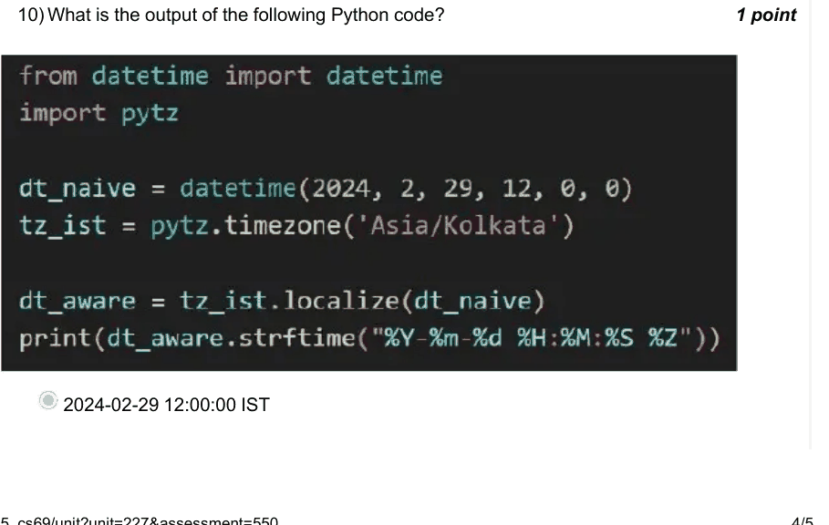

