# JOC Jan-2025 · Week 12: portal print

- Source: `Python-NPTEL (portal print, Wk1-12).pdf` pages 59–66 (portal review printout). Parsed text below; the cropped image under each question is the exact page content (code, figures and ticks as printed) and is authoritative.
- `[x]` = option equal to the portal's **Accepted Answer** (official). Lines may carry stray spaces from the PDF text layer.

> bhargavi111gm@gmail.com · Due on 2025-04-16, 23:59 IST.

### Q1. Which of the following graphs is generated by the given Python code using the networkx module?

> No, the answer is incorrect. Score: 0

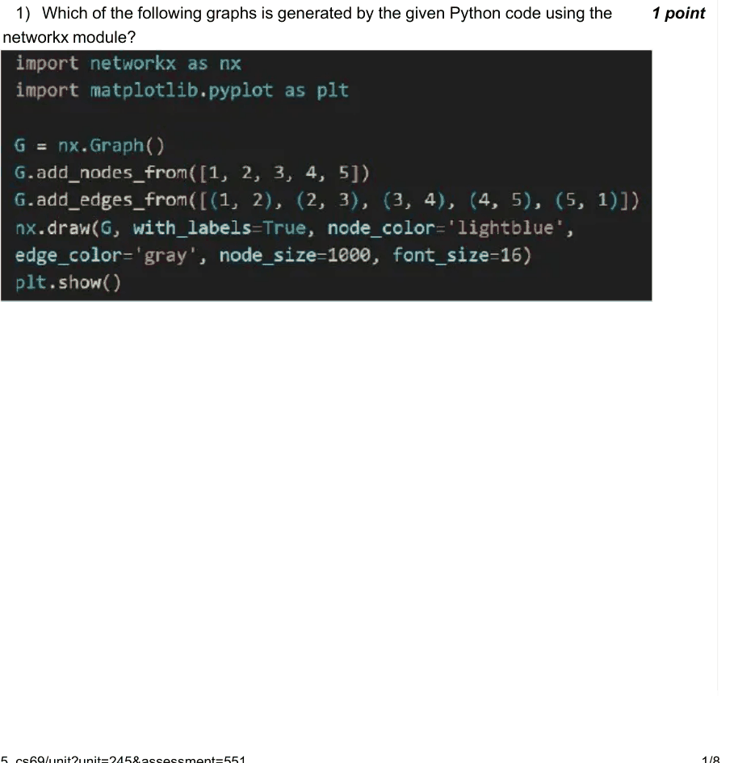

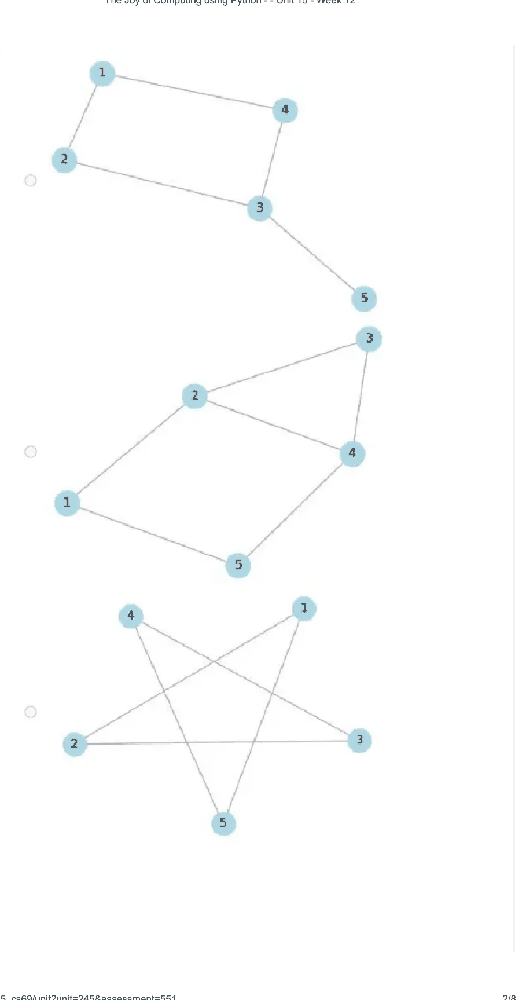

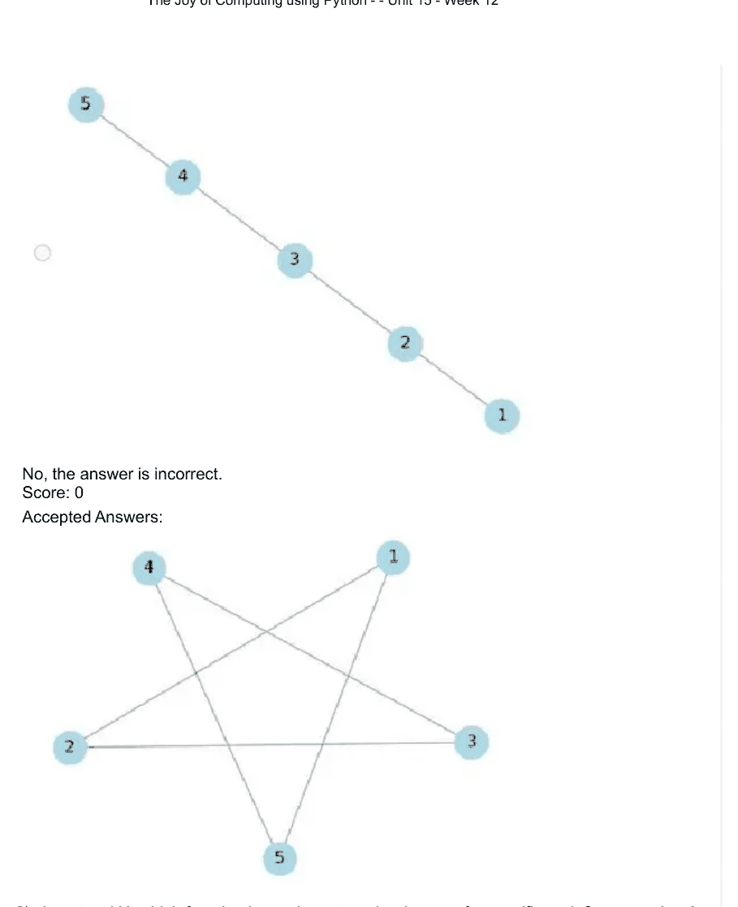

### Q2. In networkX, which function is used to return the degree of a specific node?

- [x] G.degree(node)
- [ ] G.get_degree(node)
- [ ] G.node_degree(node)
- [ ] G.find_degree(node)
> No, the answer is incorrect. Score: 0

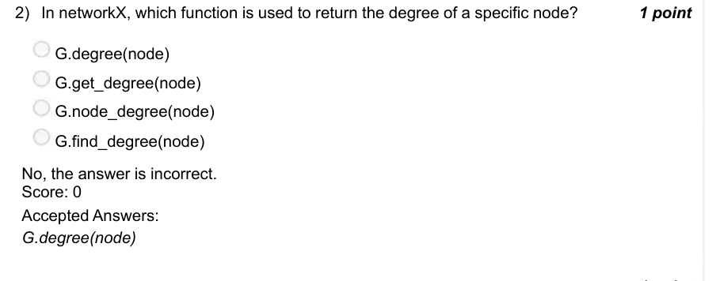

### Q3. Observe the following graph generated using the networkx module. How many edges does this graph contain?

- [ ] 6
- [x] 7
- [ ] 8
- [ ] 9
> No, the answer is incorrect. Score: 0

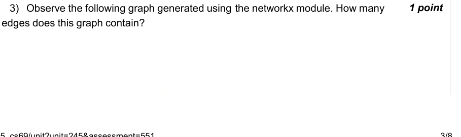

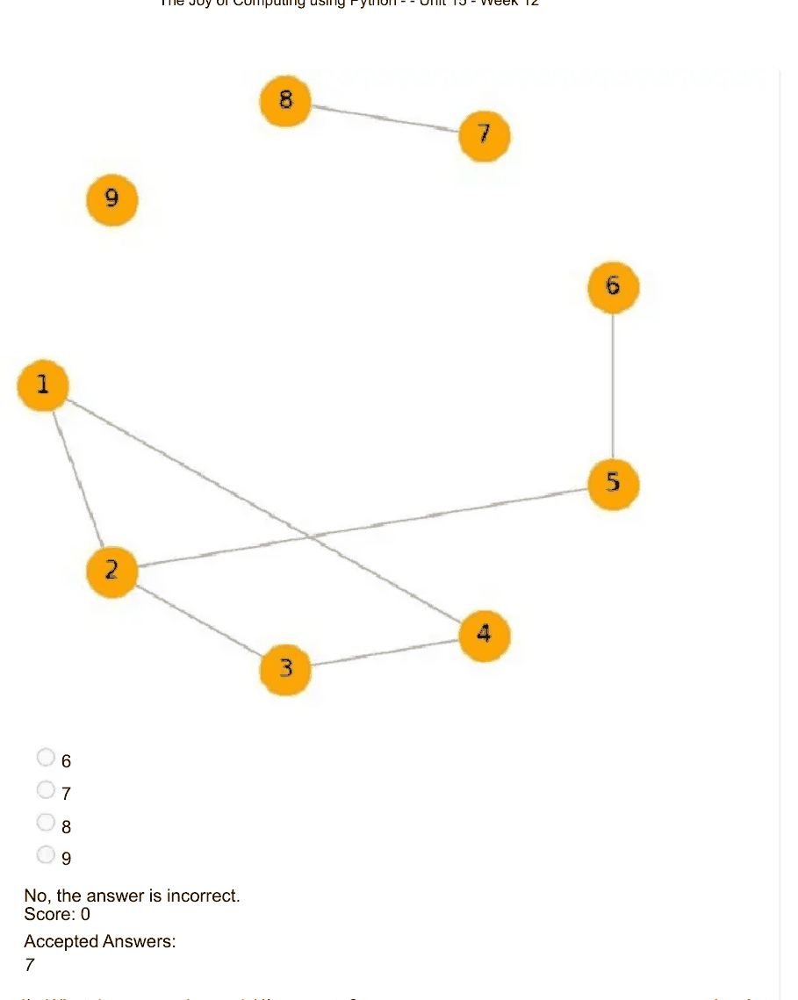

### Q4. What does nx.cycle_graph(4) generate?

- [ ] A directed cycle of 4 nodes
- [x] A cycle graph with 4 nodes connected in a closed loop
- [ ] A ladder graph with 4 rounds in the ladder
- [ ] A complete graph with 4 nodes
> No, the answer is incorrect. Score: 0

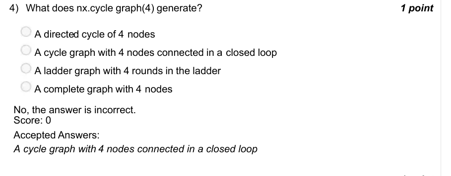

### Q5. Observe the following graph generated using the networkx module. What type of graph is this?

- [ ] Ladder Graph
- [x] Barbell Graph
- [ ] Wheel Graph
- [ ] Star Graph
> No, the answer is incorrect. Score: 0

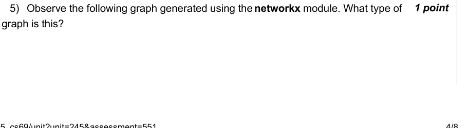

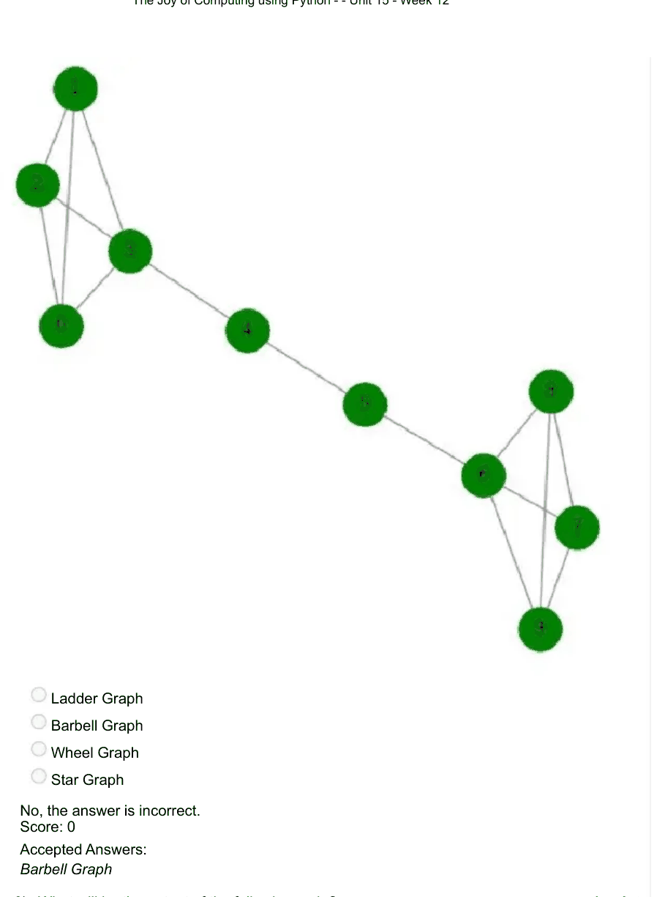

### Q6. What will be the output of the following code?

- [x] (4, 4)
- [ ] (4, 8)
- [ ] (4, 2)
- [ ] (8, 4)
> No, the answer is incorrect. Score: 0

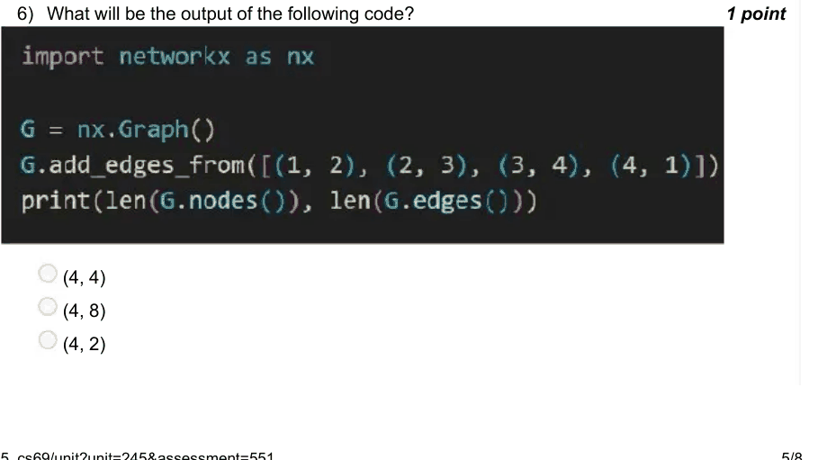

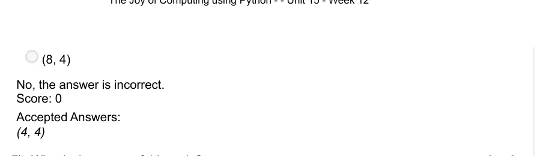

### Q7. What is the output of this code?

- [ ] 7
- [x] 16
- [ ] 5
- [ ] 10
> No, the answer is incorrect. Score: 0

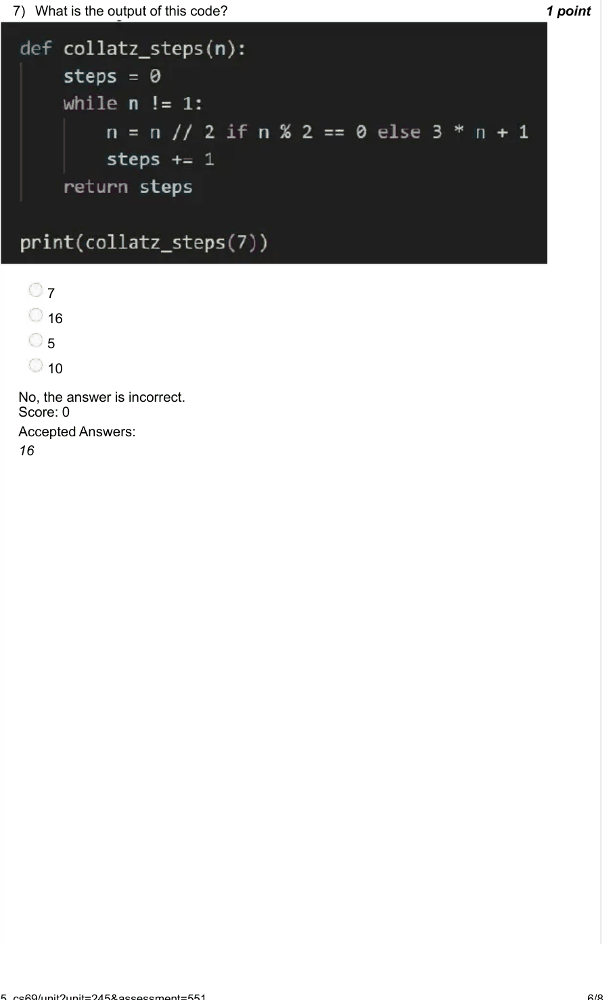

### Q8. What will be the first 10 numbers generated starting from n = 7?

- [x] [7, 36, 18, 9, 46, 23, 116, 58, 29, 146]
- [ ] [7, 36, 18, 9, 28, 14, 7, 36, 18, 9]
- [ ] [7, 20, 10, 5, 26, 13, 66, 33, 166, 83]
- [ ] [7, 31, 15, 7, 36, 18, 9, 46, 23, 116]
> No, the answer is incorrect. Score: 0

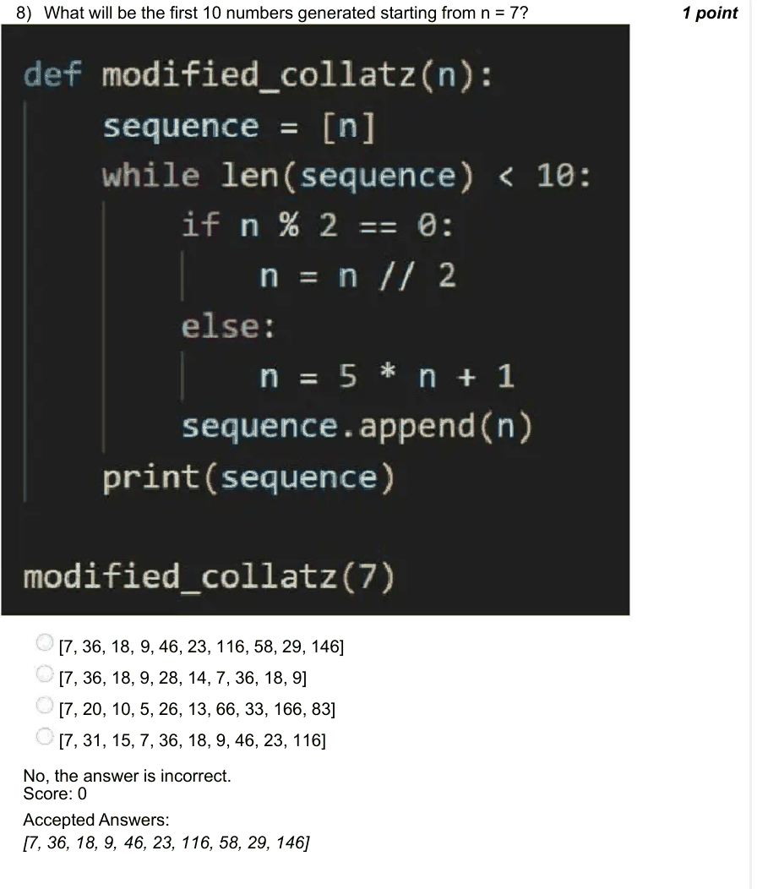

### Q9. Which technique is used in the PageRank algorithm to determine the rank of a web page?

- [ ] Depth-First Search
- [ ] Hyperlink Analysis
- [x] Random Walk Simulation
- [ ] Data Scraping
> No, the answer is incorrect. Score: 0

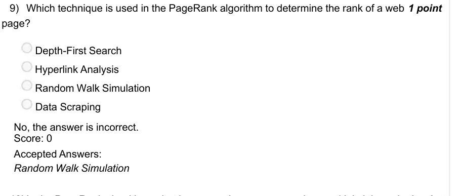

### Q10. In the PageRank algorithm, what happens when a page receives multiple inbound links from highly ranked pages?

- [ ] Its rank decreases due to increased server load
- [x] Its rank improves
- [ ] Its rank remains the same
- [ ] It is considered less relevant
> No, the answer is incorrect. Score: 0

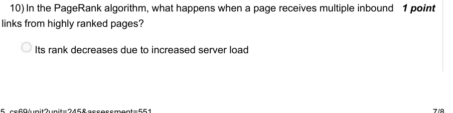

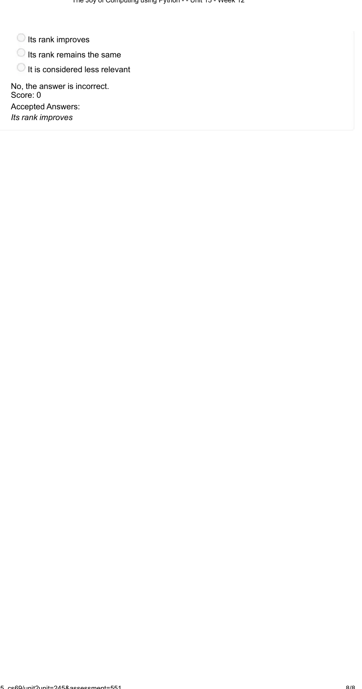
