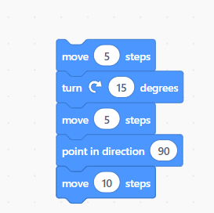
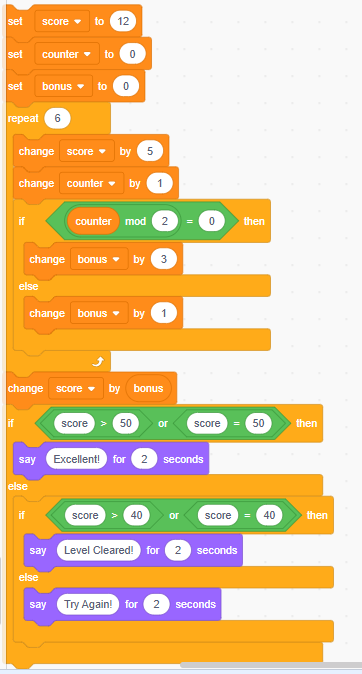

# JOC Jul-2026 · Week 1

- Source: `week-01.pdf` (case-study assignment PDF supplied by the repo owner; the only source used for the Jul-2026 session). Answers and justifications are as printed in the PDF.

## Case Study: Programming Beyond Coding, Why Every Professional Can Benefit

Riya is a first-year university student pursuing a degree in Economics. She believes learning programming is unnecessary because there are already apps and websites for almost every task. During an orientation session, her professor explains that the existence of many applications does not eliminate the need for programming. Just as existing buildings do not prevent people from constructing or improving new ones, existing software can always be enhanced, customized, or automated to solve new problems.

The professor further explains that programming is not limited to computer science. Whether someone studies mathematics, physics, economics, business, or nutrition, programming helps automate repetitive tasks, analyze data, and build customized solutions that are not available in ready-made software.

When students ask why there are so many programming languages, the professor explains that different languages evolved to solve different kinds of problems. Languages such as FORTRAN focused on scientific computing, COBOL on business applications, C emphasized efficiency, C++ introduced object-oriented programming, and Python made programming easier and more accessible. As technology evolves, programming languages and development tools continue to become simpler and more powerful.

To help students understand what programming really means, the professor conducts a classroom activity. He assigns different hand gestures to represent coffee, tea, water, juice, and cookies. Students quickly learn to interpret combinations of gestures, such as "three cups of coffee" or "two cookies." The professor explains that this activity is similar to programming: a programmer gives precise instructions using symbols that a computer has been taught to understand.

By the end of the session, Riya realizes that programming is not just about writing code, it is a problem-solving skill that can provide an advantage in almost any profession.

### Q1. Which statement best captures the professor's reason for learning programming despite the availability of many applications?

- A. Existing applications eliminate the need for programmers.
- B. Programming enables people to create, improve, and customize solutions beyond existing applications.
- C. Programming is useful only for developing mobile apps.
- D. Learning programming is compulsory for every profession.

**Correct Answer: B**

> Justification: The professor compares software to buildings—existing solutions do not prevent creating better or more customized ones.

### Q2. According to the professor, why have multiple programming languages evolved over time?

- A. Each country develops its own programming language.
- B. Different languages were designed to solve different types of problems and improve programming.
- C. Older programming languages cannot run on modern computers.
- D. Every programmer must create a new programming language.

**Correct Answer: B**

> Justification: Programming languages evolved to address different domains and make programming more effective and easier.

### Q3. What was the primary purpose of the hand-gesture classroom activity?

- A. To improve students' memory.
- B. To demonstrate that programming involves giving clear instructions using agreed-upon symbols.
- C. To teach sign language.
- D. To measure students' reaction speed.

**Correct Answer: B**

> Justification: The activity illustrated that programming is fundamentally about communicating precise instructions through symbols.

### Q4. According to the professor, what is the most effective way to become proficient in programming?

- A. Memorize every programming language before writing code.
- B. Begin with advanced programming problems.
- C. Practice regularly, stay motivated, and learn gradually through small steps.
- D. Depend entirely on modern programming tools and IDEs.

**Correct Answer: C**

> Justification: The professor emphasizes that programming is a skill developed through consistent practice and gradual learning.

### Q5. Which conclusion would Riya most likely draw after attending the session?

- A. Programming is a problem-solving skill that can benefit people across many disciplines.
- B. Programming is valuable only for software engineers.
- C. Programming is primarily about memorizing the syntax of different languages.
- D. Existing software packages make programming unnecessary.

**Correct Answer: A**

> Justification: The session highlights that programming is a transferable problem-solving skill applicable to diverse fields such as economics, science, business, and healthcare.

## Case Study: Teaching a Robot Efficiently – The Power of Loops A robotics club is programming a small robot to train for a fitness challenge. The robot must move forward and then return to its starting position. On every round, it should travel a little farther than before. Initially, one student writes separate instructions for every movement: move forward, pause, move backward, pause, and repeats this pattern many times with different distances.

Another student notices that the instructions follow the same pattern repeatedly. Instead of writing dozens of similar commands, she suggests using a loop along with a variable that stores the current distance. After every round, the variable is increased by a fixed amount, and the loop repeats until all rounds are completed.

The instructor points out that this shorter program is easier to understand, modify, and reuse. Later, instead of fixing the starting distance in the program, they introduce another variable so that the same program can be used for different fitness challenges without changing the main logic.

The students realize that loops are not just about reducing the number of lines of code—they make programs flexible, easier to maintain, and less prone to errors.

### Q1. Why did the second student recommend using a loop instead of writing every movement instruction separately?

- A. Loops allow repeated actions to be expressed with fewer instructions while preserving the same behavior.
- B. Loops make the robot move faster.
- C. Loops reduce the distance travelled by the robot.
- D. Loops automatically correct programming errors.

**Correct Answer: A**

> Justification: A loop eliminates repetitive code by executing the same sequence multiple times.

### Q2. In the improved program, what is the primary purpose of using a variable for the travel distance?

- A. To store the robot's battery level.
- B. To allow the distance to change automatically after each repetition.
- C. To count how many students are programming.
- D. To increase the robot's speed.

**Correct Answer: B**

> Justification: The variable stores the current distance and is updated after each iteration, allowing the robot to travel progressively farther.

### Q3. The instructor later replaces the fixed starting distance with another variable. What is the main advantage of this change?

- A. The robot no longer requires a loop.
- B. The same program can easily be reused for different starting distances without rewriting the logic.
- C. The program will execute only once.
- D. Variables automatically make the program run faster.

**Correct Answer: B**

> Justification: Replacing fixed values with variables increases flexibility and reusability.

### Q4. Suppose a student removes the statement that updates the distance variable inside the loop. Which outcome is most likely?

- A. The robot will continue repeating the same movement distance in every round.
- B. The robot will stop after the first movement.
- C. The robot will automatically choose new distances.
- D. The loop will immediately terminate.

**Correct Answer: A**

> Justification: Without updating the variable, its value remains unchanged, so every iteration performs the same movement.

### Q5. Which statement best summarizes the role of loops in programming?

- A. Loops are useful only for mathematical calculations.
- B. Loops replace the need for variables.
- C. Loops help automate repetitive tasks and make programs easier to modify and maintain.
- D. Loops should be avoided because they make programs difficult to understand.

**Correct Answer: C**

> Justification: Loops improve readability, reduce duplication, and make programs easier to update and extend.

## Case Study: Understanding a Scratch Program A student is learning Scratch and creates the program shown in the figure below. The sprite starts from its initial position and executes each block from top to bottom exactly once. The student expects the sprite to follow the path specified by the movement and direction blocks. Study the Scratch program carefully that is presented below and answer the following questions based on the program shown.

### Q1. Which Scratch block determines the direction of the sprite before its final movement of 10 steps?

- A. move 5 steps (first block)
- B. turn 15 degrees
- C. move 5 steps (third block)
- D. point in direction 90°

**Correct Answer: D**

> Justification: The point in direction 90° block sets the sprite's direction immediately before the final move 10 steps block.

### Q2. What is the purpose of the turn 15 degrees block in this program?

- A. It changes the sprite's direction before the second movement.
- B. It changes the sprite's position by 15 steps.
- C. It changes the direction for the entire program, including after the point in direction block.
- D. It makes the sprite move automatically.

**Correct Answer: A**

> Justification: The turn block only changes the current direction. The next movement follows this new direction until another direction block changes it.

### Q3. Suppose the point in direction 90° block is removed while keeping all other blocks unchanged. Which statement is most likely to be true?

- A. The final movement will continue in the direction established by the earlier turn.
- B. The sprite will not execute the last move.
- C. The sprite will return to its starting position.
- D. The program will stop with an error.

**Correct Answer: A**

> Justification: Without the point in direction block, the sprite keeps its current direction after the 15° turn.

### Q4. Which Scratch blocks in the program only change the sprite's position and never its direction?

- A. the two move 5 blocks
- B. all three move blocks
- C. turn and point
- D. move 10 and point

**Correct Answer: B**

> Justification: The move blocks change only the sprite's position. They do not alter its facing direction.

### Q5. A student accidentally swaps the positions of the turn 15 degrees block and the point in direction 90° block. What is the most likely effect?

- A. The sprite will follow exactly the same path.
- B. The final movement will occur after turning 15° from 90°, producing a different path.
- C. The sprite will not execute the second movement.
- D. The program will become an infinite loop.

**Correct Answer: B**

> Justification: Scratch executes blocks sequentially. Swapping the two direction blocks changes the direction before the final movement, resulting in a different path.

## Case Study: Evaluating a Scratch-Based Game Scoring System A student is developing a simple game in Scratch to reward players based on their performance. The Scratch program shown in the figure keeps track of three variables: score, counter, and bonus.

When the green flag is clicked, the variables are initialized. The program then repeats a set of instructions several times. During each repetition, the player's score increases, the round counter is updated, and a bonus is awarded depending on whether the current round number is even or odd. After all repetitions are complete, the accumulated bonus is added to the score. Finally, the program displays one of three messages—"Excellent!", "Level Cleared!", or "Try Again!"—depending on the final score. Study the Scratch program carefully and answer the following questions.

### Q1. Why does the program use the expression counter mod 2 = 0?

- A. To check whether the current round number is even.
- B. To stop the repeat loop after two iterations.
- C. To calculate the total score.
- D. To reset the bonus variable.

**Correct Answer: A**

> Justification: The modulo operation returns the remainder after division by 2. A remainder of 0 indicates an even number.

### Q2. Which variable is updated in every iteration of the repeat loop, regardless of the outcome of the if-else condition?

- A. bonus
- B. counter
- C. score
- D. Both score and counter

**Correct Answer: D**

> Justification: Every iteration increases both score and counter. The bonus changes in both branches, but by different amounts.

### Q3. What is the purpose of the statement change score by bonus placed after the repeat loop?

- A. It resets the score before displaying the final message.
- B. It adds the total bonus accumulated during all iterations to the final score.
- C. It increases the bonus by the current score.
- D. It determines how many times the loop executes.

**Correct Answer: B**

> Justification: The bonus is accumulated during the loop and added to the score only once after the loop finishes.

### Q4. Suppose the statement change score by bonus is moved inside the repeat loop, immediately before the if condition. What would be the most likely effect?

- A. The final score would become much larger because the bonus would be added repeatedly.
- B. The final score would remain unchanged.
- C. The bonus variable would always become zero.
- D. The repeat loop would execute fewer times.

**Correct Answer: A**

> Justification: Adding the accumulated bonus during every iteration would repeatedly increase the score, resulting in a much larger final value.

### Q5. Which statement best describes how the Scratch program decides which message to display?

- A. The message depends only on the value of counter.
- B. The message depends only on the value of bonus.
- C. The program first computes the final score and then checks the score against the conditions in order.
- D. All three messages are displayed one after another.

**Correct Answer: C**

> Justification: After the bonus is added to the score, the program evaluates the conditions sequentially. Once a condition is true, the corresponding message is displayed.
