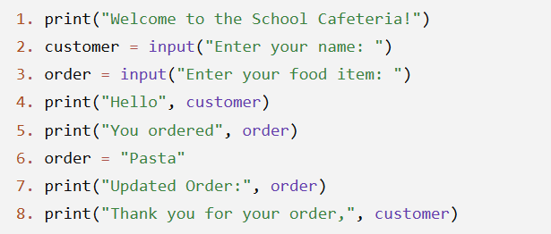
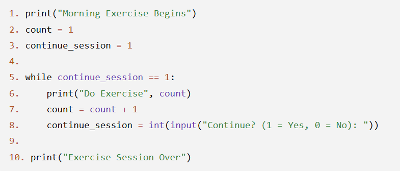

# JOC Jul-2026 · Week 2

- Source: `week-02.pdf` (case-study assignment PDF supplied by the repo owner; the only source used for the Jul-2026 session). Answers and justifications are as printed in the PDF.

## Scenario: Student Registration for a Coding Bootcamp A school is organizing a one-day coding bootcamp for beginners. When students arrive, they register at a computer kiosk. The kiosk asks each student to enter their name and age. It stores this information so it can display a personalized welcome message and generate a participation slip. During registration, if a student notices that they entered incorrect information, they can update it before the final slip is printed. The computer always uses the most recently entered information when displaying the student's details.

### Question 1

Why does the registration kiosk ask each student to enter their name?

- A. To personalize the welcome message and participation slip.
- B. To make the computer process information faster.
- C. To install the coding software.
- D. To increase the computer's storage.

**Answer: A**

> Justification: The student's name is collected so the computer can use it in personalized messages and printed information.

### Question 2

A student first enters their age as 15, but later realizes it should be 16 and updates it before the participation slip is printed. Which age will appear on the slip?

- A. 15
- B. Both 15 and 16
- C. 16
- D. No age will be displayed.

**Answer: C**

> Justification: The latest value replaces the previous one, so the updated age is used.

### Question 3

The computer displays a greeting that includes the student's name without asking for it again. How is this possible?

- A. The computer remembers every student's name forever.
- B. The name is stored and reused whenever needed during the program.
- C. The greeting works only for the first student.
- D. The student secretly enters the name again.

**Answer: B**

> Justification: The program stores the entered name and can use it multiple times without asking again.

### Question 4

A student accidentally enters the name Riya instead of Diya. Before the participation slip is printed, the mistake is corrected. What is the most likely outcome?

- A. The slip will show Riya.
- B. The slip will show both Riya and Diya.
- C. The slip will show Diya.
- D. The slip will not display any name.

**Answer: C**

> Justification: Once the information is updated, the program uses the corrected value instead of the old one.

### Question 5

Why is it useful for the program to store information like a student's name and age?

- A. It allows the same information to be used multiple times without asking the student again.
- B. It permanently stores the information on every computer.
- C. It prevents the program from displaying messages.
- D. It eliminates the need for user input in all future programs.

**Answer: A**

> Justification: Storing information allows the program to reuse it whenever needed during its execution, making the interaction more efficient.

## Scenario: Ordering Food at a School Cafeteria A school cafeteria has introduced a self-service ordering kiosk. Students enter their name and the food item they would like to order. The kiosk stores this information and displays a confirmation message. Before the order is finalized, one student changes their order from Sandwich to Pasta. The kiosk updates the stored value and prints the final order receipt. The Python program running on the kiosk is shown below.

### Question 1

Which line collects the name of the customer?

- A. Line 1
- B. Line 2
- C. Line 3
- D. Line 8

**Answer: B**

> Justification: Line 2 uses input() to ask the customer to enter their name.

### Question 2

A student initially enters Sandwich as the food item. What will be displayed in Line 7?

- A. Sandwich
- B. Sandwich Pasta
- C. Pasta
- D. No food item will be displayed.

**Answer: C**

> Justification: Line 6 changes the value of order to Pasta, so the updated value is printed.

### Question 3

Which variable stores the name of the customer throughout the program?

- A. order
- B. customer
- C. input
- D. print

**Answer: B**

> Justification: The variable customer stores the user's name and is used whenever the program needs it.

### Question 4

If the customer enters Neha as the name, what will be displayed in Line 8?

- A. Thank you for your order, customer
- B. Thank you for your order, Neha
- C. Thank you for your order, Pasta
- D. Thank you for your order

**Answer: B**

> Justification: The variable customer contains the value Neha, which is displayed in the final message.

### Question 5

Why is the variable order updated in Line 6 instead of creating another variable?

- A. A variable can only store one value at a time, and the latest value replaces the previous one.
- B. Python does not allow more than one variable in a program.
- C. The original value cannot be changed.
- D. Updating a variable permanently changes all future programs.

**Answer: A**

> Justification: Assigning a new value to a variable replaces its previous value, so the program always uses the latest information.

## Scenario: Online Bookstore Checkout An online bookstore is developing a simple checkout system. When a customer selects a book, the system asks for the book's price. Since the entered value comes from the keyboard, the system first converts it into a number before performing any calculations. A 10% discount is then applied to the original price to calculate the final amount the customer has to pay. While testing the program, the developers also discover that if they forget to convert the entered value into a number, mathematical calculations do not work as expected. They also learn that Python is very particular about following the correct syntax and indentation rules. Even a small mistake, such as forgetting a colon or incorrect indentation, can prevent the program from running.

### Question 1

Why does the program convert the customer's entered price into a number before calculating the discount?

- A. To make the input appear on the screen.
- B. To allow mathematical operations such as multiplication.
- C. To permanently save the customer's purchase history.
- D. To reduce the size of the program.

**Answer: B**

> Justification: Keyboard input is initially treated as text. Converting it to a number allows arithmetic operations like calculating discounts.

### Question 2

A customer enters the price of a book as ₹800. After applying a 10% discount, what amount should the customer pay?

- A. ₹720
- B. ₹780
- C. ₹880
- D. ₹700

**Answer: A**

> Justification: A 10% discount means the customer pays 90% of the original price: ₹800 × 0.9 = ₹720.

### Question 3

During testing, a developer forgets to convert the entered price into a number before performing calculations. What is the most likely outcome?

- A. The calculations may fail or produce unexpected results.
- B. The discount becomes 20% automatically.
- C. The program permanently deletes the input.
- D. Python automatically fixes the mistake.

**Answer: A**

> Justification: Without converting the input into a numeric type, Python treats it as text, so arithmetic operations cannot be performed correctly.

### Question 4

Another developer accidentally removes the required colon (:) from a Python statement. What is the most likely result?

- A. The program will ignore the missing colon and continue.
- B. Python will report a syntax error.
- C. The program will apply the wrong discount.
- D. The program will ask the user to re-enter the price.

**Answer: B**

> Justification: Python follows strict syntax rules. Missing required symbols, such as a colon, results in a syntax error.

### Question 5

Which of the following statements are correct about the bookstore's discount program? (Select all that apply.)

- A. User input must often be converted into a number before performing arithmetic calculations.
- B. Python requires correct syntax and indentation for a program to run properly.
- C. A 10% discount means the customer pays 90% of the original price.
- D. Python automatically treats every keyboard input as a number.

**Correct Answers: A, B, C**

> Justification: - A: Correct. User input is initially treated as text and often needs conversion. - B: Correct. Python is sensitive to syntax and indentation. - C: Correct. Paying after a 10% discount means paying 90% of the original price. - D: Incorrect. Keyboard input is treated as text unless explicitly converted.

## Scenario: Morning Exercise Counter A school has installed a digital exercise board in the playground. Every morning, the board displays the number of jumping jacks students should perform. It starts from 1 and continues until the teacher decides to stop the session. The board repeatedly displays the next exercise number as long as the teacher chooses to continue. The following Python program is used for the exercise board.

### Question 1

What is displayed first when the program starts?

- A. Do Exercise 1
- B. Continue? (1 = Yes, 0 = No)
- C. Morning Exercise Begins
- D. Exercise Session Over

**Answer: C**

> Justification: Line 1 executes before the loop begins, displaying the welcome message.

### Question 2

The teacher enters 1 three times and then enters 0. Which exercise numbers will be displayed?

- A. 1, 2, 3
- B. 1, 2, 3, 4
- C. 0, 1, 2, 3
- D. 2, 3, 4

**Answer: B**

> Justification: The program displays Exercise 1 initially. Each time the teacher enters 1, the next exercise number is displayed. After entering 0, the loop stops, so the displayed numbers are 1, 2, 3, and 4.

### Question 3

Which statements about the program are correct? (Select all that apply.)

- A. The value of count increases by 1 during each repetition.
- B. The while loop repeats only while continue_session is equal to 1.
- C. The message "Exercise Session Over" is displayed after the loop ends.
- D. The value of count decreases during each repetition.

**Correct Answers: A, B, C**

> Justification: - A: Correct. Line 7 increases count by 1. - B: Correct. The loop condition is checked in Line 5. - C: Correct. Line 10 runs after the loop finishes. - D: Incorrect. count never decreases.

### Question 4

Why is a while loop used in this program?

- A. Because the number of repetitions depends on the teacher's choice.
- B. Because the program always repeats exactly 10 times.
- C. Because Python cannot print numbers without a while loop.
- D. Because variables cannot be used inside a for loop.

**Answer: A**

> Justification: The teacher decides when to stop the exercise session, so the number of repetitions is not fixed beforehand.

### Question 5

Which of the following statements correctly compare for loops and while loops? (Select all that apply.)

- A. A for loop is useful when the number of repetitions is known in advance.
- B. A while loop continues until its condition becomes false.
- C. A while loop always executes exactly 10 times.
- D. Both for and while loops are used to repeat tasks.

**Correct Answers: A, B, D**

> Justification: - A: Correct. for loops are commonly used for a fixed number of repetitions. - B: Correct. A while loop keeps running as long as its condition is true. - C: Incorrect. A while loop may run any number of times depending on the condition. - D: Correct. Both loop types are repetition constructs used in programming.
