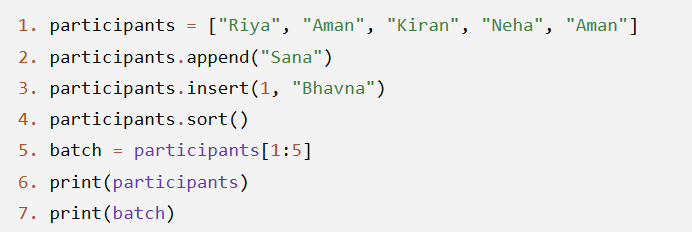

# JOC Jul-2026 · Week 3

- Source: `week-03.pdf` (case-study assignment PDF supplied by the repo owner; the only source used for the Jul-2026 session). Answers and justifications are as printed in the PDF.

## Scenario: Managing the School Library A school library maintains a digital catalog of all its books using a Python list. As new books arrive, the librarian updates the catalog by adding new titles or inserting important reference books at specific positions. Sometimes multiple copies of the same book are available, so the librarian checks how many times a title appears in the list. To help students find books more easily, the catalog is sorted alphabetically. During special exhibitions, the sorted list is displayed in reverse alphabetical order. Occasionally, the librarian also displays only a selected range of books, such as books belonging to a particular shelf or category, instead of showing the entire catalog. Answer the following questions based on the scenario.

### Q1. Why does the librarian sort the catalog of books?

- A. To remove duplicate book titles
- B. To make the books easier to organize and locate
- C. To increase the number of books in the catalog
- D. To replace old books with new ones

**Answer: B**

> Justification: Sorting arranges the book titles in a meaningful order, making them easier to organize, search, and analyze.

### Q2. After sorting the catalog alphabetically, the librarian wants to display the books from Z to A. Which operation is most suitable?

- A. Count
- B. Append
- C. Reverse
- D. Length

**Answer: C**

> Justification: Reversing a sorted list changes the order from ascending (A–Z) to descending (Z–A).

### Q3. The librarian wants to know how many copies of the book Python Basics are present in the catalog. Which list operation is most appropriate?

- A. Length
- B. Reverse
- C. Insert
- D. Count

**Answer: D**

> Justification: The count() operation returns the number of times a particular item appears in the list.

### Q4. A newly purchased encyclopedia must appear as the second item in the catalog instead of being added at the end. Which operation should be used?

- A. Insert
- B. Append
- C. Sort
- D. Reverse

**Answer: A**

> Justification: The insert() operation places an item at a specified position in the list.

### Q5. The librarian wants to know the total number of books currently stored in the catalog. Which operation provides this information?

- A. Count
- B. Length
- C. Reverse
- D. Slice

**Answer: B**

> Justification: The length operation returns the total number of elements present in the list.

## Scenario: Managing Participants for a Workshop A training institute maintains a list of participant names for a Python workshop. As registrations are received, new participants are added to the list. A late VIP registration is inserted at a specific position. Before printing attendance sheets, the participant names are arranged alphabetically. Finally, only a selected group of participants is displayed for one workshop batch. Study the following program and answer the questions.

### Q1. What will be the output of line 6?

- A. ['Aman', 'Aman', 'Bhavna', 'Kiran', 'Neha', 'Riya', 'Sana']
- B. ['Riya', 'Bhavna', 'Aman', 'Kiran', 'Neha', 'Aman', 'Sana']
- C. ['Aman', 'Bhavna', 'Kiran', 'Neha', 'Riya', 'Sana']
- D. ['Bhavna', 'Aman', 'Aman', 'Kiran', 'Neha', 'Riya', 'Sana']

**Answer: A**

> Justification: After appending and inserting, the list is sorted alphabetically before being printed.

### Q2. What is stored in the variable batch after line 5?

- A. ['Aman', 'Bhavna', 'Kiran', 'Neha']
- B. ['Bhavna', 'Kiran', 'Neha', 'Riya']
- C. ['Aman', 'Aman', 'Bhavna', 'Kiran']
- D. ['Kiran', 'Neha', 'Riya', 'Sana']

**Answer: A**

> Justification: Slicing participants[1:5] returns elements at indices 1, 2, 3, and 4.

### Q3. (MSQ) Which of the following statements are true after line 4?

- A. The participant Sana has been added to the list.
- B. The name Aman appears twice.
- C. The list contains 6 participants.
- D. The names are arranged alphabetically.

**Answer: A, B, D**

> Justification: - A: True. append() adds Sana. - B: True. Aman appears twice. - C: False. The list contains 7 participants. - D: True. sort() arranges the names alphabetically.

### Q4. Which line inserts the participant Bhavna at a specific position in the list?

- A. Line 1
- B. Line 2
- C. Line 3
- D. Line 5

**Answer: C**

> Justification: insert(1, "Bhavna") places Bhavna at index 1 before sorting.

### Q5. Which operation is demonstrated by line 5?

- A. Appending a new participant
- B. Sorting the participant list
- C. Counting duplicate names
- D. Extracting a portion of the participant list

**Answer: D**

> Justification: The slicing operation creates a new list containing only a selected range of participants.

## Scenario: Traffic Signal Announcement System A city traffic department is developing a digital announcement system for a pedestrian crossing. The system displays numbers from 1 to 30. To make the display more informative, it follows these rules: - If the number is divisible by 3, it displays "Walk" instead of the number. - If the number is divisible by 5, it displays "Wait" instead of the number. - If the number is divisible by both 3 and 5, it displays "WalkWait". - Otherwise, it displays the number itself. A programmer uses a loop and conditional statements to implement this logic. Answer the following questions based on the scenario.

### Q1. What should the system display when the number 15 is reached?

- A. 15
- B. Walk
- C. Wait
- D. WalkWait

**Answer: D**

> Justification: Since 15 is divisible by both 3 and 5, the system displays WalkWait.

### Q2. Which of the following numbers will display "Walk"?

- A. 8
- B. 12
- C. 20
- D. 25

**Answer: B**

> Justification: 12 is divisible by 3 but not by 5.

### Q3. A programmer first checks whether a number is divisible by 3, then checks whether it is divisible by 5, and only after that checks whether it is divisible by both 3 and 5. What problem is likely to occur?

- A. Numbers divisible by both 3 and 5 will be displayed as Walk instead of WalkWait.
- B. Numbers divisible by 5 will never be displayed.
- C. The loop will never stop.
- D. The program will print every number twice.

**Answer: A**

> Justification: The first condition is satisfied for numbers like 15, so the later check for both conditions is never reached.

### Q4. Which programming concept allows the system to process every number from 1 to 30 automatically?

- A. Function
- B. List
- C. Loop
- D. Variable

**Answer: C**

> Justification: A loop repeats the same set of instructions for each number in the specified range.

### Q5. Which statement best explains why the condition "divisible by both 3 and 5" should be checked before checking divisibility by 3 or 5 individually?

- A. It reduces the number of iterations in the loop.
- B. It ensures that numbers satisfying both conditions receive the correct output.
- C. It changes the range of numbers processed.
- D. It makes the program run without using loops.

**Answer: B**

> Justification: Checking the combined condition first prevents numbers like 15 from being incorrectly classified as only divisible by 3 or only divisible by 5.

## Scenario: Choosing the Best Estimate for a Wildlife Survey A wildlife research team wants to estimate the number of birds nesting in a protected forest. Since counting every bird is difficult, they ask 120 volunteers to independently estimate the number of nests. The estimates vary widely because some volunteers underestimate while others overestimate the actual value. The researchers analyze the estimates by sorting them, removing extreme values, and computing different aggregate measures. They also visualize the estimates using Matplotlib to better understand the spread of the data. Answer the following questions based on the scenario.

### Q1. (MCQ) Why did the researchers ask a large number of volunteers instead of only one wildlife expert?

- A. To reduce the size of the dataset
- B. Because a larger group can produce a reliable collective estimate
- C. Because volunteers always know the exact answer
- D. To avoid using statistical measures

**Answer: B**

> Justification: The wisdom of crowds suggests that combining many independent estimates often leads to a reliable result.

### Q2. (MCQ) Which statistical measure is specifically designed to reduce the effect of extremely high and extremely low estimates?

- A. Maximum
- B. Median
- C. 10% Trimmed Mean
- D. Range

**Answer: C**

> Justification: A trimmed mean removes a percentage of the smallest and largest values before calculating the average.

### Q3. (MCQ) The researchers create a histogram of all the estimates using Matplotlib. What is the main purpose of this graph?

- A. To sort the estimates automatically
- B. To visualize how the estimates are distributed
- C. To calculate the trimmed mean
- D. To remove incorrect estimates

**Answer: B**

> Justification: A histogram helps visualize the distribution and frequency of estimates.

### Q4. (MSQ) Which of the following statements about 10% trimmed mean are correct?

- A. The data should be sorted before removing extreme values.
- B. The smallest and largest 10% of estimates are removed.
- C. Every estimate is included in the final calculation.
- D. It helps reduce the influence of outliers.

**Answer: A, B, D**

> Justification: - A: Correct. Sorting is required to identify the extreme values. - B: Correct. Both the lowest and highest 10% are removed. - C: Incorrect. Extreme values are excluded. - D: Correct. This reduces the effect of unusually high or low estimates.

### Q5. (MSQ) The researchers use the following statement before calculating the trimmed mean: estimates.sort() Which of the following are true about this statement?

- A. It arranges the estimates in ascending order.
- B. It changes the original list of estimates.
- C. It creates a new sorted copy while leaving the original unchanged.
- D. It helps identify the smallest and largest estimates for trimming.

**Answer: A, B, D**

> Justification: - A: Correct. sort() arranges elements in ascending order. - B: Correct. sort() modifies the original list. - C: Incorrect. sort() does not create a new list; sorted() does. - D: Correct. Once sorted, extreme values are easy to locate and remove.
