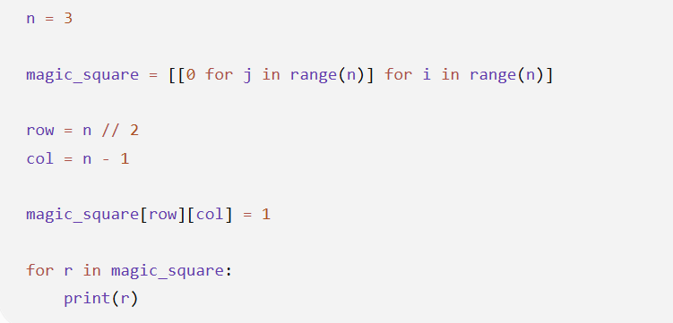
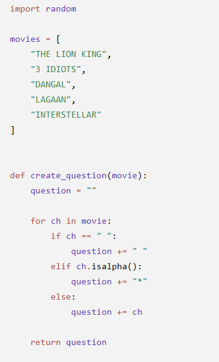
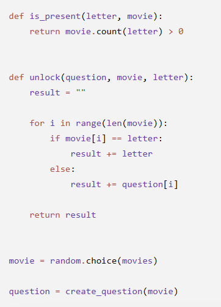
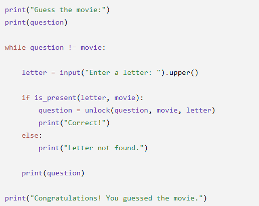

# JOC Jul-2026 · Week 4

- Source: `week-04.pdf` (case-study assignment PDF supplied by the repo owner; the only source used for the Jul-2026 session). Answers and justifications are as printed in the PDF.

## Scenario: Birthday Collision Simulator A data science club is developing a Python program to demonstrate the Birthday Paradox, which shows that in a surprisingly small group of people, two individuals are likely to share the same birthday. Since collecting real birthday data is impractical, the program randomly generates birthdays for 50 people. It first generates a random year, month, and day while ensuring that the generated date is valid by checking whether the selected year is a leap year. The birthdays are stored as datetime.date objects and then converted into their corresponding day of the year (1–365 or 366), since only the day and month are relevant for detecting birthday matches. These values are stored in a list, sorted in ascending order, and scanned for repeated values. Each repeated value represents a birthday collision. Because the birthdays are generated randomly, running the program multiple times produces different numbers of collisions, helping students understand the Birthday Paradox through simulation.

### MCQ 1

Why does the program check whether a randomly generated year is a leap year?

- A. To ensure that February is assigned the correct number of days.
- B. To reduce the number of duplicate birthdays.
- C. To generate birthdays in chronological order.
- D. To calculate the person's age.

**Answer: A**

> Justification: Leap years determine whether February has 28 or 29 days.

### MCQ 2

Which Python library is primarily responsible for creating valid calendar dates in the program?

- A. random
- B. math
- C. datetime
- D. calendar

**Answer: C**

> Justification: The datetime library is used to represent birthdays as valid date objects.

### MCQ 3

Why does the program convert each birthday into its "day of the year" value?

- A. To calculate the age of each person.
- B. To compare birthdays without considering the birth year.
- C. To reduce the amount of memory used.
- D. To make sorting unnecessary.

**Answer: B**

> Justification: Only the day and month matter when checking for birthday collisions.

### MCQ 4

Why is the list of day-of-year values sorted before checking for collisions?

- A. To generate birthdays more efficiently.
- B. To remove invalid dates automatically.
- C. To arrange birthdays by year.
- D. To make duplicate values easier to identify.

**Answer: D**

> Justification: Sorting places identical values next to each other, making collisions easy to detect.

### MCQ 5

Why does the program usually produce a different number of collisions each time it is executed?

- A. The random birthday generation creates a different set of birthdays in every run.
- B. The leap year calculation changes during execution.
- C. The sorting algorithm produces a different order every time.
- D. The datetime library stores dates differently in each execution.

**Answer: A**

> Justification: Different randomly generated birthdays result in different collision counts.

## Scenario: Digital Dobble Card Generator A game development team is creating a digital version of the Dobble card game using Python. Each card contains five symbols, represented by letters of the alphabet. The program randomly generates two cards such that exactly one symbol is common between them, while all other symbols are unique. To achieve this, it uses Python's string library to obtain a pool of symbols and the random library to select symbols and their positions. Once a symbol is placed on a card, it is removed from the available pool to prevent duplicates. After generating the cards, the program displays them and asks the player to identify the common symbol. If the player's input matches the common symbol, the program prints "Correct"; otherwise, it prints "Wrong". During testing, the developers also discovered that generating random indices from 0 to 5 for a five-element list caused an IndexError, which was fixed by generating indices from 0 to 4.

### MCQ 1

What is the primary objective of the Python program?

- A. To generate two cards with exactly one common symbol.
- B. To sort symbols alphabetically before displaying them.
- C. To count the number of vowels on each card.
- D. To generate identical cards every time.

**Answer: A**

> Justification: The program is designed so that the two cards share exactly one common symbol.

### MCQ 2 (MSQ)

Which of the following steps help ensure that the two cards contain exactly one common symbol? (Select all that apply.)

- A. Removing the common symbol from the symbol pool after placing it.
- B. Removing every newly assigned symbol from the available symbol pool.
- C. Randomly choosing only one symbol to be shared between both cards.
- D. Sorting the cards after they are generated.

**Answer: A, B, C**

> Justification: Removing used symbols prevents extra matches, while random positions determine where the single common symbol appears. Sorting does not affect the card contents.

### MCQ 3

Why does the program use random.choice()?

- A. To sort the available symbols.
- B. To select a symbol randomly from the available symbol list.
- C. To compare the two cards.
- D. To convert uppercase letters into lowercase letters.

**Answer: B**

> Justification: random.choice() selects a random element from a list.

### MCQ 4

Why was random.randint(0, 5) changed to random.randint(0, 4) while selecting card positions?

- A. The cards contain only four symbols.
- B. The random library cannot generate the value 5.
- C. A five-element list has valid indices only from 0 to 4.
- D. Python lists always begin with index 1.

**Answer: C**

> Justification: A list with five elements has indices 0 through 4; index 5 is out of range.

### MCQ 5

What does the program do after displaying both generated cards?

- A. It automatically highlights the common symbol.
- B. It asks the player to identify the common symbol.
- C. It generates another pair of cards immediately.
- D. It removes all symbols from both cards.

**Answer: B**

> Justification: The player is prompted to enter the common symbol, and the program checks whether the answer is correct.

## Scenario: Building the First Prototype of a Magic Square Generator A software development team is creating a Python program to generate odd-sized Magic Squares. Rather than implementing the complete algorithm immediately, they decide to build and test the program incrementally. In the first prototype, the program accepts the size of the square (n), creates an n × n matrix initialized with zeros, determines the starting position for the first number using the Magic Square algorithm, places the number 1 at that position, and then displays the matrix for verification. Once this initial step works correctly, the team plans to extend the program to place the remaining numbers by following the movement rules of the algorithm.

### MCQ 1

Which programming construct is primarily responsible for creating the two-dimensional matrix in the prototype?

- A. Nested list comprehension
- B. Nested if-else statements
- C. Nested while loops
- D. Function recursion

**Answer: A**

> Justification: The matrix is created using a nested list comprehension that generates rows and columns.

### MCQ 2

If the value of n is changed from 3 to 5, which statement remains true without modifying the rest of the program?

- A. The number 1 will always be placed in the center of the matrix.
- B. The number 1 will always be placed in the middle row of the last column.
- C. The matrix will automatically become a valid Magic Square.
- D. The program will generate numbers from 1 to 25 automatically.

**Answer: B**

> Justification: The starting position is determined by the algorithm and remains the middle row of the last column for any odd-sized matrix.

### MCQ 3

Why is the matrix initialized with zeros instead of leaving it empty?

- A. To allow the program to identify cells that have not yet been assigned a value.
- B. To ensure that every row initially has the same sum.
- C. To improve the speed of printing the matrix.
- D. To prevent duplicate numbers from being generated.

**Answer: A**

> Justification: Zero acts as a placeholder, making it easy to distinguish occupied and unoccupied cells.

### MCQ 4

What is the primary limitation of this prototype compared to the complete Magic Square algorithm?

- A. It cannot create matrices larger than 3 × 3.
- B. It places only the first number and does not determine positions for the remaining numbers.
- C. It cannot display the matrix.
- D. It requires recursion to execute.

**Answer: B**

> Justification: The prototype demonstrates only the initialization and placement of the first value.

### MSQ 5

Which of the following statements correctly describe the prototype program? (Select all that apply.)

- A. It allocates memory for an n × n matrix before placing any numbers.
- B. It determines the initial position of the first number using the Magic Square algorithm.
- C. It uses nested iteration while creating the matrix.
- D. It verifies that every row, column, and diagonal has the same sum.

**Answer: A, B, C**

> Justification: The prototype creates the matrix, determines the starting position, and uses nested iteration for initialization, but it does not validate or construct the complete Magic Square.

## Scenario: Movie Guessing Game A movie streaming platform is developing a Movie Guessing Game to improve user engagement. The game randomly selects a movie title from a predefined list and displays a masked version of it, where every alphabetic character is replaced with * while spaces remain visible. The player repeatedly guesses one letter at a time. If the guessed letter is present in the movie title, all its occurrences are revealed. Otherwise, the player is informed that the letter is not present. The game continues until the player successfully reveals the complete movie title.

### MCQ 1

Which function is responsible for creating the initial masked movie title displayed to the player?

- A. unlock()
- B. is_present()
- C. create_question()
- D. random.choice()

**Answer: C**

> Justification: create_question() replaces alphabetic characters with * while preserving spaces and other characters.

### MCQ 2

The player enters a letter that is not present in the selected movie title. What happens next?

- A. The movie title is selected again.
- B. The current masked title remains unchanged, and a message is displayed.
- C. The game terminates immediately.
- D. All hidden letters are revealed.

**Answer: B**

> Justification: If the guessed letter is absent, the program displays "Letter not found." and continues with the existing masked title.

### MCQ 3

Why does the unlock() function receive both the original movie title and the current masked title as parameters?

- A. To compare their lengths before displaying the result.
- B. To generate a new random movie title.
- C. To reveal only the newly guessed letters while preserving previously revealed letters.
- D. To convert the movie title into uppercase.

**Answer: C**

> Justification: The original title identifies matching letters, while the masked title preserves letters revealed in earlier guesses.

### MCQ 4

Which condition causes the game loop to terminate?

- A. The player enters an incorrect letter.
- B. All letters in the movie title have been revealed.
- C. The player guesses five incorrect letters.
- D. The movie list becomes empty.

**Answer: B**

> Justification: The loop continues until the masked title becomes identical to the original movie title.

### MSQ 5

Which of the following statements about the program are correct? (Select all that apply.)

- A. random.choice() is used to select one movie title from the list.
- B. isalpha() ensures that spaces and non-alphabetic characters are replaced with *.
- C. The unlock() function may reveal multiple occurrences of the guessed letter in a single attempt.
- D. The player's input is converted to uppercase before it is checked against the movie title.

**Answer: A, C, D**

> Justification: The program randomly selects a movie, converts the player's input to uppercase, and reveals every occurrence of a correctly guessed letter. isalpha() masks only alphabetic characters, leaving spaces and other non-alphabetic characters unchanged rather than replacing them.
