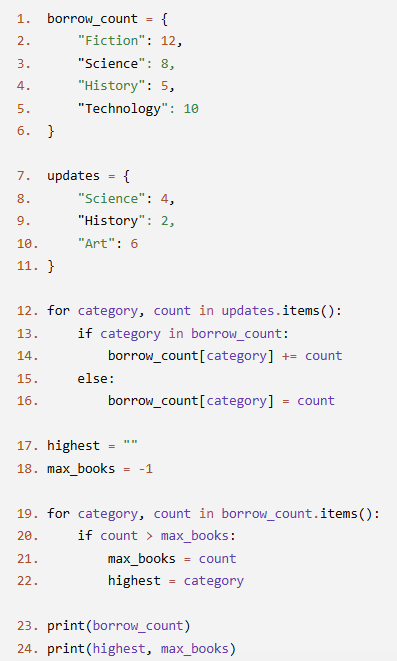
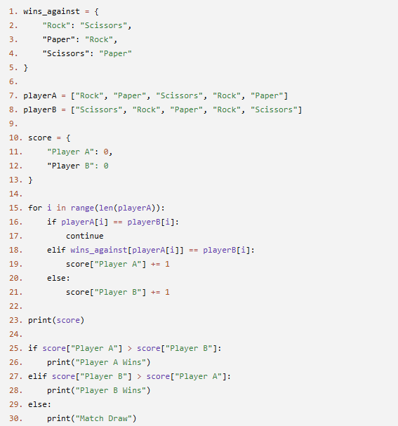
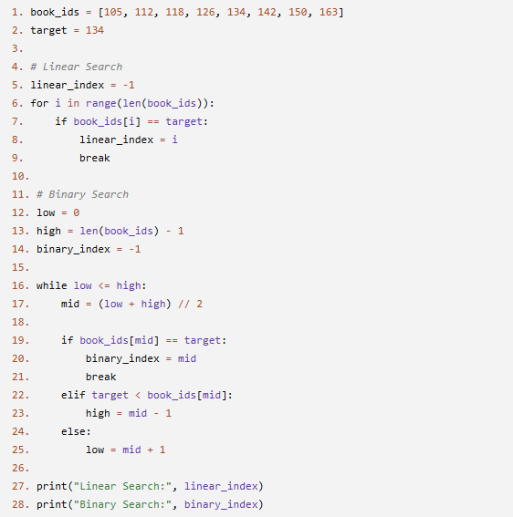

# JOC Jul-2026 · Week 5

- Source: `week-05.pdf` (case-study assignment PDF supplied by the repo owner; the only source used for the Jul-2026 session). Answers and justifications are as printed in the PDF.

## Scenario: Community Library Book Tracker A community library keeps track of the number of books borrowed from different categories. At the end of the day, the librarian wants to update the records based on newly borrowed books and determine which category had the highest number of borrowings. Study the following Python program carefully and answer the questions that follow.

### Q1. (MCQ) How many key-value pairs are present in borrow_count immediately after the completion of Line 16?

- A. 4
- B. 5
- C. 6
- D. 7

**Answer: B**

> Justification: Initially, borrow_count contains four key-value pairs. During the update process, "Science" and "History" are updated, while "Art" is added as a new key. Therefore, the dictionary contains five key-value pairs after Line 16.

### Q2. (MCQ) Which statement correctly describes the execution of the else block (Lines 15–16)?

- A. It executes for every category in updates.
- B. It executes only when a category already exists in borrow_count.
- C. It executes only when a category is not present in borrow_count.
- D. It never executes because all categories already exist.

**Answer: C**

> Justification: The else block is executed only when the condition category in borrow_count evaluates to False. In this program, only the category "Art" is absent from borrow_count, so the else block executes exactly once.

### Q3. (MCQ) Immediately after executing Line 21 for the first time, what is the value of max_books?

- A. -1
- B. 10
- C. 12
- D. 7

**Answer: C**

> Justification: Before the second loop begins, max_books is initialized to -1. The first category processed is "Fiction" with a borrowing count of 12. Since 12 > -1, max_books is updated to 12.

### Q4. (MCQ) Which variable stores the largest borrowing count after the program completes execution?

- A. highest
- B. category
- C. count
- D. max_books

**Answer: D**

> Justification: The variable max_books stores the highest borrowing count encountered during the traversal of the dictionary. The variable highest stores the corresponding category name, while category and count represent the current key and value during iteration.

### Q5. (MSQ) Which of the following statements are correct?

- A. The values of "Science" and "History" are increased.
- B. The value of "Technology" remains unchanged.
- C. Exactly one new key is added to the dictionary.
- D. The final dictionary contains fewer keys than the initial dictionary.

**Answer: A, B, C**

> Justification: - A: Correct. "Science" is updated from 8 to 12, and "History" is updated from 5 to 7. - B: Correct. "Technology" is not present in the updates dictionary, so its value remains unchanged. - C: Correct. "Art" is the only new category added to borrow_count. - D: Incorrect. The dictionary grows from four keys to five keys after the addition of "Art".

## Scenario: Rock–Paper–Scissors Championship A coding club is organizing a Rock–Paper–Scissors championship. The choices made by both players are stored in two lists. A dictionary is used to define which move defeats another. The program compares the choices in each round, updates the scores, and declares the overall winner. Study the following program and answer the questions.

### Q1. (MCQ) What is the purpose of the dictionary wins_against?

- A. It stores the scores of both players.
- B. It stores the choices made by each player.
- C. It stores which move defeats another move.
- D. It stores the winner of each round.

**Answer: C**

> Justification: The dictionary maps each move to the move it defeats. For example, "Rock" maps to "Scissors" because Rock beats Scissors.

### Q2. (MCQ) What is the value of the score dictionary after the loop finishes?

- A. {"Player A": 2, "Player B": 2}
- B. {"Player A": 3, "Player B": 1}
- C. {"Player A": 4, "Player B": 0}
- D. {"Player A": 1, "Player B": 3}

**Answer: B**

> Justification: Player A wins Rounds 1, 2, and 3, while Player B wins Round 5. Round 4 is a draw, so the final score is {"Player A": 3, "Player B": 1}.

### Q3. (MCQ) What does the expression wins_against[playerA[i]] return?

- A. The current score of Player A.
- B. The move that defeats Player A's current move.
- C. The move defeated by Player A's current move.
- D. The current round number.

**Answer: C**

> Justification: The expression retrieves the value associated with Player A's current move from the dictionary. For example, if Player A chooses "Paper", it returns "Rock".

### Q4. (MCQ) Which statement is printed at the end of the program?

- A. Player A Wins
- B. Player B Wins
- C. Match Draw
- D. No output is printed.

**Answer: A**

> Justification: Player A scores 3 points, while Player B scores 1 point. Since Player A has the higher score, the program prints "Player A Wins".

### Q5. (MSQ) Which of the following statements are correct?

- A. The dictionary score is updated during program execution.
- B. The dictionary wins_against is modified during the program.
- C. The program records one drawn round.
- D. The statement score["Player A"] += 1 updates the value associated with the key "Player A".

**Answer: A, C, D**

> Justification: The score dictionary is updated whenever a player wins a round, while wins_against is used only for lookups. One round ends in a draw, and score["Player A"] += 1 increments Player A's score by one.

## Scenario: Library Book Search System A digital library stores book IDs in a sorted list. When a student searches for a book, the librarian first performs a Linear Search to locate the book. Later, the system uses a Binary Search to improve search efficiency on the same sorted list. Study the following program and answer the questions.

### Q1. (MCQ) Why is the list book_ids arranged in ascending order?

- A. To reduce memory usage.
- B. Because Binary Search requires the data to be sorted.
- C. Because Linear Search requires the data to be sorted.
- D. To avoid duplicate values.

**Answer: B**

> Justification: Binary Search works correctly only when the elements are sorted. Linear Search does not require a sorted list.

### Q2. (MCQ) What is the output of the program?

- A. Linear Search: 3 and Binary Search: 3
- B. Linear Search: 4 and Binary Search: 4
- C. Linear Search: 5 and Binary Search: 5
- D. Linear Search: -1 and Binary Search: -1

**Answer: B**

> Justification: The value 134 is present at index 4 in the list. Both search algorithms locate the same element and return the same index.

### Q3. (MCQ) During the first iteration of the Binary Search loop, what is the value of mid?

- A. 2
- B. 3
- C. 4
- D. 5

**Answer: B**

> Justification: Initially, low = 0 and high = 7. Therefore, mid = (0 + 7) // 2 = 3.

### Q4. (MCQ) Suppose the statement break on Line 9 is removed. Which statement is correct?

- A. The program produces an error.
- B. The Linear Search continues checking the remaining elements even after finding the target.
- C. The Binary Search stops working.
- D. The value of linear_index becomes -1.

**Answer: B**

> Justification: Without the break, the loop continues until the end of the list. Since the target appears only once, the final value of linear_index remains unchanged.

### Q5. (MSQ) Which of the following statements are correct?

- A. Linear Search checks elements one by one from the beginning of the list.
- B. Binary Search repeatedly divides the search space into two halves.
- C. Both Linear Search and Binary Search return index 4 for the given input.
- D. Binary Search can be applied correctly even if book_ids is not sorted.

**Answer: A, B, C**

> Justification: Linear Search examines elements sequentially, while Binary Search repeatedly halves the search range. Since the target exists at index 4, both algorithms return 4; however, Binary Search requires the list to be sorted.

## Scenario: Airport Boarding Gate Search An airport maintains a sorted list of boarding gate numbers for departing flights. [101, 104, 108, 112, 117, 121, 126, 130, 135, 140] A passenger is looking for Gate 126. The airport system can use either Linear Search or Binary Search to locate the gate. Answer the following questions.

### Q1. (MCQ) How many elements would Linear Search examine before finding Gate 126?

- A. 5
- B. 6
- C. 7
- D. 8

**Answer: C**

> Justification: Linear Search checks elements one by one from the beginning. Gate 126 is the 7th element in the list, so seven comparisons are required.

### Q2. (MCQ) During the first comparison of Binary Search, which gate number is examined?

- A. 112
- B. 117
- C. 121
- D. 126

**Answer: B**

> Justification: The middle index of a 10-element list is (0 + 9) // 2 = 4. The element at index 4 is 117.

### Q3. (MCQ) After the first Binary Search comparison, which part of the list will be searched next?

- A. [101, 104, 108, 112]
- B. [101, 104, 108, 112, 117]
- C. [121, 126, 130, 135, 140]
- D. [126, 130, 135, 140]

**Answer: C**

> Justification: Since 126 is greater than 117, Binary Search discards the left half. It continues searching the right half of the list.

### Q4. (MCQ) Why is Binary Search generally faster than Linear Search for large sorted lists?

- A. It compares every element only once.
- B. It checks two elements in every comparison.
- C. It eliminates half of the remaining search space after each comparison.
- D. It works only on lists with unique values.

**Answer: C**

> Justification: Binary Search reduces the search space by half after each comparison. This makes it much more efficient than checking elements one by one.

### Q5. (MSQ) Which of the following statements are correct?

- A. Binary Search requires the list to be sorted.
- B. Linear Search can be used on both sorted and unsorted lists.
- C. Both Linear Search and Binary Search will locate Gate 126 in this scenario.
- D. Binary Search always examines every element in the list.

**Answer: A, B, C**

> Justification: Binary Search works correctly only on sorted data, whereas Linear Search works on any list. In this scenario, both methods successfully locate Gate 126, but Binary Search does not examine every element.
