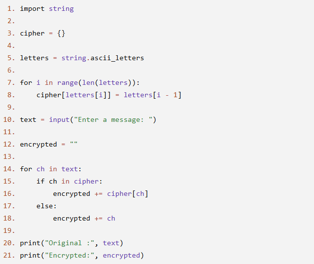
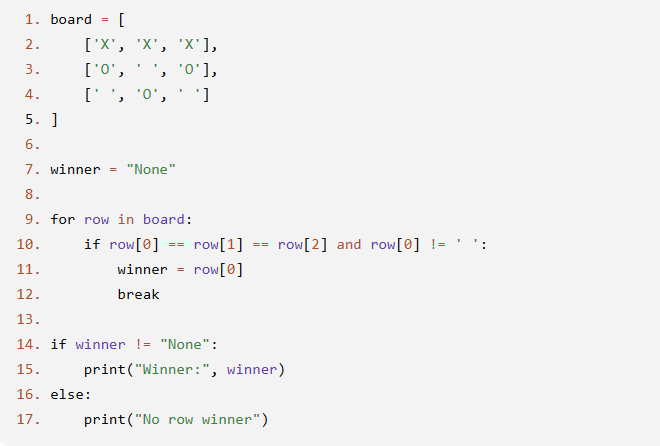
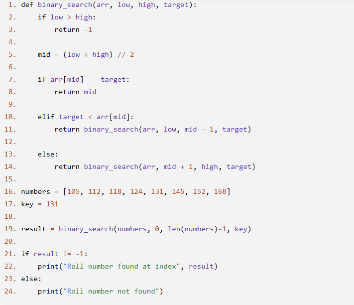

# JOC Jul-2026 · Week 6

- Source: `week-06.pdf` (case-study assignment PDF supplied by the repo owner; the only source used for the Jul-2026 session). Answers and justifications are as printed in the PDF.

## Scenario: Secret Notice Encoder A college club regularly shares announcements with its members. Since these messages are posted on a public notice board, the club wants to make them difficult for outsiders to read. To achieve this, the club uses a Substitution Cipher. Every alphabetic character is replaced by the previous letter in string.ascii_letters. Non-alphabetic characters such as spaces, digits, and punctuation marks remain unchanged. The following Python program performs this encryption.

### Q1. (MCQ) Which line creates the substitution rule that maps each letter to its replacement?

- A. Line 5
- B. Line 7
- C. Line 8
- D. Line 16

**Answer: C**

> Justification: Line 8 stores each original letter as a key and its substituted letter as the corresponding value in the dictionary.

### Q2. (MCQ) Suppose the user enters the input: ABC123 Which statement ensures that the digits 1, 2, and 3 remain unchanged?

- A. Line 10
- B. Lines 17–18
- C. Line 20
- D. Line 21

**Answer: B**

> Justification: If a character is not found in the dictionary (such as digits or punctuation), the else block copies it unchanged.

### Q3. (MCQ) What is the purpose of Line 12?

- A. It stores the substitution dictionary.
- B. It stores the original input.
- C. It initializes an empty string to build the encrypted message.
- D. It prints the encrypted output.

**Answer: C**

> Justification: The variable encrypted starts as an empty string, and encrypted characters are appended to it during processing.

### Q4. (MCQ) If Line 16 encrypted += cipher[ch] is replaced with encrypted += ch what will be the result?

- A. Only uppercase letters will be encrypted.
- B. The program will generate an error.
- C. Only digits will be encrypted.
- D. The output will be identical to the input.

**Answer: D**

> Justification: The substitution dictionary is no longer used. Every character is copied directly into the output.

### Q5. (MSQ) Which of the following statements about the program are correct? (Select all that apply.)

- A. Line 5 stores all lowercase and uppercase English letters.
- B. Line 8 creates a substitution mapping using a dictionary.
- C. Line 15 checks whether the current character is a digit.
- D. Lines 20 and 21 display both the original and encrypted messages.

**Answer: A, B, D**

> Justification: - A: string.ascii_letters contains both lowercase and uppercase English letters. - B: Line 8 creates the mapping from each letter to its substitute. - C: Line 15 checks whether the character exists in the dictionary, not whether it is a digit. - D: The final two print statements display both the original input and the encrypted output.

## Scenario: Tic-Tac-Toe Winner Checker A programming club is developing a simple Tic-Tac-Toe game. The game board is represented using a nested list, where each inner list represents a row of the board. - 'X' represents Player X. - 'O' represents Player O. - ' ' (space) represents an empty cell. The program checks only the rows of the board to determine whether either player has won. If a row contains three identical non-space symbols, that player is declared the winner. Otherwise, the program reports that there is no row winner.

### Q1. (MCQ) Which line checks whether all three cells in a row contain the same non-empty symbol?

- A. Line 7
- B. Line 9
- C. Line 10
- D. Line 15

**Answer: C**

> Justification: Line 10 compares all three elements of a row and ensures that they are not blank.

### Q2. (MCQ) What is the purpose of the break statement in Line 12?

- A. It skips the current row.
- B. It exits the loop after finding a winner.
- C. It resets the board.
- D. It starts checking the rows again.

**Answer: B**

> Justification: Once a winning row is found, there is no need to examine the remaining rows.

### Q3. (MCQ) Which variable stores the winning player's symbol?

- A. board
- B. row
- C. winner
- D. print

**Answer: C**

> Justification: The variable winner is updated with 'X' or 'O' when a winning row is found.

### Q4. (MCQ) If Line 11 winner = row[0] is replaced with winner = "Player" what will the program display when a winning row is found?

- A. The winning symbol (X or O)
- B. "Player"
- C. "None"
- D. The entire row

**Answer: B**

> Justification: The variable winner would always contain the string "Player" instead of the winning symbol.

### Q5. (MSQ) Which of the following statements about the program are correct? (Select all that apply.)

- A. The board is represented using a nested list.
- B. The program checks only row-wise winning conditions.
- C. The loop stops immediately after a winner is found.
- D. The program checks both row-wise and diagonal winning conditions.

**Answer: A, B, C**

> Justification: - A: Correct. The board is stored as a list of lists. - B: Correct. The program examines only the rows for a winning condition. - C: Correct. The break statement terminates the loop once a winner is detected. - D: Incorrect. The program does not check diagonal or column-wise winning conditions.

## Scenario-Based Question: Recursive Folder Search A company stores its documents in a hierarchy of folders. Each folder can contain: - Files - Other folders A software engineer is asked to write a program to find a file named Report.pdf. The program begins with the main folder. Whenever it encounters a subfolder, it performs the same search process inside that subfolder. If the file is found, the search stops. If a folder contains no more subfolders or files, the program returns to the previous folder and continues searching. No loops are explicitly used to revisit folders; instead, the same search procedure is repeatedly applied to each subfolder.

Questions

### Q1. (MCQ) Which characteristic of the search process best represents recursion?

- A. The search visits folders in alphabetical order.
- B. The same search procedure is applied repeatedly to each subfolder.
- C. Every folder contains the same number of files.
- D. The search uses multiple computers simultaneously.

**Answer: B**

> Justification: In recursion, the same task is performed repeatedly on smaller instances of the same problem.

### Q2. (MCQ) In this scenario, what is the base case for the recursive search?

- A. The search begins from the main folder.
- B. A folder contains only PDF files.
- C. A folder has no more files or subfolders to search, or the required file is found.
- D. The search enters a subfolder.

**Answer: C**

> Justification: A recursive process stops when it reaches a condition where no further recursive calls are needed.

### Q3. (MCQ) Why is recursion a suitable approach for this problem?

- A. Every folder has exactly one subfolder.
- B. The same search operation must be repeated for each subfolder.
- C. Recursion is always faster than iteration.
- D. Files can only exist in the main folder.

**Answer: B**

> Justification: Each subfolder is simply a smaller version of the original problem, making recursion a natural solution.

### Q4. (MCQ) What would most likely happen if the search process had no base case?

- A. The search would immediately stop.
- B. The search would examine only the main folder.
- C. The search could continue indefinitely or until system resources are exhausted.
- D. The search would automatically switch to an iterative approach.

**Answer: C**

> Justification: Without a stopping condition, recursive calls continue indefinitely, eventually causing a stack overflow or exhausting system resources.

### Q5. (MSQ) Which of the following statements correctly describe recursion in the given scenario? (Select all that apply.)

- A. The same search procedure is used for every subfolder.
- B. The search must have a stopping condition.
- C. Each subfolder represents a smaller instance of the original problem.
- D. Recursion can only be used if every folder contains exactly one subfolder.

**Answer: A, B, C**

> Justification: - A: Correct. The same search logic is applied to every subfolder. - B: Correct. Every recursive solution requires a base case to terminate. - C: Correct. Each subfolder is a smaller version of the original folder search problem. - D: Incorrect. A folder may contain any number of subfolders or none at all; recursion does not require exactly one subfolder.

## Scenario: Recursive Binary Search for Student Roll Numbers A university stores student roll numbers in ascending order. When an administrator wants to verify whether a particular roll number exists, the system performs a recursive binary search. The search begins by checking the middle roll number in the current range. - If the middle roll number matches the required roll number, the search is successful. - If the required roll number is smaller, the same search process is repeated on the left half. - If the required roll number is larger, the search continues recursively on the right half. - If the search range becomes invalid (the left index becomes greater than the right index), the roll number is reported as not found. The following program implements this recursive binary search.

### Q1. (MCQ) Which line represents the base case where the search terminates because the search range has become invalid?

- A. Line 5
- B. Line 2
- C. Line 7
- D. Line 14

**Answer: B**

> Justification: Line 2 checks whether low > high. If true, there are no more elements to search, and the recursion terminates.

### Q2. (MCQ) Which line performs the recursive search on the left half of the list?

- A. Line 5
- B. Line 8
- C. Line 11
- D. Line 19

**Answer: C**

> Justification: When the target is smaller than the middle element, the function recursively searches from low to mid - 1.

### Q3. (MCQ) What is the purpose of Line 5?

- A. It checks whether the element is found.
- B. It calculates the middle index of the current search range.
- C. It sorts the list.
- D. It prints the search result.

**Answer: B**

> Justification: The middle index is calculated so that the current search range can be divided into two halves.

### Q4. (MCQ) If Line 14 return binary_search(arr, mid + 1, high, target) is replaced with return binary_search(arr, low, high, target) what is the most likely outcome when the target is greater than the middle element?

- A. The program always finds the target immediately.
- B. The search correctly moves to the right half.
- C. The search continues without reducing the search range, leading to infinite recursion.
- D. The program searches only the left half.

**Answer: C**

> Justification: Since the search boundaries do not change, the same recursive call is repeated indefinitely.

### Q5. (MSQ) Which of the following statements about the program are correct? (Select all that apply.)

- A. The recursive calls in Lines 11 and 14 reduce the search space in every recursive step.
- B. The program can correctly perform binary search even if numbers is not sorted.
- C. Line 5 compares the target with every element in the list.
- D. The recursion stops either when the target is found (Line 8) or when the search range becomes invalid (Line 3).

**Answer: A, D**

> Justification: - A: Correct. Each recursive call searches only one half of the remaining list. - B: Incorrect. Binary search requires the list to be sorted. - C: Incorrect. Line 5 only computes the middle index; it does not compare every element. - D: Correct. These are the two terminating conditions of the recursive binary search.
