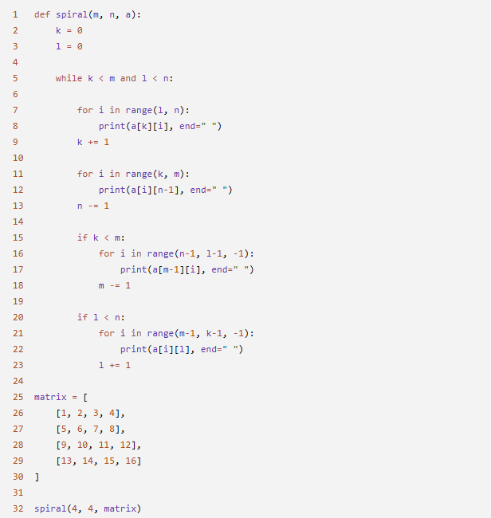
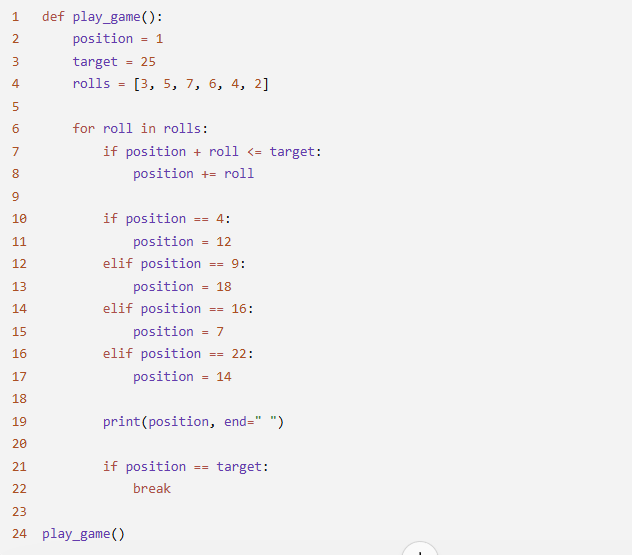
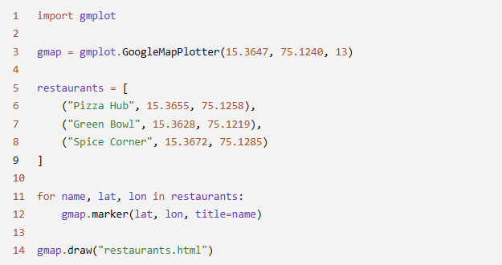

# JOC Jul-2026 · Week 7

- Source: `week-07.pdf` (case-study assignment PDF supplied by the repo owner; the only source used for the Jul-2026 session). Answers and justifications are as printed in the PDF.

## Scenario: Drone Surveillance Route A disaster management team uses a drone to capture images of a disaster-affected area. The images are stored in a matrix. During analysis, the system processes the images in a spiral order, beginning from the outer boundary and gradually moving toward the center so that all regions are examined systematically. The following Python program performs the spiral traversal of the matrix.

### Question 1 (MCQ)

Which variables store the starting row and starting column of the current spiral layer?

- A. k and l
- B. m and n
- C. i and k
- D. a and i

**Correct Answer: A**

> Justification: k stores the starting row index and l stores the starting column index.

### Question 2 (MCQ)

What is the purpose of the statement at line 9?

- A. It moves to the next column.
- B. It moves to the next row after printing the top row.
- C. It moves to the previous row.
- D. It resets the row index.

**Correct Answer: B**

> Justification: The starting row index is increased after the top row has been printed.

### Question 3 (MCQ)

Which statement best describes the loop at lines 11–12?

- A. It prints the first column from top to bottom.
- B. It prints the last row from left to right.
- C. It prints the last column from top to bottom.
- D. It prints the top row from right to left.

**Correct Answer: C**

> Justification: The column index remains fixed at n-1 while the row index increases.

### Question 4 (MCQ)

What is the first sequence of numbers printed by the program?

- A. 1 2 3 4
- B. 4 8 12 16
- C. 13 14 15 16
- D. 1 5 9 13

**Correct Answer: A**

> Justification: The algorithm begins by traversing the top row from left to right.

### Question 5 (MSQ)

Which of the following statements are true about the program?

- A. The variables k, l, m, and n define the current boundaries of the unvisited portion of the matrix.
- B. After each side of the spiral is printed, the corresponding boundary is updated.
- C. The program prints only square matrices correctly.
- D. The program traverses the matrix column by column throughout.

**Correct Answers: A, B**

> Justification: The algorithm maintains and updates four boundaries to progressively traverse the matrix in spiral order.

## Scenario: Mini Snake and Ladder Tournament A board game club is testing a simplified Snake and Ladder game. The board has 25 positions. A player starts at position 1 and moves according to a sequence of dice rolls. If the player lands on the bottom of a ladder, the player climbs immediately. If the player lands on the head of a snake, the player slides down immediately. If the player's position becomes greater than 25, the move is ignored. The game has the following snakes and ladders: - Ladder: 4 → 12 - Ladder: 9 → 18 - Snake: 16 → 7 - Snake: 22 → 14 The following Python program simulates the player's journey.

### Question 1 (MCQ)

Which statement ensures that the player does not move beyond the last position on the board?

- A. if position == target:
- B. if position + roll <= target:
- C. position += roll
- D. break

**Correct Answer: B**

> Justification: The condition allows a move only if the new position does not exceed the target.

### Question 2 (MCQ)

If the player reaches position 16, what happens next?

- A. The player moves to position 22.
- B. The player stays at position 16.
- C. The player moves to position 18.
- D. The player moves to position 7.

**Correct Answer: D**

> Justification: Position 16 is the head of a snake that sends the player to position 7.

### Question 3 (MCQ)

What is the purpose of the statement at line 21?

- A. It checks whether all dice rolls are completed.
- B. It checks whether the player has reached the target position.
- C. It resets the player's position.
- D. It moves the player to the next turn.

**Correct Answer: B**

> Justification: The condition checks if the player has reached the final position.

### Question 4 (MCQ)

Which statement immediately ends the loop once the player reaches the target?

- A. break
- B. position += roll
- C. print(position, end=" ")
- D. for roll in rolls:

**Correct Answer: A**

> Justification: The break statement terminates the loop immediately.

### Question 5 (MSQ)

Which of the following statements are true about the program?

- A. The player always moves after every dice roll.
- B. The game stops only after all dice rolls are processed.
- C. A move is ignored if it takes the player beyond position 25.
- D. Landing on a snake or ladder changes the player's position immediately.

**Correct Answers: C, D**

> Justification: The program ignores moves beyond the target and immediately applies snakes or ladders whenever the player lands on them.

## Scenario: Food Delivery Pickup Locations A food delivery company uses a map to display the locations of restaurants where delivery agents need to collect orders. Each restaurant is represented by a marker on the map. When a marker is clicked, the restaurant's name is displayed. The following Python program creates a map and places markers for three restaurants.

### Question 1 (MCQ)

What is the purpose of the statement at line 3?

- A. It creates a marker on the map.
- B. It stores restaurant names.
- C. It creates a Google map centered at the given location.
- D. It saves the map as an HTML file.

**Correct Answer: C**

> Justification: The statement creates a Google Map object centered at the specified latitude and longitude.

### Question 2 (MCQ)

Which statement adds a marker for each restaurant?

- A. gmap.draw("restaurants.html")
- B. gmap.marker(lat, lon, title=name)
- C. restaurants = [...]
- D. for name, lat, lon in restaurants:

**Correct Answer: B**

> Justification: The marker() method places a marker at the specified coordinates.

### Question 3 (MCQ)

What is displayed as the title of each marker?

- A. The latitude value
- B. The longitude value
- C. The map's zoom level
- D. The restaurant name

**Correct Answer: D**

> Justification: The value of name is passed as the marker's title.

### Question 4 (MCQ)

What is the purpose of the statement at line 14?

- A. It creates another marker.
- B. It removes all markers from the map.
- C. It changes the map center.
- D. It saves the map as an HTML file.

**Correct Answer: D**

> Justification: The draw() method generates the HTML file containing the map.

### Question 5 (MSQ)

Which of the following statements are true about the program?

- A. The program creates a separate map for each restaurant.
- B. The markers are added using the latitude and longitude values.
- C. The program iterates through all restaurants using a for loop.
- D. The HTML file is created before the markers are added.

**Correct Answers: B, C**

> Justification: The loop processes each restaurant and marker() uses its latitude and longitude to place a marker on the map.

## Case Study: Smart Heritage City Explorer The tourism department of a heritage city has developed a Smart Heritage City Explorer to help visitors explore popular attractions. The city is represented as a matrix, where each cell corresponds to a location. Every morning, an inspection drone scans the city in a spiral order, starting from the outer boundary and moving towards the center to ensure that every location is inspected exactly once. Information about each attraction is stored in a dictionary containing the attraction's name, category, visitor rating, latitude, and longitude. When a visitor searches for an attraction, the application uses linear search if the attractions are stored in random order. If the attractions are sorted alphabetically, the application uses binary search to locate the attraction more efficiently. After an attraction is found, its latitude and longitude are used to place a marker on a Google Map so that visitors can easily navigate to the destination. The application also includes a Treasure Trail game. Visitors move across 25 checkpoints using dice rolls. Some checkpoints contain ladders that move visitors ahead, while others contain snakes that move them backward. If a dice roll takes a visitor beyond the final checkpoint, that move is ignored. The developers use appropriate data structures and algorithms so that the application remains efficient and easy to maintain.

### Question 1 (MCQ)

The attractions are stored in random order. Which searching technique is most appropriate for finding a particular attraction?

- A. Binary Search
- B. Spiral Search
- C. Linear Search
- D. Depth First Search

**Correct Answer: C**

> Justification: Linear search is suitable when the data is not sorted.

### Question 2 (MCQ)

Why does the inspection drone use a spiral traversal of the city matrix?

- A. To visit only the corner locations.
- B. To inspect every location by moving from the outer boundary towards the center.
- C. To sort the locations alphabetically.
- D. To search for a specific attraction.

**Correct Answer: B**

> Justification: Spiral traversal systematically covers all cells from the outer layer to the center.

### Question 3 (MCQ)

Which information is essential for placing an attraction on the Google Map?

- A. Name and Category
- B. Rating and Category
- C. Latitude and Longitude
- D. Name and Rating

**Correct Answer: C**

> Justification: A map marker requires geographic coordinates to determine its location.

### Question 4 (MCQ)

In the Treasure Trail game, what should happen if a dice roll moves the visitor beyond checkpoint 25?

- A. The visitor returns to checkpoint 1.
- B. The visitor wins immediately.
- C. The visitor moves to checkpoint 25.
- D. The move is ignored.

**Correct Answer: D**

> Justification: The game rules specify that moves beyond the final checkpoint are not allowed.

### Question 5 (MSQ)

Which of the following statements are true about the Smart Heritage City Explorer?

- A. Binary search can be used efficiently even if the attractions are stored in random order.
- B. A dictionary is suitable for storing multiple details about each attraction.
- C. Spiral traversal is a suitable approach for visiting every location in a matrix.
- D. Google Map markers are placed using the latitude and longitude of an attraction.

**Correct Answers: B, C**

> Justification: Dictionaries can store multiple attributes of an attraction, and spiral traversal visits every matrix location exactly once.
