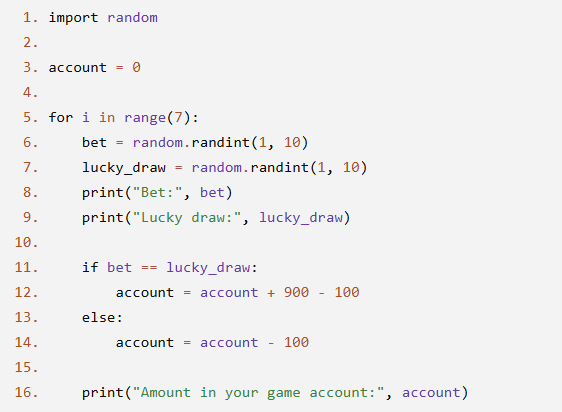
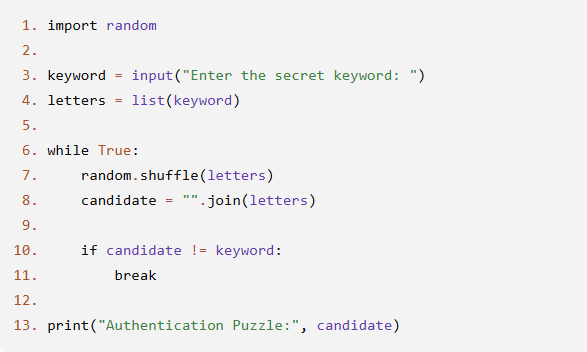
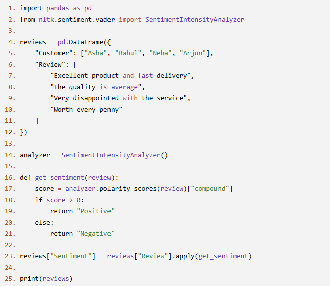

# JOC Jul-2026 · Week 8

- Source: `week-08.pdf` (case-study assignment PDF supplied by the repo owner; the only source used for the Jul-2026 session). Answers and justifications are as printed in the PDF.

## Scenario: Student Record Management A college stores each student's information as a tuple because these details do not change during a semester. One student's record is stored as: ("Ananya", 1023, "Computer Science", 8.7) The information is stored in the following order: - Student Name - Student ID - Department - CGPA The college uses this tuple whenever it needs to retrieve a student's information.

### Q1. Which piece of information is stored in the third position of the tuple?

- A. Student Name
- B. Student ID
- C. Department
- D. CGPA

**Correct Answer: C**

> Justification: The third value in the tuple is "Computer Science", which represents the student's department.

### Q2. Why is a tuple a suitable data structure for storing this record?

- A. Because the student details are not expected to change frequently.
- B. Because tuples automatically sort the data.
- C. Because tuples allow duplicate student IDs.
- D. Because tuples can only store text values.

**Correct Answer: A**

> Justification: Tuples are useful when the stored information remains fixed after creation.

### Q3. How many pieces of information are stored in the student's tuple?

- A. 2
- B. 3
- C. 4
- D. 5

**Correct Answer: C**

> Justification: The tuple contains four values: Name, Student ID, Department, and CGPA.

### Q4. Which of the following is the last item stored in the tuple?

- A. Ananya
- B. 1023
- C. Computer Science
- D. 8.7

**Correct Answer: D**

> Justification: The last value in the tuple is the student's CGPA, which is 8.7.

### Q5. A staff member wants to replace the department "Computer Science" with "Artificial Intelligence" in the existing tuple. What should they do?

- A. Modify the existing tuple directly.
- B. Create a new tuple with the updated value.
- C. Delete only the department value.
- D. Use the append() operation.

**Correct Answer: B**

> Justification: Tuples are immutable, so their values cannot be modified after creation. A new tuple must be created with the updated information.

## Scenario: Lucky Draw Betting Game A gaming café has introduced a simple Lucky Draw Challenge. A player starts with ₹0 in their game account. The game is played 7 times. In every round: - The player's bet number is randomly chosen between 1 and 10. - The lucky draw number is also randomly chosen between 1 and 10. - If both numbers are the same, the player wins ₹900, but ₹100 is deducted as the participation fee. Hence, the account increases by ₹800. - If the numbers are different, the player only loses the ₹100 participation fee. - After every round, the current account balance is displayed. The following Python program implements this game.

### Q1. According to Line 5, how many rounds will the game be played?

- A. 7
- B. 8
- C. 10
- D. Depends on the random numbers

**Correct Answer: A**

> Justification: range(7) repeats the loop 7 times, so the game consists of seven rounds.

### Q2. Which lines generate the random numbers for the player's bet and the lucky draw?

- A. Lines 3 and 5
- B. Lines 8 and 9
- C. Lines 11 and 12
- D. Lines 6 and 7

**Correct Answer: D**

> Justification: Lines 6 and 7 use random.randint(1, 10) to generate the bet number and the lucky draw number.

### Q3. If the bet number and lucky draw number are equal, what is the net change in the account balance according to Line 12?

- A. +₹100
- B. +₹900
- C. +₹700
- D. +₹800

**Correct Answer: D**

> Justification: The player receives ₹900 and pays a ₹100 participation fee. Therefore, the net increase is ₹800.

### Q4. According to Lines 13–14, what happens when the bet number and lucky draw number are different?

- A. ₹100 is deducted from the account.
- B. ₹900 is added to the account.
- C. The account balance remains unchanged.
- D. A new account is created.

**Correct Answer: A**

> Justification: The else block subtracts ₹100 from the account, representing the participation fee.

### Q5. (MSQ) Which of the following statements about the program are correct? (Choose all that apply.)

- A. The player's account balance is printed after every round.
- B. The player's bet is entered by the user using input().
- C. The lucky draw number is always different from the bet number.
- D. The player's account balance can become negative.

**Correct Answers: A and D**

> Justification: - A  Line 16 prints the account balance after each iteration of the loop. - B  The program generates the bet randomly; it does not use input(). - C  Since both values are random, they may or may not be equal. - D  If the player loses multiple rounds, ₹100 is deducted each time, so the account balance can become negative.

## Scenario: Secure Access Puzzle Generator A cybersecurity training platform uses anagrams to create authentication puzzles. Before granting access to a practice lab, the system displays a shuffled version of a secret keyword. To ensure the puzzle is meaningful, the displayed word must not be identical to the original keyword. The system keeps generating new arrangements until a valid anagram is produced. The following Python program implements this logic.

### Q1. Suppose the user enters the word LEVEL. Which of the following statements is always true?

- A. The displayed puzzle will never contain repeated letters.
- B. The displayed puzzle will always have exactly five letters.
- C. The displayed puzzle will always be alphabetically sorted.
- D. The displayed puzzle cannot be generated because the word contains repeated letters.

**Correct Answer: B**

> Justification: Shuffling changes only the order of characters. The number of characters always remains the same. Repeated letters do not prevent an anagram from being generated.

### Q2. Consider the execution of Lines 6–11. Which situation can cause the loop to execute more than once?

- A. The entered keyword has fewer than five letters.
- B. random.shuffle() arranges the letters in the same order as the original keyword.
- C. The keyword contains only uppercase letters.
- D. The keyword contains duplicate characters.

**Correct Answer: B**

> Justification: If the shuffled arrangement is identical to the original word, the condition on Line 10 fails and the loop repeats until a different arrangement is obtained.

### Q3. Which of the following inputs may cause the program to never terminate?

- A. PYTHON
- B. RANDOM
- C. A
- D. SECURE

**Correct Answer: C**

> Justification: A single-character word has only one possible arrangement. Therefore, candidate will always be equal to keyword, making the condition on Line 10 false forever.

### Q4. Which statement best describes the purpose of Lines 10–11?

- A. They ensure that every possible anagram is generated exactly once.
- B. They ensure that duplicate letters are removed.
- C. They stop the loop only after a shuffled word different from the original has been generated.
- D. They guarantee that the generated anagram is alphabetically smallest.

**Correct Answer: C**

> Justification: The loop terminates only when the generated arrangement differs from the original word.

### Q5. (MSQ) Which of the following statements about the program are correct? (Choose all that apply.)

- A. If the input contains only one character, the program may run indefinitely.
- B. Every execution of the program produces a different anagram.
- C. The program guarantees that all possible anagrams will eventually be generated.
- D. The generated puzzle always contains exactly the same characters as the original keyword.

**Correct Answers: A and D**

> Justification: - A Correct. A one-character word has only one possible arrangement, so the loop never satisfies the condition on Line 10. - B Incorrect. Randomness does not guarantee a different output on every execution. The same anagram may be generated in different runs. - C Incorrect. The program stops after generating the first valid anagram. It does not enumerate all possible anagrams. - D Correct. random.shuffle() only changes the order of the existing characters; it does not add, remove, or replace any characters.

## Scenario: Customer Feedback Analysis An online shopping company collects customer reviews after every purchase. The data is stored in a Pandas DataFrame. To understand customer satisfaction, the company uses NLTK's VADER (Valence Aware Dictionary and sEntiment Reasoner) sentiment analyzer. Each review is assigned a compound sentiment score. Reviews with a positive compound score are labeled Positive; otherwise, they are labeled Negative. The following Python program performs this analysis.

### Q1. What is the primary purpose of Line 14?

- A. To create a Pandas DataFrame.
- B. To create an object that can analyze the sentiment of text.
- C. To read customer reviews from a file.
- D. To display the final DataFrame.

**Correct Answer: B**

> Justification: SentimentIntensityAnalyzer() creates a VADER sentiment analyzer that is used to calculate sentiment scores for text.

### Q2. According to Line 17, which value is used to determine whether a review is positive or negative?

- A. neg
- B. compound
- C. neu
- D. pos

**Correct Answer: B**

> Justification: The program extracts the compound score from the dictionary returned by polarity_scores(). This score is used in the decision on Lines 18–21.

### Q3. What is the purpose of Line 23?

- A. It removes reviews with negative sentiment.
- B. It creates a new column containing the sentiment label for each review.
- C. It sorts the reviews based on sentiment.
- D. It replaces the original review text with sentiment scores.

**Correct Answer: B**

> Justification: The apply() function calls get_sentiment() for every review and stores the returned labels in the new Sentiment column.

### Q4. Which statement best describes the role of the function get_sentiment()?

- A. It converts reviews into uppercase.
- B. It counts the number of words in each review.
- C. It calculates the average sentiment score of all reviews.
- D. It assigns a sentiment label to a single review based on its compound score.

**Correct Answer: D**

> Justification: The function computes the compound score for one review and returns either "Positive" or "Negative".

### Q5. (MSQ) Which of the following statements are correct? (Choose all that apply.)

- A. The program stores the sentiment score directly in the Review column.
- B. The reviews are stored in a Pandas DataFrame.
- C. The sentiment label for each review is generated using the get_sentiment() function.
- D. The program classifies reviews based on the length of the review text.

**Correct Answers: B and C**

> Justification: - A. Incorrect. The original Review column is not modified. - B. Correct. Lines 4–12 create a Pandas DataFrame named reviews. - C. Correct. Line 23 applies the get_sentiment() function to every review. - D. Incorrect. Classification is based on the compound sentiment score, not the length of the review.
