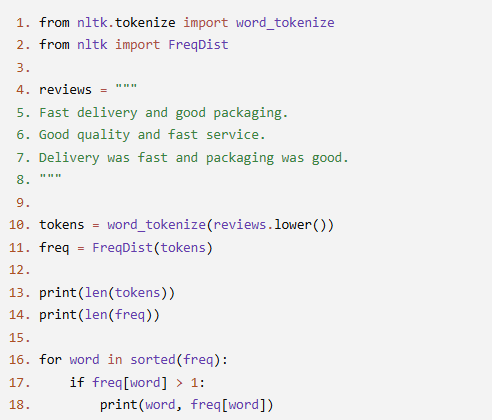
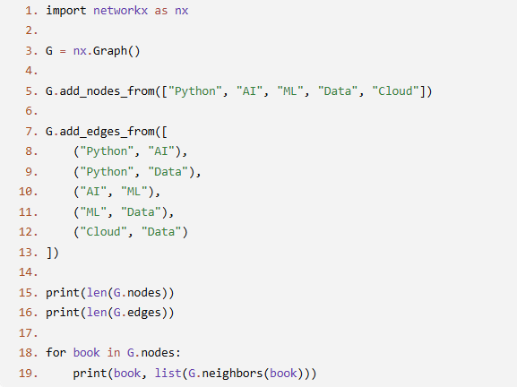
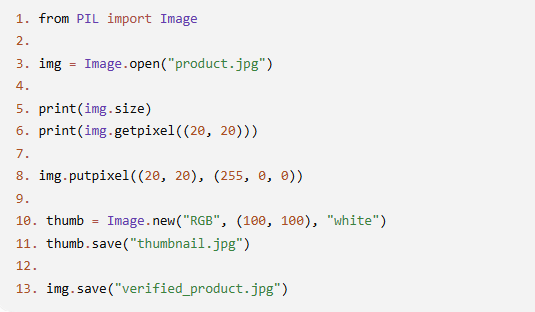

# JOC Jul-2026 · Week 9

- Source: `week-09.pdf` (case-study assignment PDF supplied by the repo owner; the only source used for the Jul-2026 session). Answers and justifications are as printed in the PDF.

## Scenario: Product Review Analysis An online marketplace wants to analyze the words used in customer reviews. The program tokenizes the review text, creates a frequency distribution using FreqDist, and displays only the words that occur more than once. It also reports the total number of unique words.

### Q1. Which statement converts the review text into a list of tokens?

- A. Line 10
- B. Line 11
- C. Line 13
- D. Line 16

**Answer: A**

> Justification: word_tokenize() splits the given text into individual tokens and stores them in the list tokens.

### Q2. What does the expression len(freq) in Line 14 return?

- A. Total number of characters in the review
- B. Number of unique tokens in the review
- C. Total number of repeated words
- D. Number of lines in the review

**Answer: B**

> Justification: A FreqDist object stores one entry for each distinct token, so len(freq) returns the number of unique tokens.

### Q3. Which line creates the frequency distribution of the tokens?

- A. Line 10
- B. Line 16
- C. Line 11
- D. Line 13

**Answer: C**

> Justification: FreqDist(tokens) counts the occurrences of every token and stores the resulting frequency distribution.

### Q4. Which part of the program prints only the words that occur more than once?

- A. Line 10
- B. Line 13
- C. Line 14
- D. Lines 16–18

**Answer: D**

> Justification: The loop checks each token's frequency and prints only those whose count is greater than 1.

### Q5. (MSQ) Which of the following statements are correct?

- A. len(tokens) returns the number of unique words in the review.
- B. word_tokenize() automatically counts the frequency of each token.
- C. FreqDist stores each token as a key and its frequency as the corresponding value.
- D. len(freq) gives the number of distinct tokens present in the text.

**Answer: C and D**

> Justification: FreqDist behaves like a dictionary with tokens as keys and counts as values, and len(freq) returns the number of distinct keys stored in the distribution.

## Scenario: Library Book Recommendation Network A digital library recommends books based on their similarity. Each book is represented as a node, and an edge between two books indicates that they are frequently borrowed together. The librarian uses NetworkX to model and examine this recommendation network.

### Q1. In this graph, what does a node represent?

- A. A book
- B. A recommendation between two books
- C. The total number of books
- D. A borrowing record

**Answer: A**

> Justification: Each node represents one book in the recommendation network.

### Q2. What does an edge between two books indicate?

- A. The books have the same author.
- B. The books belong to different categories.
- C. The books are borrowed together and are recommended to each other.
- D. The books have the same publication year.

**Answer: C**

> Justification: Each edge represents a recommendation relationship between two books.

### Q3. What does len(G.nodes) represent?

- A. Number of recommendations
- B. Number of books in the network
- C. Number of neighboring books
- D. Number of connected components

**Answer: B**

> Justification: G.nodes contains all the books (nodes) present in the graph.

### Q4. Why is G.neighbors(book) used in the program?

- A. To remove duplicate books
- B. To sort the books alphabetically
- C. To calculate the shortest path
- D. To find books directly connected to a given book

**Answer: D**

> Justification: neighbors() returns all nodes that share an edge with the given node.

### Q5. (MSQ) Which of the following statements are correct?

- A. Every node must be connected to every other node.
- B. An edge can exist without any nodes.
- C. len(G.edges) returns the total number of recommendation links in the graph.
- D. A graph can be used to model relationships between connected objects.

**Answer: C and D**

> Justification: Edges represent relationships between nodes, and graphs are commonly used to model such connections.

## Scenario: Six Degrees of Separation A social networking platform represents its users as a graph. Each person is a node, and a friendship between two people is represented by an edge. According to the "Six Degrees of Separation" concept, any two people in a social network can usually be connected through a small chain of mutual friends. The platform analyzes these connections to recommend new friends and understand how closely users are connected.

### Q1. In the social network described above, what does an edge represent?

- A. A user profile
- B. A friendship between two users
- C. The total number of users
- D. A friend recommendation

**Answer: B**

> Justification: An edge represents a direct friendship connecting two users.

### Q2. Alice is friends with Bob, and Bob is friends with Carol. Alice and Carol are not directly connected. What exists between Alice and Carol?

- A. A path through Bob
- B. A duplicate edge
- C. A disconnected graph
- D. A self-loop

**Answer: A**

> Justification: A path connects two nodes through one or more intermediate nodes.

### Q3. Why is the shortest path between two users often important in a social network?

- A. It increases the total number of users.
- B. It removes duplicate friendships.
- C. It identifies the minimum number of friendship links connecting two users.
- D. It converts the graph into a directed graph.

**Answer: C**

> Justification: The shortest path represents the fewest intermediate connections between two users.

### Q4. When is a social network considered to be connected?

- A. Every user has exactly one friend.
- B. Every user is directly connected to every other user.
- C. The graph has no edges.
- D. A path exists between every pair of users.

**Answer: D**

> Justification: A connected graph allows every node to be reached from every other node through at least one path.

### Q5. (MSQ) Which of the following statements are correct?

- A. Every pair of users must have a direct friendship for a path to exist.
- B. A graph cannot have more than one path between two users.
- C. A node represents an individual user in the social network.
- D. The Six Degrees of Separation concept is based on finding paths between people in a network.

**Answer: C and D**

> Justification: In a social graph, nodes represent users, and the Six Degrees concept relies on paths that connect people through mutual friends.

## Scenario: Quality Inspection of Product Images An online retail company inspects product images before publishing them on its website. The system opens an image, checks the color of a specific pixel, marks that pixel with a new color for verification, creates a small thumbnail image, and saves the modified image.

### Q1. Why is getpixel() used in this program?

- A. To resize the image
- B. To change the image dimensions
- C. To retrieve the color value of a specific pixel
- D. To save the image

**Answer: C**

> Justification: getpixel() returns the color value stored at the specified pixel location.

### Q2. What is the purpose of putpixel()?

- A. To create a new image
- B. To modify the color of a specific pixel
- C. To compress the image
- D. To display the image

**Answer: B**

> Justification: putpixel() updates the color value of a specified pixel.

### Q3. What is the purpose of Image.new()?

- A. To open an existing image
- B. To copy an existing image
- C. To convert an image into grayscale
- D. To create a new blank image

**Answer: D**

> Justification: Image.new() creates a new image with the specified mode, size, and background color.

### Q4. Why is the save() method used?

- A. To store the processed image as a file
- B. To display the image on the screen
- C. To remove unwanted pixels
- D. To count the number of pixels

**Answer: A**

> Justification: The save() method writes the image object to a file.

### Q5. (MSQ) Which of the following statements are correct?

- A. getpixel() changes the color of a pixel.
- B. Image.new() creates a new image with the specified mode and dimensions.
- C. putpixel() automatically saves the modified image to disk.
- D. Changes made using putpixel() are stored in memory until the image is saved.

**Answer: B and D**

> Justification: Image.new() creates a new image object, and modifications made using putpixel() become permanent only after calling save().
