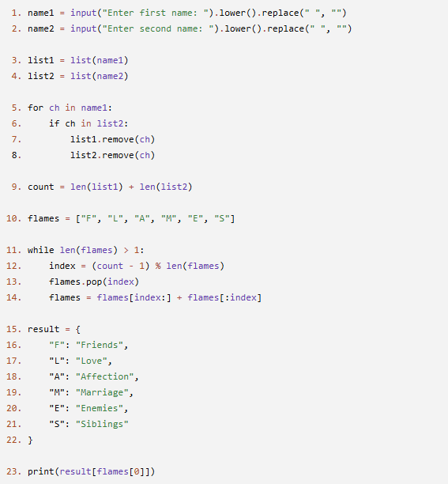
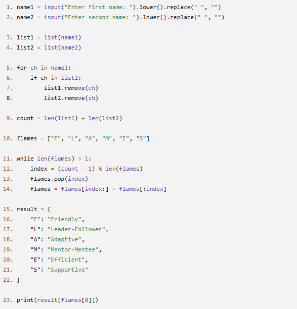
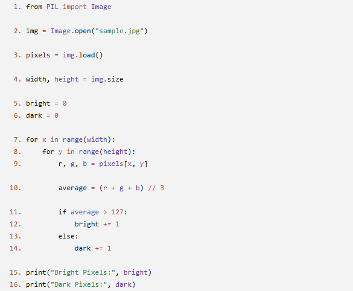
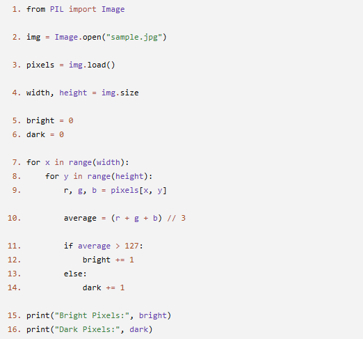

# JOC Jul-2026 · Week 10

- Source: `week-10.pdf` (case-study assignment PDF supplied by the repo owner; the only source used for the Jul-2026 session). Answers and justifications are as printed in the PDF.

## Scenario - FLAMES A school is conducting a fun activity where students enter two names to predict their relationship using the classic FLAMES game. The program removes all common letters from the two names, counts the remaining letters, and repeatedly eliminates letters from the word FLAMES until only one letter remains. Based on the final letter, the corresponding relationship is displayed. Study the program below and answer the questions.

### Question 1 (MCQ)

What is the purpose of the statements in Lines 1 and 2?

- A. Convert both names to uppercase.
- B. Convert names to lowercase and remove spaces.
- C. Reverse both names.
- D. Remove duplicate letters from the names.

**Answer: B**

> Justification: The methods lower() and replace(" ", "") convert names to lowercase and remove spaces.

### Question 2 (MCQ)

What is stored in the variable count at Line 9?

- A. Total number of letters in the original names.
- B. Number of common letters.
- C. Total number of remaining letters after removing common letters.
- D. Number of letters in the word FLAMES.

**Answer: C**

> Justification: count is calculated using the lengths of the remaining characters in both lists.

### Question 3 (MCQ)

Which statement actually removes a letter from the FLAMES list during each iteration?

- A. Line 11
- B. Line 12
- C. Line 13
- D. Line 14

**Answer: C**

> Justification: pop(index) removes the element at the specified position.

### Question 4 (MCQ)

Why is the modulo operator (%) used in Line 12?

- A. To convert the index into a floating-point value.
- B. To ensure the index always stays within the current size of the list.
- C. To sort the FLAMES list.
- D. To count the number of common letters.

**Answer: B**

> Justification: The modulo operation wraps the index so that it always remains valid for the current list size.

### Question 5 (MSQ)

Which of the following statements are correct about the program?

- A. The loop in Lines 11–14 continues until only one letter remains in the flames list.
- B. The dictionary result maps each FLAMES letter to a relationship.
- C. The program removes all vowels before calculating the result.
- D. list(name1) in Line 3 converts the first name into a list of characters.

**Answers: A, B, D**

> Justification: - A: The loop stops only when one element remains. - B: The dictionary stores the relationship corresponding to each FLAMES letter. - D: list(name1) creates a list containing individual characters of the first name.

## Scenario – FLAMES 2 A software company has developed a Team Compatibility Analyzer to compare the names of two employees working on a project. The program removes the common letters from both names, counts the remaining letters, and repeatedly eliminates options from a predefined list until only one category remains. The final category is then displayed as the team's compatibility result. Study the program carefully and answer the following questions.

### Question 1 (MCQ)

Why are the methods lower() and replace(" ", "") used in Lines 1 and 2 before comparing the names?

- A. To sort the letters in each name.
- B. To make the comparison independent of letter case and spaces.
- C. To remove duplicate characters.
- D. To reverse the names before processing.

**Answer: B**

> Justification: Converting to lowercase and removing spaces ensures consistent comparison.

### Question 2 (MCQ)

Which statement correctly describes the value stored in count at Line 9?

- A. The total number of characters entered by the user.
- B. The number of matching characters between the two names.
- C. The total number of characters remaining after common letters are removed.
- D. The number of elements in the flames list.

**Answer: C**

> Justification: count is calculated using the lengths of the updated character lists.

### Question 3 (MCQ)

Which line changes the size of the flames list during each iteration of the loop?

- A. Line 11
- B. Line 12
- C. Line 13
- D. Line 14

**Answer: C**

> Justification: pop(index) removes one element, reducing the list size by one.

### Question 4 (MCQ)

Suppose count is greater than the current length of the flames list. Why does the program still work correctly?

- A. Python automatically increases the size of the list.
- B. The modulo operator (%) converts the value into a valid list index.
- C. The list is sorted before accessing an element.
- D. The while loop ignores values larger than the list size.

**Answer: B**

> Justification: The modulo operator wraps the value within the valid index range.

### Question 5 (MSQ)

Which of the following statements about the program are correct?

- A. The while loop continues until only one element remains in the flames list.
- B. Removing Line 14 would change the sequence in which elements are eliminated.
- C. The dictionary result is used to remove elements from the flames list.
- D. The value of count is computed only after common letters have been removed from both names.

**Answers: A, B, D**

> Justification: - A: The loop terminates only when one element remains. - B: Line 14 rotates the list, affecting the elimination order. - D: count is calculated after updating both character lists.

## Scenario: Wild Life A wildlife research team is studying drone images of a forest to estimate the amount of sunlight reaching the ground. They use a Python program that examines every pixel in an image. For each pixel, the program calculates the average intensity of its Red (R), Green (G), and Blue (B) values. If the average intensity is greater than 127, the pixel is classified as Bright; otherwise, it is classified as Dark. Finally, the program displays the total number of bright and dark pixels in the image. Study the following program and answer the questions.

### Question 1 (MCQ)

What is the purpose of Line 3 (pixels = img.load())?

- A. It opens the image file.
- B. It creates a pixel access object to read individual pixel values.
- C. It converts the image into grayscale.
- D. It returns the width and height of the image.

**Answer: B**

> Justification: img.load() provides access to the RGB values of individual pixels.

### Question 2 (MCQ)

What is stored in the variables width and height at Line 4?

- A. The total number of pixels in the image.
- B. The RGB values of the first pixel.
- C. The dimensions of the image in pixels.
- D. The brightness and darkness counts.

**Answer: C**

> Justification: img.size returns the width and height of the image.

### Question 3 (MCQ)

What is the value of r, g, and b after executing Line 9?

- A. The row, column, and pixel number.
- B. The Red, Green, and Blue intensity values of the current pixel.
- C. The width, height, and brightness of the image.
- D. Three randomly generated numbers.

**Answer: B**

> Justification: pixels[x, y] returns the RGB values of the pixel at position (x, y).

### Question 4 (MCQ)

Why is integer division (//) used in Line 10?

- A. To compute the average RGB intensity as a whole number.
- B. To increase the brightness of every pixel.
- C. To convert the image into grayscale.
- D. To avoid using nested loops.

**Answer: A**

> Justification: // computes the average as an integer by discarding the decimal part.

### Question 5 (MCQ)

Suppose an image has 200 × 100 pixels. How many times will the statement in Line 9 execute?

- A. 200
- B. 100
- C. 300
- D. 20,000

**Answer: D**

> Justification: The nested loops visit every pixel once, so the statement executes 200 × 100 = 20,000 times.

## Scenario: PixelMap Image Quality Inspector A photography studio has developed a PixelMap Image Quality Inspector to identify overexposed regions in digital photographs. The program scans every pixel in an image using the PixelMap, calculates the average intensity of its Red (R), Green (G), and Blue (B) values, and classifies each pixel as Bright or Dark based on a threshold value. At the end, it reports the total number of bright and dark pixels. Study the following program and answer the questions.

### Question 1 (MCQ)

Which statement ensures that every pixel in the image is processed exactly once?

- A. Line 3
- B. Lines 7–8
- C. Line 10
- D. Line 15

**Answer: B**

> Justification: The nested loops iterate through every (x, y) pixel position in the image.

### Question 2 (MCQ)

What is the data type of the value returned by pixels[x, y] for a color image?

- A. Integer
- B. String
- C. Tuple
- D. List

**Answer: C**

> Justification: A color pixel is returned as an RGB tuple containing three values.

### Question 3 (MCQ)

If the current pixel has RGB values (90, 150, 180), what will be the value of average?

- A. 120
- B. 140
- C. 150
- D. 420

**Answer: B**

> Justification: (90 + 150 + 180) // 3 = 420 // 3 = 140.

### Question 4 (MCQ)

If a pixel has an average intensity of 127, how will it be classified?

- A. Bright
- B. Dark
- C. Both Bright and Dark
- D. The program generates an error.

**Answer: B**

> Justification: The condition is average > 127, so 127 is classified as Dark.

### Question 5 (MSQ)

Which of the following statements are correct?

- A. img.load() allows the program to access individual pixel values.
- B. The variables bright and dark are used as counters.
- C. The nested loops execute once for each row only.
- D. The program processes pixels using their (x, y) coordinates.

**Answers: A, B, D**

> Justification: - A: img.load() provides pixel-level access. - B: bright and dark count the number of classified pixels. - D: Pixels are accessed using their x and y coordinates.
