# JOC Jul-2026 · Week 11

- Source: `week-11.pdf` (case-study assignment PDF supplied by the repo owner; the only source used for the Jul-2026 session). Answers and justifications are as printed in the PDF.

---
**Page 1** (scanned page; the text below is its OCR layer, check against the image)

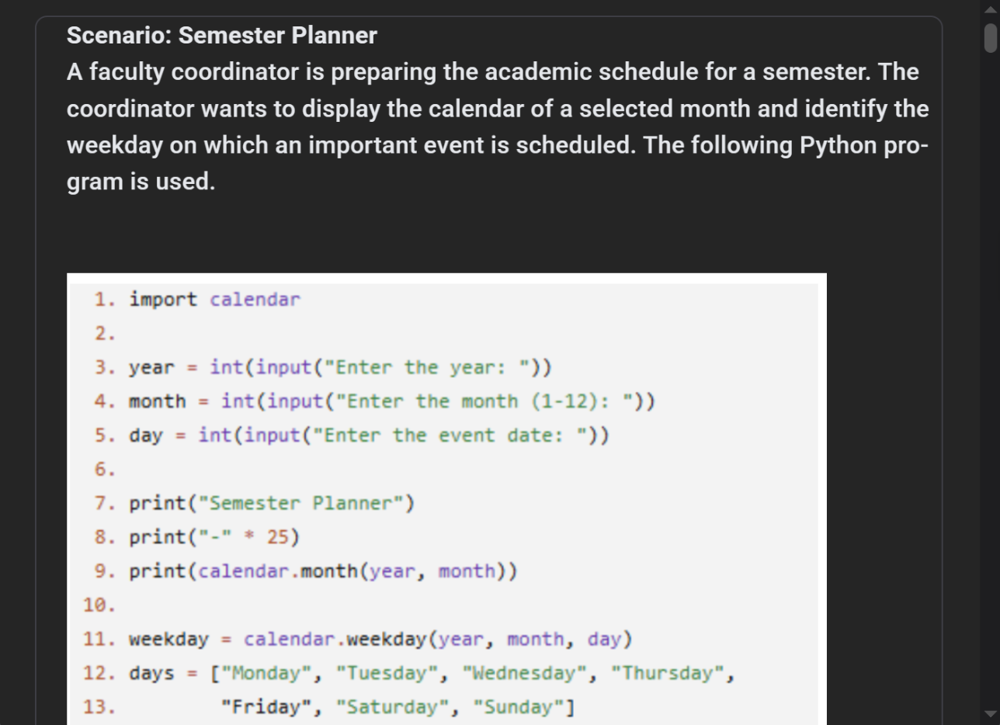

## Scenario: Semester Planner A faculty coordinator is preparing the academic schedule for a semester. The coordinator wants to display the calendar of a selected month and identify the weekday on which an important event is scheduled. The following Python pro- gram is used. . print("Semeste 8. print("- 25) 9. print(calendar.month(year, month)) l. weekday = calendar.weekday(year, month, day . days = ["Monday", “Tuesda "Friday", '

---
**Page 2** (scanned page; the text below is its OCR layer, check against the image)

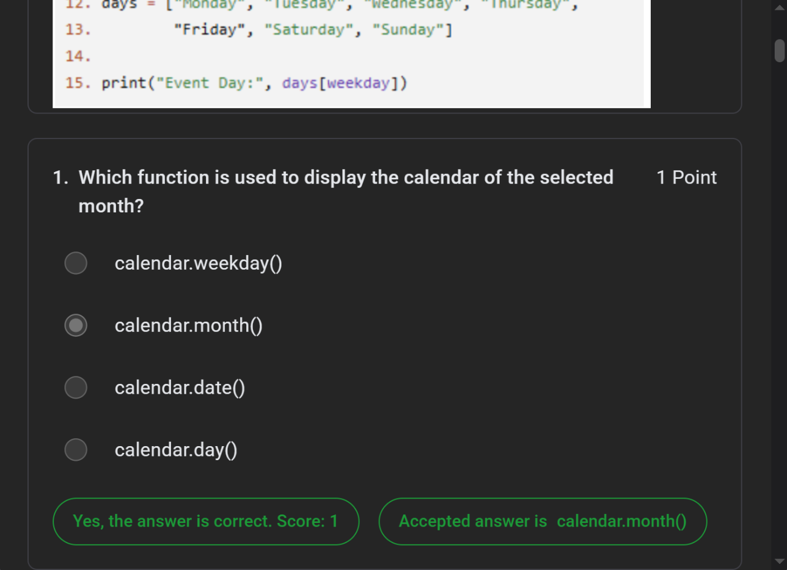

1. Which function is used to display the calendar of the selected 1 Point month? calendar.weekday() calendar.month() calendar.date() calendar.day()

---
**Page 3** (scanned page; the text below is its OCR layer, check against the image)

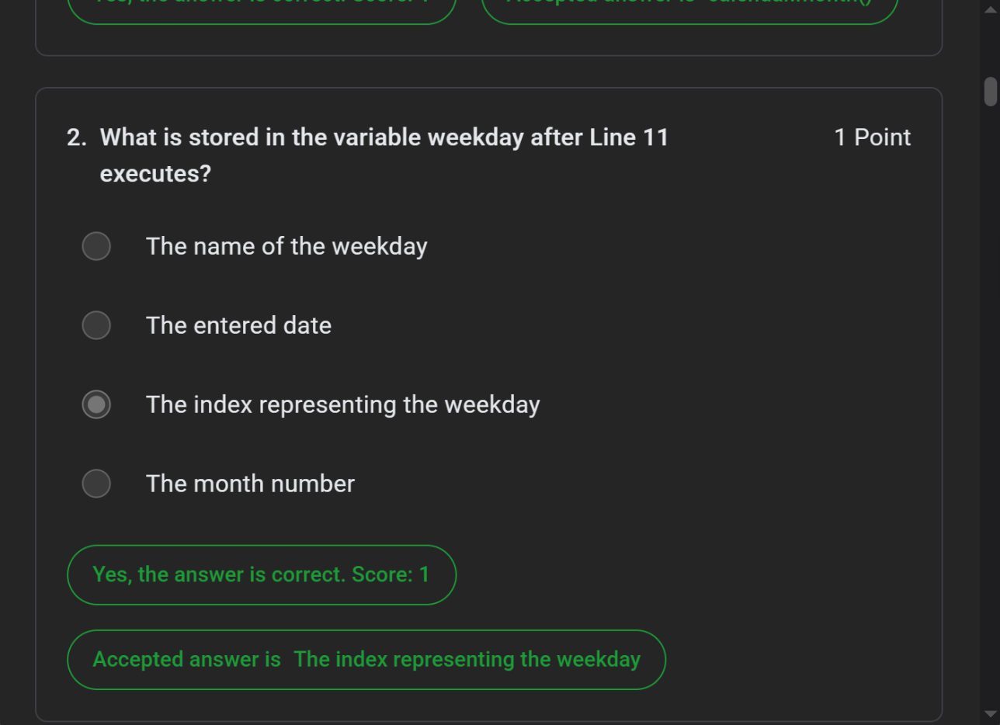

2. What is stored in the variable weekday after Line 11 1 Point executes? The name of the weekday The entered date The index representing the weekday The month number

---
**Page 4** (scanned page; the text below is its OCR layer, check against the image)

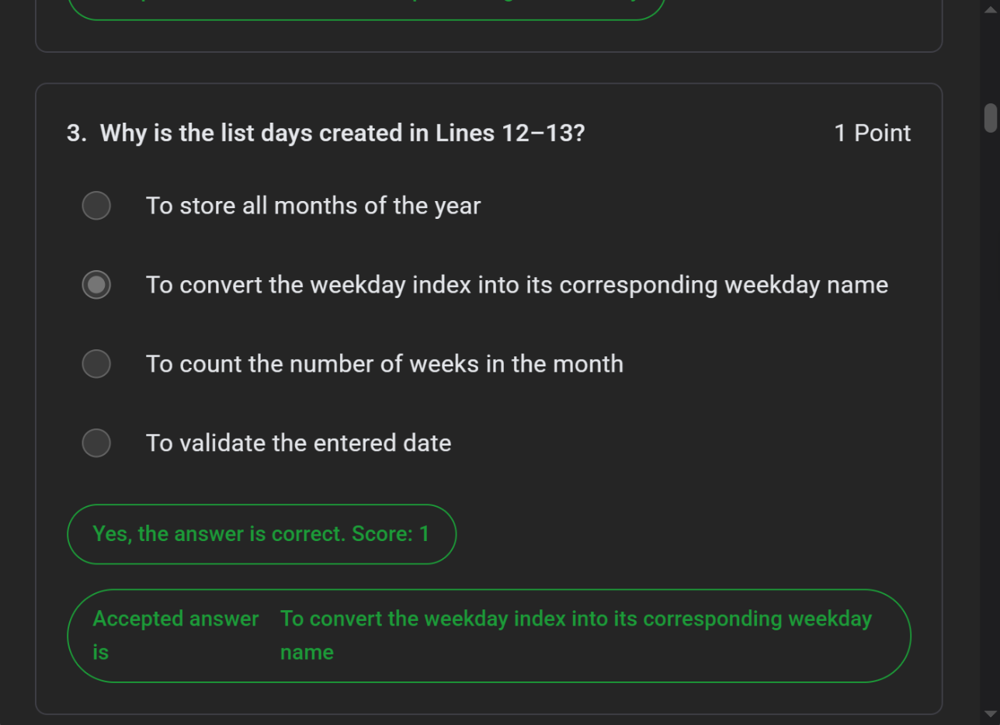

3. Why is the list days created in Lines 12-13? 1 Point To store all months of the year To convert the weekday index into its corresponding weekday name To count the number of weeks in the month To validate the entered date

---
**Page 5** (scanned page; the text below is its OCR layer, check against the image)

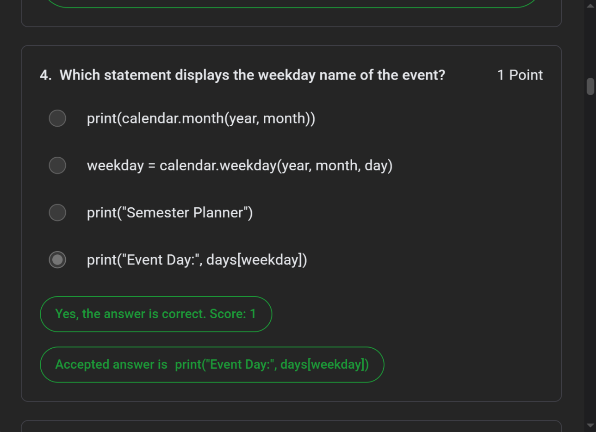

4. Which statement displays the weekday name of the event? 1 Point print(calendar.month(year, month)) weekday = calendar.weekday(year, month, day) print("Semester Planner") print("Event Day:", days[weekday])

---
**Page 6** (scanned page; the text below is its OCR layer, check against the image)

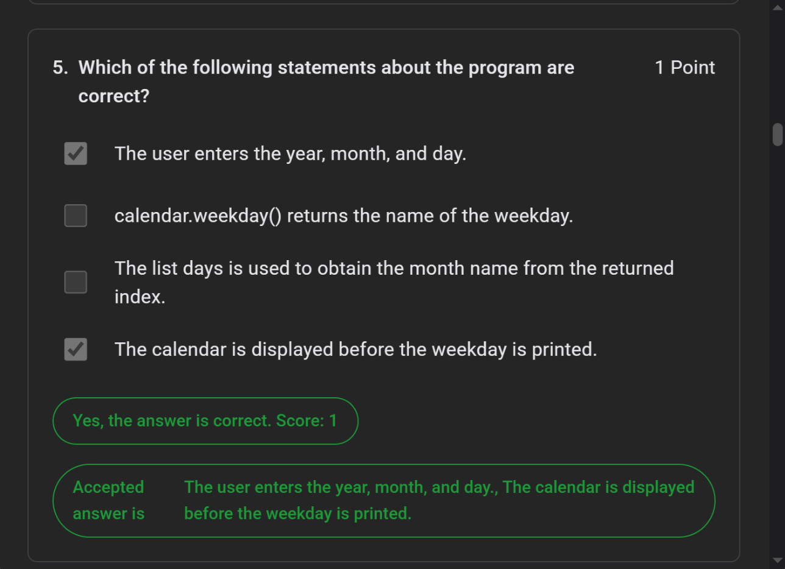

5. Which of the following statements about the program are 1 Point correct? ~~ The user enters the year, month, and day. calendar.weekday() returns the name of the weekday. The list days is used to obtain the month name from the returned index. ~ The calendar is displayed before the weekday is printed.

---
**Page 7** (scanned page; the text below is its OCR layer, check against the image)

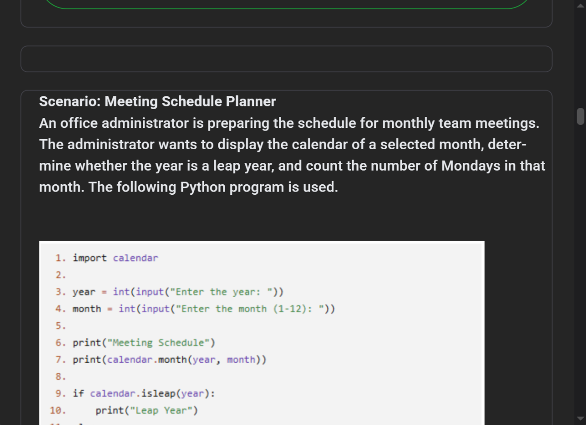

## Scenario: Meeting Schedule Planner An office administrator is preparing the schedule for monthly team meetings. The administrator wants to display the calendar of a selected month, deter- mine whether the year is a leap year, and count the number of Mondays in that month. The following Python program is used. l. import calenda . year int(input( "Ente +. month = int(input("Enter the month . print("Meeting Schedule”) ?. print(calendar.month(year, montt 9. if calendar.isleap(year): print("Leap Year")

---
**Page 8** (scanned page; the text below is its OCR layer, check against the image)

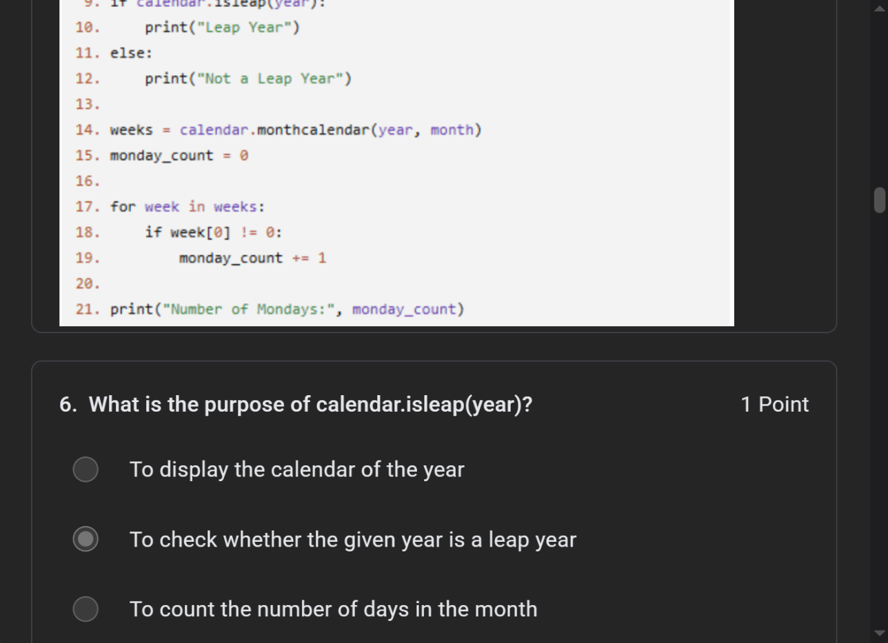

print( "Lez l. else: print("! +. weeks = calendar.monthcalendar(year, month) 15. monday_count = @ PP. weeks: if week[@] monday_count + l. print("Number co 6. What is the purpose of calendar.isleap(year)? 1 Point To display the calendar of the year To check whether the given year is a leap year To count the number of days in the month

---
**Page 9** (scanned page; the text below is its OCR layer, check against the image)

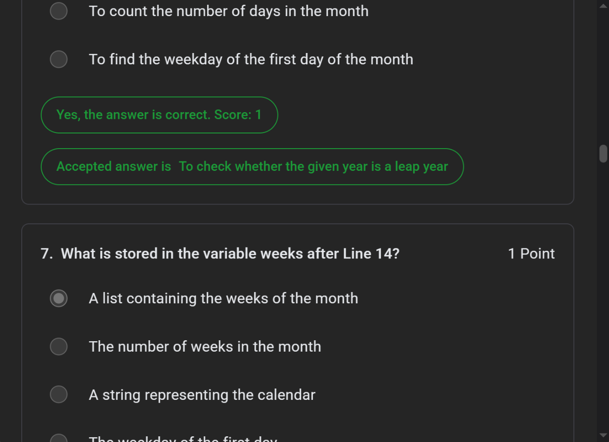

To count the number of days in the month To find the weekday of the first day of the month 7. What is stored in the variable weeks after Line 14? 1 Point A list containing the weeks of the month The number of weeks in the month A string representing the calendar 7” eee Se oe ee) eee eee ee ae

---
**Page 10** (scanned page; the text below is its OCR layer, check against the image)

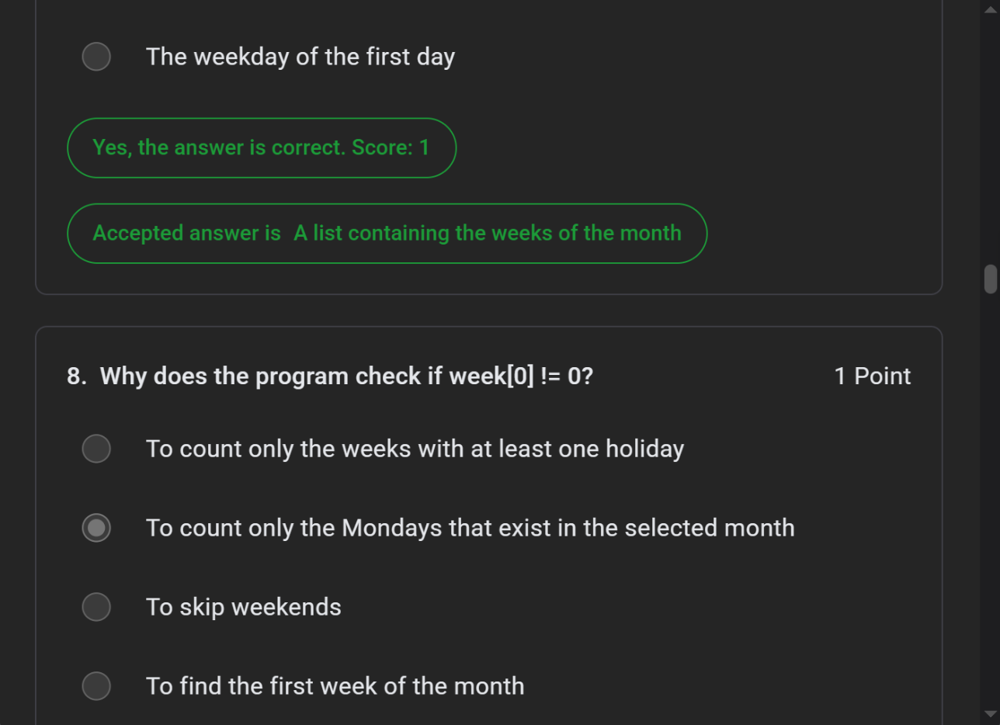

The weekday of the first day 8. Why does the program check if week[0] != 0? 1 Point To count only the weeks with at least one holiday To count only the Mondays that exist in the selected month To skip weekends To find the first week of the month

---
**Page 11** (scanned page; the text below is its OCR layer, check against the image)

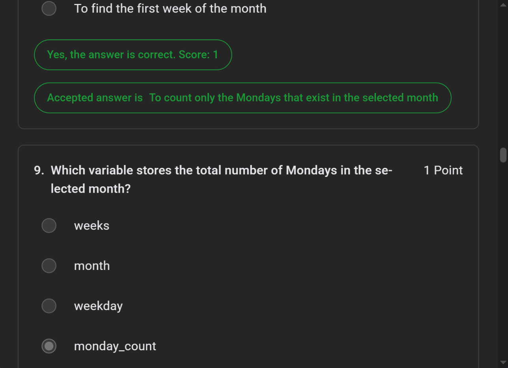

To find the first week of the month 9. Which variable stores the total number of Mondays in the se- 1 Point lected month? weeks month weekday monday_count

---
**Page 12** (scanned page; the text below is its OCR layer, check against the image)

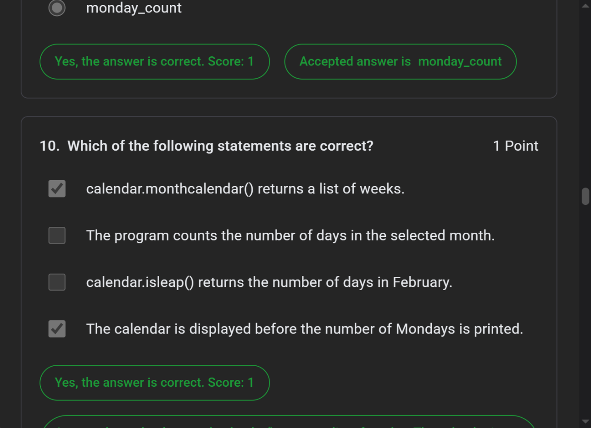

monday_count 10. Which of the following statements are correct? 1 Point ~~ calendar.monthcalendar() returns a list of weeks. The program counts the number of days in the selected month. calendar.isleap() returns the number of days in February. ~~ The calendar is displayed before the number of Mondays is printed.

---
**Page 13** (scanned page; the text below is its OCR layer, check against the image)

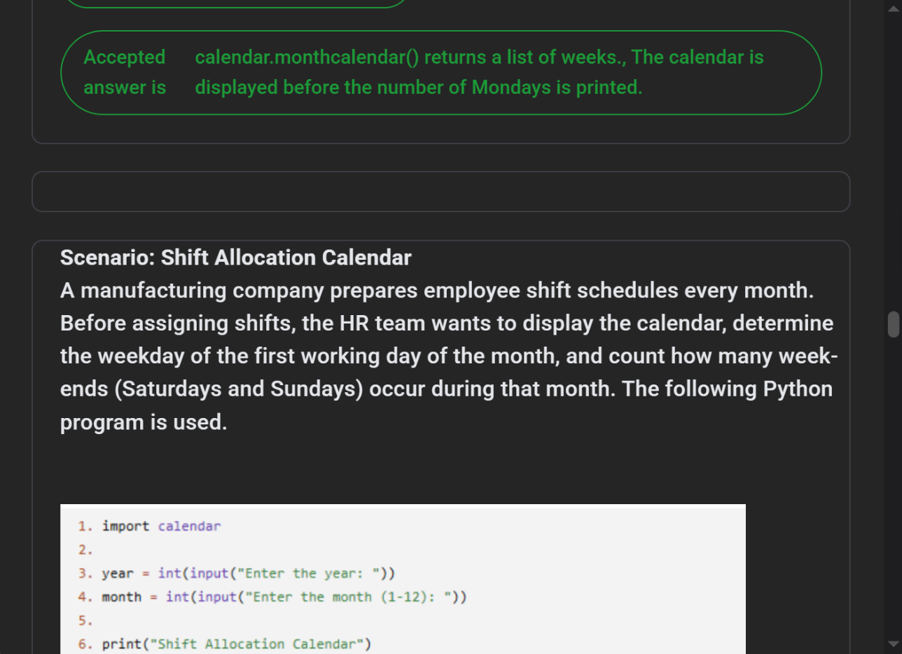

## Scenario: Shift Allocation Calendar A manufacturing company prepares employee shift schedules every month. Before assigning shifts, the HR team wants to display the calendar, determine the weekday of the first working day of the month, and count how many week- ends (Saturdays and Sundays) occur during that month. The following Python program is used. l. import calendar

---
**Page 14** (scanned page; the text below is its OCR layer, check against the image)

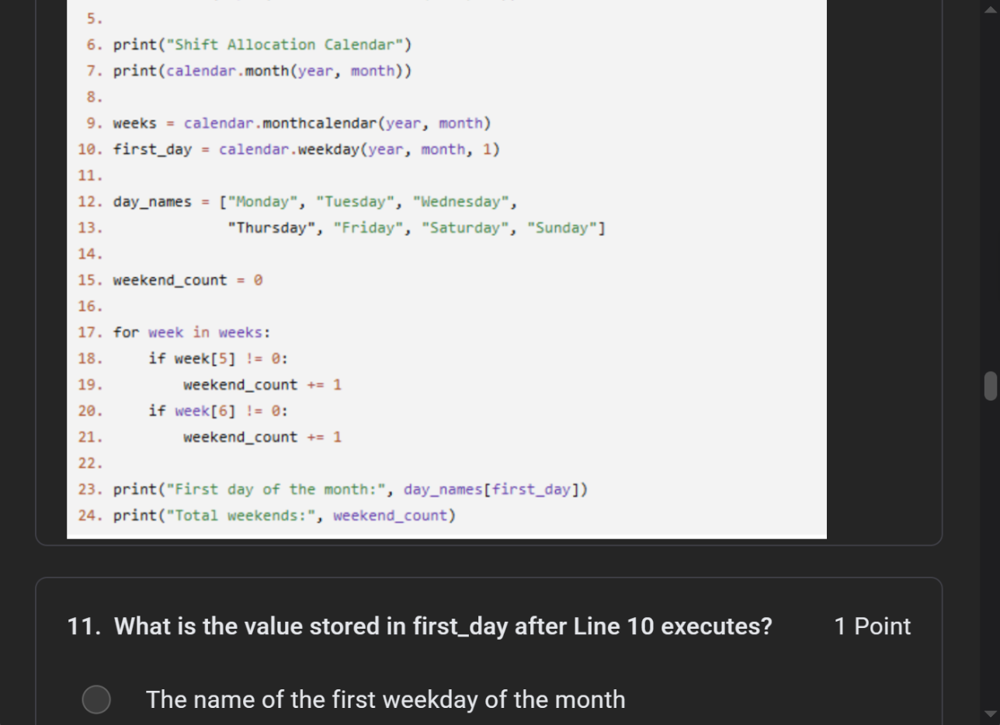

Shift All it Calend ) . print(calendar.month(year, month)) . weeks calendar .monthcalendar(year, ). first_day = calendar.weekday(year, month, 1 . day_names ["“Monday", “Thursday”, 5. weekend_count = if week[5] weekend_count += 1 if week[6] weekend_count += 1 . What is the value stored in first_day after Line 10 executes? 1 Point The name of the first weekday of the month

---
**Page 15** (scanned page; the text below is its OCR layer, check against the image)

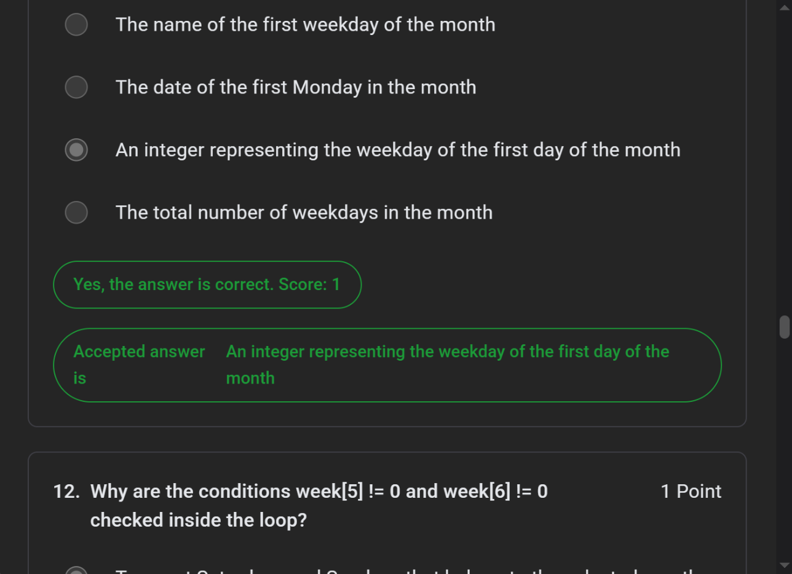

The name of the first weekday of the month The date of the first Monday in the month An integer representing the weekday of the first day of the month The total number of weekdays in the month 12. Why are the conditions week[5] != 0 and week[6] != 0 1 Point checked inside the loop?

---
**Page 16** (scanned page; the text below is its OCR layer, check against the image)

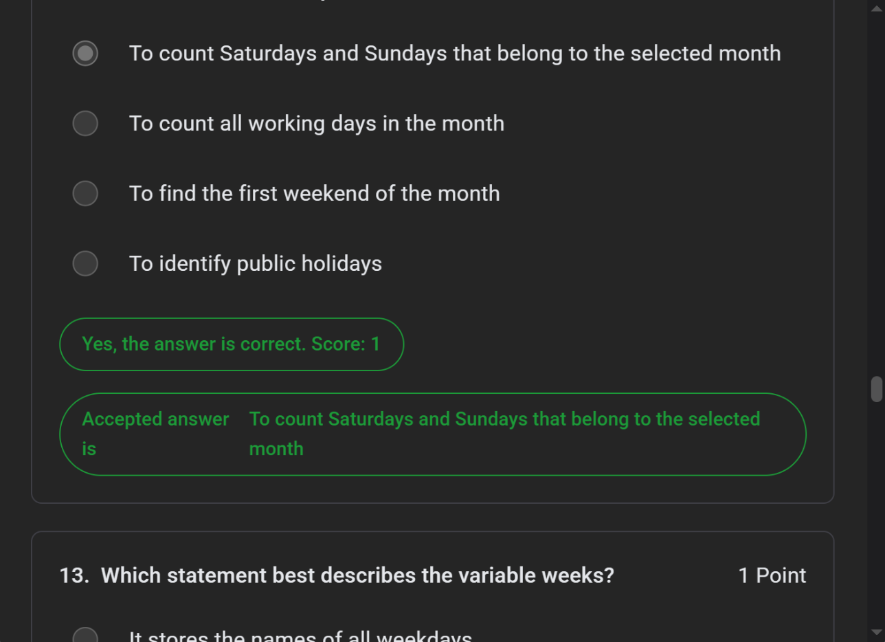

To count Saturdays and Sundays that belong to the selected month To count all working days in the month To find the first weekend of the month To identify public holidays 13. Which statement best describes the variable weeks? 1 Point It atrnrac tha namae nf all ~sanlbdave

---
**Page 17** (scanned page; the text below is its OCR layer, check against the image)

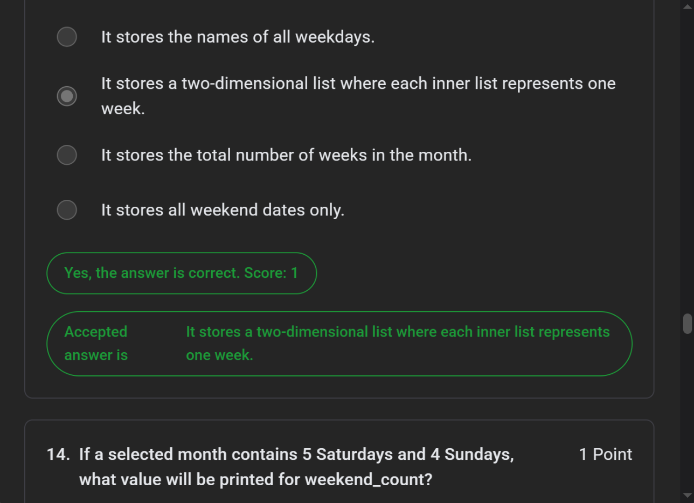

It stores the names of all weekdays. It stores a two-dimensional list where each inner list represents one week. It stores the total number of weeks in the month. It stores all weekend dates only. 14. If a selected month contains 5 Saturdays and 4 Sundays, 1 Point what value will be printed for weekend_count?

---
**Page 18** (scanned page; the text below is its OCR layer, check against the image)

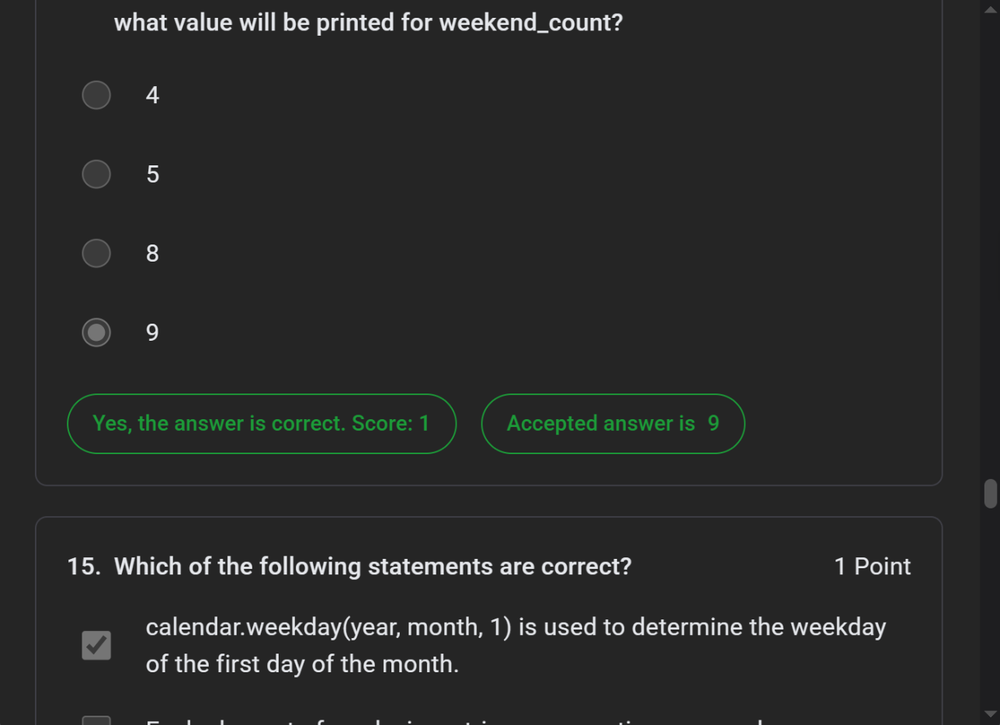

what value will be printed for weekend_count? 4 15. Which of the following statements are correct? 1 Point -, calendar.weekday(year, month, 1) is used to determine the weekday of the first day of the month. _— 5 , =- rr

---
**Page 19** (scanned page; the text below is its OCR layer, check against the image)

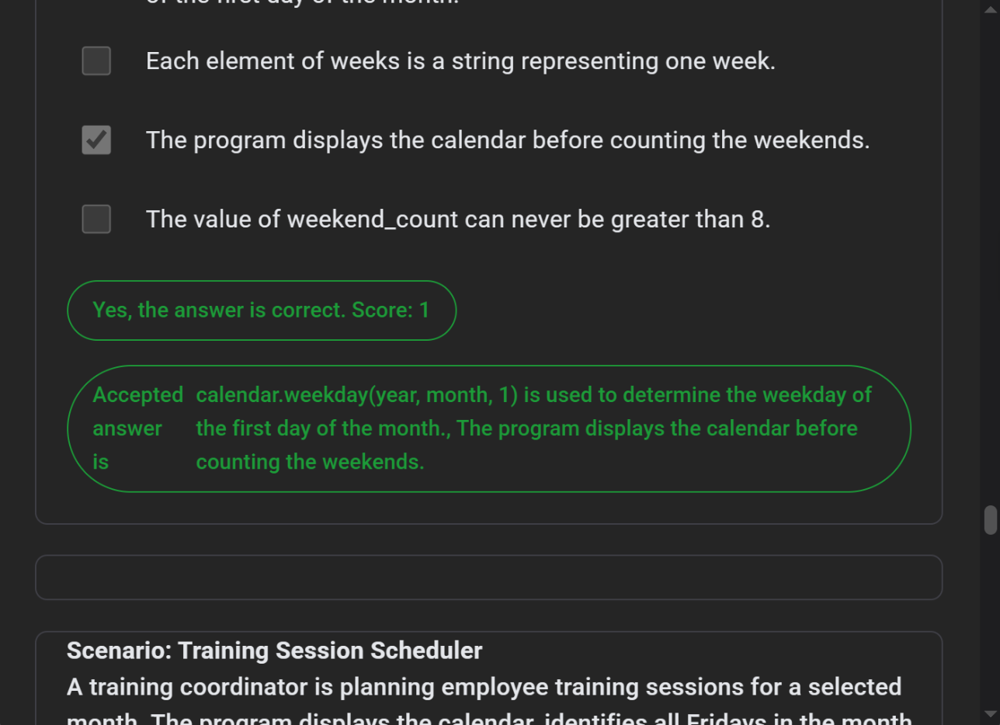

Each element of weeks is a string representing one week. | The program displays the calendar before counting the weekends. The value of weekend_count can never be greater than 8.

## Scenario: Training Session Scheduler A training coordinator is planning employee training sessions for a selected manth Tha mpranram Aiantiave tha nalandar idantitiacg all Cesdavre im tha manth

---
**Page 20** (scanned page; the text below is its OCR layer, check against the image)

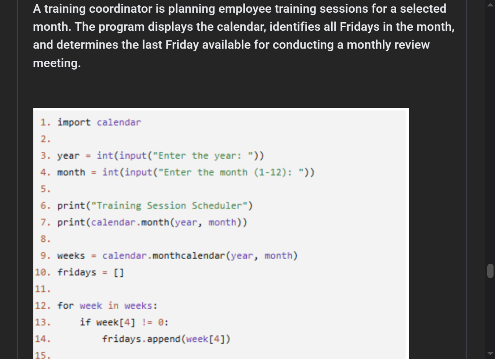

A training coordinator is planning employee training sessions for a selected month. The program displays the calendar, identifies all Fridays in the month, and determines the last Friday available for conducting a monthly review meeting. import calendar year = int(input( "Enter month = int(input("Ente print("Training print(calendar.month(year, weeks = calendar.monthcalendar(year, month) fridays = [] for week in weeks: if week[4] fridays .append(week[4])

---
**Page 21** (scanned page; the text below is its OCR layer, check against the image)

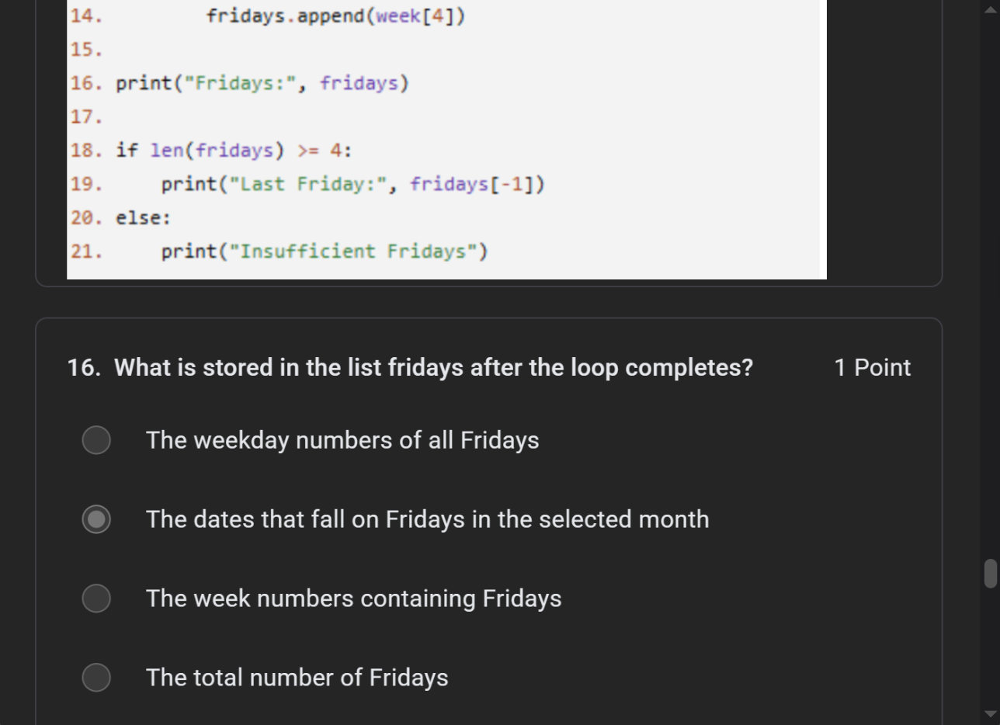

fridays .append(week[4]) s:", fridays) 16. What is stored in the list fridays after the loop completes? 1 Point The weekday numbers of all Fridays The dates that fall on Fridays in the selected month The week numbers containing Fridays The total number of Fridays

---
**Page 22** (scanned page; the text below is its OCR layer, check against the image)

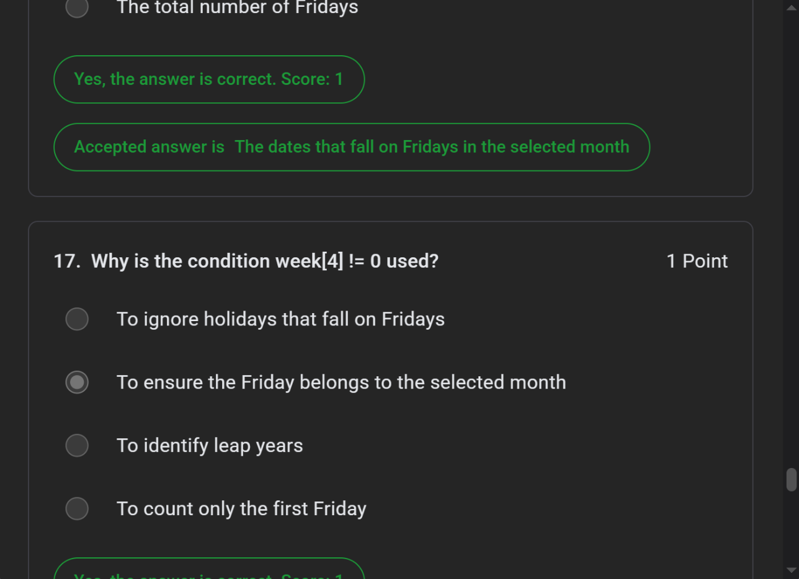

The total number of Fridays 17. Why is the condition week[4] != 0 used? 1 Point To ignore holidays that fall on Fridays To ensure the Friday belongs to the selected month To identify leap years To count only the first Friday

---
**Page 23** (scanned page; the text below is its OCR layer, check against the image)

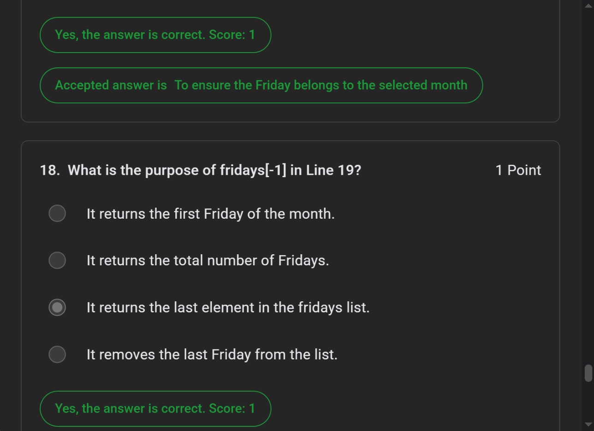

18. What is the purpose of fridays[-1] in Line 19? 1 Point It returns the first Friday of the month. It returns the total number of Fridays. It returns the last element in the fridays list. It removes the last Friday from the list.

---
**Page 24** (scanned page; the text below is its OCR layer, check against the image)

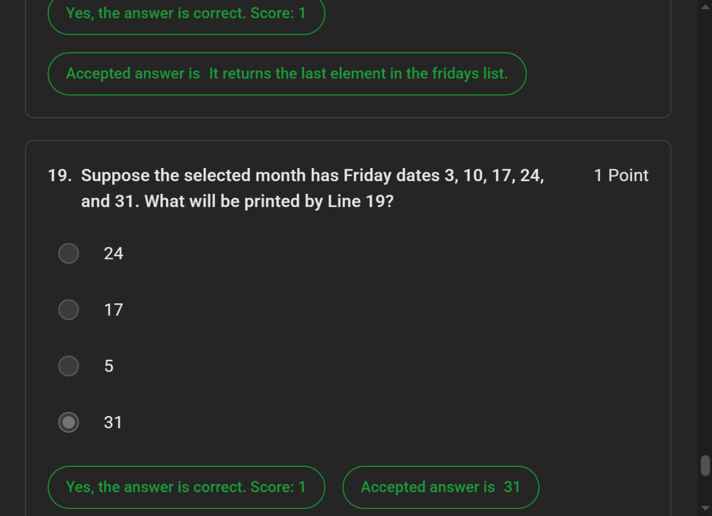

19. Suppose the selected month has Friday dates 3, 10, 17, 24, 1 Point and 31. What will be printed by Line 19? 24 17 31

---
**Page 25** (scanned page; the text below is its OCR layer, check against the image)

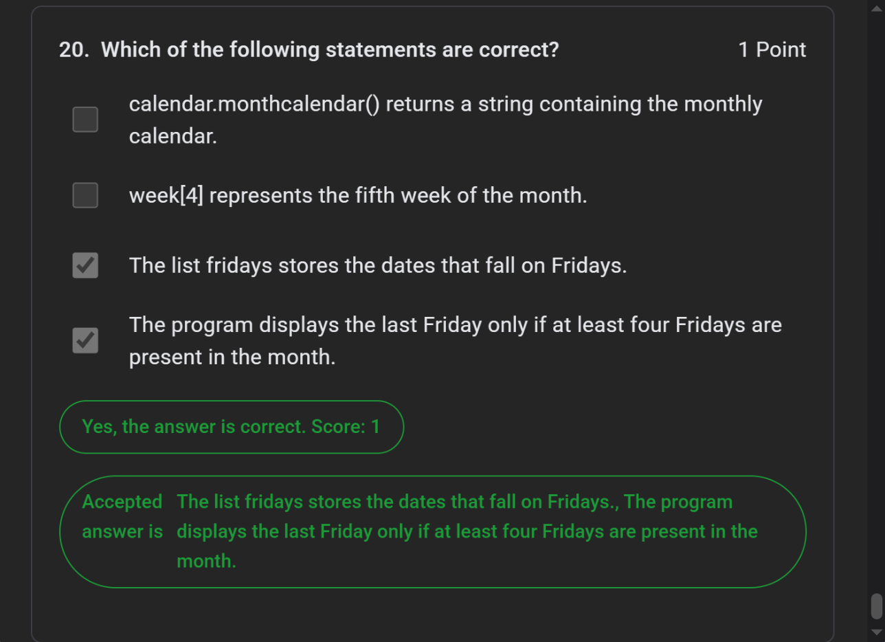

20. Which of the following statements are correct? 1 Point calendar.monthcalendar() returns a string containing the monthly calendar. week[4] represents the fifth week of the month. ~, The list fridays stores the dates that fall on Fridays. se» the program displays the last Friday only if at least four Fridays are present in the month.
