# JOC Jul-2026 · Week 12

- Source: `week-12.pdf` (case-study assignment PDF supplied by the repo owner; the only source used for the Jul-2026 session). Answers and justifications are as printed in the PDF.

---
**Page 1** (scanned page; the text below is its OCR layer, check against the image)

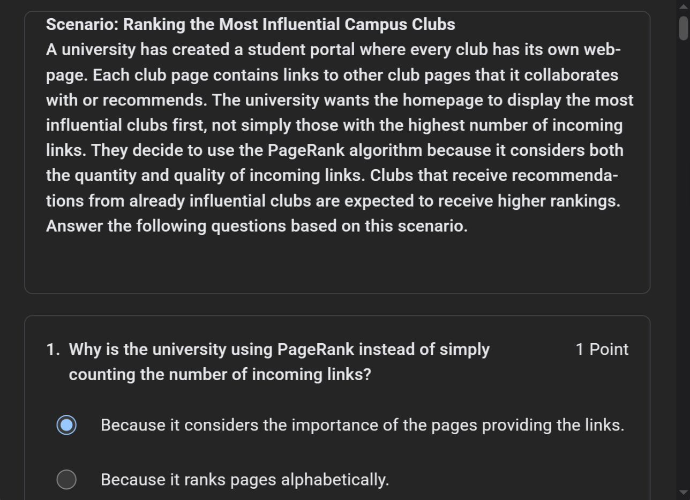

## Scenario: Ranking the Most Influential Campus Clubs A university has created a student portal where every club has its own web- page. Each club page contains links to other club pages that it collaborates with or recommends. The university wants the homepage to display the most influential clubs first, not simply those with the highest number of incoming links. They decide to use the PageRank algorithm because it considers both the quantity and quality of incoming links. Clubs that receive recommenda- tions from already influential clubs are expected to receive higher rankings. Answer the following questions based on this scenario. 1. Why is the university using PageRank instead of simply 1 Point counting the number of incoming links? @ Because it considers the importance of the pages providing the links. () Because it ranks pages alphabetically.

---
**Page 2** (scanned page; the text below is its OCR layer, check against the image)

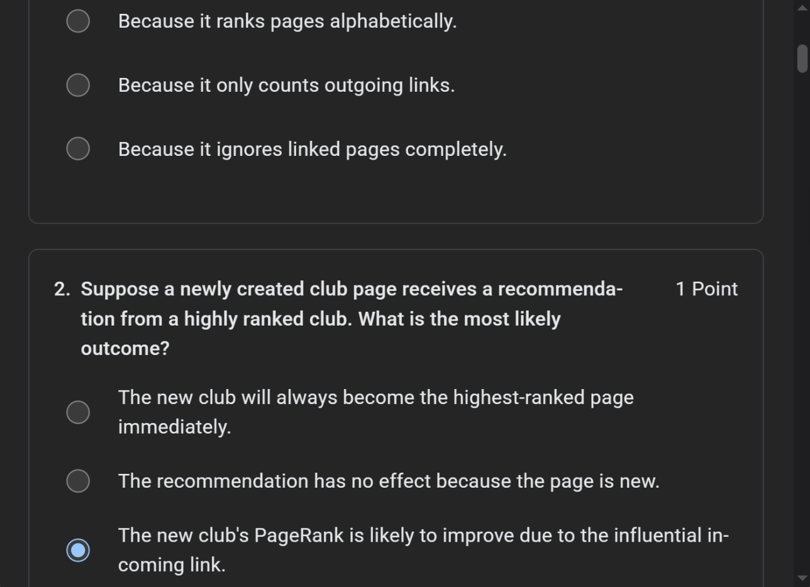

() Because it ranks pages alphabetically. (©) Because it only counts outgoing links. (©) Because it ignores linked pages completely. 2. Suppose a newly created club page receives a recommenda- 1 Point tion from a highly ranked club. What is the most likely outcome? The new club will always become the highest-ranked page immediately. O (.)) The recommendation has no effect because the page is new. © The new club's PageRank is likely to improve due to the influential in- coming link.

---
**Page 3** (scanned page; the text below is its OCR layer, check against the image)

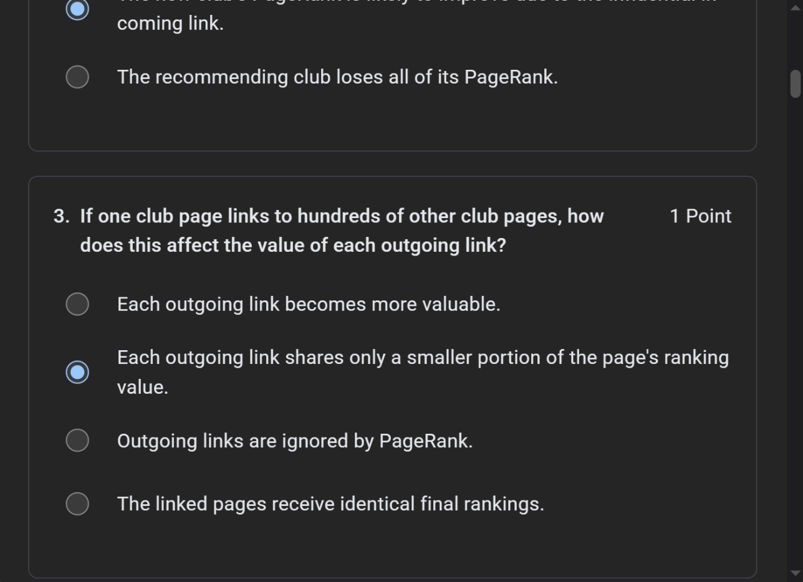

@) coming link. (©) The recommending club loses all of its PageRank. 3. If one club page links to hundreds of other club pages, how 1 Point does this affect the value of each outgoing link? O Each outgoing link becomes more valuable. Each outgoing link shares only a smaller portion of the page's ranking @ value. O Outgoing links are ignored by PageRank. O The linked pages receive identical final rankings.

---
**Page 4** (scanned page; the text below is its OCR layer, check against the image)

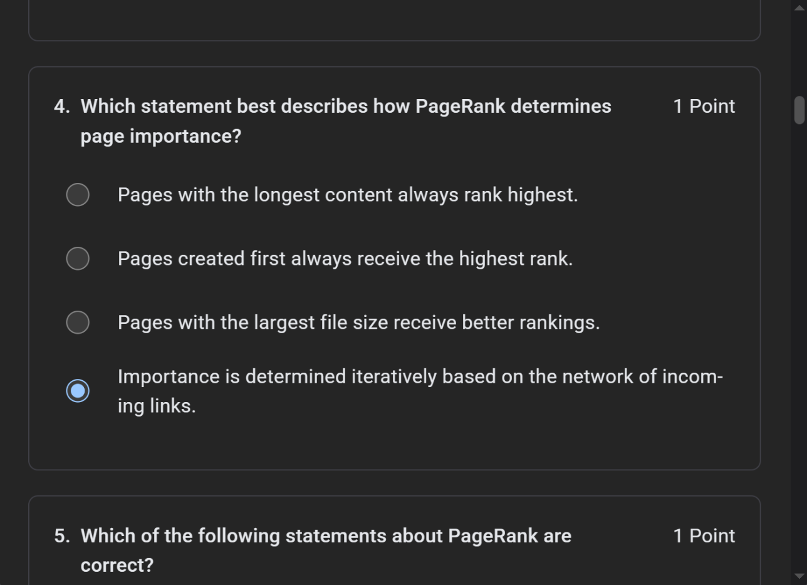

4. Which statement best describes how PageRank determines 1 Point page importance? (©) Pages with the longest content always rank highest. © Pages created first always receive the highest rank. ©) Pages with the largest file size receive better rankings. Importance is determined iteratively based on the network of incom- @ ing links. 5. Which of the following statements about PageRank are 1 Point correct?

---
**Page 5** (scanned page; the text below is its OCR layer, check against the image)

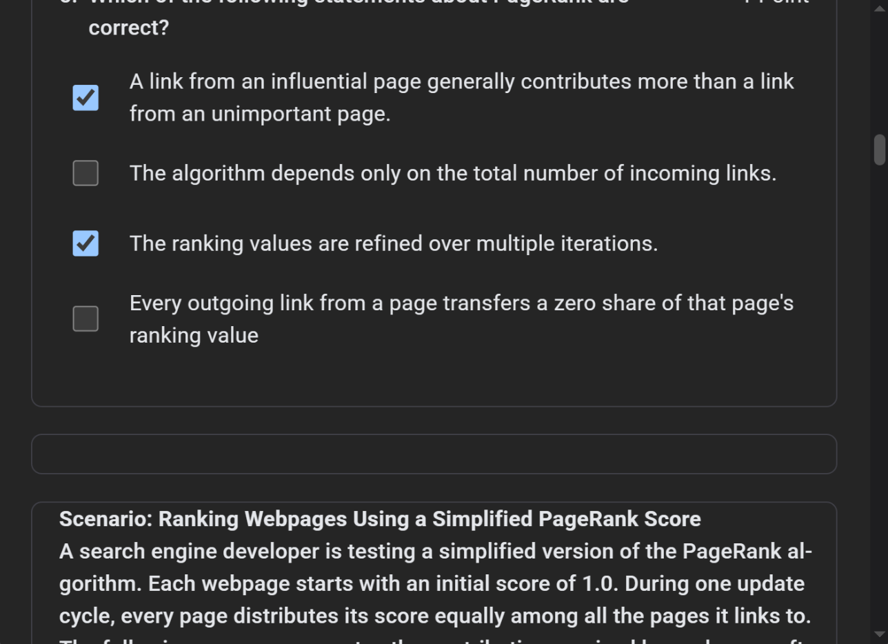

— > => ULL lm lee SS hl le ee! ll -— = correct? A link from an influential page generally contributes more than a link from an unimportant page. The algorithm depends only on the total number of incoming links. The ranking values are refined over multiple iterations. Every outgoing link from a page transfers a zero share of that page's (J ranking value

## Scenario: Ranking Webpages Using a Simplified PageRank Score A search engine developer is testing a simplified version of the PageRank al- gorithm. Each webpage starts with an initial score of 1.0. During one update cycle, every page distributes its score equally among all the pages it links to. —_ rr a8 —— = - *8 a Bg f sg ,

---
**Page 6** (scanned page; the text below is its OCR layer, check against the image)

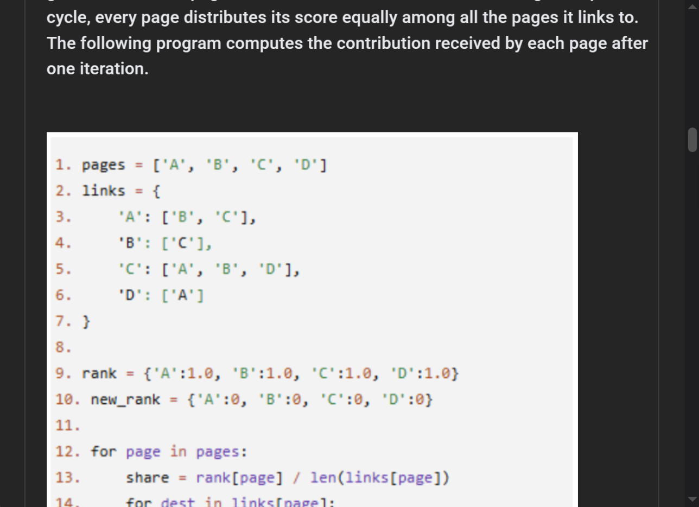

cycle, every page distributes its score equally among all the pages it links to. The following program computes the contribution received by each page after one iteration. rank = {'A new_rank = {

---
**Page 7** (scanned page; the text below is its OCR layer, check against the image)

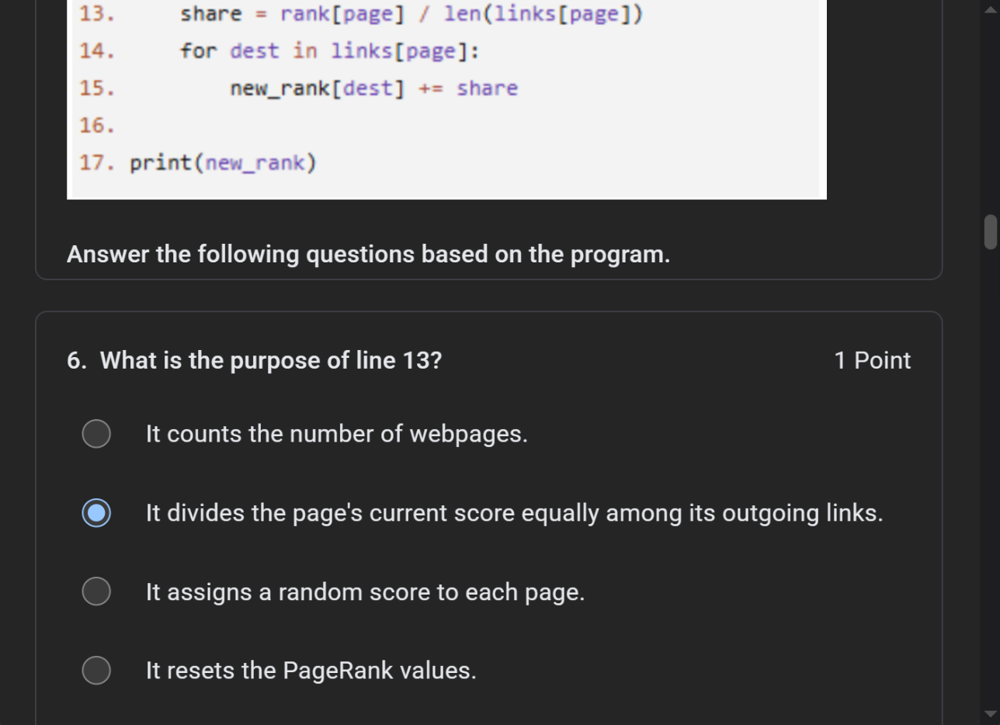

share = rank[page] / len(links for dest in links[page]: share Answer the following questions based on the program. 6. What is the purpose of line 13? 1 Point It counts the number of webpages. @© It divides the page's current score equally among its outgoing links. It assigns a random score to each page. It resets the PageRank values.

---
**Page 8** (scanned page; the text below is its OCR layer, check against the image)

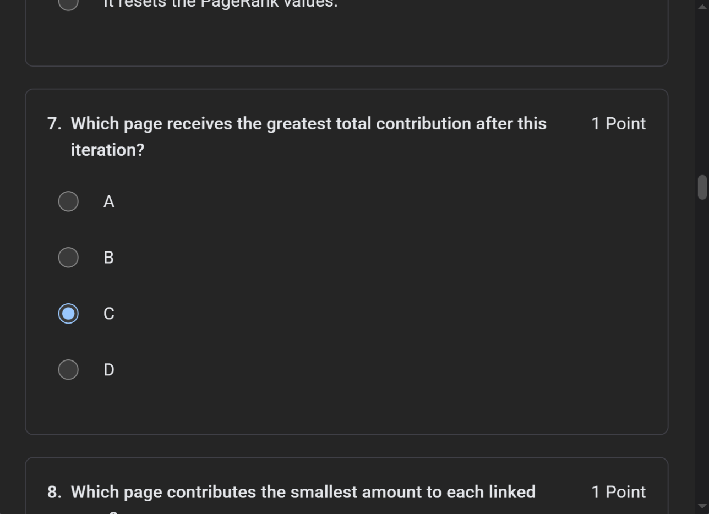

a, PLPC otlo LUIS FaYyCNaiin Valuco. 7. Which page receives the greatest total contribution after this 1 Point iteration? © A O @© c © 8. Which page contributes the smallest amount to each linked 1 Point

---
**Page 9** (scanned page; the text below is its OCR layer, check against the image)

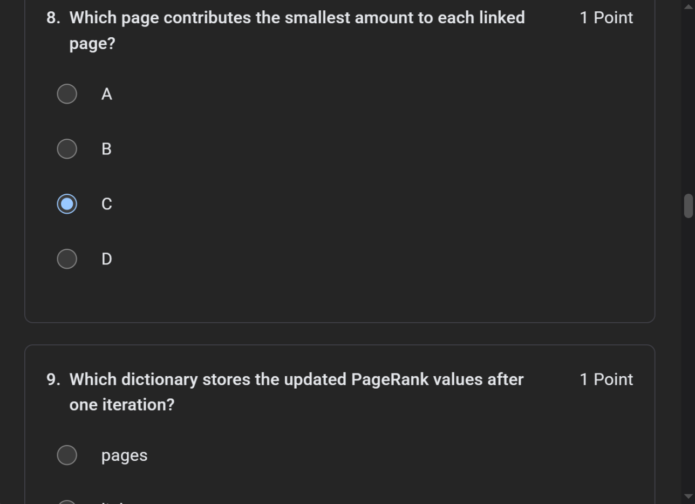

8. Which page contributes the smallest amount to each linked 1 Point page? Oa © ® c © 9. Which dictionary stores the updated PageRank values after 1 Point one iteration? ©) pages

---
**Page 10** (scanned page; the text below is its OCR layer, check against the image)

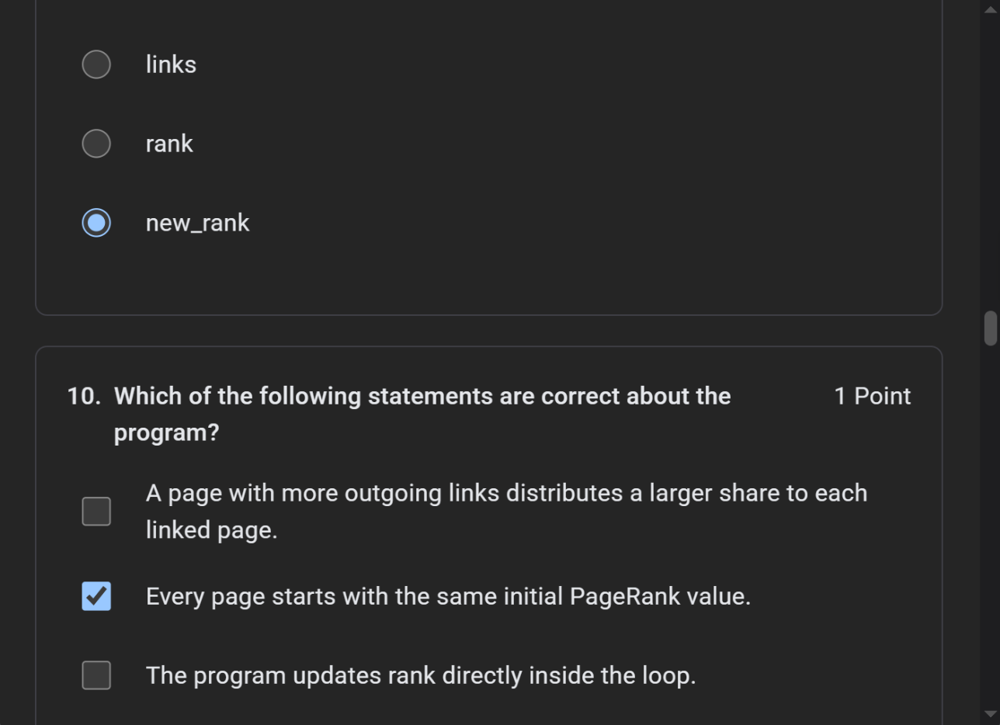

©) links ©) rank @ _new_rank 10. Which of the following statements are correct about the 1 Point program? 7 A page with more outgoing links distributes a larger share to each linked page. Every page starts with the same initial PageRank value. |_| The program updates rank directly inside the loop.

---
**Page 11** (scanned page; the text below is its OCR layer, check against the image)

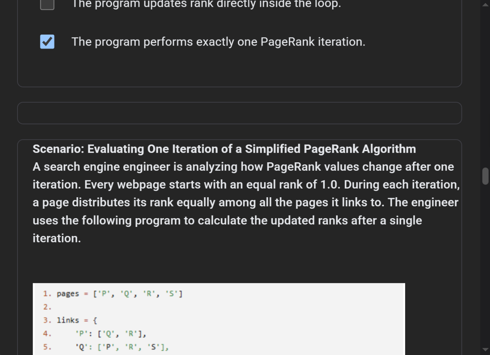

ine program updates rank airectly inside the loop. The program performs exactly one PageRank iteration.

## Scenario: Evaluating One Iteration of a Simplified PageRank Algorithm A search engine engineer is analyzing how PageRank values change after one iteration. Every webpage starts with an equal rank of 1.0. During each iteration, a page distributes its rank equally among all the pages it links to. The engineer uses the following program to calculate the updated ranks after a single iteration.

---
**Page 12** (scanned page; the text below is its OCR layer, check against the image)

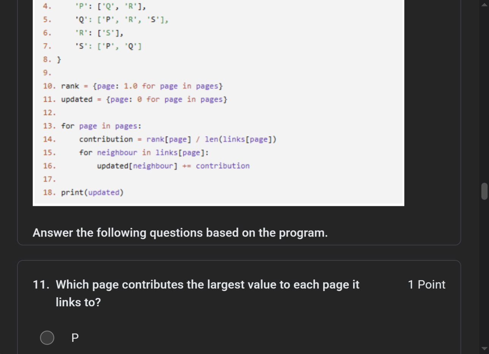

13. for page in pages: contribution = rank for neighbour updated[neighbour 18. print(updated) Answer the following questions based on the program. 11. Which page contributes the largest value to each page it 1 Point links to?

---
**Page 13** (scanned page; the text below is its OCR layer, check against the image)

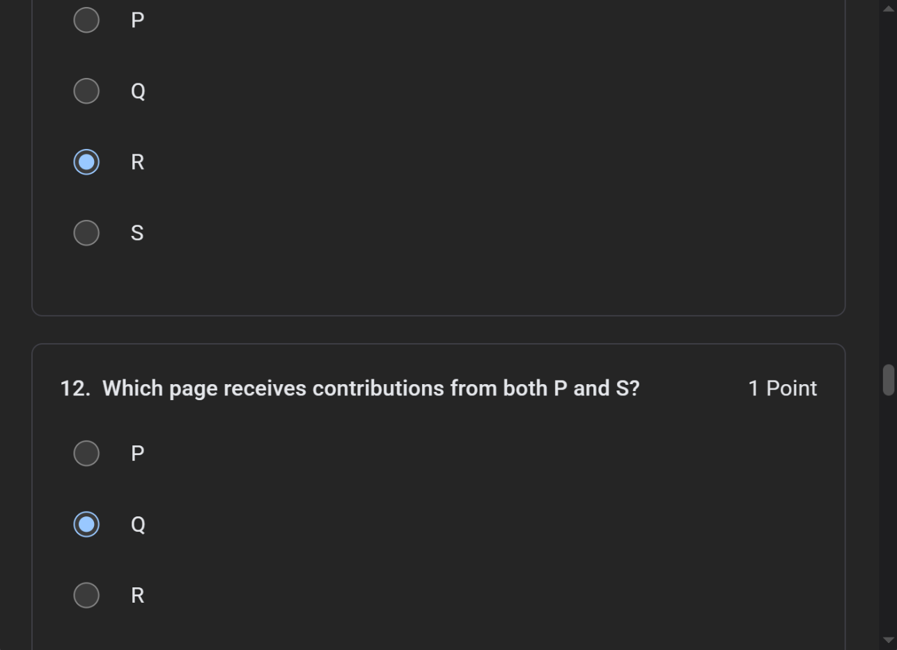

O ®@ OC O 12. Which page receives contributions from both P and S? 1 Point © P @© a

---
**Page 14** (scanned page; the text below is its OCR layer, check against the image)

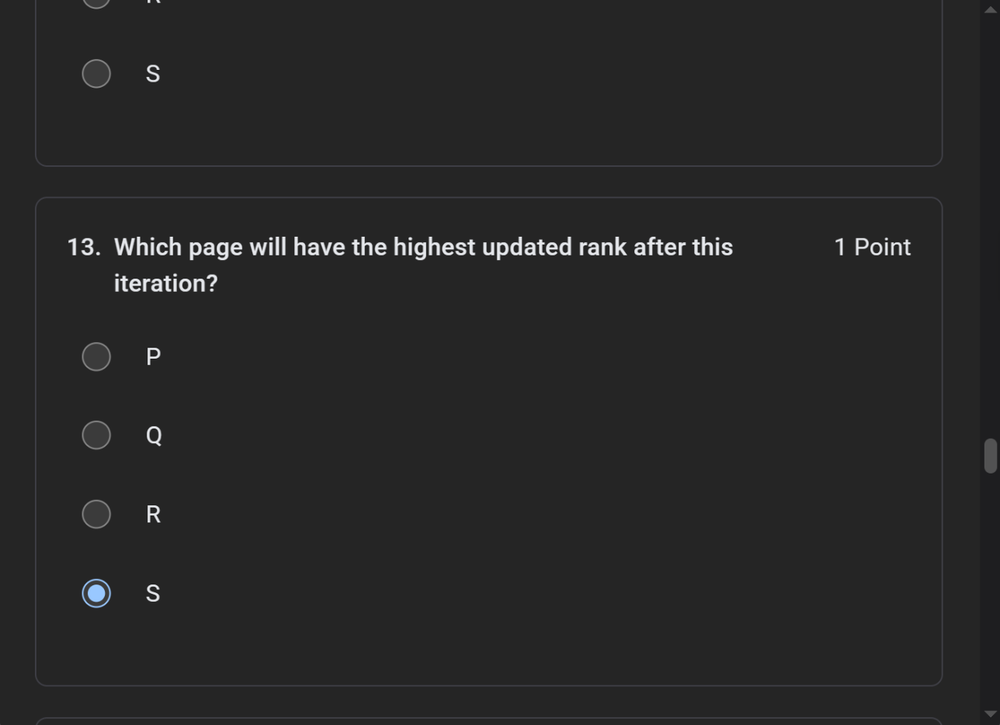

13. Which page will have the highest updated rank after this 1 Point iteration? ©®© 0 O O

---
**Page 15** (scanned page; the text below is its OCR layer, check against the image)

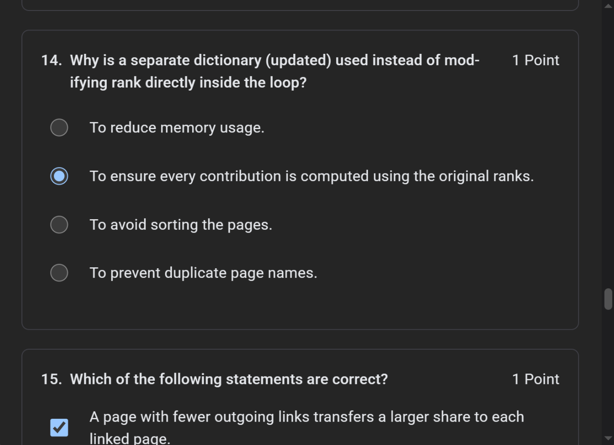

14. Why is a separate dictionary (updated) used instead of mod- 1 Point ifying rank directly inside the loop? To reduce memory usage. CO OO © O To ensure every contribution is computed using the original ranks. To avoid sorting the pages. To prevent duplicate page names. 15. Which of the following statements are correct? 1 Point v A page with fewer outgoing links transfers a larger share to each linked paae.

---
**Page 16** (scanned page; the text below is its OCR layer, check against the image)

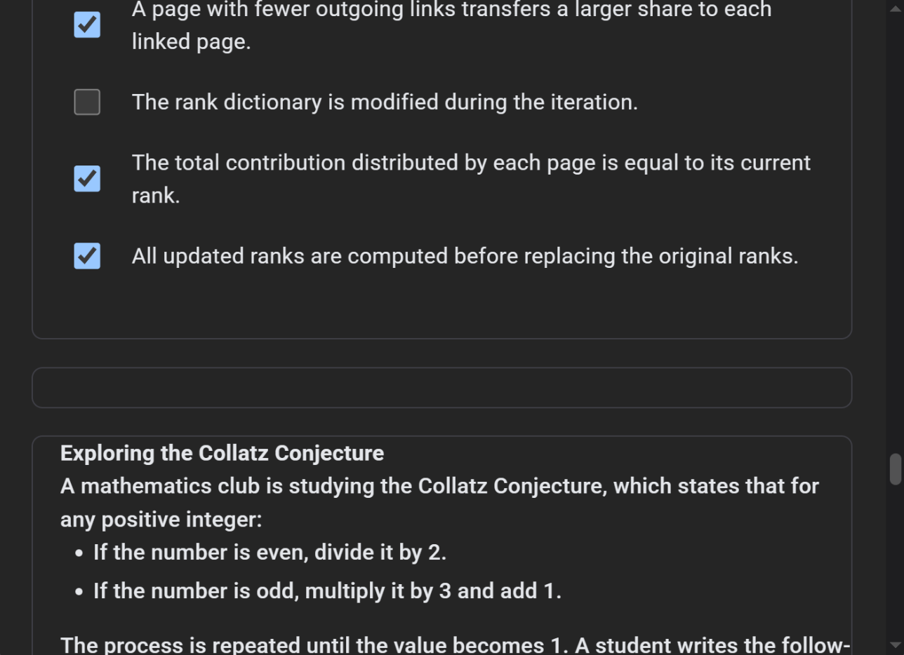

A page with fewer outgoing links transfers a larger share to each <<) linked page. The rank dictionary is modified during the iteration. The total contribution distributed by each page is equal to its current S rank. All updated ranks are computed before replacing the original ranks. <) Exploring the Collatz Conjecture A mathematics club is studying the Collatz Conjecture, which states that for any positive integer: e If the number is even, divide it by 2. e If the number is odd, multiply it by 3 and add 1. The process is repeated until the value becomes 1. A student writes the follow-

---
**Page 17** (scanned page; the text below is its OCR layer, check against the image)

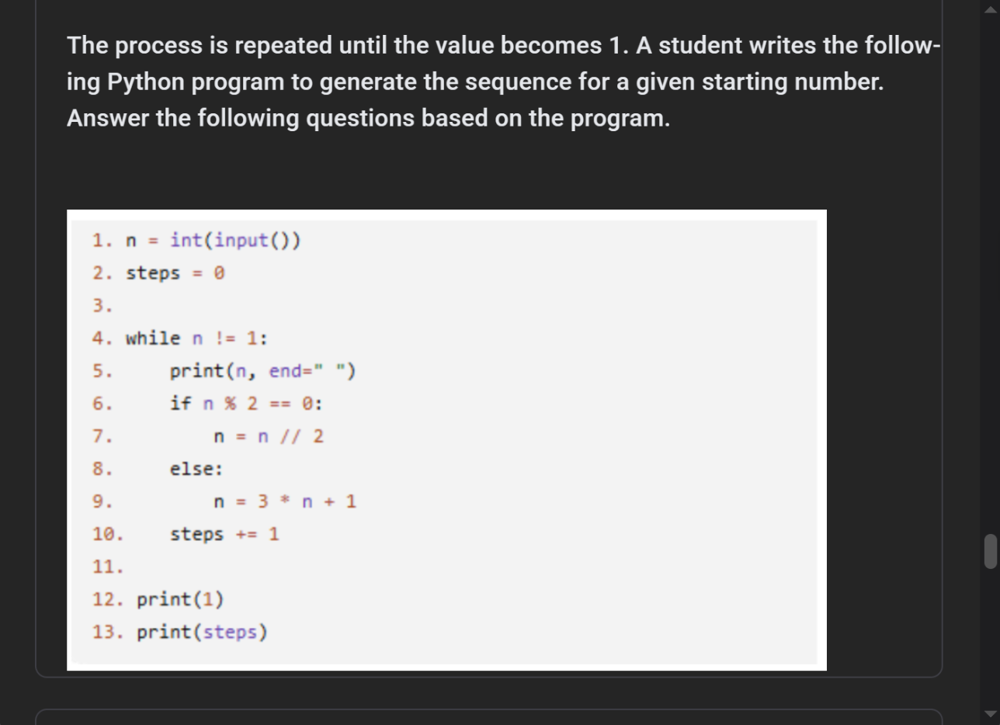

The process is repeated until the value becomes 1. A student writes the follow- ing Python program to generate the sequence for a given starting number. Answer the following questions based on the program.

---
**Page 18** (scanned page; the text below is its OCR layer, check against the image)

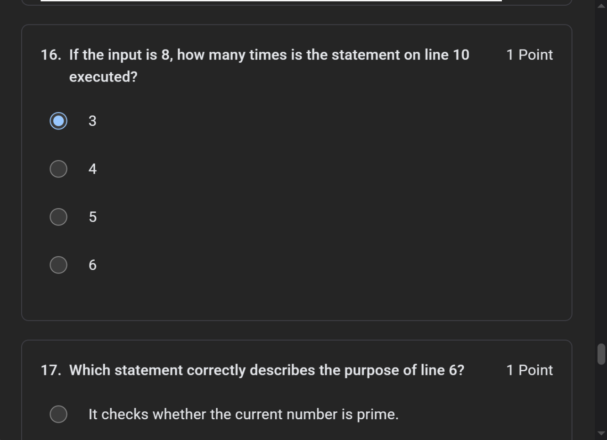

16. If the input is 8, how many times is the statement on line 10 1 Point executed? 17. Which statement correctly describes the purpose of line 6? 1 Point ()) It checks whether the current number is prime.

---
**Page 19** (scanned page; the text below is its OCR layer, check against the image)

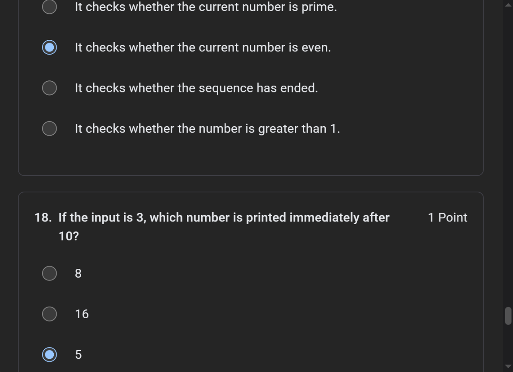

It checks whether the current number is prime. CO OC © OC It checks whether the current number is even. It checks whether the sequence has ended. It checks whether the number is greater than 1. 18. If the input is 3, which number is printed immediately after 1 Point 10? () 8 () 16 @© 5

---
**Page 20** (scanned page; the text below is its OCR layer, check against the image)

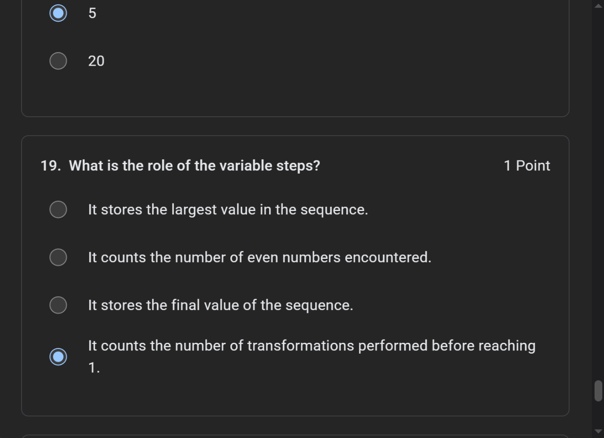

19. What is the role of the variable steps? 1 Point () It stores the largest value in the sequence. O It counts the number of even numbers encountered. ©) It stores the final value of the sequence. It counts the number of transformations performed before reaching @ 1.

---
**Page 21** (scanned page; the text below is its OCR layer, check against the image)

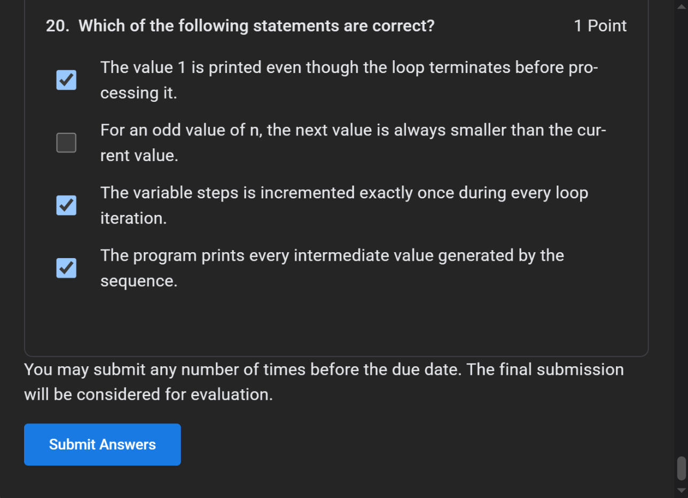

20. Which of the following statements are correct? 1 Point The value 1 is printed even though the loop terminates before pro- cessing it. For an odd value of n, the next value is always smaller than the cur- rent value. The variable steps is incremented exactly once during every loop iteration. The program prints every intermediate value generated by the sequence. You may submit any number of times before the due date. The final submission will be considered for evaluation. Submit Answers
